# 第 5 章 大规模分布式训练

[总目录](../index.qmd) · 上一章：[第 4 章](04-pretraining.md) · 下一章：[第 6 章](06-efficient-attention.md)

贯穿模型仅权重、梯度和 AdamW 两个状态就有 64.842819 GiB。现在有 8 张 GPU，最直觉的做法是启动 8 路 DDP；但作业刚初始化，每个 rank 依然各自持有一份 64.842819 GiB 状态。设备变多了，单副本容量却没有改变：我们解决了“处理更多样本”，却还没有回答“每卡保留哪些状态”。

这个失败提醒了本章的阅读顺序：先确认受限的是容量、完成时间、单算子可执行性还是负载不均；再根据调用前后的数据布局选择 collective；最后才决定切数据、切状态、切张量、切层、切序列还是切专家。@fig-ch05-constraint-to-layout 把这条决策链压缩成一张图；全章中每种策略都固定回答四个问题：切什么、每卡保留什么、通信什么、何时不划算。

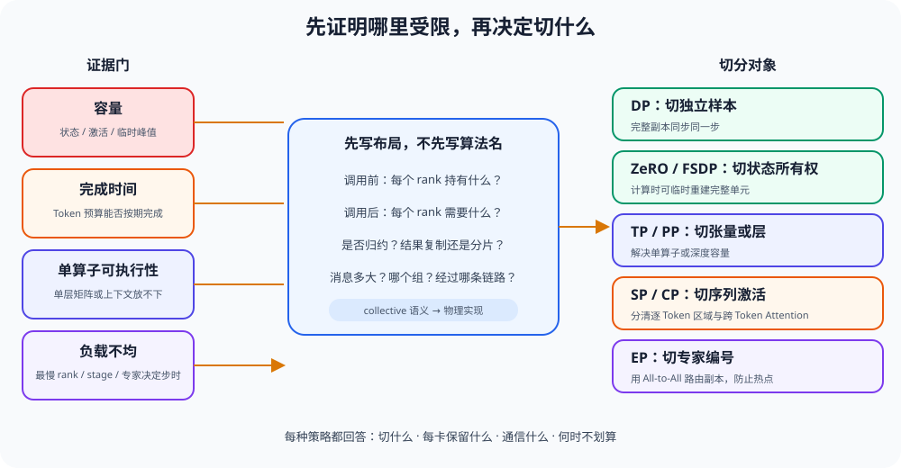{#fig-ch05-constraint-to-layout fig-alt="左侧是容量、完成时间、单算子可执行性和负载不均四类证据门；中间要求先写每个 rank 调用前持有什么、调用后需要什么，并核对归约、消息、通信组和链路；右侧是切独立样本的 DP、切状态所有权的 ZeRO/FSDP、切张量或层的 TP/PP、切序列激活的 SP/CP 和切专家编号的 EP。" width="100%"}

<a id="learning"></a>

## 学习目标与前置知识

本章的目标不是记住并行策略缩写，而是把容量、数据布局、通信与步时账本连成一个可证伪的设计过程。

完成本章后，读者应能够：

1. 把容量、完成时间、单算子可执行性和负载不均区分开，并从目标布局选择Broadcast、All-Reduce、Reduce-Scatter、All-Gather、All-to-All或P2P。
2. 写出DP、ZeRO/FSDP、TP、PP、SP、CP的输入/输出布局和通信边界，并解释EP的dispatch/combine。
3. 用参数状态、激活、collective逻辑payload和pipeline bubble公式复算一个候选配置，指出未计入的峰值与墙钟因素。
4. 为多维并行建立rank网格，检查$d,H,H_{\mathrm{KV}},d_{\mathrm{ff}},L$的整除性，并把高频通信映射到合适拓扑。
5. 比较至少两种GPU数量相同的训练方案，给出可证伪的初选理由和测量字段，而不把理论估算写成实测或最优性保证。

前置知识是[第2章Transformer结构](02-transformer.md)、[第3章资源与GPU账本](03-compute-and-gpu.md)及[第4章训练流程](04-pretraining.md)。5.1–5.7、5.9–5.10为核心；5.8 EP为选修扩展。

<a id="sec-5-1"></a>

## 5.1 为什么需要分布式训练

分布式训练不是“有很多GPU就一起用”，而是为三类约束选择切分：**容量**决定一次训练状态能否放下，**完成时间**决定Token预算能否在期限内处理，**单个算子的可执行性**决定某层是否必须跨设备拆分。三者可能同时存在，但对应的并行方式和通信不同。

### 单卡容量与计算时间是两个问题

复用[3.4显存账本](03-compute-and-gpu.md#sec-3-4)，贯穿模型在BF16权重/梯度、FP32 AdamW两状态、无FP32主权重时，仅参数相关逻辑状态就有$12P=69{,}624{,}446{,}976$ bytes，即64.842819 GiB。它还没有激活、Attention临时量、通信bucket、workspace、运行时和碎片。因此在一个**假想64 GiB设备**上，不能因$64.84\approx64$就宣称“勉强能放下”；仅状态已越界。减小micro-batch主要减少激活，不能消除完整参数和optimizer状态。

容量方案有不同含义：数据并行（DP）复制完整模型，通常不解决单副本状态过大；ZeRO/FSDP按DP组分片状态；张量并行（TP）拆单层矩阵；流水线并行（PP）拆层；Context Parallelism（CP）拆长序列。若把上述$12P$理想均分到8个设备，每设备参数相关逻辑状态下界约8.105352 GiB，但真实峰值还要加临时聚合、激活和不均匀项，不能用“总量除8”代替生命周期账本。

即使单卡能放下，时间也可能不可接受。4.6的$D_{\mathrm{tok}}=10^{11}$情景有$C\approx3.4812223488\times10^{21}$模型FLOPs；假设单设备300 TFLOP/s理论峰值、端到端MFU 0.40，理想化耗时约29,010,186秒，即335.766天。64台同样假想设备若仍能保持0.40 MFU才是5.246天；现实中通信、负载不均、流水线空泡和输入停顿会让MFU随规模改变，所以这不是线性加速承诺。

### 分布式步时间的资源账本

把一个成功更新步的关键路径写成：

<a id="eq-05-distributed-step-time"></a>

$$
t_{\mathrm{step}}
=t_{\mathrm{comp}}+t_{\mathrm{comm}}-t_{\mathrm{overlap}}
+t_{\mathrm{idle}}+t_{\mathrm{input}},
\qquad
0\le t_{\mathrm{overlap}}\le\min(t_{\mathrm{comp}},t_{\mathrm{comm}}).
$$

式（05-Distributed-Step-Time）是测量分类账，不假设通信一定能隐藏。$t_{\mathrm{comp}}$是设备计算关键路径，$t_{\mathrm{comm}}$是collective与点对点通信，$t_{\mathrm{overlap}}$只扣除真实并发部分；$t_{\mathrm{idle}}$包括负载不均与PP空泡，$t_{\mathrm{input}}$是未隐藏的数据等待。优化某一项可能增大另一项：更细分片降低常驻显存却增加collective频率；更大micro-batch提高GEMM效率却增加激活；重计算省激活却增加计算。

因此并行选择至少检查四个维度：

| 问题 | 先看什么 | 常见代价 |
| --- | --- | --- |
| 状态放不下 | 权重、梯度、optimizer和临时聚合的逐设备峰值 | 分片通信、重建buffer、复杂checkpoint |
| 单层算子放不下 | 权重/激活沿哪一维可切，头数与维度整除性 | 层内高频通信，受慢链路限制 |
| 训练太慢 | 每步计算、有效Token/s、强/弱扩展效率 | 设备越多，通信与空闲占比可能上升 |
| 负载不均 | 各rank shape、Token、专家或stage时间 | 最慢rank决定同步关键路径 |

### Scale-up、Scale-out与拓扑

本章把**Scale-up**用于同一节点或同一高带宽GPU互连域内增加设备，把**Scale-out**用于跨节点经网络扩展。前者常经过PCIe、NVLink或NVSwitch，后者还经过GPU到NIC路径及InfiniBand/RoCE等网络。名称不保证性能：同机GPU也可能跨CPU root complex，多机系统也可能有专用高速fabric；应读取真实拓扑和实测链路，而不是只数GPU。

拓扑是一张带宽、时延和共享竞争关系不相同的图。频繁交换大张量的TP通常更依赖低时延高带宽邻接；可降低同步频率的DP更容易跨较慢边界；PP应考虑相邻stage放置；通信组若跨越慢链路，collective关键路径由它限制。NCCL是拓扑感知的collective通信库，但“拓扑感知”不等于任意放置都最优。[NCCL文档](https://docs.nvidia.com/deeplearning/nccl/index.html) 官方排障资料也说明GPU P2P可能走NVLink或满足条件的PCIe，并建议用拓扑工具检查实际peer关系；拓扑描述本身仍不是带宽实测。[NCCL GPU通信排障](https://docs.nvidia.com/deeplearning/nccl/user-guide/docs/troubleshooting/gpu_troubleshooting.html)

后续先用5.2定义Broadcast、All-Reduce、Reduce-Scatter、All-Gather与All-to-All，再讨论各并行策略的数据布局。没有布局、消息大小、通信组、链路和是否重叠，就不能只凭算法名称判断速度。

因此，5.1 不会直接得出“该用哪个并行库”，而是得出一张待验证的需求单：哪类对象放不下、哪段关键路径太长、哪个 rank 在等待，以及高频通信能否留在高带宽域。5.2 将这张需求单翻译成数据移动语义。

本节全部数字来自第3–4章理论账本和假想设备，没有运行多GPU或网络基准，也不宣称某种布局在真实集群最优。

**理解检查。** 若完整模型和optimizer状态能放入单卡，但预计训练需300天，应优先把问题归为容量还是完成时间？增加64张卡为什么仍不能直接把时间除以64？

<a id="sec-5-2"></a>

## 5.2 GPU 通信原语（Collective Communication）

Collective Communication要求一个通信组内的rank共同参加操作。选择原语前先写清四件事：每个rank调用前持有什么布局、哪些rank的数据要参与、是否做逐元素归约、调用后每个rank需要什么布局。名字相近不代表可替换：Broadcast是一源复制；All-Reduce是多源归约并复制；Reduce-Scatter归约后保留分片；All-Gather收集分片并复制完整结果；All-to-All做源—目的个性化交换。

下列子节都区分**语义数据布局**与**物理通信算法**。同一语义可由ring、tree、分层或拓扑专用实现完成；消息大小、rank数、链路、同步与buffer生命周期共同决定时间和峰值。除明确说明外，例子只做整数/字节复算，没有运行NCCL或多GPU基准。

- [Broadcast](#sec-5-2-1)：初始化和控制信息的一源复制；
- [All-Reduce](#sec-5-2-2)：DP梯度等同布局张量的全组归约；
- [Reduce-Scatter](#sec-5-2-3)：归约后保持分片；
- [All-Gather](#sec-5-2-4)：分片参数或张量的临时完整物化；
- [All-to-All](#sec-5-2-5)：MoE等不规则源—目的路由。

@fig-ch05-collectives 把五种原语放进同一个 4-rank 框架。读图时不要先数箭头，而要看右侧结果：是完整复制、归约后分片，还是每个目的只收到专属数据。这个结果布局才决定它能否接到下一个算子。

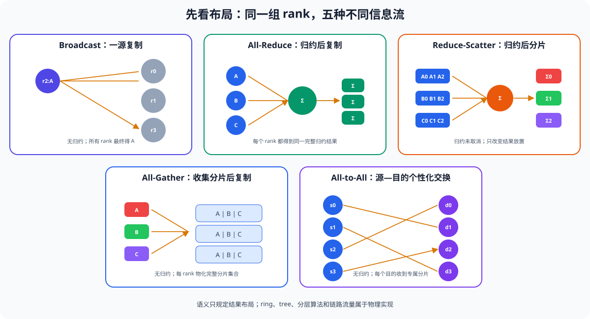{#fig-ch05-collectives fig-alt="Broadcast 由一个源 rank 向其他 rank 复制同一数据；All-Reduce 把多个 rank 的同布局输入归约后让每个 rank 得到完整结果；Reduce-Scatter 归约后让每个 rank 只保留一个不同分片；All-Gather 收集各 rank 分片并让每 rank 得到完整集合；All-to-All 让每个源向每个目的发送不同的专属分片。" width="100%"}

::: {.callout-warning title="Collective 语义不等于物理算法"}
All-Reduce 规定“多源归约后每 rank 得完整结果”；ring、tree、分层算法则决定轮数、分块和链路。只有同时写明语义布局、实现算法、消息大小与拓扑，才能讨论时间和流量。
:::

<a id="sec-5-2-1"></a>

### 5.2.1 Broadcast

Broadcast（广播）在一个通信组内选定源rank（root/src）：源rank提供张量内容，其余参与rank提供同形状容量的接收张量；操作完成后，组内每个rank的对应张量都等于源数据。rank只是通信组内进程/参与者编号，不等同于物理GPU型号；同一进程也可能参加多个不同通信组。

以组$G=\{0,1,2,3\}$、源rank 2为例，调用前各rank持有两个整数：

```text
rank 0: [0, 0]    rank 1: [1, 1]
rank 2: [10, 20]  rank 3: [3, 3]
```

对组$G$执行`broadcast(tensor, src=2)`后，四个rank的本地`tensor`均为`[10, 20]`。这是一对多复制，没有求和、平均或拼接；它不能代替梯度All-Reduce。PyTorch接口要求所有参与进程的张量元素数相同：源rank的张量是输入，其他rank的张量是就地接收缓冲；异步调用还必须在复用缓冲前等待完成。[PyTorch distributed broadcast](https://docs.pytorch.org/docs/stable/distributed.html#torch.distributed.broadcast)

语义上有$p-1$个接收者各得到$n$个元素，但不能据此断言每条物理链路都传$(p-1)n$个元素。实现可能用树、链或分层算法，并依据消息大小与拓扑选择路径；总链路流量、关键路径轮数和root出口压力需要结合实现测量。小消息常更受启动时延影响，大消息更受带宽与共享链路影响。

Broadcast适合从一个权威rank分发初始化参数、随机seed、配置版本或小型控制张量。若每个rank已有不同梯度并要求聚合，应用All-Reduce/Reduce-Scatter；若每个rank贡献不同分片并要求汇集，应用All-Gather。广播整个模型还会在所有rank产生完整副本，不能解决单副本放不下的问题。

实践中所有组员必须以一致顺序参加同一collective，否则可能等待或报错；通信组之外的rank不参与。对象广播涉及序列化和额外安全/性能边界，大规模数值状态优先使用张量collective。本节只是语义与逻辑流量例子，本机没有启动多进程或GPU通信，不报告延迟/带宽实测。

**理解检查。** 四个rank各有不同梯度，目标是让每个rank得到四者平均值。为什么从rank 0执行Broadcast会丢失信息？应改用哪类collective？

<a id="sec-5-2-2"></a>

### 5.2.2 All-Reduce

All-Reduce让每个rank都贡献一个同布局张量，先逐元素执行归约（Reduce），再让通信组内每个rank都得到同一归约结果。若输入为$\mathbf x_r$、组大小为$p$，SUM语义是每个rank最终持有$\sum_{r=0}^{p-1}\mathbf x_r$；MAX/MIN则逐元素取极值。输入shape与dtype必须兼容，结果通常覆写本地buffer。PyTorch的`all_reduce`支持SUM、MAX、MIN等操作并返回可选异步handle；AVG的可用性依backend与版本，不能假设所有环境都有相同支持。[PyTorch `all_reduce`](https://docs.pytorch.org/docs/stable/distributed.html#torch.distributed.all_reduce)

**四rank例子。** 令各rank梯度向量依次为$[1,2]$、$[3,4]$、$[5,6]$、$[7,8]$。All-Reduce SUM后每个rank都是$[16,20]$；若目标是四rank算术平均，则再除$p=4$得到$[4,5]$。这与Broadcast不同：四份输入都参与结果。

“求和还是平均”必须与[4.5的有效Token归一化](04-pretraining.md#sec-4-5)配套。设rank $r$在一个更新窗口的NLL总和为$S_r$、有效目标数为$N_r$，$N_{\mathrm{global}}=\sum_rN_r$。正确目标是$\sum_rS_r/N_{\mathrm{global}}$：

- 若collective对梯度做SUM，每个rank对$S_r/N_{\mathrm{global}}$反向即可；
- 若collective返回rank平均，则要补偿$p$，例如对$pS_r/N_{\mathrm{global}}$反向；
- 只有所有$N_r$相等时，“各rank先求local mean再对梯度取rank平均”才恰好等于全局Token mean。

MAX/MIN常用于汇总溢出标志、最大长度或诊断统计，不能拿来平均梯度。浮点SUM还受归约顺序影响：数学上等价的ring/tree可能有细小舍入差异，不应在跨拓扑运行中默认逐bit一致。

#### Ring All-Reduce成本模型

经典ring把每个$N$-byte输入分为$p$块：先用$p-1$轮Reduce-Scatter让每个rank得到一个已归约块，再用$p-1$轮All-Gather传播所有结果块。每轮每个rank发送/接收约$N/p$ bytes，因此每rank单方向发送总量为$2(p-1)N/p$，接收量相同。在均匀双向链路、无拥塞、块可流水、归约计算可忽略的简化$alpha$–带宽模型中：

<a id="eq-05-ring-allreduce"></a>

$$
t_{\mathrm{ring}}
\approx2(p-1)\alpha
+2\frac{p-1}{p}\frac{N}{\mathcal B}.
$$

$\alpha$是每轮启动/时延项，$\mathcal B$是模型所假设的有效单方向带宽。$p=4,N=16\,\mathrm{MiB}$时，每rank在两个阶段各发送$12\,\mathrm{MiB}$，合计24 MiB，并经历6轮；这是逻辑算法量，不是交换机总流量或实测时间。Patarasuk与Yuan给出了大消息ring All-Reduce的带宽最优性分析，同时指出不同归约括号化会产生浮点舍入差异。[Patarasuk & Yuan, 2009](https://doi.org/10.1016/j.jpdc.2008.09.002)

@fig-ch05-ring-allreduce 把公式中的 $2(p-1)$ 轮拆成可跟踪的两段。Reduce-Scatter 结束时，每个 rank 只有一个已归约分片；只有后续 All-Gather 把全部分片传播到所有 rank，才达到 All-Reduce 的完整输出布局。

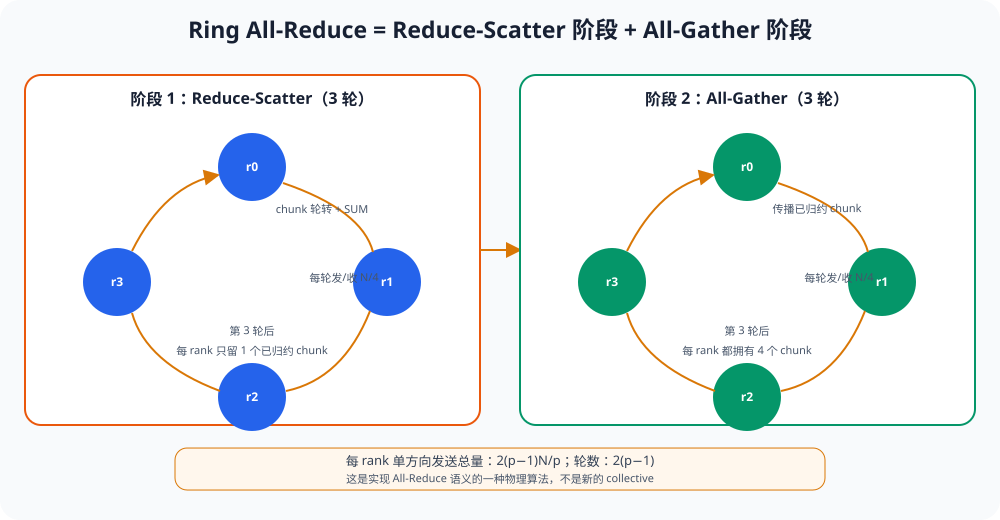{#fig-ch05-ring-allreduce fig-alt="左侧四个 rank 沿环传递 chunk 并逐块求和，经过三轮后每个 rank 只留一个已归约 chunk；右侧再沿环传播这些 chunk，经过三轮后每个 rank 都有全部四块。底部标明每 rank 发送总量为 2(p-1)N/p，这是 All-Reduce 的一种实现。" width="100%"}

Tree/recursive类算法可把轮数降到$O(\log p)$，因而常对小消息或高时延环境有利；具体每轮消息量、端口并发与是否带宽最优取决于算法和拓扑。Ring有$2(p-1)$轮，rank多且消息小时启动项可能占主导；大消息时其分块流水更容易接近带宽上界。真实库会按消息、拓扑和版本选择/组合算法，不能固定宣称ring或tree永远更快。

在数据并行中，反向产生的梯度bucket可异步All-Reduce并与更早层的反向计算重叠，但只有handle完成后才能安全执行依赖该结果的更新。过小bucket增加启动次数，过大bucket延迟通信启动并增加buffer峰值；慢rank、共享链路和不一致collective顺序也会进入关键路径。

本节只给语义、整数例子与理论成本模型；本机没有运行多rank、NCCL、ring或tree基准，不报告通信带宽或加速比。

**理解检查。** 两个rank分别有$(S_0,N_0)=(8,10)$和$(S_1,N_1)=(18,6)$。若backend对梯度做rank平均，为什么直接对两个local mean反向会得到错误权重？应怎样缩放本地NLL总和？

<a id="sec-5-2-3"></a>

### 5.2.3 Reduce-Scatter

Reduce-Scatter先对所有rank的同布局输入逐元素归约，再按预定分片把结果分给不同rank。与All-Reduce的关键差别是输出布局：All-Reduce让每个rank持有完整归约张量，Reduce-Scatter只让rank $r$持有结果的第$r$个分片。

**四rank、8元素例子。** 设SUM输入为：

```text
rank 0: [ 0,  1,  2,  3,  4,  5,  6,  7]
rank 1: [10, 11, 12, 13, 14, 15, 16, 17]
rank 2: [20, 21, 22, 23, 24, 25, 26, 27]
rank 3: [30, 31, 32, 33, 34, 35, 36, 37]
```

逐元素SUM为$[60,64,68,72,76,80,84,88]$。按连续、等长、rank顺序切成四个2元素块后，rank 0–3分别得到$[60,64]$、$[68,72]$、$[76,80]$、$[84,88]$。每rank输入8元素、输出2元素；一般等分布局要求输入元素数是输出元素数的$p$倍。PyTorch的单张量接口允许输入按主维拼接或stack，输出在各rank同形；具体backend支持与shape要求应按所用版本核验。[PyTorch `reduce_scatter`](https://docs.pytorch.org/docs/stable/distributed.html#torch.distributed.reduce_scatter_tensor)

在相同归约操作、分片边界和rank顺序下，

```text
All-Reduce = Reduce-Scatter + All-Gather
```

上例若继续All-Gather四个输出分片，每个rank都会重建完整的$[60,64,68,72,76,80,84,88]$。这是语义分解，不要求库内部一定按两个独立API调用，也不保证中间buffer或性能完全相同。5.2.2的ring正是用Reduce-Scatter阶段归约分块，再用All-Gather阶段传播结果。

分片数据并行可让每个rank只保留自己负责的梯度分片并更新对应参数/optimizer分片，从而把**完成后的逻辑梯度输出**从$N$降为约$N/p$。但峰值还取决于输入梯度何时释放、bucket大小、参数是否临时All-Gather、optimizer是否同时分片和通信workspace；单独把All-Reduce替换成Reduce-Scatter不会自动把全部训练状态除以$p$。

Reduce-Scatter适合结果本来就要保持分片的场景；若下一算子立刻需要完整结果，随后All-Gather可能抵消其驻留收益。非整除shape需要padding或不等长分片API支持，padding会增加物理通信。异步执行仍需在读取输出或复用输入前满足handle/stream依赖。

本节例子是整数语义复算，没有运行多rank、NCCL或通信内存测量，也不宣称分片后的真实峰值恰为$1/p$。

**理解检查。** 上例Reduce-Scatter后，为什么rank 0不能独立得到完整归约向量？若下一步每个rank都需要完整向量，还缺哪个collective，它会改变最终复制布局吗？

<a id="sec-5-2-4"></a>

### 5.2.4 All-Gather

All-Gather让每个rank贡献一个本地分片，并让通信组内每个rank都得到按约定顺序排列的全部分片。它不做数值归约；输出是收集（列表、stack或沿指定轴拼接），因此必须同时约定分片轴、全局shape、rank到分片的映射和不等长处理方式。

沿用5.2.3的四个2元素分片：

```text
rank 0: [60, 64]  rank 1: [68, 72]
rank 2: [76, 80]  rank 3: [84, 88]
```

按rank顺序沿第0维拼接后，每个rank都得到$[60,64,68,72,76,80,84,88]$。每rank输入2元素、输出8元素；若每个等长分片为$n$ bytes、组大小为$p$，每rank最终物化$pn$ bytes，并从其他rank逻辑接收$(p-1)n$ bytes。具体ring/tree/分层实现的链路流量和轮数仍依库与拓扑。

PyTorch的单张量All-Gather要求各rank输入同大小，输出buffer按主维容纳所有输入的拼接或stack；列表接口可支持不等长输入，但buffer准备与backend能力需要按版本核验。异步调用只表示返回handle，读取完整输出前仍要满足完成与stream依赖。[PyTorch `all_gather`](https://docs.pytorch.org/docs/stable/distributed.html#torch.distributed.all_gather_into_tensor)

分片参数训练中的典型生命周期是：某层计算前All-Gather该层参数分片，得到临时完整参数；完成前向/反向所需使用后释放非本地部分（reshard）。这样常驻参数可约为$P/p$，但聚合瞬间至少该层完整参数与本地分片可能同时存在，还要加输出buffer、激活和workspace。预取下一层可隐藏一部分通信，却会让两层完整参数的生命周期重叠并提高峰值。

若所有rank只需各自分片，就不应无条件All-Gather；若目标是对不同输入求和，All-Gather也不能替代All-Reduce。频繁聚合很小分片可能被启动时延主导，聚合很大分片则受带宽与临时显存限制。实现要在通信重叠、峰值显存和重算/reshard频率之间权衡。

本节整数例子和容量均为逻辑语义；本机没有运行多rank、NCCL、参数预取或显存测量。

**理解检查。** 四rank各常驻一层参数的$1/4$分片。为什么在该层计算前All-Gather后，峰值不能仍按“每rank只有$1/4$层参数”估算？计算完成后reshard又改变了哪个生命周期？

<a id="sec-5-2-5"></a>

### 5.2.5 All-to-All

All-to-All是“每个源rank向每个目的rank发送**不同**分片”的个性化交换。可把通信看成$p\times p$分片矩阵$C$：$C_{ij}$是源$i$发给目的$j$的元素数；源$i$的输入按行切分，目的$j$的输出由第$j$列按源rank顺序拼接。它既不归约数值，也不让所有rank获得同一完整张量。

**等长四rank例子。** 每个源按目的0–3准备四个标量：

```text
source 0: [ 0,  1,  2,  3]
source 1: [10, 11, 12, 13]
source 2: [20, 21, 22, 23]
source 3: [30, 31, 32, 33]
```

All-to-All相当于转置源—目的矩阵，目的rank 0–3分别收到$[0,10,20,30]$、$[1,11,21,31]$、$[2,12,22,32]$、$[3,13,23,33]$。每rank发送和接收4元素，但每个目的收到的是来自所有源的专属分片，不是所有输入的完整副本。

不等长时必须交换或预先知道split sizes。假设每个源有4个Token，路由计数矩阵为：

$$
C=\begin{bmatrix}
2&1&1&0\\
0&3&1&0\\
1&0&2&1\\
0&1&0&3
\end{bmatrix}.
$$

各行和均为4，说明每个源发出4个Token；列和为$(3,5,4,4)$，所以目的rank 1接收5个Token，其他分别接收3、4、4个。发送buffer必须先按目的分桶，接收后还要保存原Token位置、源rank和专家槽位，专家计算完成后通常用第二次All-to-All把输出送回并恢复原顺序。PyTorch `all_to_all_single`允许显式输入/输出split sizes；若不指定则主维需可等分，API/backend能力和实验性标记需按所用版本核验。[PyTorch `all_to_all`](https://docs.pytorch.org/docs/stable/distributed.html#torch.distributed.all_to_all_single)

三类collective的信息流不同：

| collective | 每rank贡献 | 每rank最终得到 | 是否归约 |
| --- | --- | --- | --- |
| All-Gather | 一个分片 | 所有rank分片的完整集合 | 否 |
| All-Reduce | 一个同布局张量 | 全rank逐元素归约的同一结果 | 是 |
| All-to-All | 给每个目的的不同分片 | 所有源发给自己的分片 | 否 |

MoE的Token Dispatch正符合All-to-All：router按Token选择远端专家所在rank，先dispatch隐藏向量，再在专家计算后combine返回。Switch Transformer讨论了专家容量、负载均衡损失与溢出Token处理，说明稀疏激活的通信/稳定性代价；具体路由规则不是所有MoE的统一保证。[Switch Transformer](https://arxiv.org/abs/2101.03961)

性能挑战来自网络拥塞、负载不均与不规则性。列和不均使接收多的rank成为straggler；容量上限过小会丢弃、回退或重路由Token，过大则增加padding、显存和通信。多源同时发往热点目的可能拥塞；小而碎的消息受启动开销影响；跨节点专家放置还会把流量推到较慢网络。缓解方法包括负载均衡目标、容量规划、Token排序/合并、拓扑感知专家放置与分层All-to-All，但都可能改变模型目标、padding或实现复杂度。

本节矩阵均为逻辑路由例子；本机没有运行多rank、MoE、All-to-All或网络拥塞测量，不报告吞吐或负载均衡实测。

**理解检查。** 上述计数矩阵中为何rank 1更可能成为straggler？若把它误换成All-Gather，通信后的数据布局和冗余会怎样变化？

<a id="sec-5-3"></a>

## 5.3 数据并行（Data Parallelism）

数据并行（Data Parallelism, DP）把数据分给多个rank，而不是把一次前向中的矩阵切开。经典同步DP在每个GPU进程中保存相同的完整参数$\theta$，通常也各自保存完整梯度和优化器状态；rank $r$只读取自己的数据分片，独立完成前向和反向。因而它适合“单个副本已经放得下、还要提高训练吞吐”的情形，不能让一个原本放不下的模型突然放下。

本节围绕一个不变量展开：同一个成功更新结束后，所有副本必须仍处于相同模型和 optimizer 状态。Token 加权决定应该归约成哪个梯度，DDP hook 与 bucket 决定它何时移动，而完整状态复制则决定了 DP 的容量边界。

### 从局部损失到同一次全局更新

设本次更新有$p_{\mathrm{DP}}$个rank。rank $r$的有效目标Token集合产生NLL总和$S_r$、有效数$N_r>0$，总数$N_{\mathrm{global}}=\sum_rN_r$。各rank可独立计算$S_r$及其梯度，但若直接用各自梯度更新，副本会在一步后分叉；同步DP因此必须在优化器更新前归约同一参数对应的梯度。

<a id="eq-05-dp-token-gradient"></a>

**式（05-DP-Token-Gradient）：变长数据并行的全局Token加权梯度**

$$
\begin{aligned}
\mathcal{L}_{\mathrm{global}}
&=\frac{\sum_{r=0}^{p_{\mathrm{DP}}-1}S_r}{N_{\mathrm{global}}},\\
\mathbf g_{\mathrm{global}}
&=\nabla_\theta\mathcal{L}_{\mathrm{global}}\\
&=\frac{\sum_r\nabla_\theta S_r}{N_{\mathrm{global}}}.
\end{aligned}
$$

若通信原语返回SUM，可先对$\nabla S_r$做All-Reduce，再除以公共的$N_{\mathrm{global}}$；若reducer对$p_{\mathrm{DP}}$个rank取平均，则每个rank反向的局部标量应取

$$
\widetilde{\mathcal L}_r
=\frac{p_{\mathrm{DP}}S_r}{N_{\mathrm{global}}}
=p_{\mathrm{DP}}\frac{N_r}{N_{\mathrm{global}}}\frac{S_r}{N_r},
$$

这样平均后的梯度才等于式（05-DP-Token-Gradient）。只有各rank的$N_r$相等时，“局部mean梯度再按rank平均”才自动正确。这与[4.2的更新窗口Token加权](04-pretraining.md#eq-04-token-weighted-loss)是同一个归一化问题；实现可先All-Reduce各rank的$N_r$取得公共分母。

**两rank反例。** 若$(S_0,N_0)=(8,10)$、$(S_1,N_1)=(18,6)$，正确全局损失是$26/16=1.625$，局部mean的无权平均却是$(0.8+3.0)/2=1.9$。对平均reducer，两个局部反向标量应为$2\times8/16=1.0$与$2\times18/16=2.25$；二者平均恢复$1.625$。这些标量只演示权重，实际同步的是每个参数的梯度张量。

固定长度且各rank每个micro-step的序列数相同时，[全局batch](04-pretraining.md#eq-04-global-batch)仍是$B_{\mathrm{global}}=b_{\mathrm{micro}}a_{\mathrm{acc}}p_{\mathrm{DP}}$；变长任务还必须另外记录有效Token数。TP、PP或CP不会额外乘入独立数据样本数。

### PyTorch DDP的核心路径

PyTorch `DistributedDataParallel`（DDP）同步模型副本的梯度，但不会自动切分输入；调用方通常用分布式sampler令不同rank读取互斥的数据索引。官方API还指出，各副本须以相同的参数注册顺序工作，构造时可检查/同步初始状态，而每轮不是重新广播参数：对应梯度归约后，各进程用相同优化器规则在本地更新，副本因而继续一致。[PyTorch DDP API](https://docs.pytorch.org/docs/stable/generated/torch.nn.parallel.DistributedDataParallel.html)

一轮典型执行顺序是：

1. 初始化process group，创建同构模型、优化器和DDP包装器，并保证初始参数一致；
2. rank $r$读取自己的micro-batch，独立前向得到$S_r,N_r$，按约定构造反向标量；
3. autograd反向逐步生成参数梯度；DDP注册的hook通知reducer哪些梯度已经就绪；
4. reducer按固定顺序把多个梯度装入bucket。一个bucket全部就绪后即可发起异步All-Reduce，而更早的网络层仍可能继续反向；
5. 反向结束前等待所有bucket完成，把同步后的梯度交给本地优化器；所有rank执行相同step。

这一路径依据PyTorch的[DDP设计说明](https://docs.pytorch.org/docs/stable/notes/ddp.html)概括；该说明明确提醒其实现细节会演进，因此本书只把“hook触发、bucket归约、反向末尾等待”作为机制模型，具体bucket重建、默认值和API应按所用版本核验。

### Bucket为何能重叠，也为何未必更快

若等全部反向完成才归约一个巨大梯度buffer，通信完整落在反向之后。Gradient Bucketing把梯度按参数顺序分组：靠近输出端的梯度通常先就绪，其bucket可先通信，于是式（05-Step-Time）中的$t_{\mathrm{overlap}}$可能增大。`bucket_cap_mb`控制近似bucket容量，但“异步发起”不等于“已经隐藏”：bucket必须全部就绪，网络与计算还要能并发，且所有rank必须以一致的collective顺序参加。

bucket过小会增加collective启动次数、元数据和调度开销；过大则延后首个通信，尾部bucket仍可能暴露在关键路径上。某个rank的数据读取或反向较慢时，其他rank即使先到同一All-Reduce也必须等待，形成straggler空闲项。梯度累积时可用DDP的[`no_sync`](https://docs.pytorch.org/docs/stable/generated/torch.nn.parallel.DistributedDataParallel.html#torch.nn.parallel.DistributedDataParallel.no_sync)避免每个micro-step都通信，但其上下文必须覆盖对应前向与反向，并在更新窗口末尾同步；这不会免除式（05-DP-Token-Gradient）的Token权重。

### 显存与通信边界

经典DDP复制模型状态。按[3.4的状态账本](03-compute-and-gpu.md#eq-03-state-memory)，若采用BF16权重、BF16梯度、两个FP32 AdamW状态且**没有另存FP32主权重**，则每rank逻辑状态仍为$12P$ bytes。贯穿模型$P=5{,}802{,}037{,}248$时是$69{,}624{,}446{,}976$ bytes，即约$64.84$ GiB；若实现另有FP32主权重则应改为$16P$、约$86.46$ GiB。两者尚未计激活、bucket、临时张量、通信库工作区和分配器行为；增加$p_{\mathrm{DP}}$不会降低这些复制项的每rank容量。

每次同步的BF16完整梯度逻辑大小为$2P=11{,}604{,}074{,}496$ bytes，约$10.81$ GiB。若用5.2.2的均匀8-rank ring模型，每rank两阶段发送量为$2(8-1)/8$倍buffer，即约$18.91$ GiB；这是算法流量估算，不是物理链路吞吐或本机测量。增大本地计算量或累积步数可降低每个样本对应的通信频率，却会改变global batch、激活峰值、优化动态或梯度新鲜度，不能只以“更少通信”判断收益。

本节没有运行多进程、GPU、DDP、NCCL或网络性能实验；数值均由固定参数账本和ring公式推得，不是实测吞吐、显存峰值或重叠比例。

**理解检查。** 两个rank分别有100与60个有效Token，DDP对rank梯度取平均。若每rank先对本地Token取mean，应分别给两份局部mean乘什么系数，才能得到全局160个Token的平均梯度？为什么把bucket减半不保证训练步更快？

<a id="sec-5-4"></a>

## 5.4 分片数据并行：ZeRO 与 FSDP

经典DDP在每个rank复制完整训练状态；分片数据并行仍让各rank处理不同数据，却把状态所有权分散到DP组，并在计算需要时通信重建。阅读本节应分清两个层次：[5.4.1 ZeRO](#sec-5-4-1)给出从优化器状态到梯度、参数的三阶段分片思想与容量/通信账本；[5.4.2 FSDP](#sec-5-4-2)把全分片落实为PyTorch FSDP2的模块分组、All-Gather—计算—reshard—Reduce-Scatter生命周期。

两者都不会自动分片单个算子的计算，也不会让激活、临时buffer和通信工作区按DP度无条件等比下降。选择时要同时检查常驻状态、最大临时完整参数组、网络关键路径、checkpoint格式与目标软件版本；模型状态放得下只是可运行条件，不是高吞吐保证。

@fig-ch05-state-layouts 先只画“常驻所有权”。从 DDP 到 ZeRO-3，分片依次覆盖 optimizer 状态、梯度和权重；右下角的临时 All-Gather 则提醒我们，当前计算单元的完整参数仍会在生命周期中出现。

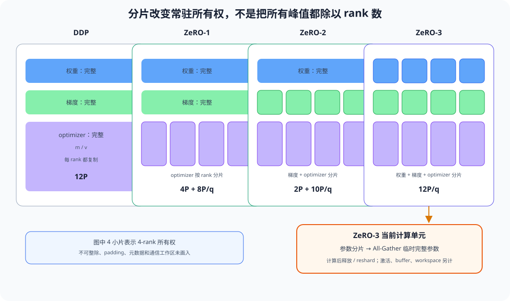{#fig-ch05-state-layouts fig-alt="四列分别是 DDP、ZeRO-1、ZeRO-2 和 ZeRO-3。DDP 中权重、梯度、optimizer 均完整；ZeRO-1 只把 optimizer 状态切成四片；ZeRO-2 再把梯度切片；ZeRO-3 三类都切片。一条箭头从 ZeRO-3 指向当前计算单元的临时完整参数，并注明激活、buffer 和 workspace 另计。" width="100%"}

::: {.callout-important title="常驻分片不等于峰值除以 rank 数"}
$12P/q$ 只是 ZeRO-3 在明确 dtype 口径下的逻辑常驻状态。峰值还要加当前单元的完整参数、激活、预取重叠、communication buffer、workspace 和分配器保留。
:::

<a id="sec-5-4-1"></a>

### 5.4.1 ZeRO

经典DP的浪费不在计算结果重复，而在每个rank长期保存同样的模型状态。Zero Redundancy Optimizer（ZeRO）保留“各rank处理不同数据”的粗粒度计算方式，却把优化器状态、梯度和参数依次切成互不重叠的分片。它降低的是**每rank常驻模型状态**；激活、临时聚合buffer、通信工作区与碎片仍要另列，不能把状态缩减比例直接当作峰值显存缩减比例。[ZeRO原论文，§5](https://arxiv.org/abs/1910.02054)

#### 三个累积Stage

设DP组有$q=p_{\mathrm{DP}}$个rank，并假设参数可均匀分片；不能整除时各rank容量可能略有差异。三个Stage是累积的：

- **Stage 1（optimizer state partitioning）**：参数和梯度仍复制，只把优化器负责的状态分片；每个rank仅更新自己负责的参数分片，随后同步更新后的参数。
- **Stage 2（+ gradient partitioning）**：再把归约后的梯度分片；每个rank只保留与其优化器分片对应的梯度。梯度All-Reduce可分解为Reduce-Scatter与参数更新后的All-Gather，从而不必让完整归约梯度长期驻留每个rank。
- **Stage 3（+ parameter partitioning）**：参数也只常驻一个分片；某层前向或反向需要完整参数时才临时聚合，使用后再释放或reshard。DeepSpeed官方文档把这三阶段分别定义为分片优化器状态、再分片梯度、再分片16-bit模型参数。[DeepSpeed ZeRO文档](https://deepspeed.readthedocs.io/en/latest/zero3.html)

“分片”不等于参数在计算时永远不完整。Stage 3仍须为当前算子物化所需参数，因此峰值取决于模块粒度、预取窗口、并发通信、最大单层参数和释放时机；若一次聚合过多层，理论常驻节省会被临时buffer部分吃回。

#### 同一精度口径下的状态账本

令$b_{\mathrm w},b_{\mathrm g},b_{\mathrm o}$分别为每参数常驻权重、梯度和“优化器侧状态”的字节数；这里$b_{\mathrm o}$包含AdamW一/二阶矩，若实现另存FP32主权重也把它计入。忽略padding、元数据、临时聚合和不均匀分片，则：

<a id="eq-05-zero-state-memory"></a>

**式（05-ZeRO-State-Memory）：ZeRO各Stage的每rank逻辑模型状态**

$$
\begin{aligned}
M_0&=P(b_{\mathrm w}+b_{\mathrm g}+b_{\mathrm o}),\\
M_1&=P\left(b_{\mathrm w}+b_{\mathrm g}+\frac{b_{\mathrm o}}{q}\right),\\
M_2&=P\left(b_{\mathrm w}+\frac{b_{\mathrm g}+b_{\mathrm o}}{q}\right),\\
M_3&=\frac{P(b_{\mathrm w}+b_{\mathrm g}+b_{\mathrm o})}{q}.
\end{aligned}
$$

取贯穿模型$P=5{,}802{,}037{,}248$、$q=8$，并沿用“BF16权重2 bytes、BF16梯度2 bytes、两个FP32 AdamW状态共8 bytes、无FP32主权重”的$12P$情景：

先看每参数口径如何随 Stage 改变，再代入同一个 $P$。拆成两张表可避免把“bytes/参数”和模型总 bytes 混为一列：

| 布局 | 每rank逻辑式 | bytes/参数 |
| --- | ---: | ---: |
| 经典DP | $12P$ | 12 |
| ZeRO-1 | $(4+8/8)P=5P$ | 5 |
| ZeRO-2 | $(2+10/8)P=3.25P$ | 3.25 |
| ZeRO-3 | $(12/8)P=1.5P$ | 1.5 |

| 布局 | 每rank总 bytes | GiB |
| --- | ---: | ---: |
| 经典DP | 69,624,446,976 | 64.842819 |
| ZeRO-1 | 29,010,186,240 | 27.017841 |
| ZeRO-2 | 18,856,621,056 | 17.561597 |
| ZeRO-3 | 8,703,055,872 | 8.105352 |

若另有FP32主权重，应令$b_{\mathrm o}=12$而不是8；同一$q=8$下Stage 1/2/3分别约为29.72、20.26、10.81 GiB。表中数字不是设备峰值：激活没有随ZeRO Stage自动按$q$缩小，Stage 3还需要参数聚合buffer。

#### 通信并没有消失

ZeRO用更短的状态生命周期换通信。原论文在大消息、均匀分片的元素流量抽象下，把基线DP的梯度All-Reduce写成Reduce-Scatter加All-Gather，共$2\Psi$元素；Stage 1/2可以用梯度归约分片与更新参数聚合保持相同的$2\Psi$量级，Stage 3因前向与反向都要按需取得参数，再加梯度Reduce-Scatter，达到约$3\Psi$，即该模型下的1.5倍。[ZeRO原论文，§7](https://arxiv.org/abs/1910.02054)

这里的$\Psi$是论文通信分析中的参数元素数，不是本机链路字节计数。实际字节取决于通信dtype、$q$、collective算法、模块边界和是否重叠；跨节点拓扑、许多小模块以及预取不准都可能使相同逻辑元素量得到不同墙钟时间。Stage 1的具体参数同步路径也可因实现而异，不能把某个框架的bucket调度写成ZeRO定义本身。

#### CPU与NVMe Offload

当GPU容量仍不足，可把优化器状态、梯度乃至参数放到主机内存；ZeRO-Infinity还支持借助NVMe扩展容量。官方DeepSpeed说明，较早的ZeRO-Offload主要在Stage 1/2把优化器和梯度移到CPU，Stage 3的Infinity offload可覆盖更多模型状态并使用CPU/NVMe。[DeepSpeed ZeRO文档](https://deepspeed.readthedocs.io/en/latest/zero3.html) [ZeRO-Offload教程](https://www.deepspeed.ai/tutorials/zero-offload/)

Offload改变的是放置，不是免费删除：GPU—CPU要经过互连，NVMe又多一层更高延迟、更低带宽的存储路径；CPU优化器计算、页锁定buffer、预取队列和双缓冲都消耗主机资源。只有传输能与足够长的计算重叠，或没有offload根本无法运行时，容量收益才可能抵消墙钟代价。计划时至少记录每步搬运bytes、可持续互连/NVMe带宽、暴露传输时间、CPU核与内存容量，不能引用教程中的特定GPU结果作为本机性能。

本节没有运行DeepSpeed、ZeRO、多GPU、CPU/NVMe offload或通信测量；所有GiB是式（05-ZeRO-State-Memory）的逻辑常驻状态复算，不包含运行时峰值。

**理解检查。** 在$q=4$、无FP32主权重的$12P$口径下，分别写出ZeRO-1/2/3的每rankbytes/参数。为什么ZeRO-3得到$12P/4$仍不能推出峰值显存恰为经典DP的四分之一？

<a id="sec-5-4-2"></a>

### 5.4.2 Fully Sharded Data Parallel（FSDP）

Fully Sharded Data Parallel（FSDP）是在PyTorch中实现全分片数据并行的一条具体路线：数据仍按rank切分，但参数、梯度和优化器状态在DP组内分片。就状态分类而言，它与上一节ZeRO Stage 3追求相同目标；“ZeRO”是分阶段消除冗余的算法/系统思想，“FSDP2”则有明确的PyTorch对象、hook、`DTensor`布局与checkpoint接口，二者不是可互换的产品名称。

#### 一组参数的一次训练生命周期

设某个FSDP单元含$G$个参数元素，分片组大小$q$，且可均匀切分。平时每rank只持有约$G/q$个参数及对应优化器状态；计算该单元时，完整参数的生命周期如下：

| 时刻 | 每rank需要的参数/梯度布局 | 主要动作 |
| --- | --- | --- |
| 单元前向前 | 参数分片 | All-Gather参数，临时重建完整$G$元素 |
| 单元前向 | 完整参数 | 计算本rank的数据；参数值相同，激活不同 |
| 前向后 | 依策略保留完整参数或reshard | 若reshard，释放非本地参数，只留$G/q$分片 |
| 单元反向前 | 若已reshard则仍是参数分片 | 再次All-Gather参数，供局部梯度计算 |
| 单元反向后 | 完整局部梯度 | Reduce-Scatter跨rank求和/平均并切分，只保留梯度分片；释放完整参数 |
| optimizer step | 参数、梯度、状态均分片 | 每rank只更新自己负责的参数分片 |

PyTorch FSDP2的官方契约正是：`fully_shard`在初始化时把参数原地变成分片`DTensor`；前向/反向前的hook执行All-Gather并临时恢复普通完整张量，之后释放非分片参数；反向后再Reduce-Scatter梯度。[PyTorch `fully_shard`文档](https://docs.pytorch.org/docs/stable/distributed.fsdp.fully_shard.html) 这里的梯度归约仍须服从[式（05-DP-Token-Gradient）](#eq-05-dp-token-gradient)的有效Token权重，分片不会自动修正变长batch的归一化。

@fig-ch05-fsdp-lifecycle 把表格中的六个时刻放到一条时间线上。粒度大时，collective 次数少，但单次消息和临时完整参数峰值大；粒度小时容易预取与重叠，却可能被启动时延和调度拖慢。这也是为什么 FSDP 分组不只是 API 细节，而是峰值与关键路径的共同边界。

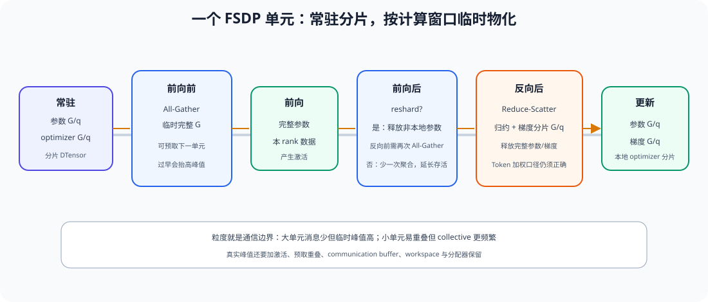{#fig-ch05-fsdp-lifecycle fig-alt="时间线从常驻参数和 optimizer 分片开始；前向前 All-Gather 得到完整参数，本 rank 数据做前向；前向后可选释放非本地参数，选择释放则反向前需再 All-Gather；反向后 Reduce-Scatter 归约梯度并只留本地分片，再在参数、梯度和 optimizer 分片上更新。" width="100%"}

**Resharding的取舍。** `reshard_after_forward=True`时，前向后尽快释放完整参数，降低前向末尾和已保存激活共存的峰值，但反向前要再做一次All-Gather。若保留完整参数直到反向，则少一次聚合却延长其生命周期；模型较小或通信昂贵时可能有利，容量紧张时可能OOM。无论哪种策略，完整参数的临时buffer都说明$12P/q$只是常驻状态近似，不是峰值保证。

#### FSDP2的分片粒度就是通信边界

FSDP2按每次`fully_shard(module)`形成一个参数通信组；官方建议自底向上应用：先对各Transformer Block调用，再对根模型调用以收纳Embedding、最终归一化和LM Head等未归组参数。概念性API骨架如下，接口以使用版本文档为准：

```python
# 概念性FSDP2骨架；本机PyTorch 2.5.1未运行此代码
from torch.distributed.fsdp import fully_shard

for block in model.blocks:
    fully_shard(block, mesh=dp_mesh)
fully_shard(model, mesh=dp_mesh)   # 收纳尚未归组的根参数
optimizer = AdamW(model.parameters(), lr=lr)  # 使用分片后的DTensor参数
```

若只在根模型调用一次，全部参数形成一个大组：完整模型All-Gather后才能开始前向，完整反向结束才Reduce-Scatter，通信几乎不能与层计算重叠，临时峰值也大。逐Block分组可预取下一Block参数并与当前Block计算重叠，峰值接近少数Block的完整参数；代价是collective次数增多，分得太细会被启动时延、调度和小消息效率拖累。最佳粒度取决于单层大小、网络、计算时长和可用显存，不是“越细越好”。[FSDP2入门教程](https://docs.pytorch.org/tutorials/intermediate/FSDP_tutorial.html)

通信重叠同样不是自动保证。预取过早会让多个完整参数组同时存活，降低空等却抬高峰值；预取过晚则暴露All-Gather。反向中的Reduce-Scatter和下一组参数All-Gather还可能共享同一通信资源而串行，实际关键路径必须以目标拓扑、dtype、组大小和Profiler记录验证。

#### 精度、初始化与checkpoint边界

FSDP2可分别配置参数计算dtype与梯度归约dtype；这不会改变优化器状态实际dtype，仍应逐项代入式（05-ZeRO-State-Memory）。模型初始化、权重绑定/共享、冻结参数和设备mesh也必须在分片前后顺序上符合所用版本契约。贯穿模型绑定Embedding与LM Head，因此实际实现需验证共享参数是否仍保持同一存储语义，不能让两个调用各自切出独立副本。

FSDP2的`state_dict()`保留参数全限定名，但分片状态含`DTensor`；当前官方文档建议通过`DTensor.full_tensor()`或PyTorch Distributed Checkpoint等高层API转换/保存。训练恢复必须同时保存分片参数、optimizer状态、mesh与world-size元数据、scheduler、随机状态和数据游标；“能导出完整权重”不等于“能精确续跑”。这些接口随PyTorch版本演进，本机固定的2.5.1+cu124并未执行当前在线FSDP2示例。

FSDP适合模型状态复制是主要瓶颈、单个计算单元临时聚合后仍能装入且互连足以承担频繁collective的训练。若单层本身也无法临时装入，需要张量并行等进一步切分单个算子；若网络慢、模型很小或通信组过碎，经典DDP可能更简单更快。

本节没有运行FSDP2、DTensor、多进程、GPU、All-Gather/Reduce-Scatter或checkpoint恢复；生命周期和API来自官方文档，性能取舍是待目标系统验证的机制分析。

**理解检查。** 对一个含4个Block的模型，只在根模型调用一次`fully_shard`与逐Block自底向上调用相比，collective次数、单次消息、临时完整参数峰值和可重叠窗口分别如何变化？为什么`reshard_after_forward=True`可能省显存却增加通信？

<a id="sec-5-5"></a>

## 5.5 张量并行（Tensor Parallelism）

张量并行把同一层的权重、计算与中间激活沿特征或头维分给多个rank，解决单算子容量并缩短每rank GEMM；代价是把collective放进每个Transformer Block的关键路径。本节按“代数分解→单层布局→整Block组合”展开：[5.5.1](#sec-5-5-1)统一行向量分解，[5.5.2](#sec-5-5-2)与[5.5.3](#sec-5-5-3)分别固定Column/Row Parallel的前反向语义，[5.5.4](#sec-5-5-4)再接入贯穿GQA与SwiGLU。

核心判断始终是相邻算子需要复制还是分片布局，而不是孤立地数一次GEMM：Column输出能直接被Row输入消费时可避免中间All-Gather，Row输出则按残差、Norm或Sequence Parallel需要选择All-Reduce或Reduce-Scatter。TP不增加独立样本数，也不保证提高吞吐；整除条件、局部矩阵效率和互连拓扑共同限制合理并行度。

@fig-ch05-tp-column-row 先把两个线性层连起来看：复制输入进入不同的输出特征分片，局部非线性保持分片；只有 Row Parallel 的完整形状部分和需要逐元素求和。图中省掉的中间 All-Gather 正是相邻布局配合带来的收益，而末端 SUM 仍是恢复正确语义所必需的。

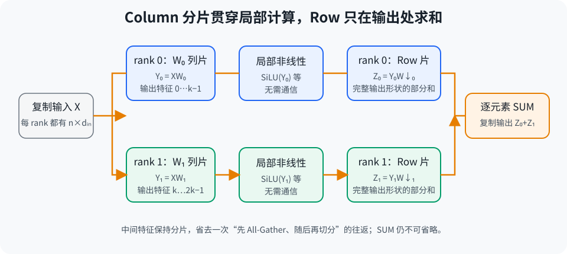{#fig-ch05-tp-column-row fig-alt="输入 X 在两个 rank 上复制，分别乘 Column 权重列片得到蓝、绿两个输出特征分片；两个分片独立经过非线性，再分别乘匹配的 Row 权重片得到完整输出形状的部分和 Z0、Z1；末端以逐元素 SUM 得到复制输出，中间没有 All-Gather。" width="100%"}

<a id="sec-5-5-1"></a>

### 5.5.1 Tensor Parallelism 的基本原理

数据并行让每个rank拥有完整算子；FSDP在算子执行前临时重建完整参数。若单个线性层、Attention投影或其临时张量本身仍放不进一张GPU，就要把**同一个算子内部的张量维度**切到$p_{\mathrm{TP}}$个rank上共同计算，这就是张量并行（Tensor Parallelism, TP）。同一TP组处理的是同一批Token，不是不同数据，因此$p_{\mathrm{TP}}$不乘入全局batch。

TP通过张量分片（Tensor Sharding）让每rank只保存和计算权重的一部分；代价是算子图内部出现频繁布局变换与collective。它不同于流水线并行按层切阶段，也不同于ZeRO/FSDP只改变训练状态所有权：TP真正把一次矩阵乘法拆成多个局部矩阵乘法。

#### 线性层的两种基本分解

沿用全书行向量约定，展平$B,T$后令$\mathbf X\in\mathbb R^{n\times d_{\mathrm{in}}}$、$\mathbf W\in\mathbb R^{d_{\mathrm{in}}\times d_{\mathrm{out}}}$、$\mathbf Y=\mathbf X\mathbf W$，其中$n=BT$。为简洁假设对应维度可被$p_{\mathrm{TP}}$整除；实际不整除时需要不均匀分片或padding。

<a id="eq-05-tp-linear"></a>

**式（05-TP-Linear）：输出维与输入维的线性层分解**

$$
\begin{aligned}
\text{输出维切分：}\quad
\mathbf W&=[\mathbf W_0\;\mathbf W_1\;\cdots\;\mathbf W_{p_{\mathrm{TP}}-1}],\\
\mathbf Y&=[\mathbf X\mathbf W_0\;\cdots\;\mathbf X\mathbf W_{p_{\mathrm{TP}}-1}],\\[3pt]
\text{输入维切分：}\quad
\mathbf X&=[\mathbf X_0\;\mathbf X_1\;\cdots\;\mathbf X_{p_{\mathrm{TP}}-1}],
\\
\mathbf W&=\begin{bmatrix}\mathbf W_0\\\mathbf W_1\\\vdots\\\mathbf W_{p_{\mathrm{TP}}-1}\end{bmatrix},\\
\mathbf Y&=\sum_{j=0}^{p_{\mathrm{TP}}-1}\mathbf X_j\mathbf W_j.
\end{aligned}
$$

输出维切分俗称Column Parallel：rank $j$持有$\mathbf W_j\in\mathbb R^{d_{\mathrm{in}}\times(d_{\mathrm{out}}/p_{\mathrm{TP}})}$，输入$\mathbf X$复制，各自得到不重叠的输出特征分片；若下一算子能直接消费这种布局，就不必立刻All-Gather。输入维切分俗称Row Parallel：rank $j$持有$\mathbf X_j\in\mathbb R^{n\times(d_{\mathrm{in}}/p_{\mathrm{TP}})}$和匹配的$\mathbf W_j$，局部结果形状都是$n\times d_{\mathrm{out}}$，必须跨rank求和才能得到完整$\mathbf Y$。5.5.2与5.5.3将分别展开前向和反向通信。

**局部玩具例子。** 取$p_{\mathrm{TP}}=2$，

$$
\mathbf X=[1,2,3,4],\qquad
\mathbf W=
\begin{bmatrix}
1&0&1&2\\0&1&2&1\\1&1&0&1\\2&0&1&0
\end{bmatrix}.
$$

完整结果为$\mathbf Y=[12,5,9,7]$。按输出维切，两个rank直接得到$[12,5]$和$[9,7]$，拼接才恢复完整输出；按输入维切，rank 0计算$[1,2]\mathbf W_{0:2,:}=[1,2,5,4]$，rank 1计算$[3,4]\mathbf W_{2:4,:}=[11,3,4,3]$，逐元素SUM得到同一个$[12,5,9,7]$。这验证了布局等价性，不是GPU性能实验。

#### 通信必须和张量布局一起推导

局部GEMM只回答“每rank算什么”，collective回答“下一算子需要什么布局”。若Column Parallel输出后立刻All-Gather，虽恢复复制布局，却可能白白搬运即将再次切分的数据；经典Transformer TP通常把第一层Column Parallel的分片输出直接送入可逐元素计算的激活，再由第二层Row Parallel消费，直到后者求和才同步。Megatron-LM用这一结构把MLP和Attention中的多次GEMM组合成少量同步点，说明优化对象不是单个线性层，而是相邻算子的布局链。[Megatron-LM，§3](https://arxiv.org/abs/1909.08053)

反向传播的通信方向与前向布局互补：输出维切分的权重梯度可局部形成，但复制输入的梯度贡献通常要跨rank求和；输入维切分经前向求和得到复制输出，而对应输入梯度天然按输入特征分片。任何省略通信的说法都必须同时声明前向输入、输出以及反向梯度是复制还是分片。

#### 容量、吞吐与适用边界

理想均匀切分把该权重矩阵和主GEMM工作量约降到每rank的$1/p_{\mathrm{TP}}$，但不会让所有资源都等比下降：某些输入或输出激活仍复制，collective buffer、归一化、逐元素算子和框架元数据也可能不分片。若模型本来就能高效放入单卡，TP还会把大GEMM切成较小GEMM，降低算术强度或设备占用，并增加通信启动与同步等待。

TP通信发生在层内关键路径，通常比DP每次更新一次梯度同步更频繁，因此更依赖低延迟、高带宽且拓扑对称的互连；把TP组跨越慢链路往往放大straggler与通信暴露。增大$p_{\mathrm{TP}}$还会受$d$、$d_{\mathrm{ff}}$、头数和词表维度的可分性约束，并可能让每rank只剩很小的矩阵。最优TP度应由单算子容量、局部GEMM效率、通信时间和与PP/DP的组合共同决定，不能只追求更小参数分片。

PyTorch当前在线文档提供基于`DTensor`的`ColwiseParallel`、`RowwiseParallel`与`parallelize_module`，并明确标记TP API为experimental。[PyTorch TP文档](https://docs.pytorch.org/docs/main/distributed/tensor.parallel.html) 本书本节使用其布局术语，不把2026年在线API视为本机PyTorch 2.5.1已验证接口。

本节没有运行TP、多进程、GPU、DTensor或collective性能实验；矩阵例为手工可复算的代数验证，容量与性能讨论是机制边界而非实测结论。

**理解检查。** 对$\mathbf W\in\mathbb R^{4096\times11008}$做8路输出维切分时，每rank权重形状和输出形状是什么？若下一层要求复制的完整11008维输入，需要哪个collective；若下一层能按输入维消费分片，又能省掉什么？

<a id="sec-5-5-2"></a>

### 5.5.2 Column Parallel Linear

Column Parallel Linear沿数学权重$\mathbf W\in\mathbb R^{d_{\mathrm{in}}\times d_{\mathrm{out}}}$的**列**切分，也就是切输出特征维。注意PyTorch `Linear.weight`实际存为`[out_features, in_features]`，因此同一逻辑切分在存储张量上是切第0维；“column”按本书$\mathbf Y=\mathbf X\mathbf W$命名，不能直接按框架存储外观判断。

设$q=p_{\mathrm{TP}}$且$d_{\mathrm{out}}$可被$q$整除。rank $j$持有
$\mathbf W_j\in\mathbb R^{d_{\mathrm{in}}\times(d_{\mathrm{out}}/q)}$，输入$\mathbf X\in\mathbb R^{n\times d_{\mathrm{in}}}$采用TP组内的输入复制布局，$n=BT$。

<a id="eq-05-column-parallel"></a>

**式（05-Column-Parallel）：列并行线性层前向与反向**

$$
\begin{aligned}
\mathbf Y_j &= \mathbf X\mathbf W_j,
\\
\mathbf Y&=[\mathbf Y_0\;\cdots\;\mathbf Y_{q-1}],\\
\nabla_{\mathbf W_j}\mathcal L&=\mathbf X^\top\nabla_{\mathbf Y_j}\mathcal L,\\
\nabla_{\mathbf X}\mathcal L&=\sum_{j=0}^{q-1}
\nabla_{\mathbf Y_j}\mathcal L\,\mathbf W_j^\top.
\end{aligned}
$$

前向每rank独立得到$\mathbf Y_j\in\mathbb R^{n\times(d_{\mathrm{out}}/q)}$，不需要为这次GEMM归约。反向中权重梯度也完全局部；但复制输入$\mathbf X$收到来自所有输出分片的梯度贡献，若上游需要复制布局，就要对各rank的局部$\nabla_{\mathbf X}^{(j)}$做SUM All-Reduce。若采用其他输入布局，具体反向collective会改变，不能脱离布局套用这条通信规则。

**两rank复算。** 复用5.5.1的$\mathbf X=[1,2,3,4]$与$4\times4$权重。两个rank按前两列/后两列切分，前向分别得到$[12,5]$和$[9,7]$。再设输出梯度$\nabla_{\mathbf Y}\mathcal L=[1,2,3,4]$，两个分片产生的局部输入梯度分别为

$$
\begin{aligned}
[1,2]\mathbf W_0^\top&=[1,2,3,2],\\
[3,4]\mathbf W_1^\top&=[11,10,4,3].
\end{aligned}
$$

SUM后才得到完整输入梯度$[12,12,7,5]$。这同时说明“前向无通信”不等于该层训练全程无通信。

#### 为什么输出可以保持Sharded

如果消费者只做逐元素运算，例如ReLU、GELU、SiLU或SwiGLU门控在匹配分片上的逐元素乘法，各rank可直接处理$\mathbf Y_j$，无需知道别的输出特征。若下一层恰按输入维切分，其$\mathbf X_j$就可以直接引用这里的$\mathbf Y_j$；Column—Row相邻布局因此避免了中间All-Gather。Megatron-LM的MLP正利用“第一层列切—局部激活—第二层行切”把同步推迟到第二层输出。[Megatron-LM，§3](https://arxiv.org/abs/1909.08053)

只有当消费者要求每rank都看到完整$d_{\mathrm{out}}$维，例如未分片算子、跨分片归一化/统计或某个复制布局边界，才需要按输出维All-Gather。若只有单个目的rank需要完整输出，Gather可能比All-Gather更合适；选择collective必须以消费者布局为准。过早聚合会同时增加通信和完整激活驻留。

贯穿模型的SwiGLU gate/up投影均为$4096\times11008$。8路Column Parallel时，每rank权重为$4096\times1376$，输入为$BT\times4096$复制张量，局部输出为$BT\times1376$；8片拼接才是$BT\times11008$。两个投影必须采用相同输出分片边界，才能在本地执行$\operatorname{SiLU}(\mathbf X\mathbf W_{\mathrm{gate},j})\odot(\mathbf X\mathbf W_{\mathrm{up},j})$。

Column Parallel把权重和主GEMM工作量均匀切小，但复制输入、输入梯度All-Reduce、可能的输出All-Gather、bias处理和不均匀尾片仍有成本；贯穿模型无bias，其他模型若有bias应按输出维一同切分。$d_{\mathrm{out}}/q$过小时，局部GEMM效率下降，通信可能超过计算收益。

本节没有运行TP、GPU、DTensor、All-Reduce或All-Gather；矩阵与形状均为代数复算，不报告吞吐或显存峰值实测。

**理解检查。** 对贯穿SwiGLU的$4096\times11008$ gate投影做8路Column Parallel，为什么SiLU不需通信？若随后的down投影没有按输入维切分，必须在何处恢复什么形状；这会增加哪些显存和通信项？

<a id="sec-5-5-3"></a>

### 5.5.3 Row Parallel Linear

Row Parallel Linear沿数学权重$\mathbf W\in\mathbb R^{d_{\mathrm{in}}\times d_{\mathrm{out}}}$的**行**切分，也就是切输入特征维。输入必须按同一边界切成$\mathbf X_j$；否则每rank没有与本地权重相乘所需的输入特征。对PyTorch存储的[out_features, in_features]权重，这对应切第1维，与Column Parallel的存储方向相反。

令$q=p_{\mathrm{TP}}$且$d_{\mathrm{in}}$可被$q$整除。rank $j$持有$\mathbf X_j\in\mathbb R^{n\times(d_{\mathrm{in}}/q)}$与$\mathbf W_j\in\mathbb R^{(d_{\mathrm{in}}/q)\times d_{\mathrm{out}}}$。

<a id="eq-05-row-parallel"></a>

**式（05-Row-Parallel）：行并行线性层的局部部分和**

$$
\mathbf Z_j=\mathbf X_j\mathbf W_j
\in\mathbb R^{n\times d_{\mathrm{out}}},
\qquad
\mathbf Y=\sum_{j=0}^{q-1}\mathbf Z_j.
$$

每个$\mathbf Z_j$覆盖完整输出形状，却只含一部分输入特征的贡献；它们必须**逐元素求和**，不能沿特征维直接拼接。若下一算子要求复制输出，对$\mathbf Z_j$做SUM All-Reduce，使每rank都得到完整$\mathbf Y$。若下一算子能消费某一输出维（例如序列维）的分片，可用Reduce-Scatter：先对同位置贡献求和，再让rank $j$只保留$\mathbf Y$的相应输出分片。Reduce-Scatter改变的是归约结果的放置，并没有取消求和。

**两rank复算。** 复用5.5.1的输入维切分。rank 0与rank 1的局部部分和分别是

$$
\mathbf Z_0=[1,2,5,4],\qquad
\mathbf Z_1=[11,3,4,3].
$$

All-Reduce后两个rank都得到$\mathbf Y=[12,5,9,7]$。若教学性地沿最后一维做Reduce-Scatter，rank 0只保留$[12,5]$，rank 1只保留$[9,7]$；这是“SUM后分片”，不是把$\mathbf Z_0$前半和$\mathbf Z_1$后半直接拿走，后者会错误得到$[1,2,4,3]$。

#### 反向布局

在All-Reduce产生复制输出、因而$\nabla_{\mathbf Y}\mathcal L$也复制的基本情形下，各rank可局部计算

$$
\nabla_{\mathbf X_j}\mathcal L
=\nabla_{\mathbf Y}\mathcal L\,\mathbf W_j^\top,
\qquad
\nabla_{\mathbf W_j}\mathcal L
=\mathbf X_j^\top\nabla_{\mathbf Y}\mathcal L.
$$

两者与本地分片形状匹配，不需为这个Row Parallel层再聚合；$\nabla_{\mathbf X_j}$自然保持输入特征分片，可直接传回前一层Column Parallel的分片输出。若前向采用Reduce-Scatter令输出分片，反向到本层时通常需要先恢复每个rank计算本地$\nabla_{\mathbf X_j},\nabla_{\mathbf W_j}$所需的输出梯度布局，例如All-Gather对应分片；具体collective取决于输出沿哪一维分片，不能仅凭“Row Parallel”省略。

贯穿SwiGLU的down投影为$11008\times4096$。8路Row Parallel时，每rank权重是$1376\times4096$，输入恰接5.5.2中gate/up产生的$BT\times1376$本地门控结果，局部部分和是$BT\times4096$；对8份结果求和才恢复复制的$BT\times4096$残差分支输出。这样第一层Column输出与第二层Row输入在中间维完全对齐，无需为$BT\times11008$中间激活做All-Gather。

Row Parallel减少本地权重与GEMM的输入维，却让每rank生成完整形状的部分和，并把归约放在层内关键路径。$d_{\mathrm{in}}/q$过小会降低GEMM效率；完整输出All-Reduce或分片输出Reduce-Scatter的选择还会影响后续残差、归一化和序列并行布局。只有把相邻算子共同规划，才能判断哪种结果放置更省通信。

本节没有运行TP、GPU、All-Reduce或Reduce-Scatter；数值是局部矩阵乘法与归约的代数复算，不是通信或吞吐实测。

**理解检查。** 对8路SwiGLU down投影，为什么8个$BT\times4096$局部结果必须求和而不是拼接？若改用沿Token维Reduce-Scatter，随后的残差连接要满足什么布局，反向又可能需要哪种逆向布局变换？

<a id="sec-5-5-4"></a>

### 5.5.4 Transformer 中的 Tensor Parallelism

Transformer TP不是把每个线性层孤立切开，而是设计一条跨算子的布局链：复制的Block输入先经Column Parallel产生特征/头分片，中间非线性或Attention在本地完成，再由Row Parallel把各分片贡献求和，恢复残差连接需要的布局。这样既切分两侧大权重，又避免物化巨大的完整中间激活。[Megatron-LM，§3](https://arxiv.org/abs/1909.08053)

#### GQA Attention：Q/K/V列切，O行切

贯穿模型有$d=4096,H=32,H_{\mathrm{KV}}=8,d_h=128$。采用$p_{\mathrm{TP}}=8$并按完整Attention头分组时，每rank得到4个Query头和1个KV头，仍保持$H/H_{\mathrm{KV}}=4$个Query头共享1个KV头。形状账本如下：

先看权重如何切：

| 投影 | 完整数学权重 | 8路每rank权重 |
| --- | ---: | ---: |
| Q，Column | $4096\times4096$ | $4096\times512$ |
| K，Column | $4096\times1024$ | $4096\times128$ |
| V，Column | $4096\times1024$ | $4096\times128$ |
| O，Row | $4096\times4096$ | $512\times4096$ |

再看每片结果如何流向下一算子：

| 投影 | 本地结果 | 后续布局 |
| --- | ---: | --- |
| Q，Column | $BT\times4\times128$ | 4个Q头 |
| K，Column | $BT\times1\times128$ | 1个KV头 |
| V，Column | $BT\times1\times128$ | 1个KV头 |
| O，Row | 部分和$BT\times4096$ | SUM后复制 |

每rank拥有完整序列位置，却只拥有一组本地GQA头；RoPE可在本地Q/K上按同一绝对位置执行，Attention分数和加权V也不跨头混合，因此本地完成。把8个rank的Attention头输出看作沿$d$切分的$BT\times512$输入，恰由O投影的Row Parallel分片消费；各rank生成$BT\times4096$部分和，SUM All-Reduce后恢复复制隐藏状态，再与复制残差相加。

若实现把Q/K/V存成一个融合权重，不能机械等宽切融合输出：Q总宽4096而K、V各1024。分片计划必须让每rank分别取得512维Q、128维K和128维V，维持4:1的头组对应。否则张量虽然可能整除，语义上的Q—KV共享关系却会错位。

#### SwiGLU MLP：gate/up列切，down行切

贯穿SwiGLU包含两个$4096\times11008$投影和一个$11008\times4096$投影。8路布局是：

1. gate与up都做Column Parallel，每rank各持$4096\times1376$，从复制$BT\times4096$输入得到两份$BT\times1376$分片；
2. 本地计算$\operatorname{SiLU}(\mathrm{gate}_j)\odot\mathrm{up}_j$，逐元素操作不要求其他rank的数据；
3. down做Row Parallel，每rank持$1376\times4096$，直接消费本地中间分片并产生$BT\times4096$部分和；
4. SUM All-Reduce得到复制的$BT\times4096$输出，再做残差加法。

若在gate/up之后立即All-Gather，完整中间激活有$BT\times11008$元素，随后down又会按同一1376维边界切开；这次往返没有为局部非线性提供新信息。先列后行正是把中间分片直接贯穿两层，只在需要恢复Block隐藏维时同步。反过来先做Row Parallel，会在非线性前就必须归约完整输出，难以获得同样的通信合并。

#### 一个Block的同步点与TP度（Tensor Parallel Degree）

在“RMSNorm与残差隐藏状态复制、未启用Sequence Parallel”的基础布局中，每个Block前向通常有两个主同步点：O投影后的SUM和down投影后的SUM；反向则在QKV Column组和gate/up Column组向复制输入回传梯度时出现对应同步。实现可把All-Reduce分解或替换成Reduce-Scatter/All-Gather以接入序列分片，但那会改变Norm、残差和下一层输入布局，不能在计数时仍声称全部隐藏状态复制。

提高$p_{\mathrm{TP}}$大致降低这些大线性权重和局部GEMM的每rank份额，却不保证端到端显存或时间按比例下降。至少要检查：

- **整除与语义**：头本地布局通常要求$p_{\mathrm{TP}}$同时整除$H$与$H_{\mathrm{KV}}$，SwiGLU要求适配$d_{\mathrm{ff}}$；本配置8路得到每rank 4Q/1KV和1376中间维。16路虽整除32个Q头，却不整除8个KV头，需改为切head_dim、复制KV或其他布局，不能沿用上表。
- **通信**：同步次数不会因权重变小而自动减少，而每次消息、局部GEMM与可重叠计算会变小；跨慢链路时All-Reduce可能主导关键路径。
- **显存**：分片参数和中间激活下降，但复制残差、RMSNorm输入、collective buffer及其他运行时项仍在；还要计入DP/FSDP等组合后的状态放置。
- **计算效率**：过高TP度产生窄GEMM、更多启动/同步和负载尾片，可能低于单卡大GEMM效率。

因此TP通常优先放在节点内高带宽互连上，并与跨节点DP/PP组合；这是一种常见拓扑映射原则，不是对所有硬件的性能保证。PyTorch当前TP文档也建议对Attention/MLP组合Colwise与Rowwise计划，而非独立处理单层；API仍属experimental。[PyTorch TP文档](https://docs.pytorch.org/docs/main/distributed/tensor.parallel.html)

本节没有运行8路TP、GQA Kernel、GPU、All-Reduce或Profiler；表中形状由贯穿配置整除复算，同步点是基础布局的机制分析，不是通信耗时实测。

**理解检查。** 为什么本配置8路TP可让每rank保持4Q:1KV，而16路不能直接沿用“完整头切分”？若把MLP中间$BT\times11008$在gate/up后All-Gather，再在down前重切，会比Column—Row直连新增哪些数据移动和峰值？

<a id="sec-5-6"></a>

## 5.6 流水线并行（Pipeline Parallelism）

流水线并行（Pipeline Parallelism, PP）把连续Transformer层划成$S=p_{\mathrm{PP}}$个stage，每个stage常驻不同层。一个micro-batch在stage 0完成前向后，把边界激活点对点发送给stage 1，直至末stage计算loss；反向则把边界激活梯度按相反方向逐stage发送。它切的是层和时间，不切单个层内张量；因此可与TP、DP组合。

Stage边界需要明确张量形状、dtype、序列padding/packing元数据和通信顺序。前向发送的是激活，反向返回的是该激活的梯度；每个stage仍在本地形成所拥有参数的梯度。若stage计算量、激活通信或重计算时间不均，整条pipeline受最慢stage限制，不能只按层数平均分配。

@fig-ch05-pipeline-schedules 用同一个 $S=4,m=4$ 更新窗口比较两种同步调度。GPipe 先堆积前向再排空反向，早期 stage 的激活存活更久；同步 1F1B 在预热后交替前反向，缩短在途激活队列。两条路线最终都要等全部反向完成，才进入同一个 optimizer step。

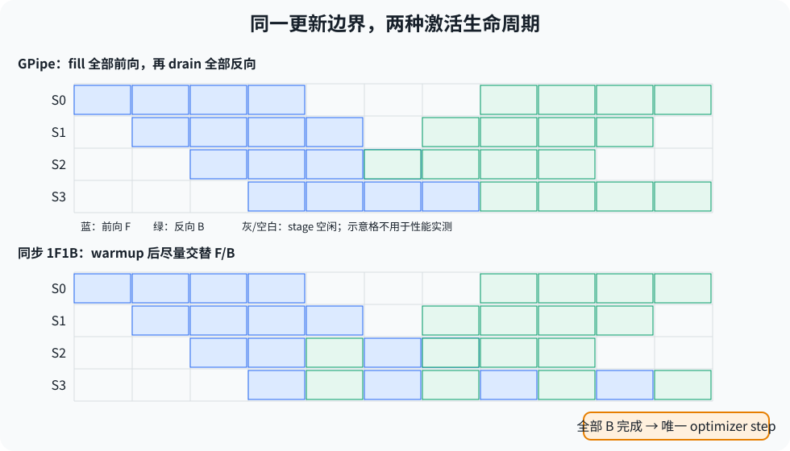{#fig-ch05-pipeline-schedules fig-alt="上半图的四行 stage 先按对角线执行四个蓝色前向，再按反向依赖执行绿色反向；下半图预热后蓝色前向与绿色反向交替，减少激活等待时间。两种调度的末端都标出全部反向完成后才执行唯一 optimizer step，空白格表示 bubble。" width="100%"}

#### Micro-batching与更新边界

设一次同步更新在一个pipeline副本内含$m$个micro-batch，每个micro-batch有$b_{\mathrm{micro}}$条序列。把它们依次注入pipeline，才能让不同stage同时处理不同micro-batch。PP没有创造新数据副本：固定等长且无尾批异常时，全局batch仍为

$$
B_{\mathrm{global}}=b_{\mathrm{micro}}\,m\,p_{\mathrm{DP}},
$$

这里$m$扮演该pipeline更新窗口内的累积次数；$p_{\mathrm{PP}}$不乘入样本数。所有$m$个micro-batch的梯度完成后才做一次同步optimizer step，loss仍按有效Token总和加权。若各stage在同一更新中使用不同版本权重，就不再是这里的同步语义。

::: {.callout-warning title="Stage 数不会创造更多独立样本"}
$p_{\mathrm{PP}}$ 只把同一个 micro-batch 依次送过不同层；它不应乘入 $B_{\mathrm{global}}$。只有 DP 副本处理了互不相同的数据，才增加同一更新窗口的独立样本数。
:::

#### GPipe：Fill-Drain

GPipe先让$m$个micro-batch全部完成前向（fill），再按反向依赖完成全部反向（drain），最后统一更新参数。它实现简单且保持同步mini-batch梯度语义；原论文还结合activation rematerialization控制保存量。[GPipe](https://arxiv.org/abs/1811.06965)

以$S=4,m=4$为例，用$F_k/B_k$表示第$k$个micro-batch的前/反向。pipeline先经历$F_1$从stage 0走到stage 3的填充；随后前向波连续流过；最后$B_4,\ldots,B_1$反向排空。最早stage在完成所有前向后，要等待末端开始并返回反向梯度；若不重计算或offload，它可能同时保留多个尚未反向的micro-batch激活，峰值随$m$增长。

#### 同步1F1B：Warmup—Steady—Cooldown

同步、带flush的1F1B（One Forward One Backward）先做足够的warmup前向填满依赖，随后每个stage尽可能交替执行一个前向和一个反向，最后cooldown排空剩余反向。它仍在$m$个micro-batch全部完成后统一step，因此没有异步pipeline的跨版本权重陈旧；不能把PipeDream等不flush调度的结论直接套入。[Megatron-LM流水调度，§2.2](https://arxiv.org/abs/2104.04473)

非交错1F1B在下述平衡模型中不必然减少总bubble，却显著缩短激活从前向到反向的存活队列：GPipe fill-drain的未完成激活可随$m$增长，而1F1B的在途数量主要由pipeline深度和stage位置限制，量级约为$O(S)$。实际峰值还取决于每层保存清单、重计算、通信buffer以及前反向时长。

#### Pipeline Bubble：明确口径的Bubble Ratio

为避免把不同“比例”混为一谈，作如下教学假设：$S$个stage完全平衡；每个micro-batch在每stage的前向时长为$t_f$、反向为$t_b$；相邻通信已计入对应stage时长；同步、非交错调度；不考虑数据输入、DP归约和optimizer时间。在GPipe或基础非交错1F1B下，填充/排空相当于$S-1$份前反向stage时间：

<a id="eq-05-pipeline-bubble"></a>

**式（05-Pipeline-Bubble）：同步非交错流水的理想化bubble**

$$
\begin{aligned}
t_{\mathrm{ideal}}&=m(t_f+t_b),\\
t_{\mathrm{bubble}}&=(S-1)(t_f+t_b),\\
t_{\mathrm{total}}&=(m+S-1)(t_f+t_b),\\
\rho_{\mathrm{bubble}}
&=\frac{t_{\mathrm{bubble}}}{t_{\mathrm{total}}}
 =\frac{S-1}{m+S-1},\\
\frac{t_{\mathrm{bubble}}}{t_{\mathrm{ideal}}}
&=\frac{S-1}{m}.
\end{aligned}
$$

$\rho_{\mathrm{bubble}}$是idle bubble占**实际总时间**的比例；$(S-1)/m$是bubble相对无bubble理想时间的开销，两者分母不同。取$S=4,m=8$，前者为$3/11\approx27.27\%$，后者为$3/8=37.5\%$。GPipe原论文给出的$O((S-1)/(m+S-1))$正对应前一口径；具体实现若前/反向不平衡、通信不重叠或stage不均，额外idle不能被这条理想式解释。

#### Memory vs Utilization

增大$m$可摊薄固定fill/drain，但并非免费：

- 固定$b_{\mathrm{micro}}$时，$B_{\mathrm{global}}$随$m$增大，学习率、更新次数和收敛口径要复核；
- 固定global batch时，增大$m$会缩小micro-batch，局部GEMM可能变窄、Kernel启动占比上升；
- GPipe保存的在途激活通常增多，可能需要重计算；1F1B降低激活队列，却仍有warmup/cooldown与stage边界buffer；
- $m$过小则bubble大，尤其当$S$深；stage负载不均会让快stage等待慢stage，即使$m$很大也不能消除。

实践中还可用交错1F1B让每设备承载多个非连续模型chunk以缩短bubble，但会增加stage边界通信和调度复杂度；本节不把该扩展的收益并入基础公式。选择PP度、层划分和$m$时，应同时最小化最慢stage时间、控制激活峰值并保持可接受的global batch，而不是只优化bubble比例。

本节没有运行多stage、GPU、P2P通信、GPipe或1F1B实验；时间线和比例均为明确假设下的理论调度账本，不是本机利用率或吞吐实测。

**理解检查。** 在$S=8,m=16$的基础同步模型中，bubble占总时间与相对理想时间开销分别是多少？若保持global batch不变而把$m$加倍，为什么bubble下降却可能使局部GEMM和激活显存呈现不同方向的变化？

<a id="sec-5-7"></a>

## 5.7 Sequence Parallelism 与 Context Parallelism

SP与CP都沿序列维放置激活，但解决的不是同一个问题。[5.7.1 Sequence Parallelism](#sec-5-7-1)服务于Tensor Parallel布局：在Norm、残差等逐Token区域保留序列分片，在Column/Row边界用All-Gather与Reduce-Scatter转换，Attention仍由本地TP头看到完整上下文。[5.7.2 Context Parallelism](#sec-5-7-2)则让上下文分片贯穿整个Block，并在Attention内部交换远端K/V、精确合并跨块softmax，以扩大单条序列可承载的长度。

选择时先问容量瓶颈在哪里：若主要是TP后非Attention激活的复制，SP可在不改变Attention算法的前提下降低常驻量；若单条长序列的Attention激活也放不下，则需要CP或其他真正分布式Attention。二者可以组合，但并行度、通信组、残差布局与反向collective必须联合设计；名称中都含“Sequence”不代表可以互换，两者不能互换，也不代表通信必然被计算隐藏。

@fig-ch05-sp-cp-contrast 把区别放回 Block 内部：SP 在逐 Token 区域保留 $T/q$，进入 TP 线性区前仍恢复完整序列；CP 则让本地 Query 始终只占 $T/c$，在 Attention 内交换远端 K/V，并把各块统计量合成一个全局 softmax。

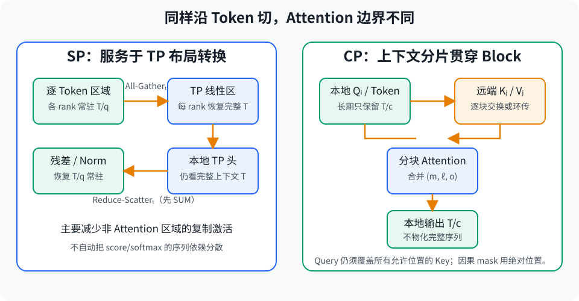{#fig-ch05-sp-cp-contrast fig-alt="左侧 SP 路径从 T/q 的逐 Token 分片经沿序列 All-Gather 变成每 rank 完整 T，TP Attention 后以 Reduce-Scatter 恢复 T/q；右侧 CP 路径让本地 Query 长期保持 T/c，远端 K/V 进入分块 Attention，在线合并 m、l、o 后仍输出本地 T/c。" width="100%"}

::: {.callout-important title="SP 不等于分布式 Attention"}
SP 的名称描述激活放置维度；在本节基础布局中，每个本地 TP 头仍处理完整 $T$。只有 CP 或其他分布式 Attention 方案把 Query/Key 的跨 Token 依赖也分到多个 rank。
:::

<a id="sec-5-7-1"></a>

### 5.7.1 Sequence Parallelism（SP）

Sequence Parallelism（SP）在一个Tensor Parallel组内，把部分激活沿Token/Sequence Dimension分片。它主要针对TP后仍复制的逐Token区域，例如贯穿模型的RMSNorm、残差加法及某些逐元素操作：这些算子对每个Token独立，rank只处理自己的连续或约定Token子集即可，参数仍可在TP组复制。

令$q=p_{\mathrm{TP}}$，为简洁假设$T$可被$q$整除。完整隐藏状态$\mathbf X\in\mathbb R^{B\times T\times d}$沿序列维写为$\mathbf X=\operatorname{Concat}_T(\mathbf X_0,\ldots,\mathbf X_{q-1})$，其中$\mathbf X_j\in\mathbb R^{B\times(T/q)\times d}$。RMSNorm沿最后的$d$维计算均方根，因此每个Token所需的$d$维仍完整，本地计算与未分片结果一致；它不需要跨Token统计。

<a id="eq-05-sequence-layout"></a>

**式（05-Sequence-Layout）：SP与TP计算区之间的布局转换**

$$
\begin{aligned}
\operatorname{AllGather}_T(\{\mathbf X_j\}_{j=0}^{q-1})
&=\mathbf X,\\
\operatorname{ReduceScatter}_T(\{\mathbf Z_j\}_{j=0}^{q-1})
&=\operatorname{Shard}_T(\mathbf Z),\\
\mathbf Z&=\sum_{j=0}^{q-1}\mathbf Z_j.
\end{aligned}
$$

第一行让每个 rank 得到完整序列；后两行表示先对同一输出 Token 的贡献求和，再让每个 rank 保留序列分片。这里$\mathbf Z_j\in\mathbb R^{B\times T\times d}$是Row Parallel产生的完整形状部分和。第二行不能解释为不归约的Scatter；所有TP rank对同一输出Token的贡献仍须相加。

#### 与Column—Row TP组合

基础布局可以按如下循环组织：

1. 隐藏状态以$B\times(T/q)\times d$常驻，RMSNorm与逐Token操作在本地序列分片上执行；
2. 进入需要每个TP权重分片处理所有Token的Column Parallel投影前，沿序列维All-Gather，得到每rank的$B\times T\times d$输入；
3. Attention头或SwiGLU中间区继续按5.5的特征/头维TP布局计算；
4. Row Parallel不再All-Reduce出复制隐藏状态，而用Reduce-Scatter在求和同时恢复$B\times(T/q)\times d$序列分片；
5. 残差两支必须采用相同序列分片边界，才能本地相加并进入下一RMSNorm。

All-Gather加Reduce-Scatter与基础TP的All-Reduce有相近的逻辑数据移动量级，但启动、复制、拓扑和重叠行为不同，不能据此保证同样墙钟时间。Sequence Parallelism原论文正是用这种布局减少不适合按隐藏维TP切分区域的激活复制，并与TP配合降低重计算需求；论文的具体节省和速度数字不作为本机结果。[Korthikanti等，Sequence Parallelism](https://arxiv.org/abs/2205.05198)

**8-Token布局例。** 取$B=1,T=8,d=4,q=2$、BF16。完整隐藏张量有32元素、64 bytes；复制布局是每rank 64 bytes，而SP常驻分片各为$1\times4\times4$、32 bytes。rank 0持Token 1–4，rank 1持Token 5–8；RMSNorm各自本地完成。投影前All-Gather暂时让两rank都看到$1\times8\times4$；Row Parallel之后，Reduce-Scatter求和并让两rank重新各留4个Token。这个32/64 bytes只计一个逻辑隐藏张量，不是Block峰值。

#### 哪些显存会降，哪些不会

若分片均匀，序列并行区域的常驻激活可从每rank $BTd$元素降到约$BTd/q$；残差、Norm输入/输出和逐Token dropout掩码等是典型候选。以下项目不会自动按$q$下降：

- TP线性区为计算临时All-Gather出的完整序列输入及其通信buffer；
- 本节布局下每个本地Attention头仍看完整$T$个位置，Attention score/softmax的序列依赖没有被SP分散；
- 参数、优化器状态和非序列形状临时量，除非另有TP/FSDP等分片；
- padding、不均匀Token数、分配器和collective工作区。

因此SP的“Sequence”指激活放置维度，不代表它已经解决长上下文Attention。下一节上下文并行（Context Parallelism, CP）才让不同rank长期持有不同上下文Token，并为Q访问远端K/V设计通信。

PyTorch当前SequenceParallel文档支持LayerNorm、Dropout和RMSNorm Python实现等兼容逐Token模块，输入/输出均保持sequence-sharded DTensor；API版本与模块支持范围会演进。[PyTorch SequenceParallel](https://docs.pytorch.org/docs/stable/distributed.tensor.parallel) 本机PyTorch 2.5.1没有运行该在线接口。

本节没有运行SP、DTensor、GPU、All-Gather或Reduce-Scatter；字节例和布局转换为理论复算，不报告实际峰值或性能收益。

**理解检查。** 对$B=2,T=4096,d=4096,q=8$的BF16隐藏状态，复制与均匀SP常驻分片各有多少逻辑bytes/rank？为什么这不能推出Attention score显存也缩小8倍？

<a id="sec-5-7-2"></a>

### 5.7.2 Context Parallelism（CP）

Context Parallelism（CP）把同一条长序列的Token及其激活长期分布到$p_{\mathrm{CP}}$个rank。令$c=p_{\mathrm{CP}}$且$T$可被$c$整除；rank $i$持有绝对位置集合$\mathcal I_i$及

$$
\mathbf Q_i\in\mathbb R^{B\times H\times(T/c)\times d_h},\qquad
\mathbf K_i,\mathbf V_i\in\mathbb R^{B\times H_{\mathrm{KV}}\times(T/c)\times d_h}.
$$

RMSNorm、线性投影、SwiGLU和残差等不跨Token的算子可直接在本地上下文分片上运行。模型权重并不会因CP自动切小：同一CP组通常复制权重，反向还须按所用DP/CP组合归约权重梯度；CP也不增加独立样本数，不能乘入$B_{\mathrm{global}}$。Megatron Core的当前说明把CP定义为沿序列维分片网络输入与全部激活，并把Attention列为需要额外跨rank处理的例外。[Megatron Core Context Parallel](https://docs.nvidia.com/megatron-core/developer-guide/latest/user-guide/features/context_parallel.html)

#### 为什么SP不能替代CP

| 问题 | 5.7.1的SP | 本节CP |
| --- | --- | --- |
| 主要目标 | 减少TP组内Norm、残差等非TP区域的激活复制 | 让整条长上下文的激活持续分布在多个rank |
| 典型边界 | Column前All-Gather完整序列，Row后Reduce-Scatter | Attention本身也按上下文分块，不能在进入Attention前永久恢复完整$T$ |
| Attention视野 | 每个本地TP头仍处理完整$T$个位置 | 每rank只保存本地Query，但须让它访问所有允许位置的K/V |
| 新通信 | TP布局转换 | 每层Attention的远端K/V交换及其反向通信 |

关键差别是Attention存在跨Token依赖。对rank $i$上的查询块，不能只计算$\mathbf Q_i\mathbf K_i^\top$；那会把其他rank的历史Token错误地当作不存在。它必须依次处理各rank的K/V块：

$$
\mathbf S_{ij}=\frac{\mathbf Q_i\mathbf K_j^\top}{\sqrt{d_h}}+\mathbf M_{ij},
\qquad j=0,\ldots,c-1,
$$

其中$\mathbf M_{ij}$必须用Query与Key的**绝对位置**构造因果可见性。某个块对某行完全不可见时应跳过或安全处理，不能对全$-\infty$行直接做softmax而产生NaN。

#### 分块Attention必须合并全局softmax

不同K/V块的局部softmax不能直接相加或平均，因为全局归一化分母跨越所有可见Key。对某一Query行，令当前K/V块$j$的分数向量为$\mathbf s_j$、Value为$\mathbf V_j$，定义块最大值$m_j$、块指数和$\ell_j$与未归一化输出$\mathbf o_j$。维护跨块运行状态$(m,\ell,\mathbf o)$：

<a id="eq-05-cp-blockwise-attention"></a>

**式（05-CP-Blockwise-Attention）：分块softmax的精确在线合并**

$$
\begin{aligned}
m_j&=\max(\mathbf s_j),
\\
\ell_j&=\sum_k e^{s_{j,k}-m_j},\\
\mathbf o_j&=\sum_k e^{s_{j,k}-m_j}\mathbf V_{j,k},\\[3pt]
m'&=\max(m,m_j),
\\
\ell'&=e^{m-m'}\ell+e^{m_j-m'}\ell_j,\\
\mathbf o'&=e^{m-m'}\mathbf o+e^{m_j-m'}\mathbf o_j,\\
\mathbf y&=\mathbf o/\ell.
\end{aligned}
$$

初始状态为$m=-\infty,\ell=0,\mathbf o=\mathbf0$；只在至少一个Key可见时输出$\mathbf y$。每次把旧块与新块都重缩放到共同最大值$m'$，所以最终结果与在全部可见Key上一次做softmax相同，且不必物化完整$T\times T$分数矩阵。

**标量复算。** 一个Query在块0上的分数为$[0,0]$、Value为$[1,3]$，在块1上的分数为$[\ln4]$、Value为$[5]$。全局softmax权重比是$1:1:4$，输出为$(1+3+4\times5)/6=4$。分别做块内softmax再等权平均会得到$(2+5)/2=3.5$，是错误结果。按上式，块0给$m_0=0,\ell_0=2,o_0=4$；合入块1后$m'=\ln4,\ell'=2/4+1=1.5,o'=4/4+5=6$，故$y=6/1.5=4$。

#### Ring Attention：让K/V块绕环移动

一种实现是Ring Attention。每个rank固定本地$\mathbf Q_i$和在线softmax状态，先处理本地$\mathbf K_i,\mathbf V_i$，再把当前K/V块发送给环上的下一rank、从上一rank接收下一块；经过$c$轮后，每个查询分片都处理过所有K/V块，只保留本地Query对应的输出。Liu、Zaharia与Abbeel提出的Ring Attention正是把长序列分到多设备，并将K/V块的环形传输与分块Attention计算组合。[Ring Attention原论文](https://arxiv.org/abs/2310.01889)

@fig-ch05-cp-ring-softmax 把“块在移动、Query 不移动”画成一条循环：每到一块 K/V，本地 Query 更新 $(m,\ell,\mathbf o)$；走完 $c$ 轮后只留下本地 Query 的输出，但归一化已经覆盖全部可见 Key。图中的环传是一种实现路径，不是 CP 的唯一 collective 契约。

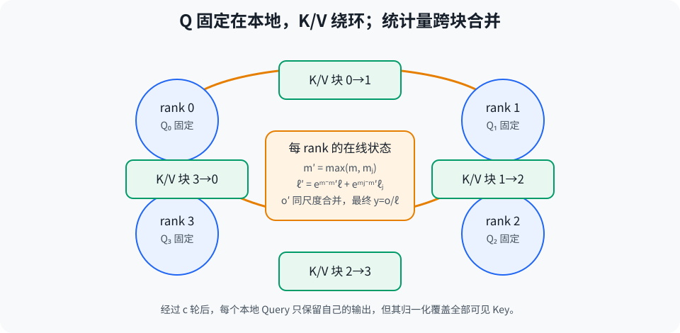{#fig-ch05-cp-ring-softmax fig-alt="四个 rank 位于环的四角，每个 rank 固定本地 Query；四个 K/V 块沿橙色箭头依次传给下一 rank。中央列出每收到一块便更新共同最大值 m、指数和 l 与未归一化输出 o，经过 c 轮后以 o/l 得到覆盖全部可见 Key 的本地输出。" width="100%"}

对最简单的单向ring，若每rank本地K与V合计为$M_{\mathrm{KV,local}}$ bytes，则前向每rank逻辑发送量与接收量各约为$(c-1)M_{\mathrm{KV,local}}$；这是忽略协议、padding与重发的算法数据量，不是链路实测。因果Attention可跳过完全位于未来的块内计算，但连续等长分片会让不同rank有效工作量不均；交错或zigzag位置分配可改善平衡，却会增加位置与布局管理复杂度。

反向还要把K/V及其梯度贡献送回正确所有者，可能采用再次环传、All-Gather/Reduce-Scatter或其他融合方案；具体时序属于实现契约。Megatron Core当前实现说明用点对点ring完成K/V交换，并在前向聚合K/V、反向对K/V激活梯度做Reduce-Scatter；GQA/MQA因为K/V头较少，可降低这部分通信量。这里不把某个框架版本的调度当作CP定义本身。

#### 长上下文收益与代价

CP的直接收益是每rank只常驻约$1/c$的序列形激活与本地Q/K/V块，从而让原本因激活容量无法放入单卡的长上下文成为可能。若精确全Attention且负载均衡，全局主要计算量并未消失，只是约分到$c$个rank；每rank计算主项可近似降到$1/c$，同时加入每层K/V通信、同步和buffer。Attention以外的参数、optimizer状态不会因CP本身下降。

是否有收益取决于计算块能否覆盖通信、K/V头数与dtype、互连拓扑、因果负载平衡、序列长度和与TP/PP/DP的组合。短序列、慢链路、小块或不平衡mask可能让通信与启动成本超过容量/并行收益；论文中“通信与计算完全重叠”是其算法和实验条件下的目标，不是任意硬件上的保证。CP组应优先放在能频繁交换K/V的高速互连域，并用目标shape的Profiler与逐rank时间线验证重叠。

本节没有运行CP、Ring Attention、多进程、GPU、P2P、All-Gather或Reduce-Scatter；公式和标量例是精确代数复算，通信量是明确假设下的逻辑账本，不是显存峰值、带宽或吞吐实测。

**理解检查。** 设$c=4$且每rank本地K/V块为64 MiB，在最简单单向ring前向中，每rank逻辑发送和接收各多少MiB？为什么把四个块各自的softmax输出取平均不能得到全局Attention，又为什么采用GQA可能降低通信却不改变Query必须覆盖全部可见Key的要求？

<a id="sec-5-8"></a>

## 5.8 Expert Parallelism（EP）（建议扩展）

::: {.callout-note title="选修扩展"}
本节把[2.7节](02-transformer.md#sec-2-7)单设备视角的MoE路由展开成跨设备数据布局；Dense层仍沿用全书的行向量约定，专家输入和输出维度均为$d$。
:::

### 专家分片：切的是专家编号，不是Token维度

设一层有$n_{\mathrm{exp}}$个路由专家，Expert Parallelism（专家并行，EP）组大小为$p_{\mathrm{EP}}=e$。在最简单且$n_{\mathrm{exp}}$可被$e$整除的放置中，rank $j$常驻$n_{\mathrm{exp}}/e$个完整专家；例如8个专家放到4个rank时，每rank放2个。这样专家参数的逻辑常驻量约降为全体专家参数的$1/e$，但Router、Attention、Norm、共享专家等非路由参数不会因EP自动变小。若单个专家本身仍放不下，须再用Expert Tensor Parallelism切专家矩阵；EP本身并没有沿$d$切一个专家。

每个源rank先对本地Token计算Router。对每个选中的专家，保存`(原Token索引, 全局专家编号, 路由权重)`，把一份$d$维隐藏状态按“目的rank→该rank内专家”稳定分组。Top-$k_{\mathrm{route}}$会让一个Token产生至多$k_{\mathrm{route}}$份路由副本；因此通信和专家batch应按**路由副本数**而非原Token数计账。专家计算完成后，必须按原索引反置换，并按2.7节定义的路由权重合并；仅把各rank返回张量拼接起来会破坏序列顺序，也会遗漏top-k加权。

### Dispatch、专家计算与Combine

令$n_{ij}$为源rank $i$送往目的rank $j$的路由副本数，$\sum_j n_{ij}$是源rank $i$的路由副本总数。Dispatch用可变split的All-to-All把隐藏状态送到专家所有者；目的rank按本地专家再次分组并执行若干个形状为`[tokens_for_expert, d]`的MLP。随后Combine用反向All-to-All把$d$维专家输出送回原源rank，再反置换和加权。[PyTorch All-to-All语义](https://docs.pytorch.org/docs/stable/distributed.html#torch.distributed.all_to_all_single)允许显式不等长split；[Megatron Core MoE指南](https://docs.nvidia.com/megatron-core/developer-guide/0.19.2/user-guide/features/moe.html)也把All-to-All列为标准EP的Token dispatcher，并明确专家计算后返回、合并成原序列。

@fig-ch05-ep-dispatch-combine 沿一份路由副本走完整个往返：Router 保存原 Token 索引、专家编号和权重；第一次 All-to-All 把隐藏状态送到专家所有者；第二次把专家输出送回源 rank。若省掉反置换或权重合并，即使矩阵 shape 正确，序列语义也已经错误。

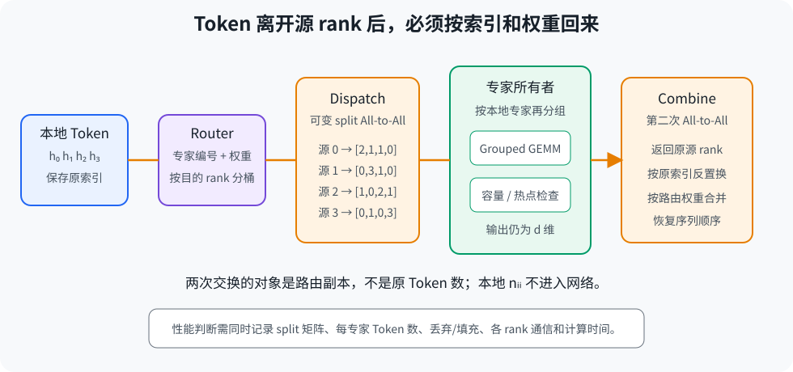{#fig-ch05-ep-dispatch-combine fig-alt="从左到右依次是本地 Token、保存索引和路由权重的 Router、带可变 split 矩阵的 Dispatch All-to-All、按本地专家分组的专家计算，以及返回原源 rank 的 Combine All-to-All；最后按原索引反置换并按路由权重合并。" width="100%"}

<a id="eq-05-ep-alltoall"></a>

$$
\begin{aligned}
M^{\mathrm{dispatch}}_{\mathrm{send},i}
  &=d\,s_h\sum_{j\ne i}n_{ij},\\
M^{\mathrm{dispatch}}_{\mathrm{recv},j}
  &=d\,s_h\sum_{i\ne j}n_{ij},\\
M^{\mathrm{dispatch+combine}}_{\mathrm{global}}
  &=2d\,s_h\sum_i\sum_{j\ne i}n_{ij}.
\end{aligned}
$$

式（05-EP-All-to-All）中$s_h$是通信隐藏状态每元素字节数；最后一式假设专家输出仍为$d$维且使用相同dtype，统计两次collective的全组**有向逻辑payload**。本地$n_{ii}$不进入网络。它不含路由元数据、对齐与padding、collective协议流量、反向传播、临时buffer和链路重复转发，因此既不是NIC字节计数，也不是峰值显存。

**局部玩具例子。** 取$e=4$、每rank有4个Token、top-1、每rank一个专家。路由计数矩阵（行为源rank，列为专家所在目的rank）为

$$
\mathbf N=\begin{bmatrix}
1&2&1&0\\
0&1&1&2\\
2&0&1&1\\
1&1&1&1
\end{bmatrix}.
$$

行和与列和都为4，所以每个源发出4份、每个专家收到4份，且每rank恰有3份跨rank。贯穿模型$d=4096$、BF16通信$s_h=2$ bytes时，每rankDispatch逻辑发送和接收各$3\times4096\times2=24{,}576$ bytes，即24 KiB；Combine相同，所以两阶段每rank发送48 KiB、接收48 KiB。全组两阶段有向payload为$2\times12\times4096\times2=196{,}608$ bytes，即192 KiB。它只验证布局与单位，没有运行All-to-All。

### 容量、负载均衡与设备利用率

设EP组本轮共有$R$份路由副本；若每个原Token固定选择$k_{\mathrm{route}}$个专家且没有提前丢弃，则$R=k_{\mathrm{route}}N_{\mathrm{tok}}$。固定容量实现常取

$$
C=\left\lceil\phi\frac{R}{n_{\mathrm{exp}}}\right\rceil,
$$

其中$\phi\ge1$为capacity factor，$C$是**每个专家**的槽位数。Switch Transformer给出的同类定义说明：容量过小会使热点专家溢出，增大capacity factor又会增加空槽、内存、计算与通信。[Switch Transformer §2.1–2.2](https://jmlr.org/papers/volume23/21-0998/21-0998.pdf) 例如16份top-1路由在4个专家上的负载为`[10,2,2,2]`，$\phi=1$时$C=4$，第一个专家有6份溢出；全组虽有16个槽位，其他专家的空槽也不会自动转给它。若取$\phi=2.5$，$C=10$可容纳全部路由，但40个槽位中24个为空。丢弃、改投、padding或dropless可变形状各有不同语义，必须随实现声明。

辅助负载损失、动态bias等方法只能鼓励更均匀的选择，不能保证每个micro-batch严格均匀。即使每个rank收到总数相同，rank内专家也可能一热一冷；同步步时间由最慢专家/rank决定。另一方面，细粒度专家的Token batch过小会使GEMM利用率低，常以Grouped GEMM、路由/置换融合和通信重叠改善，但重叠受依赖、buffer与互连限制，不能预设All-to-All完全隐藏。

### 与DP、TP和其他并行维组合

- **DP**复制一组模型并切独立样本；同一专家编号在不同数据副本中的梯度仍要按其数据并行组同步。EP切专家编号，不增加独立样本数，不能代入$B_{\mathrm{global}}$。
- **TP/Expert TP**切一个Dense层或一个专家内部矩阵；它解决单层/单专家容量，却增加层内collective。EP与TP的进程组可能重叠或折叠，GPU总数不能在未定义rank网格时机械乘积。Megatron Core当前指南要求其TP+EP配置启用Sequence Parallelism，这是该实现的配置约束，不是MoE数学定义。
- **PP**沿层深切分，某个含MoE的stage内部再建立EP组；stage负载还受MoE层数量和路由热点影响。CP切上下文，作用对象也不同。

EP在专家参数放不下、专家计算足以摊销路由与通信、且高速互连能承载两次交换时最有价值。专家很少、Token很少、top-k很大、跨节点链路慢或路由高度偏斜时，All-to-All、打包和小GEMM可能抵消稀疏计算收益。应记录每专家Token数、split矩阵、丢弃率、各rank计算/通信时间和端到端吞吐，再判断布局；不能仅凭“每Token激活参数少”声称训练更快。

本节没有运行MoE、Router、Grouped GEMM、多进程、GPU或All-to-All；路由矩阵、容量和字节数均为理论复算，不是显存、带宽或吞吐实测。

**理解检查。** 上例若把每个Token改成top-2，为什么路由副本数通常翻倍，却不能据此断言网络payload恰好翻倍？提示：检查本地$n_{ii}$比例、容量丢弃、dtype、padding和Combine输出布局。

<a id="sec-5-9"></a>

## 5.9 多维并行策略设计

单一并行维通常只解决一种约束：DP扩展独立样本，TP拆单层，PP拆深度，CP拆上下文，EP拆专家。真实方案要把它们组织成可验证的rank网格，并依次检查容量、整除性、通信关键路径、负载和拓扑，而不是从“GPU总数乘得出来”倒推配置。

- [5.9.1](#sec-5-9-1)给出简单笛卡尔rank网格、进程组组织以及CP/EP重叠时不能机械相乘的边界。
- [5.9.2](#sec-5-9-2)用贯穿模型比较两种128-GPU候选，从状态/激活、整除性、global batch、pipeline bubble与通信账本走完整个选择流程。

选择顺序是先满足“能执行”：单层与单stage容量、头数/FFN/层数整除、长上下文和专家放置；再比较“是否值得”：高频通信是否留在高速域、bubble与负载是否可控、额外分片或重计算是否解决了真实瓶颈。任何纸面方案最终都须在目标shape与集群上以相同测量协议对照，理论账本只负责排除明显不可行配置并提出可证伪假设。

<a id="sec-5-9-1"></a>

### 5.9.1 3D/4D Parallelism

多维并行不是把若干缩写相乘，而是同时回答三件事：每个张量沿哪一维切、每个collective在哪些rank上发生、每个rank属于哪些组。经典3D Parallelism组合DP、TP、PP：TP切层内矩阵，PP切层深，DP复制一个完整的TP×PP模型副本并切样本。长上下文再加CP，MoE再加EP，常被口头称作“4D/更高维”；维数名称不如明确rank网格可靠。

#### 简单笛卡尔网格与适用条件

只在各维彼此正交、覆盖同一world且每个rank恰有一个坐标时，设备数才能写成简单乘积。令坐标依次为$(i_{\mathrm{DP}},i_{\mathrm{PP}},i_{\mathrm{CP}},i_{\mathrm{EP}},i_{\mathrm{TP}})$，并让TP为最快变化维：

<a id="eq-05-parallel-rank-grid"></a>

$$
\begin{aligned}
N_{\mathrm{GPU}}
 &=p_{\mathrm{DP}}p_{\mathrm{PP}}p_{\mathrm{CP}}p_{\mathrm{EP}}p_{\mathrm{TP}},\\
u_1&=i_{\mathrm{DP}}p_{\mathrm{PP}}+i_{\mathrm{PP}},\\
u_2&=u_1p_{\mathrm{CP}}+i_{\mathrm{CP}},\\
u_3&=u_2p_{\mathrm{EP}}+i_{\mathrm{EP}},\\
r&=u_3p_{\mathrm{TP}}+i_{\mathrm{TP}}.
\end{aligned}
$$

式（05-Parallel-Rank-Grid）中的$u_1,u_2,u_3$只是把同一个row-major flatten过程分步写出，便于逐级检查坐标；这不是唯一编号实现。固定其余坐标、只枚举某一坐标，就得到对应parallel group。例如TP组固定DP/PP/CP/EP，只改变$i_{\mathrm{TP}}$；DP组则只改变$i_{\mathrm{DP}}$。全局batch仍只由$p_{\mathrm{DP}}$增加，TP、PP、CP与EP都不增加独立样本数。

MoE实现可能让Attention使用TP×CP×DP，而MoE层使用Expert-TP×EP×Expert-DP；不同逻辑维也可能共享同一批物理rank或采用parallel folding。这时不能把$p_{\mathrm{EP}}$再机械乘到已有GPU数上，必须分别列出Attention网格、MoE网格以及二者的rank映射。[Megatron Core MoE指南](https://docs.nvidia.com/megatron-core/developer-guide/0.19.2/user-guide/features/moe.html)当前文档也明确区分这两套映射。这是框架支持的一种实现，不改写本书前述各并行维的数学含义。

#### 32-GPU局部玩具布局

假设4节点、每节点8 GPU，取$p_{\mathrm{DP}}=2,p_{\mathrm{PP}}=2,p_{\mathrm{CP}}=2,p_{\mathrm{EP}}=1,p_{\mathrm{TP}}=4$，乘积为32。按上式，rank 11的坐标为$(0,1,0,0,3)$；它所在的TP组是$\{8,9,10,11\}$，CP组是$\{11,15\}$，PP组是$\{3,11\}$，DP组是$\{11,27\}$。这组整数只验证分组：TP的4个rank连续，TP与CP合计8个rank恰可放在一个节点；PP与DP通信跨节点。若改变flatten次序却不相应重建进程组，算法shape可能仍正确，但高频TP collective可能意外跨节点。

@fig-ch05-rank-grid 将 rank 11 的四个通信组放回物理节点。蓝色 TP 组与绿色 CP 伙伴都留在节点内；PP 和 DP 伙伴跨节点。这里的连线只表达组成员与相对频率优先级，不代表真实网络路由或带宽。

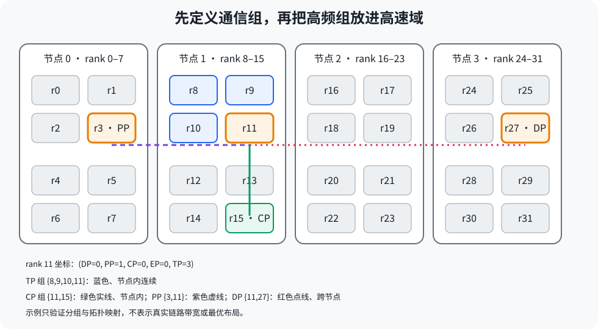{#fig-ch05-rank-grid fig-alt="四个节点各包含八个 rank。节点 1 中 rank 8、9、10、11 构成蓝色 TP 组，rank 11 与同节点 rank 15 构成绿色 CP 组；rank 11 还以紫色虚线连接节点 0 的 rank 3 作为 PP 伙伴，以红色点线连接节点 3 的 rank 27 作为 DP 伙伴。" width="100%"}

为避免“组建对了、布局错了”，配置至少逐维记录：

先登记“切什么、通信什么”：

| 维度 | 切分对象 | 典型通信 |
| --- | --- | --- |
| TP | 单层隐藏/头/FFN维 | 每层All-Reduce、All-Gather或Reduce-Scatter |
| PP | 连续层/stage | 相邻stage激活与梯度P2P |
| CP | 上下文Token | 每层K/V交换或collective |
| EP | 专家编号 | Dispatch/Combine All-to-All |
| DP | 独立样本副本 | 梯度/状态同步 |

再登记“放在哪里、启动前检查什么”：

| 维度 | 优先拓扑 | 关键约束 |
| --- | --- | --- |
| TP | 节点内低时延高带宽域 | $d,H,H_{\mathrm{KV}},d_{\mathrm{ff}}$与具体切法兼容 |
| PP | 相邻stage链路稳定 | 层数与stage负载可平衡 |
| CP | 长序列下优先高带宽域 | $T$与分块、mask兼容 |
| EP | 尽量限制跨慢链路的热点交换 | 专家放置、容量与路由可执行 |
| DP | 可放到相对较慢的外层网络 | 有效Token归一化和状态组一致 |

这只是优先级，不是绝对规则。消息大小、频率、是否重叠、节点内拓扑和NIC共享会改变最佳映射；“拓扑感知”的collective库也不能修复任意不良rank放置。[Megatron Core并行策略指南](https://docs.nvidia.com/megatron-core/developer-guide/latest/user-guide/parallelism-guide.html)给出各维的当前组合入口，但其中产品配置不能替代目标集群的拓扑检查和Profiler。

设计顺序通常是：先按单层/单stage容量确定最低TP和PP，再按上下文激活确定CP，MoE再定义EP/Expert-TP网格，最后把剩余设备用于DP；随后根据通信频率将TP、CP或EP优先映射到高速域，并复核PP负载和DP有效Token口径。更多维度可能降低某一项显存，却增加进程组、布局转换、buffer与checkpoint复杂度；短序列、小模型或慢互连上，4D不一定优于更简单的3D布局。

本节没有运行多进程、GPU、collective或拓扑基准；32-GPU例是rank整数映射，不是性能测量，也不宣称该布局对某个真实集群最优。

**理解检查。** 在上述32-GPU网格中，为什么$p_{\mathrm{CP}}=2$不能把$B_{\mathrm{global}}$再乘2？若节点内只有8卡，为什么让TP=4与CP=2占满节点只是候选方案，仍需测量而不能直接判定最优？

<a id="sec-5-9-2"></a>

### 5.9.2 实战：128 张 GPU 如何设计训练方案

本案例只做**理论方案评审**。假设集群有16节点、每节点8张80 GiB GPU；节点内有高带宽互连，节点间网络较慢。单卡低精度峰值暂取300 TFLOP/s，规划MFU取0.40，但两者均为假想输入，不对应具体产品或本机。训练使用贯穿模型：$P=5{,}802{,}037{,}248$，$L=32,d=4096,H=32,H_{\mathrm{KV}}=8,d_h=128,d_{\mathrm{ff}}=11008,V=32000$，最大序列长度$T=4096$；BF16权重与梯度、FP32 AdamW两状态、无FP32主权重。

::: {.callout-warning title="这是理论方案评审，不是 128-GPU 实测"}
下文所有 GiB、MiB、bubble、MFU 和天数都由明确假设复算。它们用于排除明显不可行方案和提出测量起点；在目标集群完成同协议对照前，不能据此宣称吞吐、工期或最优配置。
:::

#### 先证明能放下，再讨论速度

由[3.4节状态账本](03-compute-and-gpu.md#eq-03-state-memory)，未分片参数相关逻辑状态为$12P=64.842819$ GiB。任一布局若使模型参数在TP×PP的16个rank上理想均分，则每GPU的参数状态下界为

$$
\frac{12P}{16}=4.052676\ \mathrm{GiB}.
$$

这是假设各类状态与层能均匀分片的下界，不含Embedding/首尾stage不均、通信buffer、workspace、CUDA上下文和碎片。激活沿用3.4节明确的**假设情景**：$B=1,T=4096$时，完整32层的$c_{\mathrm{act}}=8$保存清单为8 GiB。仅按PP均分、暂不把SP或重计算收益算入时，PP=4约为2 GiB/GPU，PP=2约为4 GiB/GPU。因此两个候选的“状态下界+激活情景”分别约6.052676和8.052676 GiB；这远低于80 GiB，却仍不是峰值预测。

若使用ZeRO-1式optimizer分片，DP=8时理想逻辑状态可进一步写成

$$
\frac{4P}{p_{\mathrm{TP}}p_{\mathrm{PP}}}
+\frac{8P}{p_{\mathrm{TP}}p_{\mathrm{PP}}p_{\mathrm{DP}}}
=1.688615\ \mathrm{GiB},
$$

其中$4P$是BF16权重与梯度，$8P$是两个FP32 Adam状态。它省的是optimizer常驻量，不会把激活或TP临时聚合自动缩小。当前80 GiB假设下，ZeRO-1不是“能否启动”的必要条件，但可能为更大micro-batch或buffer留余量；ZeRO-3/FSDP还会加入更频繁参数聚合，不能只因显存更低就默认启用。

#### 两个乘积均为128的候选

固定每DP副本$b_{\mathrm{micro}}=1$、每次更新$m=a_{\mathrm{acc}}=16$个micro-batch，两方案均有$p_{\mathrm{DP}}=8$，所以[式（04-Global-Batch）](04-pretraining.md#eq-04-global-batch)给出$B_{\mathrm{global}}=1\times16\times8=128$条定长序列，即每次更新最多$128\times4096=524{,}288$个输入Token；有效目标Token仍须按mask另计。

两方案的 $p_{\mathrm{CP}}$ 均为 1，设备乘积均为 128。先比较并行度和层划分：

| 方案 | TP | PP | DP | 每stage层数 |
| --- | ---: | ---: | ---: | ---: |
| A：较浅TP、较深PP | 4 | 4 | 8 | 8 |
| B：较深TP、较浅PP | 8 | 2 | 8 | 16 |

再比较在同一假设下的资源与主要风险：

| 方案 | 状态下界 | 激活情景 | 主要风险 |
| --- | ---: | ---: | --- |
| A | 4.052676 GiB | 2 GiB | PP边界更多、bubble较大 |
| B | 4.052676 GiB | 4 GiB | TP组更宽、层内collective更重 |

整除性必须在启动前检查。方案A中$d/4=1024,H/4=8,H_{\mathrm{KV}}/4=2,d_{\mathrm{ff}}/4=2752,L/4=8$；方案B中$d/8=512,H/8=4,H_{\mathrm{KV}}/8=1,d_{\mathrm{ff}}/8=1376,L/2=16$，均为整数。方案B已把KV头切到每TP rank一个；再增大朴素TP会违反$H_{\mathrm{KV}}=8$的头分片约束，除非复制KV头或改算法。两方案的TP组都能放在单个8-GPU节点内：A可在节点内放两个TP组，B每节点一个TP组。

#### 通信、bubble与理论时间账本

对同步非交错pipeline，[式（05-Pipeline-Bubble）](#eq-05-pipeline-bubble)在$m=16$时给出：方案A的bubble占比为$(4-1)/(16+4-1)=3/19=15.789\%$，方案B为$1/17=5.882\%$。这只适用于平衡stage和相同前/反向时长；首尾层、数据等待或通信不均会改变结果。

每个micro-batch的未分片隐藏状态为$BTd s=1\times4096\times4096\times2=32$ MiB。若相邻stage按同TP索引传递隐藏分片，单rank消息在A/B中分别约8 MiB/4 MiB；按全TP组逻辑payload仍是每边界32 MiB。只计前向发送与反向梯度返回、忽略协议和重传，一个更新窗口跨全部PP边界的逻辑payload为

$$
2m(p_{\mathrm{PP}}-1)\times32\ \mathrm{MiB},
$$

即方案A为3072 MiB，方案B为1024 MiB/DP副本。它不是NIC计数，也没有计入pipeline重叠。

TP方向作一个同样明确的**简化前向账本**：假设每层Attention和MLP各有一次对32 MiB隐藏张量的ring All-Reduce等价操作，不启用SP且不计反向。每rank每micro-batch的调用数为$2L/p_{\mathrm{PP}}$；套用[ring通信式](#eq-05-ring-allreduce)的$2(p-1)/p$字节因子，A约为$16\times1.5\times32=768$ MiB，B约为$32\times1.75\times32=1792$ MiB。真实Megatron式TP、SP、融合与反向通信并非这一个公式；该账本只说明B用更低PP bubble换来了更宽、更频繁的层内通信。

若训练$D_{\mathrm{tok}}=10^{11}$个有效Token，[式（04-Train-Approx）](04-pretraining.md#eq-04-train-approx)给出Dense主项$3.4812223488\times10^{21}$ FLOPs。只有在128张假想设备仍能达到MFU 0.40时，[式（04-Train-Time）](04-pretraining.md#eq-04-train-time)才给出226,642.08秒，即2.623天。A与B的理论主项相同；通信、bubble和shape会改变实际MFU，所以不能用这个共同数字证明任一方案更快。

#### 初选、附加优化与验证门槛

在“80 GiB容量充足、8卡节点内互连明显快于跨节点网络”的假设下，先把**方案B作为测量起点**：TP=8完整留在节点内，PP=2减少边界和理论bubble，DP=8提供全局batch。这个选择是可证伪的工程假设，不是最优性结论。若8路TP的collective或小矩阵效率使其明显变慢，则回退方案A；A以TP=4换取更大局部GEMM和较窄collective，但承担更多PP边界和bubble。

SP可与TP配合减少非TP区域的复制激活；$T=4096$且上述容量情景有较大余量时，CP=1即可，不能为了“用满维度”强加CP。Activation Checkpointing应在实测激活峰值接近预算或希望增大micro-batch时再选择，其重计算账本留到5.10。ZeRO-1可作为optimizer状态优化；ZeRO-3/FSDP、offload或CP只有在对应状态、激活或容量瓶颈被证据确认后才加入。

最终决策至少采集：每stage allocated/reserved峰值，TP/PP/DP通信时间及是否重叠，pipeline空闲时间，每GPU有效Token/s，端到端MFU，梯度归一化一致性，以及不同micro-batch下的稳定性。若未在目标集群对A、B使用相同Token、步数、warmup和同步协议测量，就只能称它们“可行候选”，不能称B为最优。

本节没有128张GPU，也没有运行训练、NCCL、Profiler或故障演练；所有GiB、MiB、bubble和耗时均为按明确假设的理论复算。

**理解检查。** 两方案的TP×PP都等于16，为什么状态下界相同而激活情景、pipeline bubble和TP通信账本不同？如果实测B的MFU只有0.25，能否继续引用2.623天作为该方案工期？

<a id="sec-5-10"></a>

## 5.10 Activation Checkpointing 与训练显存优化

Activation Checkpointing（激活检查点，也称activation recomputation/rematerialization）解决的是**反向所需激活的存活时间**，不是模型参数本身。普通训练在前向保存反向公式需要的中间张量；检查点只保留选定边界，丢弃边界内部激活，反向到达该区域时重新执行一段前向，再立即用于求梯度。它以额外计算、可能重复的通信和更复杂的正确性约束换显存。

@fig-ch05-checkpoint-recompute 对比了两条时间线。无检查点时，早期 Block 的内部激活一直存活到对应反向；逐 Block 检查点只保存边界，反向到达某块前才重放该块前向。省下的是跨前反向长期保存的内部激活，不是参数、workspace 或重放瞬时张量。

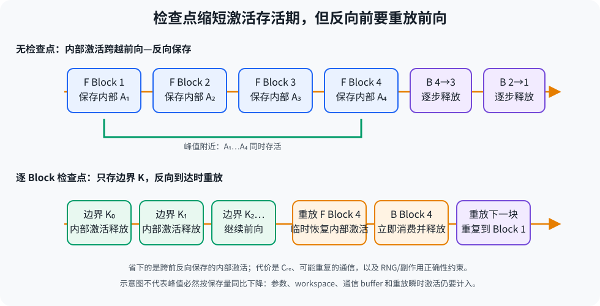{#fig-ch05-checkpoint-recompute fig-alt="上方无检查点路线依次执行四个 Block 前向并保存 A1 到 A4，峰值时多个内部激活同时存活，反向时逐步释放；下方逐 Block 检查点路线只保存边界 K，内部激活在前向后释放，反向到达每块时先重放前向，再立即求梯度并释放。" width="100%"}

### 显存—计算统一账本

设无检查点时前向、反向计算量为$C_{\mathrm f},C_{\mathrm b}$，被丢弃区域在重放时需要$C_{\mathrm{re}}$；设原本需跨前反向保存的激活集合为$\mathcal A$，仍保留的边界集合为$\mathcal K$。理想逻辑账本为

<a id="eq-05-activation-checkpoint"></a>

$$
\begin{aligned}
C'_{\mathrm{train}}&=C_{\mathrm f}+C_{\mathrm b}+C_{\mathrm{re}},\\
M'_{\mathrm{saved}}&=\sum_{a\in\mathcal K}\operatorname{bytes}(a),\\
\Delta M_{\mathrm{saved}}
&=\sum_{a\in\mathcal A}\operatorname{bytes}(a)
 -\sum_{a\in\mathcal K}\operatorname{bytes}(a).
\end{aligned}
$$

式（05-Activation-Checkpoint）只计被保存张量的逻辑容量；重放期间的瞬时激活、参数、通信buffer、workspace和分配器保留另计。若用常见教学近似$C_{\mathrm b}\approx2C_{\mathrm f}$，并令重放覆盖前向FLOPs比例$q=C_{\mathrm{re}}/C_{\mathrm f}$，则算术量相对增幅约$q/3$；全层重放$q=1$约增加33.3%的训练主项算术，而不是“训练时间必然增加33.3%”。实际墙钟还受Kernel、通信、重叠和shape影响。

**局部假设例。** 设32层在前向结束时每层需保存256 MiB内部激活，共8 GiB；每层输入边界为32 MiB。若逐层做完整Block检查点，理想化地只保留32个边界，即1 GiB，逻辑保存量减少7 GiB，同时所有Block在反向各重放一次，$q=1$。若选择性策略每层只丢弃128 MiB、且这些子模块占前向FLOPs的25%，则保存量减少4 GiB、$q=0.25$，主项算术增幅约8.33%。这些256/128 MiB是为了复算的假设清单，不是贯穿模型框架实测；真实选择必须从saved-tensor与峰值快照得到。

### 粒度：Block、分段与选择性重计算

- **完整Transformer Block。** 只保存Block输入，重放Attention、MLP、Norm及其内部。节省范围大，额外FLOPs也最大；若Block含MoE或CP，重放还可能重复All-to-All或K/V通信。
- **按分段/若干Block。** 保存段边界，反向时重放整段。边界更少，但重放时一段内部的瞬时激活可能同时抬高峰值；段长不是越大越好。
- **按子模块选择性重计算。** 只丢弃占显存大而重算相对便宜的中间量，例如某些Attention核心、激活函数或Norm输出；保留投影或通信昂贵部分。收益依具体Kernel和融合路径，不能凭模块名固定排序。

[Chen等人的sublinear-memory工作](https://arxiv.org/abs/1604.06174)给出了以重计算换中间特征内存的系统方法；[Megatron Core配置文档](https://docs.nvidia.com/megatron-core/developer-guide/0.19.0/apidocs/core/core.transformer.transformer_config.html)区分full与selective粒度。框架术语中的“full”通常指完整层重算，不代表重算整个模型。

### 正确性、随机状态与实现边界

重放函数必须在相同输入和持久状态下产生与原前向一致的语义。Dropout等随机算子需要保存/恢复RNG状态；依赖全局可变变量、原地修改、数据迭代器推进或有副作用的函数可能在重放时产生不同结果。PyTorch当前文档说明其checkpoint默认协调CPU与一种设备类型的RNG状态，并推荐显式使用非reentrant实现；但在线API晚于本机PyTorch 2.5.1，本节没有运行该接口，具体参数须按部署版本核验。[PyTorch activation checkpointing](https://docs.pytorch.org/docs/main/utils/checkpoint.html)

正确性验收至少比较：固定种子下无检查点与有检查点的loss、关键激活/梯度误差；一次optimizer更新后的参数；随机状态和数据读取位置；多步训练是否出现NaN或非确定偏差。只通过“没有OOM”不能证明梯度正确。

### 与TP、PP、FSDP、SP/CP/EP组合

- **TP与SP：** 分片可先降低每rank激活，检查点边界必须记录真实布局。重放若跨Column/Row转换，会重复All-Gather或Reduce-Scatter；SP与“分布式保存边界”是否兼容取决于实现。
- **PP：** 每stage只重算自己的层；重算会改变stage前/反向时长，可能破坏原本平衡并增加bubble。不同stage可按峰值选择不同层数，而不必全局同一比例。
- **FSDP/ZeRO-3：** 若重放时参数已reshard，可能再次触发All-Gather或延长参数常驻。须把参数物化、激活重放和梯度Reduce-Scatter放在同一时间线检查，不能把两种节省量简单相加。
- **CP：** 重算Attention可能再次交换远端K/V；长上下文下省激活更重要，但通信重放也更昂贵。
- **EP：** 重算整个MoE层可能重复Router、Dispatch/Combine和专家计算；通常先评估只重算专家内部激活的更窄边界。

### 显存不足时的选择顺序

先用[峰值生命周期账本](03-compute-and-gpu.md#eq-03-peak-memory)确认是参数状态、单算子、普通激活、长上下文Attention，还是临时workspace/碎片导致OOM。@fig-ch05-memory-decision-tree 把这些症状映射到不同路线：状态复制优先考虑ZeRO/FSDP；单算子过大考虑TP/PP；普通激活先降micro-batch再比较SP和重计算；长上下文进入CP和第6章的高性能Attention；workspace或碎片应调整实现边界，而不是盲目重算。

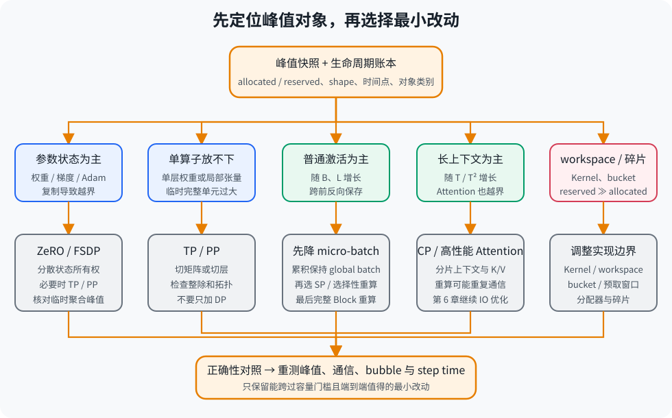{#fig-ch05-memory-decision-tree fig-alt="决策树从峰值快照和生命周期账本出发，分为参数状态、单算子、普通激活、长上下文、workspace或碎片五条路径，分别导向ZeRO/FSDP、TP/PP、降低micro-batch与SP或重计算、CP与高性能Attention、Kernel和bucket或分配器调整；所有路线最终汇合到正确性对照和重新测量峰值与步时。" width="100%"}

实施顺序是：建立无重算基线→记录逐类峰值和step time→选择最小能跨过容量门槛的边界→验证梯度等价→重新测量通信、bubble和吞吐→再决定是否扩大micro-batch。若模型本来已有充足余量，检查点只会增加工作；若重放区域通信昂贵或原前向已由FlashAttention等机制内部rematerialize，显式重复检查点也可能几乎不省峰值。

本节没有运行activation checkpoint、GPU训练、FSDP/TP/PP/CP/EP重放或显存测量；8/1/7/4 GiB及8.33%/33.3%均为明确假设下的逻辑复算。

**理解检查。** 某配置启用完整Block重算后，saved tensor减少7 GiB，但allocated峰值只降3 GiB，可能遗漏了哪些同时存活对象？为什么又不能把$q/3$直接当作墙钟减速比例？

<a id="experiment"></a>

## 本章实验

**目标。** 在2–8张GPU上对同一确定性小模型验证DDP与FSDP一步更新的一致性，并以Column/Row Parallel线性层验证TP布局；性能扩展另测，不以正确性小例的时间代表大模型。128-GPU部分直接复用[5.9.2理论案例](#sec-5-9-2)，不要求真实集群。

**GPU输入与环境。** [GPU脚本](../examples/ch05_gpu_parallel_demo.py)要求2、4或8个CUDA进程、PyTorch distributed、NCCL及每进程一张GPU；固定种子20261105，DDP/FSDP使用4入2出的FP64无偏置线性层，TP使用$8\times8$权重，因此可被2/4/8整除。脚本只做正确性，不计时。当前本机PyTorch 2.5.1+cu124，但CUDA不可用、设备数0，因此下列GPU命令**未运行**：

~~~bash
torchrun --standalone --nproc_per_node=2 \
  doc/examples/ch05_gpu_parallel_demo.py \
  --output doc/experiments/ch05_gpu_parallel.json
~~~

在目标GPU环境分别以2、4、8进程执行；每次记录GPU型号、驱动、PyTorch/NCCL版本、world size、dtype、输入shape、最大绝对误差。若增加性能测量，须另加预热、同步、至少20次稳态重复及中位数/P95，并报告每策略allocated/reserved峰值与有效Token/s。

**正确性标准。** DDP和FSDP从相同权重、相同rank局部batch及SGD配置出发，一步后的完整权重最大误差不超过$10^{-10}$；Row Parallel的SUM结果、Column Parallel的All-Gather结果与Dense矩阵乘最大误差不超过$10^{-10}$。任一rank失败、shape不整除、loss非有限或结果文件缺失均为FAIL。FSDP比较必须在受控full-param上下文中完成，不能比较局部分片的存储视图。

**本机低资源路线及实际状态。** [CPU脚本](../examples/ch05_distributed_correctness.py)先尝试2进程Gloo；两次均在进程组初始化阶段被沙箱socket权限阻止，未进入模型计算。随后实际运行单进程CPU代数模拟：

~~~bash
python doc/examples/ch05_distributed_correctness.py \
  --mode simulate --world-size 2 \
  --output doc/experiments/ch05_distributed_correctness.json
~~~

[原始JSON](../experiments/ch05_distributed_correctness.json)为PASS：模拟DDP平均梯度与串行global batch更新最大误差$1.39\times10^{-17}$，Row/Column分解误差分别$2.22\times10^{-16}$和0。它只验证公式代数，**没有运行distributed runtime、DDP/FSDP封装、GPU、NCCL或性能测试**。GPU脚本仅通过Python语法检查，运行状态仍是未运行。

**128-GPU替代任务。** 无大集群时，复算5.9.2两种布局的GPU乘积、状态/激活情景、$d,H,H_{\mathrm{KV}},d_{\mathrm{ff}},L$整除、global batch、pipeline bubble和通信payload；改变节点内卡数或有效带宽后写出选择是否翻转。理论表不得填入“实测吞吐”列。

<a id="exercises"></a>

## 本章小结与习题

分布式训练的中心不是设备数量，而是数据布局与关键路径。回看 @fig-ch05-memory-decision-tree，每条优化路线都应从一个可观察的峰值对象或等待位置出发，并在正确性对照后重新测量。

| 层次 | 学完本章后的检查标准 |
| --- | --- |
| 你现在应该知道 | DP切样本，ZeRO/FSDP切状态所有权，TP切层内矩阵，PP切层深，SP/CP切序列但Attention边界不同，EP切专家并交换路由副本 |
| 你现在应该能算 | 给定shape、dtype和并行度，复算每rank状态、collective逻辑payload、global batch、pipeline bubble、路由容量与重计算算术增量 |
| 你现在应该能判断 | 从容量、整除、通信频率、负载与拓扑证据中排除不可行布局，提出可证伪候选，并区分理论账本、CPU代数验证与目标集群实测 |

1. **基础理解。** 四个rank各有一个64 MiB同形状梯度张量。若目标是逐元素求和后让每rank只保留互不重叠的四分之一，应选哪个collective、每rank输出多大？若每rank都要完整和，又应选什么？
2. **手算与口径。** 设$b_{\mathrm{micro}}=2,a_{\mathrm{acc}}=8,p_{\mathrm{DP}}=4,T=2048$，另有TP=4、PP=2。求global batch序列数和每更新窗口的最大输入Token数；说明为什么TP/PP不进入global batch，以及变长/掩码训练还需记录什么。
3. **工程决策。** 同步非交错pipeline有$S=8,m=16$。求bubble占总时间比例及相对理想时间开销；若$m$增到32，bubble比例如何变化？为什么不能只据此增大$m$？
4. **开放探索。** 对贯穿模型尝试TP=16、PP=1、DP=8的128-GPU布局。检查$d,H,H_{\mathrm{KV}},d_{\mathrm{ff}},L$的朴素整除性，指出主要冲突，并给出一种无需复制KV头的128-GPU替代方案。若替代方案对50%前向FLOPs做重算，训练主项算术约增加多少？

[答案与提示](../appendices/exercise-solutions.md#solutions-5)

本章解决了“训练状态和计算怎样分到多张设备”，但通信账本也暴露了下一个问题：即使布局正确，Attention 仍可能因为 $T^2$ 中间量频繁往返 HBM 而变慢。第 6 章将保持标准 Attention 的数学结果不变，转而追踪 Kernel、Tile 和数据搬运，解释 FlashAttention 为什么能通过改变执行顺序减少慢层级 IO。

<a id="references"></a>

## 参考资料

本章使用 REF-061–089，覆盖 NCCL 拓扑定位、PyTorch collective 与分布式布局、ring All-Reduce、MoE、ZeRO/FSDP、pipeline、SP/CP/EP、多维并行及 activation checkpointing；按章节与主题的入口、具体阅读位置和限制见[参考资料附录](../appendices/references.md#refs-ch5)与来源台账。
