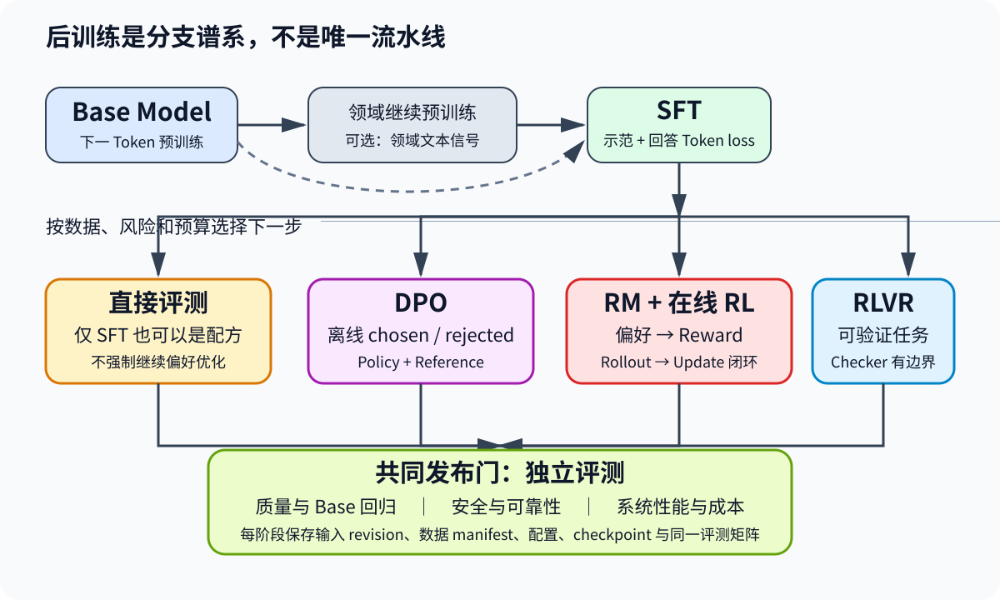
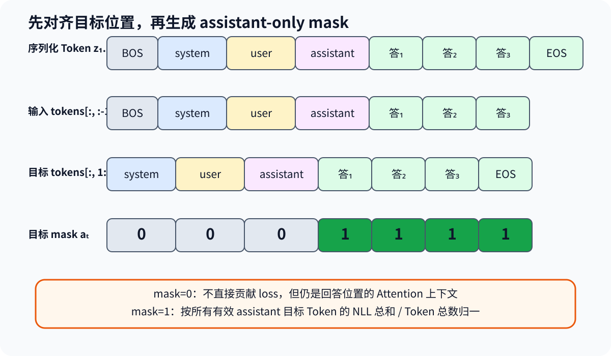
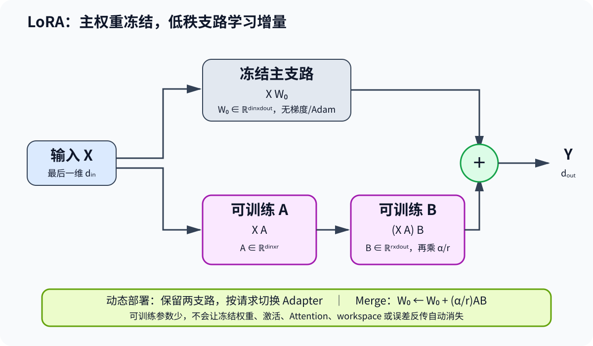
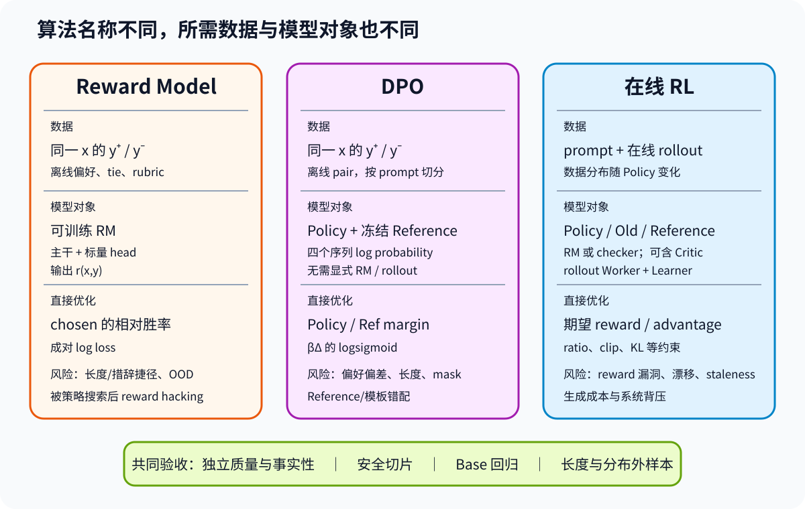
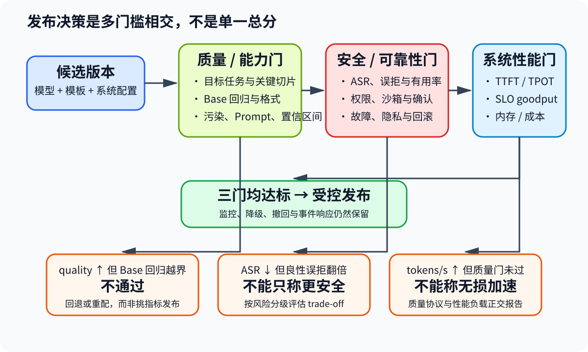

# 第 8 章 大语言模型微调、对齐与评测

[总目录](../index.qmd) · 上一章：[第 7 章](07-inference-serving.md) · 下一章：[第 9 章](09-frontiers.md)

一个Base Model已经能流畅续写。团队用5000条示范让它学会按角色回答，又用偏好数据减少冗长和无关输出；离线质量分数上升后，服务团队还发现它在某些语言上回退、遇到危险近邻请求时过度拒答，而且新解码配置改变了延迟。此时“训练完成”只是起点：究竟改了哪些参数、用了什么监督、哪些能力换来了哪些代价，必须逐阶段留下证据。

本章就沿一个Assistant候选的发布路径前进：

1. [8.1–8.2](#sec-8-1)先区分Base、SFT与后训练分支，并把消息模板、目标位移和assistant-only loss放到同一条Token序列上；
2. [8.3–8.4](#sec-8-3)再追踪Full FT、LoRA/QLoRA和偏好优化分别改变哪些参数、数据与模型对象；
3. [8.5–8.6](#sec-8-5)最后建立质量、安全、可靠性和系统性能的并列门槛，判断候选是否真的适合发布。

::: {.callout-note title="每一步都问三件事"}
改变了什么对象？监督或奖励来自哪里？什么独立证据允许进入下一阶段？训练loss、reward、Benchmark或吞吐中的任一个都只能回答部分问题。
:::

## 学习目标与前置知识

学完本章后，读者应能够：

1. 区分Base、SFT、偏好优化和在线RL各阶段的数据单元、目标与验收证据，画出不把某一配方误写成固定流水线的后训练谱系。
2. 从chat template构造assistant-only loss mask，并按有效回答Token而非micro-batch均值汇总SFT损失。
3. 在行向量约定下写出LoRA/QLoRA前向，计算给定target modules的可训练参数和参数状态payload，并说明低bit存储不等于所有计算低bit。
4. 写出Reward Model成对损失和DPO目标，解释Policy、Reference、chosen/rejected序列log probability及$\beta$的适用边界。
5. 为给定应用设计同时覆盖任务质量、统计不确定性、系统性能、污染/prompt敏感性和Base回归的评测矩阵。
6. 对Hallucination、Prompt Injection、Jailbreak和隐私风险建立威胁模型，联合报告攻击成功、正确拒答、误拒与良性有用性，而不是只给单一“安全分”。

必要前置是[第1章条件概率与损失](01-foundations.md#sec-1-3)、[第2章Transformer前向](02-transformer.md#sec-2-1)、[第4章训练循环与优化](04-pretraining.md#sec-4-2)和[第7章推理性能指标](07-inference-serving.md#sec-7-1)。8.1–8.6除明确标注外为核心；8.4.3在线RL为选修。贯穿模型仍采用全书固定的行向量、GQA、SwiGLU与绑定嵌入配置。

## 8.1 从 Pre-training 到 Post-training

预训练把大量文本压缩进条件语言模型$p_\theta(x_t\mid x_{<t})$，但“能续写互联网文本”不自动等于“会把用户输入解释为指令、遵守输出约束并在不知道时拒答”。**Post-training（后训练）**是在预训练权重之上，用更贴近目标交互的数据与优化信号改变模型行为、技能组合和输出分布。它不能补回训练数据中不存在的事实，也不保证消除幻觉、偏见或越权行为。

### Base Model与Instruction Model

**Base Model（基础模型）**通常指完成通用预训练或领域继续预训练、尚未针对助手交互完成系统后训练的模型。其核心训练样本是自然文本Token序列，目标是预测数据分布中的下一个Token；给它“请列出三点”时，数学上仍只是在该前缀后续写，可能生成答案，也可能续写网页、问答模板或另一条提问。

**Instruction Model（指令模型）**通常从兼容的Base Model继续训练，见过“指令/上下文→目标回答”、多轮角色模板、偏好比较或奖励信号。它仍是自回归语言模型，推理时仍使用[式（01-Next）](01-foundations.md#eq-01-next)的条件概率；变化主要来自训练数据、损失mask、优化目标与模板，而不是“Instruction”这个名称必然对应新网络结构。[FLAN](https://arxiv.org/abs/2109.01652)展示了在多任务自然语言指令上微调以改善未见任务的zero-shot行为；这是一种可核验的instruction tuning方案，不证明任意数据混合都能泛化。

两类模型必须绑定Tokenizer、特殊Token、chat template和权重revision。把Instruction权重套上不匹配的角色模板，或把Base Model直接当聊天助手调用，都会改变实际输入分布。模型卡中的`base`、`instruct`、`chat`、`assistant`也不是跨项目完全统一的质量等级；应看训练谱系和评测证据。

| 维度 | Base Model | Instruction/Post-trained Model |
| --- | --- | --- |
| 主要数据单元 | 文档或连续Token片段 | 指令—回答、多轮对话、偏好对、可验证任务轨迹 |
| 常见监督 | 所有有效目标Token的下一Token损失 | 回答Token监督、成对偏好、标量/规则奖励等 |
| 直接用途 | 继续预训练、研究、下游适配 | 助手交互或特定任务部署 |
| 仍需验证 | 领域建模与生成能力 | 指令遵循、质量、安全、校准和Base能力回退 |

“Instruction Model更好”必须补充任务与指标：它可能在目标指令分布上更符合偏好，却在某些续写、语言、领域或安全切片上退化。模型大小相同也不意味着训练后能力单调增加。

### Post-training要优化什么

后训练常同时追求几类目标：

- **指令遵循与格式控制：** 识别任务、角色、约束和停止条件，输出要求的语言、JSON schema或步骤。
- **对话能力：** 在多轮上下文中区分system/user/assistant内容，保持局部一致并正确处理澄清。
- **偏好与安全行为：** 在多个语义上可接受的回答中，提高被目标标注规范偏好的概率，降低有害、欺骗或不相关输出。
- **任务/领域适配：** 强化代码、数学、工具调用、企业术语或特定写作风格，同时监控通用能力回退。

这些目标可能冲突。例如更强的拒答策略会降低某些有帮助请求的完成率；格式严格可能牺牲解释性；优化单一奖励会诱发reward hacking。因而“对齐”不是一个无上下文的标量，必须声明谁的偏好、面向何种请求分布、允许哪些行为及如何处理冲突。

### 典型流程不是固定流水线

@fig-ch08-post-training-lineage 把一种常见谱系画成分支而不是单线：领域继续预训练可跳过，SFT之后可以直接评测，也可以按数据和风险选择DPO、显式RM加在线RL或可验证奖励路线。无论走哪条路，最终都回到同一组独立发布门。

{#fig-ch08-post-training-lineage fig-alt="Base Model可以直接或经过可选领域继续预训练进入SFT。SFT之后分为直接评测、离线DPO、Reward Model加在线RL、可验证奖励RLVR四条路线，所有路线最终汇合到质量与Base回归、安全与可靠性、系统性能与成本的共同发布门。"}

[InstructGPT](https://arxiv.org/abs/2203.02155)先用人工示范做SFT，再用模型回答排序训练Reward Model，并以PPO优化策略；[Tülu 3](https://arxiv.org/abs/2411.15124)公开了包含SFT、DPO与Reinforcement Learning with Verifiable Rewards（RLVR）的另一种分阶段配方。它们说明“后训练可以多阶段”，不构成所有模型必须执行SFT→RM→PPO或SFT→DPO→RLVR的定律。

实际系统可能只做SFT，可能跳过显式Reward Model而直接优化偏好对，也可能在代码/数学等可检查任务上加入RL，或多轮迭代数据生成、过滤和训练。阶段顺序还会受数据许可、质量、算力、线上风险和Base能力保持约束。每一阶段都应保存输入模型revision、数据manifest、训练配置、输出checkpoint及阶段前后同一评测矩阵，不能只保留最终模型。

::: {.callout-important title="论文配方不是阶段定律"}
“SFT→DPO”或“SFT→RM→PPO”描述具体系统的选择，不是Instruction Model的定义。复现或比较时必须逐阶段绑定输入checkpoint、数据版本、目标和验收结果。
:::

### 四类数据与监督边界

| 数据类型 | 最小记录 | 提供的信号 | 主要风险 |
| --- | --- | --- | --- |
| 预训练文本 | 文档、来源/许可、语言、时间、去重ID | 数据分布中的下一Token | 低质量、PII/版权、重复、评测污染 |
| 指令—回答示范 | instruction/context、response、角色模板、回答loss mask | “对这个请求应怎样回答” | 模板泄漏、风格单一、错误示范 |
| 偏好比较 | prompt、候选、chosen/rejected或完整排序、标注规范/一致性 | “哪些回答相对更受偏好” | 位置偏差、标注者差异、长度捷径 |
| 可验证奖励数据 | prompt、答案/轨迹、checker/test与版本、reward规则 | 可由规则或执行器检查的结果信号 | checker漏洞、奖励投机、只优化可测部分 |

预训练文本没有天然的user/assistant边界；指令数据要明确哪些Token计入损失，[8.2](#sec-8-2)将给出SFT mask。偏好数据不是两个独立“标准答案”，而是在同一prompt条件下的相对判断；[8.4](#sec-8-4)再定义Reward Modeling、DPO与RL。可验证奖励可以来自单元测试、数学答案解析器或规则检查器，但“检查通过”只覆盖checker编码的性质。[DeepSeekMath](https://arxiv.org/abs/2402.03300)是数学任务上使用奖励与GRPO的具体研究，不能据此把所有开放式写作都当成可自动验证任务。

**局部数据例。** 对请求“返回一个只含键`answer`的JSON，值为$2+3$”，四类记录可能分别是：教材中的普通算术句子；示范`{"answer":5}`且只对assistant部分计loss；同一prompt下将合法JSON排在带Markdown围栏的回答之前；以及执行JSON解析、键集合和数值等于5的checker。最后一种reward能验证格式和结果，却不能证明解释质量、事实覆盖或安全性。若checker错误地忽略额外键，模型可能学会利用该漏洞。

### 数据与阶段台账

每个数据集至少记录不可变版本/哈希、来源与许可、采集时间、语言/领域、样本数与有效Token数、过滤/去重、模板、训练/开发/测试切分、已知评测重叠和PII/安全处理。合成数据还要记录生成模型、prompt、采样参数与过滤器；人类数据记录标注指南、质量控制和聚合方式；在线策略生成的数据记录策略revision，避免把不同策略分布混成一个无版本数据集。

阶段验收不能只看训练loss。至少比较同一Base/SFT/偏好/RL checkpoint的：目标任务质量、指令/格式遵循、Base能力回归、安全与拒答、不同语言/长度/领域切片，以及训练数据未覆盖的未见集。开发集用于选配方，最终报告保留独立测试；污染检查和模板敏感性将在[8.5](#sec-8-5)展开。

本节没有训练或评测模型。流程图与JSON例是教学结构；论文中的偏好率、Benchmark和训练规模未复制为本书或本机实测。

**理解检查。** 某团队只有文档续写语料、5000条指令示范和一个能运行代码单元测试的题库。分别说明三者可支持哪种训练信号；为什么单元测试通过不能替代开放式对话的偏好与安全评测？若最终模型格式遵循提高但文档续写困惑度变差，应如何记录而不能只写“模型变好”？

## 8.2 Supervised Fine-Tuning（SFT）

**Supervised Fine-Tuning（监督微调，SFT）**从一个预训练或继续预训练checkpoint出发，用“给定上下文时应生成什么回答”的示范继续做teacher-forced next-token训练。它没有把生成改成分类器：训练时目标回答已知、各位置可并行计算loss；推理时仍需按已生成Token自回归解码。SFT教给模型的既有任务内容，也有模板、语气、长度、拒答和格式习惯。

### 从消息到一条因果序列

原始样本可表示为消息列表：

~~~text
system: You are a concise assistant.
user: Return 2+3 as JSON with key "answer".
assistant: {"answer":5}
~~~

**Chat Template（对话模板）**把角色与内容序列化为一个Token序列，例如

~~~text
<BOS><SYS>...<EOS><USER>...<EOS><ASSISTANT>{"answer":5}<EOS>
~~~

尖括号只是教学占位；真实控制Token、空格、换行、BOS/EOS和是否允许连续同角色消息由具体Tokenizer/revision决定。训练与推理必须使用同一模板语义。Hugging Face的[Chat Template官方文档](https://huggingface.co/docs/transformers/main/chat_templating)要求训练预处理使用模型模板并避免额外添加generation prompt；具体API会随版本变化，本书没有运行该在线版本。

模板实现至少验证：

- system/user/assistant/tool角色是否受支持，缺失system时如何处理；
- 用户文本中的控制Token样字符串是否被转义，不能让内容伪造assistant边界；
- 截断优先保留哪些轮次，是否会留下没有目标回答的样本；
- BOS/EOS是否重复添加，训练终止Token是否与推理停止规则一致；
- 模板文件、Tokenizer和模型权重是否作为同一revision发布。

### Assistant-only Loss Masking

令序列化后的Token为$z_{1:T}$，$a_t\in\{0,1\}$表示位置$t$的目标Token是否属于要监督的assistant区域。本书把assistant-only SFT损失定义为

$$
S_{\mathrm{NLL}}
=-\sum_{b,t}a_{b,t}
\log p_\theta(z_{b,t}\mid z_{b,<t}).
$$

$$
N_{\mathrm{asst}}=\sum_{b,t}a_{b,t}>0.
$$

$$
\mathcal L_{\mathrm{SFT}}
=\frac{S_{\mathrm{NLL}}}{N_{\mathrm{asst}}}.
$$

其中$S_{\mathrm{NLL}}$是所有被监督回答位置的NLL总和，$N_{\mathrm{asst}}$是有效assistant目标Token数。式（08-SFT-Loss）复用[有效目标Token平均损失](01-foundations.md#eq-01-loss)的口径。代码中输入通常为`tokens[:, :-1]`，label为`tokens[:, 1:]`；mask必须与**目标**位置一起左移，不能按未移位消息字符直接套到logits。prompt/system/user Token虽然$a_t=0$而不直接贡献loss，仍作为K/V上下文参与assistant位置的Attention和条件概率。

@fig-ch08-assistant-loss-mask 把这个容易错一位的操作展开：先由完整对话得到输入和左移后的目标，再在**目标行**标出回答Token。mask为0的Token没有消失，它们仍决定回答位置能够看到的上下文。

{#fig-ch08-assistant-loss-mask fig-alt="完整序列包含BOS、system、user、assistant角色头、三个回答Token和EOS。输入去掉最后一个Token，目标左移一位；目标mask只在三个回答Token和EOS处为1，其余为0。mask为0的上下文仍参与Attention，loss按所有mask为1的目标Token归一。"}

::: {.callout-warning title="mask 跟目标位置走"}
若logits预测`tokens[:, 1:]`，mask也必须对齐这些目标位置。直接把未位移的消息span套到logits上，会监督错Token；按micro-batch均值再无权平均，则会让短回答和长回答获得错误权重。
:::

是否只监督assistant并非数学定律。另一种SFT会对完整格式化序列计算loss，或给prompt Token非零权重；[关于Prompt Loss Weight的研究](https://arxiv.org/abs/2401.13586)专门比较了这些选择。多轮数据还需声明监督所有assistant轮次还是仅最后一轮，assistant角色头、工具调用、推理字段与EOS是否计入目标。模板若不提供可靠的assistant span，就不能凭Token字符串搜索边界。

**局部加权例。** 样本A有3个assistant目标Token，NLL为$0.2,0.4,0.6$，样本loss为0.4；样本B有2个目标Token，NLL为$0.1,0.9$，样本loss为0.5。正确批loss是$(1.2+1.0)/(3+2)=0.44$，不是无权平均$(0.4+0.5)/2=0.45$。若一个micro-batch全被截断为$a_t=0$，应丢弃/重组并报警，不能除零或把loss记0。

### Packing、截断与样本边界

SFT样本长度差异很大。Padding简单但浪费Token槽；Packing把多条短样本放入同一固定长度训练序列，提高有效Token比例。严格保持每条示范的独立条件分布时，需要block-diagonal causal mask、每样本position/sequence ID或等价机制，禁止后一个样本读取前一个样本。仅用EOS串接并允许跨样本Attention是另一种已定义的数据分布，不能悄悄称为独立样本Packing。

Packing还必须保留每个目标Token的$a_t$、原始sample ID与边界；分布式训练按全DP组的assistant有效Token总数归一化，不能先求各rank或micro-batch均值再无权平均。超过$T_{\max}$时记录截断前后Token数；若回答被完全截掉，该样本不再提供SFT监督。按长度排序可减少padding，但也会改变相邻样本和梯度顺序，应配合可复现shuffle。

### Full Fine-tuning与训练账本

**Full Fine-tuning（全参数微调）**让嵌入、所有Transformer层、归一化与绑定LM Head等全部可训练参数参与更新。前向结构和行向量约定不变；梯度、optimizer状态、混合精度、累积、裁剪与checkpoint顺序沿用[第4章训练循环](04-pretraining.md#sec-4-3)。全参SFT可以改变模型所有表示，适配自由度高，但参数/梯度/optimizer与激活内存接近预训练训练态，通信和checkpoint也覆盖全模型。第[8.3节](#sec-8-3)再比较只训练少量新增参数的PEFT。

训练配置至少记录Base checkpoint与Tokenizer哈希、可训练参数数/比例、dtype、optimizer/学习率与scheduler、global assistant Token batch、最大长度、Packing、梯度累积/裁剪、epoch/step、随机种子及恢复状态。用“每设备样本数”描述Batch不够，因为回答长度和mask会让有效监督Token数显著变化。

### 数据质量优先于简单堆量

高质量SFT样本应满足：指令可理解且覆盖目标任务；回答事实/推理/代码正确；角色和格式一致；拒答边界符合规范；多轮上下文自洽；来源许可、PII和安全处理可追溯。自动检查可验证JSON schema、编译/单测、引用存在性和模板往返，人审则覆盖开放式正确性、相关性和风格。

去重应同时考虑精确文本、近重复和模板化变体；train/dev/test泄漏与公开Benchmark数据污染要单列。合成回答记录teacher模型/revision、prompt、采样与过滤器，不能把同一teacher的系统性错误复制成“多数一致”。[LIMA](https://arxiv.org/abs/2305.11206)是在特定模型与评测上研究少量精心筛选示范的具体证据；它支持认真检验质量与多样性，不证明“1000条样本对任意模型都足够”。

### 遗忘、过拟合与行为退化

- **Catastrophic Forgetting（灾难性遗忘）：** SFT更新覆盖Base能力，表现为通用续写、语言、领域知识或少见任务回退。可降低学习率/步数，混入经治理的预训练或通用指令数据，使用参数高效方法，并逐checkpoint做Base回归评测；这些缓解也可能削弱目标适配。
- **Overfitting（过拟合）：** 训练loss继续下降而未见指令质量变差，模型复述训练答案、依赖模板表面特征。应用独立dev、近重复隔离、早停与多模板/未见任务切片，而不是只看epoch。
- **行为退化：** 回答趋同、过度冗长/简短、凡事拒答、丢失多语言或格式脆弱。它可能不反映在平均NLL中，需要长度、拒答、格式、事实、安全和人工/成对评测。

一个可信对照固定解码、模板和评测集，比较Base与多个SFT checkpoint的目标任务、通用能力、不同语言/长度、格式、拒答和安全切片，同时保存训练/验证的assistant Token加权loss。目标指标提高而Base回归越界时，应报告trade-off并回退/重配，而不是只挑改进项发布。

本节没有运行SFT、加载模型或生成训练曲线。0.44/0.45是确定性loss算术；论文实验结果未复制为本书或本机实测。

**理解检查。** 两个DP rank的assistant NLL总和/有效Token数分别为$(18,12)$和$(6,3)$。正确全局loss是多少，为什么不是两个rank均值的平均？若一条多轮样本只监督最后一轮assistant，前面user/assistant Token在Attention和loss中分别扮演什么角色？

## 8.3 Parameter-Efficient Fine-Tuning（PEFT）

Full Fine-tuning把适配自由度扩展到全部参数，也同步扩大梯度、优化器状态、通信和checkpoint成本。**Parameter-Efficient Fine-Tuning（PEFT）**固定大部分预训练参数，只训练较小的新增或选定参数集合。它限制的是“哪些参数可以更新”，不是免除Base前向、激活保存、Attention计算或部署兼容性；因此“可训练参数少”不能直接等同于“训练峰值显存按同比例下降”或“推理一定更快”。

本节聚焦同一条低秩更新路线的两级选择：[LoRA](#sec-8-3-1)以高精度冻结Base并训练低秩Adapter，适合先核对行/列向量方向、rank、target modules与Merge；[QLoRA](#sec-8-3-2)再压缩冻结Base的存储表示，但计算仍需反量化，LoRA、激活、梯度和optimizer并不因此全变成4-bit。两者可有相同的可训练参数量，差别主要在Base常驻表示、量化误差、Kernel支持和部署流程。

| 决策问题 | 优先考虑Full FT | 优先考虑LoRA | 优先考虑QLoRA |
| --- | --- | --- | --- |
| 更新自由度 | 需要全参数更新且资源允许 | 低秩子空间足以适配 | 低秩适配且Base常驻显存更紧 |
| 训练状态 | 接受全参数梯度/optimizer | 只为Adapter保存训练状态 | Adapter训练状态类似LoRA，Base改为量化存储 |
| 主要风险 | 成本、遗忘、分布式通信 | rank/目标模块不足、Adapter管理 | 叠加量化误差、反量化Kernel与fallback |
| 部署选择 | 完整checkpoint | 动态Adapter或高精度Merge | 量化Base+Adapter，或高精度Merge后重新量化 |

选择时先固定Base revision、Tokenizer/chat template、数据和评测，再比较目标质量、Base回归、峰值显存、step time与部署约束。若资源不足以跑同预算对照，应把结论写成方案推断而非实测。本节的具体算术都是配置账本；本机没有运行PEFT训练。

### 8.3.1 LoRA

Full Fine-tuning允许每个权重元素独立更新，却要为全模型保存梯度和optimizer状态。**Low-Rank Adaptation（LoRA）**提出一个受约束的替代：冻结预训练权重$\mathbf W_0$，只学习一个秩不超过$r$的增量。它减少的是可训练参数及其梯度/optimizer状态，不会让冻结权重、前向激活或Attention/KV计算自动消失。

### 行向量约定下的低秩更新

对本书线性层

$$
\mathbf Y=\mathbf X\mathbf W_0,\qquad
\mathbf W_0\in\mathbb R^{d_{\mathrm{in}}\times d_{\mathrm{out}}},
$$

LoRA前向定义为

$$
\Delta\mathbf W
=\frac{\alpha}{r}
\mathbf A_{\mathrm{LoRA}}\mathbf B_{\mathrm{LoRA}}.
$$

$$
\mathbf Y=\mathbf X(\mathbf W_0+\Delta\mathbf W).
$$

其中$\mathbf A_{\mathrm{LoRA}}\in\mathbb R^{d_{\mathrm{in}}\times r}$、$\mathbf B_{\mathrm{LoRA}}\in\mathbb R^{r\times d_{\mathrm{out}}}$，且$r\le\min(d_{\mathrm{in}},d_{\mathrm{out}})$；$\alpha$是scaling factor，$\Delta\mathbf W$的秩至多$r$。实际计算不必物化$\Delta\mathbf W$：先算$\mathbf X\mathbf A_{\mathrm{LoRA}}$得到最后一维$r$，再乘$\mathbf B_{\mathrm{LoRA}}$并缩放，与冻结主分支相加。

@fig-ch08-lora-branch 沿本书行向量约定画出两条支路。训练时只为紫色低秩支路保存可训练状态；误差信号仍要穿过冻结主算子。部署时可保留支路以动态切换Adapter，也可在足够精度中合并权重。

{#fig-ch08-lora-branch fig-alt="输入X分到两路：主路乘冻结权重W0；适配路先乘形状d_in乘r的A，再乘形状r乘d_out的B并缩放alpha除以r。两路相加得到Y。底部说明可动态保留Adapter支路，或把alpha除以r乘AB合并进W0。"}

原始[LoRA论文](https://arxiv.org/abs/2106.09685)采用列向量写法$\mathbf y=\mathbf W\mathbf x$，增量写成$\mathbf B\mathbf A$，其中$\mathbf A\in\mathbb R^{r\times d_{\mathrm{in}}}$、$\mathbf B\in\mathbb R^{d_{\mathrm{out}}\times r}$。原目录的“$\Delta W=BA$”沿用这一方向。转到本书行向量后，

$$
(\mathbf B\mathbf A)^\top
=\mathbf A^\top\mathbf B^\top
=\mathbf A_{\mathrm{LoRA}}\mathbf B_{\mathrm{LoRA}},
$$

两者是转置后的同一映射，不能在同一行向量公式里直接把$BA$照抄。PyTorch `Linear.weight`存为`[out_features,in_features]`，常见实现的`lora_A`为`[r,in]`、`lora_B`为`[out,r]`，对应列向量/存储方向；其前向转置关系仍等价于式（08-LoRA）。

### Rank、Scaling与初始化

单个目标权重的LoRA可训练参数量是

$$
P_{\mathrm{LoRA}}=r(d_{\mathrm{in}}+d_{\mathrm{out}}).
$$

$$
\frac{P_{\mathrm{LoRA}}}{d_{\mathrm{in}}d_{\mathrm{out}}}
=r\!\left(\frac1{d_{\mathrm{in}}}+\frac1{d_{\mathrm{out}}}\right).
$$

$r$增大时参数和两次小矩阵乘线性增加，可表达的更新子空间上界扩大；它不保证质量单调改善，也不表示最终$\Delta W$实际达到秩$r$。$\alpha/r$控制LoRA分支相对尺度；比较不同$r$时固定$\alpha$、固定$\alpha/r$或使用其他rank scaling会给出不同优化动力学，必须记录而不能只写“rank=8”。

常见初始化让一个因子随机、另一个因子为0，使训练开始时$\Delta W=0$而模型函数等于Base；若两个因子都初始化为0，两边的首步梯度也会同时为0。LoRA dropout若使用，通常施加在适配分支输入且只在训练启用；它不是低秩分解本身的一部分。学习率、weight decay和dtype也应对两个因子显式记录。

### Target Modules决定容量与行为

LoRA只作用于配置选中的线性层。常见目标包括：

- Attention的Q/K/V/O projection；Q/O为$d\times d$，本书GQA的K/V为$d\times(H_{\mathrm{KV}}d_h)=4096\times1024$，不能误按四个$d\times d$矩阵计数。
- MLP的gate/up/down projection；行向量形状分别为$d\times d_{\mathrm{ff}}$、$d\times d_{\mathrm{ff}}$和$d_{\mathrm{ff}}\times d$。
- 可选的embedding、LM Head或其他线性层；绑定权重、MoE专家和卷积等需要实现单独支持，不能由字符串匹配“all-linear”后假定语义正确。

Target越广，可训练参数与适配自由度越大，也增加训练/Adapter存储与部署算子。只改Q/V、改全部Attention projection或连同MLP都改是不同模型，质量和成本必须在同一数据/seed/预算下比较。模块选择还应保存完整规范名列表，检查每个预期模块确实注入且冻结主权重没有误解冻。

**贯穿配置账本。** 取$r=8$，若每层Q/K/V/O及gate/up/down七个线性层都加LoRA，每层形状和为

$$
2(4096+4096)+2(4096+1024)
+2(4096+11008)+(11008+4096)=71{,}936,
$$

故32层LoRA参数为$32\times8\times71{,}936=18{,}415{,}616$，约占全模型$5{,}802{,}037{,}248$参数的0.3174%。若只选Q和V，则为$32\times8\times[(4096+4096)+(4096+1024)]=3{,}407{,}872$，约0.0587%。这里没有给embedding/LM Head加LoRA。

### 显存收益与没有消失的部分

假设LoRA权重和梯度各BF16 2 bytes，Adam一阶/二阶状态各FP32 4 bytes，不另存FP32主权重，则七模块方案的可训练参数相关payload为$18{,}415{,}616\times12=210.75$ MiB；Q/V方案为39 MiB。该账本不含optimizer实现额外量化/分片，也不等于训练峰值。

冻结的Base权重仍需以其加载精度驻留或分片；前向/反向仍要保存或重算激活，LoRA分支也有中间量；长序列Attention、通信、Kernel workspace、allocator reserved和临时合并缓冲另计。冻结参数通常不保存其梯度和optimizer状态，但为了求LoRA梯度，误差仍需反传经过Base算子。因而“只有0.3174%参数可训练”不能直接推出总显存降低到0.3174%或训练加速相同比例。

::: {.callout-warning title="可训练参数比例不是峰值显存比例"}
LoRA主要省去Base梯度和optimizer状态；冻结权重、激活、Attention、通信、workspace和allocator reserved仍需单独计账。QLoRA进一步压缩的是Base存储表示，也不会把所有运行时状态变成4-bit。
:::

LoRA的另一收益是每个任务只保存Adapter和配置，而共享同一不可变Base；但Adapter必须绑定Base模型ID/revision、Tokenizer、目标模块、rank、alpha与偏置策略。把Adapter加载到形状相同但权重不同的Base上，不是可兼容部署。

### Merge与可逆部署

训练后可在足够精度中计算

$$
\mathbf W_{\mathrm{merged}}
=\mathbf W_0+\frac{\alpha}{r}
\mathbf A_{\mathrm{LoRA}}\mathbf B_{\mathrm{LoRA}},
$$

再用$\mathbf X\mathbf W_{\mathrm{merged}}$推理，省去独立LoRA分支的两个MatMul。Microsoft官方[loralib实现](https://github.com/microsoft/LoRA)支持在评估时合并及切回训练时反合并；具体库语义和多Adapter支持须按版本核验。

合并前应在同dtype/输入上比较未合并与合并logits误差，并保存Base与Adapter原件。低精度Base上直接原地相加会有舍入/饱和和重新量化问题，[8.3.2](#sec-8-3-2)再处理；多个Adapter同时合并还涉及权重、顺序、rank增长和冲突。合并后的完整checkpoint失去低成本切换优势，且若未保存来源manifest就难以追溯。未合并动态服务则要计Adapter加载、Batch内多Adapter调度和额外Kernel的实际代价。

本节没有训练、加载或合并LoRA，也没有测量GPU显存/吞吐。18,415,616、3,407,872、210.75 MiB与39 MiB是统一配置和显式dtype假设下的确定性账本；论文性能数字未复制为本书或本机实测。

**理解检查。** 对$\mathbf W\in\mathbb R^{1024\times4096}$取$r=16$，LoRA有多少可训练参数，是原权重参数的多少比例？若把$\alpha$从16改为32而rank不变，参数量是否改变，前向分支尺度如何变？为什么Adapter文件小不能证明训练峰值或延迟按同一比例下降？

### 8.3.2 QLoRA

LoRA减少可训练状态，却仍常以BF16/FP16保存整个冻结Base。**QLoRA（Quantized LoRA）**进一步把冻结Base权重以低比特码和量化元数据保存，在前向时按块反量化到计算dtype，同时训练高精度LoRA参数。核心边界是：4-bit描述Base的**存储表示**，不表示激活、LoRA、梯度、累加和optimizer状态都变成4-bit。

### 冻结4-bit Base、训练LoRA

对行向量线性层，令$Q_4$产生冻结权重的4-bit码与scale等元数据，$\mathcal D_c$把当前所需权重块反量化到计算dtype $c$。QLoRA前向可写成

$$
\widehat{\mathbf W}_0
=\mathcal D_c\!\left(Q_4(\mathbf W_0)\right).
$$

$$
\mathbf Y=\mathbf X\widehat{\mathbf W}_0
+\frac{\alpha}{r}\mathbf X
\mathbf A_{\mathrm{LoRA}}\mathbf B_{\mathrm{LoRA}}.
$$

$Q_4(\mathbf W_0)$在训练中冻结，不为量化码保存梯度或Adam状态；$\mathbf A_{\mathrm{LoRA}},\mathbf B_{\mathrm{LoRA}}$通常用BF16/FP16存储并更新，归约/optimizer状态按实现使用更宽精度。误差信号仍需穿过Base线性运算以得到$\nabla\mathbf X$和LoRA梯度。“backpropagate through a quantized model”不等于对离散4-bit码做优化器更新。

[QLoRA原论文](https://arxiv.org/abs/2305.14314)组合了4-bit NormalFloat（NF4）、Double Quantization与Paged Optimizer。NF4针对近似正态分布权重设计离散级别；它是论文的具体数据类型，不等同任意INT4/FP4。权重通常按block共享量化常数，因此4 bit/参数只是码payload，block scale、二级scale、对齐和未量化层必须另计。

**Double Quantization（双重量化）**再量化第一层量化常数，以减少scale元数据；收益依block大小、二级分组和存储格式，不能把论文报告的平均bit数硬套到其他实现。**Paged Optimizer（分页优化器）**利用统一内存/分页机制应对偶发的optimizer显存峰值；它不是让optimizer状态消失，发生主机—设备迁移时还可能增加延迟。是否可用及其行为由硬件、驱动和库版本决定。

### 存储精度不等于计算精度

一次QLoRA线性层至少涉及：

1. 从显存读取4-bit码和量化元数据；
2. 解包并按scale反量化到配置的`compute_dtype`；
3. 用该dtype执行Base MatMul及更宽/实现指定的累加；
4. 执行BF16/FP16 LoRA分支，合并两路输出；
5. 反向计算激活与LoRA梯度，但不更新Base码。

因此配置应分别写`storage_quant_type`、block/group size、double quant、compute dtype、LoRA dtype、accumulation/optimizer dtype，而不能只写“4-bit训练”。某些层、embedding、LM Head或归一化可能保留高精度；不支持的shape可能fallback。反量化可以与MatMul融合，也可能产生临时buffer，实际吞吐取决于Kernel、Batch、序列长度和硬件。低bit容量更小不保证训练更快。

### Full FT、LoRA与QLoRA的显存账本

沿用$P=5{,}802{,}037{,}248$和[7.8理想payload口径](07-inference-serving.md#eq-07-quant-storage)，比较同一七模块$r=8$ LoRA方案。只计参数相关payload，假设Full FT的权重/梯度各BF16、Adam两状态各FP32；LoRA权重/梯度与Adam状态合计12 bytes/可训练参数：

| 路线 | 冻结/主权重 | 可训练参数相关状态 | 该局部账本 |
| --- | ---: | ---: | ---: |
| Full FT | 已含在全参数状态 | $12P$ | 约64.843 GiB |
| BF16 LoRA | $2P$ | 210.75 MiB | 约10.807 GiB + 210.75 MiB |
| 理想4-bit QLoRA | $0.5P$ | 210.75 MiB | 约2.702 GiB + 210.75 MiB + 量化元数据 |

表中Full FT没有另加FP32主权重；若优化器或混合精度策略需要，须再计。QLoRA的2.702 GiB只是紧密4-bit码，实际还含scale/double-quant元数据、未量化层、解包buffer和allocator。三条路线都没有计激活、Attention矩阵/统计量、梯度检查点、通信、workspace、临时logits和数据，因此不是峰值显存预测。

QLoRA主要压缩BF16 LoRA仍需常驻的Base权重；LoRA与QLoRA的可训练参数数目可相同。若激活在长序列/大Batch下主导，4-bit Base节省不会按同一比例反映到峰值；Paged Optimizer只处理特定峰值也不能替代完整内存trace。

### 质量、速度与部署边界

量化在训练前已把$\mathbf W_0$替换为$\hat{\mathbf W}_0$，LoRA学习的是“在量化Base之上”的受限补偿。NF4、block size、哪些层保持高精度、rank/target modules、数据和训练预算都会影响最终质量。QLoRA论文在其模型/数据/评测上给出具体结果，但不能证明所有模型、任务或更低bit都等价于16-bit Full FT。

验收至少比较：相同Base revision、模板、数据顺序和预算下的BF16 LoRA与QLoRA训练/验证loss；目标任务、Base回归和安全切片；峰值allocated/reserved、step time、非有限值、fallback和实际低精度Kernel。只比较最终checkpoint大小不足以判断质量或训练效率。

部署有两种清晰路线：

- 保留量化Base和独立LoRA，要求推理后端支持相同量化格式与动态Adapter；
- 重新加载兼容的高精度Base，合并LoRA得到高精度权重，再按部署方案重新校准/量化并做质量回归。

不能把LoRA增量直接加到4-bit整数码上当作数学Merge；反量化—相加—重量化会引入新的舍入误差。Adapter还必须绑定量化前Base revision与目标模块。[官方QLoRA仓库](https://github.com/artidoro/qlora)和bitsandbytes文档给出具体实现入口，但版本、硬件支持与默认dtype会演进，本书未运行这些API。

本节没有加载4-bit模型、运行QLoRA、Paged Optimizer或GPU Kernel。64.843/10.807/2.702 GiB与210.75 MiB是显式假设下的静态payload账本；论文质量、显存和速度数字未复制为本书或本机实测。

**理解检查。** 若某4-bit checkpoint的码payload为2.702 GiB、scale/对齐与未量化层共0.35 GiB，LoRA训练状态为210.75 MiB，为什么三者之和仍不是训练峰值？把`compute_dtype`从BF16改为FP32会改变4-bit checkpoint大小、哪些运行时内存和数值行为？

## 8.4 偏好对齐（Preference Alignment）

偏好对齐处理“多个可生成回答中，目标规范更偏好哪一个”。本节沿信号到优化逐步展开：先用Reward Model把成对偏好拟合为标量差值，再用DPO直接优化离线chosen/rejected pair，最后以选修方式介绍需要在线rollout的PPO、GRPO与可验证奖励。三条路线都依赖数据分布与代理目标，不能用训练loss或reward单独替代独立质量、安全和回归评测。

阅读基础路线只需[8.4.1](#sec-8-4-1)与[8.4.2](#sec-8-4-2)；需要理解在线策略优化和推理—训练系统耦合时，再读选修[8.4.3](#sec-8-4-3)。

@fig-ch08-preference-objects 先固定三条路线的“物料清单”。RM与DPO都能从离线偏好对出发，但前者训练标量评分器，后者比较Policy相对Reference的序列概率；在线RL还要生成rollout，并处理Old Policy、reward/checker、版本滞后和Learner。

{#fig-ch08-preference-objects fig-alt="三列对照偏好方法。Reward Model使用同prompt的chosen和rejected训练标量模型；DPO使用离线偏好对、可训练Policy和冻结Reference计算序列概率；在线RL使用prompt和rollout，以及Policy、Old Policy、Reference、Reward Model或checker形成闭环。三列共同进入独立质量、安全和Base回归评测。"}

### 8.4.1 人类偏好与 Reward Modeling

### 从似然到相对偏好

Next-token pre-training学习语料中的条件分布，[SFT损失](#eq-08-sft-loss)学习示范回答的Token；两者都没有直接表达“同一请求的两个可接受回答中，哪一个更有帮助、诚实、安全或符合特定风格”。单个示范也无法区分“未被写出但同样好”与“应避免”。偏好对齐因此加入相对判断信号，但它学习的是给定标注规范、标注者与请求分布下的偏好代理，不是无条件的人类价值函数。

一个基本样本写成$(x,y^+,y^-)$：prompt $x$相同，$y^+$（chosen）在既定rubric下优于$y^-$（rejected）。生产数据还应保存候选模型/revision与采样参数、展示顺序、标注者组/时间、rubric版本、是否并列或跳过及安全升级理由。若两个回答来自不同prompt，差异可能由请求难度而非回答质量造成，不能直接当成同一成对比较。

[InstructGPT](https://arxiv.org/abs/2203.02155)让标注者对同一prompt的多个模型输出排序，再由排序构造成对比较；这是具体数据流程，不意味着所有偏好数据都只能二选一。$K$个候选最多产生$\binom K2$对，但这些对共享回答并高度相关，划分train/dev/test时应以prompt或完整排名组为单位，不能把同组pair拆到不同集合造成泄漏。位置、长度、语气、格式和模型身份都可能成为捷径；应随机化展示顺序、隐藏来源、保留并列/不可判断选项并报告标注一致性，而不是强迫每对都有“客观赢家”。

### 标量Reward Model与成对损失

Reward Model（RM）以prompt和完整回答为输入，输出序列级标量$r_\theta(x,y)\in\mathbb R$。一种常见实现从兼容的语言模型主干取得序列表示，再接标量head；究竟读取哪个位置、如何处理padding/EOS及长序列截断必须写入配置，不能把Token logits误当序列reward。

令数据集$\mathcal D$含$N>0$个偏好对，Bradley–Terry/逻辑成对模型令chosen胜出的概率为$\sigma(r^+-r^-)$，损失为

$$
\delta_\theta(x,y^+,y^-)
=r_\theta(x,y^+)-r_\theta(x,y^-).
$$

$$
\mathcal L_{\mathrm{RM}}(\theta)
=-\frac1N\sum_{\mathcal D}\log\sigma(\delta_\theta).
$$

第二式中的求和遍历$(x,y^+,y^-)\in\mathcal D$。只由差值决定意味着对同一prompt的两个reward同时加常数不会改变该pair的概率；绝对reward零点没有由这个损失识别。缩放差值会改变概率锐度，因此跨checkpoint比较reward均值还需校准与固定数据，不能把“8分”解释成可移植的回答质量单位。若有tie、强度等级或多维rubric，应明确扩展标签/损失，不能悄悄把tie任选一边。

**数值例。** 若$r^+-r^-=\ln 3$，模型预测chosen概率为$3/4$，单对损失$-\ln(3/4)\approx0.288$；若顺序标反而差值仍为$\ln3$，对应标签的损失为$-\ln(1/4)\approx1.386$。这只验证逻辑损失算术，不是模型实验。一个RM可在偏好准确率上较高，却通过长度或固定措辞捷径得分，仍不能证明它理解了事实与安全性。

### 偏差、泛化与Reward Hacking

偏好标签受rubric、标注者文化/专业背景、候选生成策略和时间影响。若训练候选都短且错误回答更短，RM可能把长度当正确性；若安全数据只含显眼关键词，它可能无法泛化到隐晦请求。验收应按prompt来源、任务、语言、长度、安全类别和候选模型分层，报告pairwise accuracy/log loss、tie与一致性，并在未参与训练的标注者和分布外候选上复核。高整体准确率不能掩盖关键安全切片失效。

当策略或best-of-$n$搜索反复最大化同一个RM时，会主动寻找代理模型的漏洞，出现**Reward Hacking / overoptimization**：代理reward继续上升，而独立人评、规则检查或更可靠的“gold”评估停滞甚至下降。[Gao等的受控研究](https://arxiv.org/abs/2210.10760)明确把proxy RM视为不完美代理并观察过优化关系；其合成gold RM设置是机制证据，不是本章系统的实测曲线。[Bai等](https://arxiv.org/abs/2204.05862)还展示了迭代收集新偏好数据、研究校准与分布外检测的一种路线，但这些措施也不能消除代理偏差。

工程上应冻结独立测试标注与安全红队集，限制策略偏离，监控reward分布/长度/重复/拒答等副指标，定期对高reward和分歧样本盲审，并用新候选压力测试RM。若更新RM，必须版本化数据与评分器，旧新策略在同一固定评测上重放；只报告被优化的RM分数属于循环验证。

::: {.callout-important title="被优化的 reward 不是独立验收"}
Policy、搜索或训练过程会主动寻找代理目标的漏洞。发布证据必须来自未参与优化的质量、事实、安全和回归评测，并同时检查长度、重复、拒答等捷径信号。
:::

本节没有采集人类偏好、训练Reward Model或优化策略。$0.288/1.386$是解析算术；引用论文的偏好率、reward曲线和模型规模未写成本书或本机实测。

**理解检查。** 为什么把同一prompt的10个候选生成的45个pair随机拆到train/test会造成泄漏？若RM验证准确率上升，但回答越长reward越高且独立事实核验下降，应如何区分数据偏差、Reward Hacking与真实质量改善？

### 8.4.2 Direct Preference Optimization（DPO）

**Direct Preference Optimization（DPO，直接偏好优化）**直接用离线偏好对更新策略，不先训练一个供后续策略优化使用的显式Reward Model，也不在训练环中从当前策略采样rollout。它把特定KL正则RLHF目标与Bradley–Terry偏好模型重参数化为二分类损失；“不用显式RL循环”不表示没有策略、参考分布、偏好假设或过拟合风险。

### 策略、参考策略与序列概率

令$\pi_\theta(y\mid x)$为待训练的条件策略，即同一自回归语言模型对完整回答$y=(y_1,\ldots,y_m)$的概率：

$$
\log\pi_\theta(y\mid x)
=\sum_{t=1}^{m}\log\pi_\theta(y_t\mid x,y_{<t}).
$$

这里只对回答Token求和，prompt提供条件但不计入回答log probability；角色头、EOS、工具字段和截断是否属于回答必须固定。$\pi_{\mathrm{ref}}(y\mid x)$是冻结的**参考策略（reference policy）**，通常取DPO开始前的SFT checkpoint。Policy与Reference必须使用相同Tokenizer、chat template、回答mask和序列边界，否则二者log probability之差混入预处理差异，不再是同一事件的概率比。

对偏好样本$(x,y^+,y^-)$，定义策略相对参考的chosen/rejected log-ratio及其差：

$$
a^+=\log\pi_\theta(y^+\mid x)
-\log\pi_{\mathrm{ref}}(y^+\mid x).
$$

$$
a^-=\log\pi_\theta(y^-\mid x)
-\log\pi_{\mathrm{ref}}(y^-\mid x).
$$

$$
\Delta=a^+-a^-.
$$

$\Delta>0$表示相对Reference而言，Policy更偏向chosen而非rejected；它不要求chosen的绝对log probability为正——离散序列概率不超过1，其log probability通常为负。

### DPO目标与Reference的作用

[DPO原论文](https://arxiv.org/abs/2305.18290)从KL正则的期望奖励目标出发。对$\beta>0$，相应最优策略可把奖励等价类写成

$$
r(x,y)=\beta\log\frac{\pi^*(y\mid x)}{\pi_{\mathrm{ref}}(y\mid x)}
+\beta\log Z(x),
$$

其中$Z(x)$只依赖prompt。在同一$x$下取两个回答的奖励差时，$\log Z(x)$消去；代入[8.4.1的成对逻辑模型](#eq-08-rm-pairwise)，得到

$$
\mathcal L_{\mathrm{DPO}}(\theta)
=-\frac1N\sum_{\mathcal D}\log\sigma(\beta\Delta).
$$

这里的求和仍遍历$(x,y^+,y^-)\in\mathcal D$，$\Delta$就是上文四个Policy/Reference序列log probability构成的差。因此DPO提高chosen相对Reference的优势、降低rejected相对Reference的优势，并由当前margin决定样本权重。Reference提供“从哪里偏移”的基准；它来源于KL正则推导，但这个离线成对损失本身不是对每个样本施加一个硬KL上限，也不保证训练后的实际KL固定。$\beta$在原推导中是KL惩罚系数，同时缩放DPO logit；改变它会改变目标锐度与梯度，不能脱离学习率、数据和实现把它简单称为“越大更新越强”或“越大越保守”。

**局部数值例。** 若Policy对chosen/rejected的序列log probability为$-2.0/-3.0$，Reference为$-2.5/-2.7$，则$a^+=0.5$、$a^-=-0.3$、$\Delta=0.8$。取$\beta=0.1$，模型给chosen的成对概率为$\sigma(0.08)\approx0.5200$，单对损失约$0.6539$。这是公式算术，不是一次DPO训练结果。

### 与SFT和显式RM+RL的边界

| 路线 | 训练记录 | 直接目标 | 训练时额外对象 |
| --- | --- | --- | --- |
| SFT | $(x,y^*)$示范 | 提高示范回答Token似然 | 无冻结Reference前向要求 |
| DPO | $(x,y^+,y^-)$离线偏好对 | 提高chosen相对rejected的Policy/Reference log-ratio差 | 冻结Reference的log probability，或等价的预计算值 |
| 显式RM+在线RL | 偏好数据，再加Policy rollout | 先拟合标量reward，再优化期望reward并控制策略漂移 | RM、Reference、rollout与策略优化状态，常还需价值估计 |

DPO省去显式RM和在线rollout环，但仍可继承偏好标签偏差、候选覆盖不足与分布外泛化问题；它也不能用偏好对学到标签从未区分的性质。SFT只拉高chosen示范并不显式使用rejected；DPO比较两者相对Reference的变化，也不是把rejected回答中的每个Token都标为错误。实践中常先SFT再DPO，是初始化与数据配方选择，不是DPO数学上强制的唯一流水线。

### 数据、长度与数值稳定性

同一pair必须共享完全相同的prompt字节和模板前缀；在pair内交换展示位置、保留tie/跳过信息，并按prompt或排名组切分数据。[8.4.1](#sec-8-4-1)讨论的长度、格式与标注者偏差不会因改用DPO而消失。若chosen系统性更长，序列log probability求和、截断与EOS策略可能形成长度相关信号；使用求和、每Token平均或额外长度正则是不同目标，必须登记，不能在复现实验时静默替换原始DPO的序列和口径。

实现时一次batch可把chosen/rejected拼接后同时送入Policy；Reference要在`eval`与无梯度状态下计算，且保持冻结。稳定实现先求四个序列log probability，再构造$\beta\Delta$并调用`logsigmoid`，不要先把很小的序列概率指数化后相除。要检查回答mask非空、PAD不计分、EOS策略一致、截断未把chosen/rejected裁成相同序列，并记录pair数、有效回答Token数、margin分布、梯度范数与非有限值。若预计算Reference log probability，须绑定Reference revision、Tokenizer、模板、dtype和预处理代码哈希。

验收不能只看DPO train/dev loss或pair accuracy。至少在独立请求上比较目标质量、事实性、格式/指令遵循、安全切片、不同语言与长度、Base能力回归，并报告相对Reference的经验KL或log-ratio分布；还要人工复核高margin、标签分歧和OOD样本。离线loss下降只说明更好拟合当前偏好对及其建模假设，不等于线上助手质量必然提高。

本节没有运行DPO、加载Policy/Reference、预计算log probability或进行模型评测。$0.5200/0.6539$是解析算术；论文的质量与稳定性结果未写成本书或本机实测。

**理解检查。** 若Policy和Reference都把chosen的log probability提高同样数值，而rejected项不变，DPO margin是否变化？为什么对chosen和rejected使用不同chat template会破坏log-ratio解释？若验证loss下降但长度切片与事实性退化，应补查哪些数据和评测证据？

### 8.4.3 RL-based Post-training（选修）

> **选修。** 本节建立在线策略优化的概念与成本边界；实现与大规模训练需要专门的RL和分布式系统知识。

### Policy—Rollout—Reward—Update闭环

RL-based Post-training把语言模型视为条件策略$\pi_\theta(y\mid x)$。对一批prompt $x$，当前或滞后的rollout策略采样回答$y$；Reward Model、规则checker或环境返回标量/分步奖励；算法把奖励转成advantage，再更新Policy，并用Reference KL、clip或其他约束限制单次漂移。更新后的Policy又产生下一批rollout，形成数据分布随参数变化的在线闭环。

这与[DPO](#sec-8-4-2)使用固定离线pair不同：RL能探索偏好数据没有覆盖的新回答，也会主动发现reward漏洞。一次样本至少绑定Policy/Reference/Reward/checker版本、prompt与采样参数、生成Token、终止原因、原始与分项reward、旧策略log probability及更新时间；否则无法判断一条轨迹究竟由哪个策略产生。

### PPO：限制旧新策略比率

令$\pi_{\mathrm{old}}$为收集rollout时冻结的旧策略，在生成Token位置$t$定义概率比$\rho_t(\theta)=\pi_\theta(a_t\mid s_t)/\pi_{\mathrm{old}}(a_t\mid s_t)$，$\hat A_t$为估计advantage。[PPO原论文](https://arxiv.org/abs/1707.06347)的一种clipped surrogate写成

$$
c_t(\theta)
=\operatorname{clip}\!\left(
\rho_t(\theta),1-\epsilon,1+\epsilon
\right),\qquad \epsilon>0.
$$

$$
u_t(\theta)=c_t(\theta)\hat A_t.
$$

$$
\mathcal J_{\mathrm{PPO\text{-}clip}}(\theta)
=\mathbb E_t\!\left[
\min\!\left(\rho_t(\theta)\hat A_t,u_t(\theta)\right)
\right].
$$

训练最大化$\mathcal J$。当更新把有利动作概率推得过远，clip分支截平该样本的继续收益；对负advantage方向则相应限制。它是surrogate中的局部保护，不是实际KL、reward提升或训练稳定性的数学保证。LLM RLHF通常还含价值函数/critic、advantage估计、Reference KL惩罚、entropy、reward whitening和多轮mini-batch更新；clip不能替代这些定义，也不能让过旧rollout无限复用。

### GRPO：组内相对基线

**Group Relative Policy Optimization（GRPO）**对同一prompt采样一组$G$个回答，以组内reward形成相对优势，从而避免为每个状态训练独立价值模型。用最简单的outcome-reward教学形式，若$G>1$且$\epsilon_A>0$，可写

$$
\bar r=\frac1G\sum_{i=1}^G r_i.
$$

$$
s_r=\sqrt{\frac1G\sum_{i=1}^G(r_i-\bar r)^2}.
$$

$$
\hat A_i=\frac{r_i-\bar r}{s_r+\epsilon_A}.
$$

随后用PPO式ratio/clip与KL项更新各回答Token。[DeepSeekMath](https://arxiv.org/abs/2402.03300)提出的GRPO还讨论outcome/process supervision和迭代训练；上式只抽取组归一化核心，不等于复现其完整算法。组内advantage依赖同prompt采样分布：若所有reward相同，分子为0，该组没有相对学习信号；$G$、采样温度、reward尺度、是否按Token广播及标准差口径都会改变更新，必须记录。

GRPO减少critic模型及其训练状态，却通常需要每个prompt生成多个回答；“省critic显存”不等于降低总rollout FLOPs、KV Cache或墙钟。组内归一还会丢失跨prompt的绝对难度尺度。算法名称也不能保证避免reward hacking、mode collapse或长度偏差。

### Verifiable Reward的适用边界

数学最终答案解析、代码单元测试、编译/执行结果、结构化格式和某些工具环境状态可由程序给出**Verifiable Reward（可验证奖励）**。Tülu 3把这类阶段称为Reinforcement Learning with Verifiable Rewards（RLVR）；它说明了一种具体配方，而不是所有能力都能自动验收。

checker必须版本化输入规范、容差、超时、沙箱、隐藏测试与部分分规则。测试通过只证明被checker编码的性质：弱测试可能接受硬编码、未处理边界或利用解析器漏洞；只验最终答案可能奖励错误推理碰巧猜中。开放式帮助性、事实解释、安全权衡和审美通常没有唯一自动判定器，不能伪装成二值“真值”。应保留独立隐藏checker、人评与安全切片，并对高reward轨迹做漏洞审计。

### 系统成本与训练稳定性

在线RL同时牵涉生成与训练两类负载：rollout偏低时延/高Token吞吐和KV Cache容量，learner偏大Batch反向与优化器状态；权重广播、版本滞后和队列背压把二者连接起来。成本账本至少分开记录rollout Token、每prompt样本数、平均输出长度、Policy/Reference/RM或checker前向、learner Token、拒绝/超时、权重同步字节和端到端墙钟，不能只报optimizer step/s。

训练监控至少包括原始/分项reward、Reference KL、entropy、clip fraction、ratio、advantage均值/方差、长度、重复、终止原因、梯度范数和独立评测。reward上升而KL、长度或格式异常，可能是策略漂移或奖励投机；非有限ratio常提示旧新log probability、mask、dtype或版本错配。更新前应验证rollout来自声明的$\pi_{\mathrm{old}}$，并为staleness设上限。

本节没有运行rollout、PPO、GRPO、RLVR、Reward Model或checker；没有GPU/服务实测。公式是论文机制的教学抽象，引用论文的质量、显存与吞吐结果未写成本书或本机结果。

**理解检查。** PPO clip为何不是硬KL约束？同一prompt的8个回答reward全相等时，上述GRPO advantage是什么？一个代码checker只有公开样例时，reward升高为何可能不代表泛化，应该增加哪些独立验收？

## 8.5 LLM 评测体系

训练loss回答“模型对当前目标Token赋予多大概率”，评测则回答“在声明的任务、输入分布、提示、解码与评分规则下，系统表现如何”。二者相关但不等价：验证NLL下降可能来自更好地拟合文体或常见Token，却不保证数学答案、代码执行、指令遵循或安全行为改善；相反，格式错误也可能让语义正确的回答在Exact Match下记0分。

一次可复现评测不是“模型名+分数”，而是至少包含：模型与权重revision、Tokenizer/chat template、数据集版本与切分、prompt/few-shot示例、最大长度、采样或贪心参数、输出解析器、评分器/checker或Judge版本、随机种子、样本级结果、聚合方式和置信区间。只改变其中一项，就可能形成不同实验。

@fig-ch08-evaluation-gates 把评测放回发布决策：质量、能力与Base回归是一道门，安全、可靠性与模型外权限是一道门，系统SLO与成本又是另一道门。三者应正交报告，不能先压成一个总分再掩盖失败切片。

{#fig-ch08-evaluation-gates fig-alt="候选模型和系统配置依次接受质量能力门、安全可靠性门和系统性能门。质量门检查任务、Base回归、污染和不确定性；安全门检查攻击成功、误拒、有用性、权限和故障；性能门检查TTFT、TPOT、SLO goodput、内存和成本。三门都达标才进入受控发布。"}

### Perplexity与任务指标测量不同对象

[式（01-PPL）](01-foundations.md#eq-01-ppl)定义$\operatorname{PPL}=\exp(\mathcal L)$，其中$\mathcal L$是有效目标Token平均NLL。它适合检查模型对固定文本分布的预测拟合和训练回归，但跨Tokenizer、不同切块/上下文、不同mask或语料不能直接比较。PPL不读取生成后的事实正确性、程序执行结果或用户偏好；一个模型可以降低参考答案措辞的PPL，却仍在自由生成时选择错误答案。

任务指标必须与任务单位对齐：分类可用accuracy、macro/micro F1与校准；抽取或短答案可用归一化Exact Match（EM）；数学可解析最终答案并另查推理；代码须在隔离环境运行隐藏测试；开放问答可结合规则、人工与经过校准的Judge。每项指标都只覆盖其评分器编码的性质。应保存失败类别和样本，而不是只保留宏平均。

**局部例。** 两个模型在同一100题集合上均答对80题，但A、B答错的题完全不同；单看80%无法说明它们可互换，也无法判断5题安全关键子集。报告应给逐样本配对结果、关键切片和不确定性。若同一题反复采样，样本也不是100个新的独立题目。

### 能力维度与经典Benchmark

知识、推理、数学、代码、指令遵循、长上下文、多语言、工具使用和安全不是一个标量维度。评测矩阵应由目标使用场景反推，并保留Base能力回归；对某一公开集优化后提升，只能证明在该协议下的表现变化。

| Benchmark | 主要对象与典型评分 | 能说明什么 | 不能单独说明什么 |
| --- | --- | --- | --- |
| [MMLU](https://arxiv.org/abs/2009.03300) | 57个学科的多项选择题；按题/学科accuracy | 学术与专业知识、问题求解的广度切片 | 开放式帮助性、生成事实性、真实工作流或安全性 |
| [GSM8K](https://arxiv.org/abs/2110.14168) | 约8.5K道小学数学文字题；通常解析最终数值Exact Match | 特定难度与语言分布下的多步算术推理 | 高等数学、证明可靠性；只验终值也不能保证过程正确 |
| [HumanEval](https://arxiv.org/abs/2107.03374) | 164个手写Python函数问题；隐藏单元测试与pass@$k$ | 从docstring生成小函数并通过给定测试的功能正确性 | 大型仓库修改、安全性、性能、可维护性或测试未覆盖行为 |

这些名称必须连同版本和协议报告。例如MMLU的zero-shot、few-shot、直接选项概率、生成字母后解析不是同一测量；GSM8K是否允许Chain-of-Thought、工具和多次采样也会改变任务；HumanEval必须记录语言/runtime、超时、沙箱、样本数$n$与$k$。论文原始数据规模描述用于界定范围，论文模型分数不作为本书或本机结果。

### Exact Match、pass@$k$、Judge与人评

**Exact Match**先用预先声明的规范化器处理预测与参考，再判断完全相等。规范化可包括空白、大小写、Unicode或数值格式，但不能在看到结果后为某个模型定制；别名、多答案和数值容差须在评测前固定。EM精确而可复算，也可能把等价表达判错。

对每道代码题独立生成$n$个候选，其中$c$个通过测试；从$n$个候选中不放回抽取$k$个，至少一个通过的无偏组合估计为

$$
\widehat{\operatorname{pass@}k}
=1-\frac{\binom{n-c}{k}}{\binom nk},
\qquad 1\le k\le n.
$$

若$n-c<k$，失败组合数为0，估计值为1。例：$n=10,c=2,k=3$，则$1-\binom{8}{3}/\binom{10}{3}=1-56/120\approx0.5333$。这不是单次只生成3个候选后的“实测成功率”，而是在已有$n$个候选上的组合估计；候选必须来自声明的同一采样协议，执行不可信代码必须使用资源受限沙箱。pass@$k$随采样预算增加，不能与pass@1混为同一成本。

**LLM-as-a-Judge**可按rubric对开放回答打分或成对比较，扩展性高，但Judge自身是有偏测量器。[MT-Bench/Chatbot Arena研究](https://arxiv.org/abs/2306.05685)讨论了位置、冗长、自增强和推理能力等偏差。实践中应冻结Judge模型/revision、rubric、温度和模板，交换A/B顺序，加入锚点与重复样本，并在目标语言/任务切片上与独立人评校准；Judge与被评模型同源时尤其要检查自偏好。Judge分数不能冒充“人类真实偏好”。

**人工评测**适合开放质量与高风险边界，但也受rubric歧义、标注者背景、顺序和疲劳影响。应盲化模型身份、随机顺序、允许tie/不可判断、训练标注者、双标关键样本并报告一致性和分歧。样本量、抽样框和置信区间比只报平均分更重要；开发中反复查看的人评集不能继续充当最终盲测集。

### 污染、Prompt敏感性与饱和

**Data Contamination（数据污染）**指评测题、答案或高度等价形式进入预训练、SFT、偏好数据或开发调参闭环，使分数混入记忆和针对性优化。公开污染审计研究表明应把检测作为评测证据的一部分，但字符串匹配既可能漏掉改写，也可能把常见短语误报。至少记录训练数据截止时间与来源、去重/近重复方法、已知重叠、题目发布日期，并用私有/新鲜集、语义改写、对照题和样本级污染标记复核；检测不到不等于证明无污染。

**Prompt Sensitivity（提示敏感性）**意味着语义等价的措辞、选项顺序、few-shot示例顺序或输出格式会改变分数。不能只挑对某模型最有利的单个prompt；先冻结主协议，再用多种等价prompt报告均值、离散度和最差切片。[RobustAlpacaEval研究](https://papers.nips.cc/paper_files/paper/2024/hash/7fa5a377b7ffabcce43cd00231bb3f9c-Abstract-Conference.html)专门把case-level改写后的最差表现作为鲁棒性视角，说明单一措辞不足以刻画使用下界。

**Benchmark Saturation（基准饱和）**是大多数候选模型接近上限、题目区分度下降；它可能来自真实能力、污染、反复调参或评分过宽。此时微小排名差容易被解析器和随机性主导。应查看逐题难度、天花板效应、置信区间与未见切片，并引入更新、更难或动态题目，而不是继续用同一公开集宣称普遍进步。[HELM](https://arxiv.org/abs/2211.09110)采用场景与多指标矩阵，示范了accuracy之外同时报告校准、鲁棒、公平、偏差、毒性和效率的思路；它也不能覆盖所有部署风险。

### 质量与系统性能必须正交报告

[第7章](07-inference-serving.md#sec-7-1)的TTFT、TPOT、吞吐和SLO goodput描述运行效率，不回答内容是否正确；本节的accuracy、EM、pass@$k$或Judge分数描述特定质量，不回答服务能否按时完成。量化、Kernel替换、Batch调度、截断、推测解码和采样设置可能同时改变速度与输出分布，因此优化前后应在同一质量协议上做回归，并在同一性能负载上测系统指标。

最低报告矩阵应同时列出：模型/系统配置、质量主指标与关键切片、样本数和不确定性、TTFT/TPOT/吞吐/峰值内存、硬件软件环境、失败/超时/拒绝率。只有在质量容差预先定义且通过时，才比较性能提升；也不能用更慢的解码预算换取质量后只报质量，或用更短输出换取TPOT后只报速度。

本节没有运行MMLU、GSM8K、HumanEval、Judge、人评或污染检测，也没有产生模型质量与服务性能实测。$0.5333$是pass@$k$组合公式的解析复算；所引论文的模型分数不作本书或本机结果。

**理解检查。** 为什么跨Tokenizer比较PPL通常无效？若10个代码候选中2个通过测试，pass@3是多少，它与只采3次的观察成功率有何不同？若量化后吞吐提高20%但MMLU下降、HumanEval不变，应如何报告而不能写成“无损加速”？

## 8.6 模型安全性与可靠性

**可靠性（reliability）**要求系统在声明的输入分布和运行条件下稳定满足正确性、校准、可用性与故障处理约定；**安全性（safety/security）**还要考虑误用、对抗输入、权限越界、隐私和对人或系统的伤害。二者是模型、检索、工具、权限、界面与运维共同形成的系统属性，不能从一次聊天或单个benchmark推断。

### Hallucination、Grounding与校准

本书把**Hallucination（幻觉/无依据生成）**用于回答中与可核验证据冲突、或在需要依据时缺乏支持的断言。它不等于所有创造性虚构，也不等于模型“有意说谎”。常见表现包括错误事实、虚构引用、把检索片段张冠李戴、在证据不足时给出过度确定的答案。流畅、低PPL和高置信措辞都不构成真实性证明。

原因来自多层：next-token目标拟合文本分布而非事实数据库；训练数据含错误、过时和冲突内容；问题可能超出知识/上下文；采样会放大低概率分支；长上下文可能检索或归因错误；SFT/偏好数据可能奖励“总能回答”的风格。[TruthfulQA](https://arxiv.org/abs/2109.07958)专门用容易诱发常见误解的问题测量真实性，说明truthfulness需要独立评测；它的题目范围也不能代表所有事实任务。

降低风险可组合：让回答绑定可追溯来源，检索后做蕴含/引用核对；把算术、代码或数据库查询交给受控工具；对结构化输出做schema与规则验证；训练和评测合理的拒答/澄清；对高风险结论引入人工复核。RAG只提供上下文，不保证检索内容正确、回答忠于来源或引用真实。模型自报“90%确信”也必须在独立集上校准；[自评研究](https://arxiv.org/abs/2207.05221)展示了特定格式下的P(True)/P(IK)信号，也报告跨任务校准困难，不能把口头信心当概率保证。

### Prompt Injection：不可信数据不是指令

**Prompt Injection（提示注入）**试图把攻击者控制的文本解释为高优先级指令，改变原任务或诱导泄露/工具调用。直接注入来自用户输入；**间接注入**可藏在网页、邮件、文档、代码注释或检索结果中，系统在处理这些不可信数据时触发。[间接注入研究](https://arxiv.org/abs/2302.12173)说明LLM集成应用会模糊“数据”和“指令”的边界，风险可从错误文本扩展到API调用与数据外泄。

威胁建模必须列出资产、攻击者可控输入、信任边界、工具权限和成功条件。例如“网页能影响摘要措辞”与“网页能让Agent发送邮件”严重度不同。把系统prompt写成“忽略恶意指令”只是一个软信号，不是隔离机制；将秘密直接放进模型可见上下文，也不能靠要求模型“不泄露”来保护。

纵深防御应在模型外建立强边界：

- 将系统/开发者指令与不可信内容分通道并保留来源标签，但不假设标签绝对阻止模型服从数据中的命令；
- 工具采用最小权限、目的限定、allowlist、参数schema、速率/金额上限和短期凭据；读与写、草稿与提交分离；
- 高影响、不可逆或跨域动作要求用户确认，确认界面展示规范化后的真实目标与参数；
- 检索内容、工具结果和模型输出都视为不可信，进入下一工具前重新验证；在沙箱中执行代码，限制网络、文件、时间和资源；
- 记录数据流、工具调用、决策和异常，使用攻击回放集持续回归；检测器失败时默认降权或停止高风险动作。

任何单一分类器、转义符或prompt模板都可能被绕过。安全目标应是即使模型被诱导，外部权限与验证仍限制损害，而不是假定模型永远正确区分指令和数据。

::: {.callout-important title="模型行为不是访问控制"}
system prompt、拒答训练和检测器都是软控制。秘密、写权限和高影响动作必须由模型外的授权、最小权限、参数验证、确认、沙箱与审计约束；这样即使模型被注入，损害范围仍受限制。
:::

### Jailbreak与行为约束绕过

**Jailbreak（越狱）**通常指用户通过角色扮演、编码、上下文构造或对抗后缀等方式绕过模型行为约束，诱导其执行本应拒绝的请求。它与Prompt Injection重叠但不相同：越狱主要攻击内容/行为策略，注入尤其关注指令优先级与集成系统控制；正常的安全研究、翻译或讨论敏感主题也不应因关键词而一律拒绝。

[通用对抗后缀研究](https://arxiv.org/abs/2307.15043)给出了对齐模型仍可能被系统化攻击的证据；具体攻击成功率依模型版本、解码、过滤器和时间，不能外推为所有系统现状。防护包括对抗训练与红队、输入/输出分类、行为策略、速率限制和模型外工具权限，但没有一层能证明“不可越狱”。发布后还要版本化攻击集，监测新型变体并重跑关键切片；不要在公开报告中泄露可直接复用的高危载荷或真实秘密。

### 训练记忆、隐私与数据泄露

模型可能逐字记忆训练片段，尤其是重复、罕见或过拟合内容；[训练数据抽取研究](https://arxiv.org/abs/2012.07805)在特定GPT-2设置中展示了黑盒查询恢复训练样本的可能性。这是机制证据，不意味着任意模型都能复现同样数量，也不能把“模型不是数据库”当作无泄露保证。

隐私风险不只来自预训练权重，还包括SFT/偏好数据、RAG索引、会话历史、工具返回、日志、缓存和评测集。应在数据进入系统前建立合法用途与许可、最小化收集、PII/秘密扫描、去重、访问控制、保留/删除策略和审计；训练阶段可按威胁模型考虑正则化、差分隐私或限制重复，但这些有质量和计算代价。部署时实施租户隔离、检索授权、输出泄露检测、速率限制和事件响应。不要把敏感信息写进prompt后再依赖模型守密。

隐私验收需区分：给定前缀的逐字抽取、无先验的可发现抽取、成员推断、跨租户RAG越权和日志泄露。每种攻击者知识、查询预算和成功判据不同；只做普通问答抽查不能证明隐私安全。

### 联合安全评测：攻击成功与误拒绝

令危险/对抗请求集为$\mathcal H$，正常良性请求集为$\mathcal B$；$s_i=1$表示攻击目标实际成功，$r_i=1$表示系统拒绝，$u_i=1$表示良性请求得到满足质量门槛的有用回答。定义

$$
\operatorname{ASR}
=\frac{1}{|\mathcal H|}\sum_{i\in\mathcal H}s_i.
$$

$$
R_{\mathrm{harm}}
=\frac{1}{|\mathcal H|}\sum_{i\in\mathcal H}r_i.
$$

$$
R_{\mathrm{over}}
=\frac{1}{|\mathcal B|}\sum_{i\in\mathcal B}r_i.
$$

$$
U_{\mathrm{benign}}
=\frac{1}{|\mathcal B|}\sum_{i\in\mathcal B}u_i.
$$

四个集合分母都须非零。ASR与危险请求拒答率不必严格互补：模型可能既未拒绝也未达成攻击目标，或给出安全替代。良性有用率也不等于$1-R_{\mathrm{over}}$，因为非拒绝回答可能错误、空泛或越权。例：100条危险请求中3条攻击成功、92条明确拒绝；100条良性请求中8条误拒绝、85条达到质量门槛，则ASR=3%、$R_{\mathrm{harm}}=92\%$、$R_{\mathrm{over}}=8\%$、$U_{\mathrm{benign}}=85\%$；剩余类别必须解释，不能只报“92%安全”。

[HarmBench](https://arxiv.org/abs/2402.04249)提供自动红队与鲁棒拒答的标准化框架示例，但任何攻击集都会遗漏未知攻击。评测应覆盖直接/间接注入、越狱、多轮、编码/多语言、工具与RAG、隐私、拒答绕过和系统失败；按危害类别、语言、权限与攻击来源分层，保存样本级判定和Judge/人工复核。攻击迭代中使用的集是开发集，最终报告需要独立隐藏攻击与良性近邻集。

### 能力、安全与有用性的决策边界

更强工具能力会扩大成功任务范围，也扩大被注入后可造成的影响；更严格拒答可降低某些ASR，却提高误拒绝并迫使用户寻找不安全替代；更频繁检索可减少过时事实，也引入恶意内容和授权风险。因此不存在脱离场景的单一“安全分”。[NIST生成式AI风险框架](https://nvlpubs.nist.gov/nistpubs/ai/NIST.AI.600-1.pdf)把confabulation、隐私、信息完整性和human-AI configuration等视为多类风险，支持按用途管理而非只优化一个榜单。

上线门槛应由风险分级决定：声明允许/禁止行为，给每类攻击和良性任务设置门限，评估最坏切片与置信区间，检查权限/沙箱/确认是否真的生效，并制定监控、降级、撤回和事件响应。低风险写作助手与可转账Agent不能共享同一验收门槛。模型更新、system prompt、检索源、工具或策略变化后都要重跑回归。

本节没有执行越狱、Prompt Injection、数据抽取、红队或安全benchmark，也没有测试任何真实系统权限。3%/92%/8%/85%是分类计数的解析例；论文攻击和评测结果未写成本书或本机实测。

**理解检查。** 为什么把秘密放入system prompt再要求模型保密不构成访问控制？ASR下降而良性误拒绝翻倍时，能否只称“安全性提升”？RAG系统应怎样区分检索数据、指令和工具权限，并在模型被注入时限制损害？

## 本章实验

**目标。** 用LoRA对一个可在课程资源内运行的decoder-only小模型做SFT，在训练前冻结固定测试集并比较Base/LoRA checkpoint的assistant-token loss与任务指标；验证只有Adapter可训练、Base没有漂移、Merge前后输出一致。可选扩展再用同一SFT checkpoint和离线偏好对做DPO。实验回答“在固定数据与协议下，适配是否改善目标任务且没有越过回归/安全门槛”，不能只以train loss或checkpoint大小判定成功。

### 输入、环境与实验矩阵

输入由不可变模型/Tokenizer、带许可与hash的数据manifest、chat template、train/dev/test划分和评测协议组成。环境manifest记录Python/框架/Adapter库、CPU/GPU与内存、CUDA/驱动、dtype和完整启动命令。基础矩阵至少包含Base before与LoRA after；资源允许时加入Full FT，QLoRA和偏好优化作为分别验收的扩展，不把多项改动合在一个无法归因的配置中。

### 真实自然语言路线（本机未运行）

选择许可证允许教学使用、能在目标设备完整加载的小型开源Base或Instruction模型，固定模型/Tokenizer revision和chat template。数据至少分为train/dev/test：train用于更新，dev用于选rank、学习率和停止点，test在配方冻结前不可查看；保存数据哈希、许可、去重/污染检查、角色字段和assistant loss mask。最低矩阵为Base、Full FT（资源允许时）、LoRA；QLoRA作为资源扩展，必须另记量化格式、group/block、compute dtype与fallback。

建议LoRA基础配置从$r\in\{4,8,16\}$、$\alpha/r\in\{1,2\}$和两组target modules开始：Q/V与Attention+MLP全部线性层。每一配置记录实际注入模块全名、可训练/总参数、权重/梯度/optimizer dtype、micro-batch、累积、有效assistant Token、学习率、warmup、裁剪、seed、更新数、checkpoint与环境。不能只写“LoRA rank 8”。

真实路线按以下步骤执行：

1. 用冻结Base在test上生成逐样本输出，保存assistant-token NLL、任务主指标、格式/安全/Base回归切片和解码参数；该结果是before基线。
2. 检查每个预期模块已注入LoRA、Base全部`requires_grad=False`、optimizer只含Adapter；用一个batch验证prompt参与Attention但只对声明的assistant目标计loss。
3. 训练时按有效assistant Token全局归一，保存train/dev曲线、梯度范数、非有限值、峰值allocated/reserved与墙钟；dev选择完成后冻结配方。
4. 在完全相同的test、模板和解码协议上评估after checkpoint，给逐样本配对变化与置信区间；同时检查Base能力、安全和误拒切片。test提升但回归门槛越界时不得记为通过。
5. 若部署Merge，保存Base和Adapter原件，在同dtype输入上比较未合并/合并logits及任务指标；QLoRA须反量化合并后按部署格式重新量化并回归，不能直接向4-bit整数码相加。

真实运行的最低正确性门槛应在实验前写定，例如：无非有限loss/梯度；Base参数校验和不变；可训练参数数目等于按target shapes复算值；固定batch的手工mask NLL与训练器一致；Merge logits最大误差不超过与dtype匹配的容差；目标test主指标改善且关键回归/安全指标在容限内。性能结论还需同一硬件、版本、Batch/长度与同步计时。

本机没有下载真实自然语言模型或数据集，没有运行Transformers/PEFT训练、Full FT、QLoRA、GPU显存/吞吐或公开benchmark，因此不存在对应质量、速度或显存实测。

### 低资源路线：合成Token上的LoRA/SFT管线（已运行）

[实际脚本](../examples/ch08_lora_sft.py)复用第2章MiniGPT的Pre-RMSNorm、RoPE、GQA、SwiGLU、无偏置线性层与绑定embedding结构，并缩为$L=1,d=32,H=4,H_{\mathrm{KV}}=2,d_h=8,d_{\mathrm{ff}}=64,V=64$。合成序列为`[BOS, instruction, class, filler, SEP, answer, EOS]`，仅answer/EOS两个目标计loss；12条train与8条预先固定的held-out filler测试不重叠。任务只检验管线，不模拟自然语言能力。

脚本把一层Q/K/V/O与gate/up/down七个线性层替换为行向量LoRA，取$r=4,\alpha=8$，Base及embedding/norm全部冻结；参数量按各层$r(d_{\mathrm{in}}+d_{\mathrm{out}})$相加为2,048。实际命令为：

~~~bash
/home/liu/anaconda3/envs/stock/bin/python doc/examples/ch08_lora_sft.py
~~~

实际环境与结果见[输出JSON](../experiments/ch08_lora_sft.json)：Python 3.10.14、PyTorch 2.9.1+cu128、CPU FP32、2线程、`torch.cuda.is_available()==False`。160次全batch AdamW更新的结果为：

| 检查项 | Before/期望 | After/实际 | 结果 |
| --- | ---: | ---: | --- |
| 可训练LoRA参数 | 公式2,048 | 实际2,048 | PASS |
| 冻结参数FP64求和校验 | 18.61702974607033 | 18.61702974607033 | PASS |
| held-out assistant-token loss | 30.30460548 | $2.67475\times10^{-6}$ | 改善 |
| held-out answer accuracy | 0 | 1 | 改善 |
| held-out answer+EOS exact accuracy | 0 | 1 | PASS |
| 单层Separate/Merged最大绝对误差 | 容限$10^{-5}$ | $1.90735\times10^{-6}$ | PASS |

JSON还保存每10步loss、seed、配置、目标模块、optimizer和九项布尔检查。该结果只能证明固定合成任务上的CPU实现、assistant mask、冻结、LoRA参数量和Merge算术可执行；held-out filler共享相同的两类class token，不是公开benchmark，也不能证明自然语言泛化。极低loss和100%准确率是这个构造任务的结果，不能与真实SFT曲线并列。

### 可选偏好优化扩展（未运行）

在真实SFT路线通过后，可为同一prompt生成两个候选并由预先冻结的rubric标chosen/rejected；按prompt组切分，保存候选Policy、采样参数、顺序与tie。先离线复算四个Policy/Reference序列log probability及[式（08-DPO）](#eq-08-dpo)，再训练小步DPO；A/B比较偏好胜率、任务质量、长度、Base回归与安全切片。Reference revision、$\beta$、序列和/长度归一口径、模板和mask必须固定。

本扩展没有采集偏好、加载Reference、训练DPO/RM或执行人评。不得把前述合成分类的两个label称作人类偏好，也不得用SFT PASS推断偏好优化有效。

### 记录表与停止条件

每次运行至少输出：配置ID与证据类型；代码/模型/Tokenizer/数据revision或hash；模板与mask；train/dev/test样本与有效Token；LoRA rank/alpha/target完整名；精度、optimizer、Batch/累积、seed、更新数；before/after逐样本预测、NLL、任务/回归/安全指标及置信区间；可训练数、Base校验和、Merge误差；峰值内存、墙钟和原始日志路径；未运行项与失败原因。

出现数据切分泄漏、测试集用于调参、Base意外更新、非有限值、mask/Token归一错误、Merge越界、目标指标未改善、关键回归/安全越界或证据缺失时，状态标为FAIL/受限并保留输出，不能删除失败点。当前低资源路线PASS；真实自然语言、GPU/QLoRA与偏好扩展保持“未运行”。

## 本章小结与习题

本章把“从Base到Assistant”拆成可审计阶段：SFT用回答Token示范，LoRA/QLoRA改变可训练状态与Base存储，Reward Modeling与DPO使用相对偏好，在线RL再引入随策略变化的rollout。任何阶段的loss或reward下降都不能独自证明模型变好；最终判断需要固定协议下的质量、回归、安全和系统性能矩阵。可靠部署还要求模型外的最小权限、验证、沙箱和事件响应。

学完本章后，可以用三问自检：**训练问**——当前阶段改变了哪些参数或分布，监督位置和分母是什么；**证据问**——改进来自独立测试还是被优化的代理指标，Base回归和不确定性是否保留；**发布问**——质量、安全/可靠性与系统SLO是否分别达标，模型外权限是否真的限制了失败后果。

1. 两个SFT micro-batch的assistant有效Token数分别为6和3，NLL总和分别为12和9。计算正确的窗口loss与两个batch mean的无权平均；说明哪个目标符合本章口径，以及prompt Token是否仍参与Attention。
2. 对$\mathbf W\in\mathbb R^{4096\times1024}$使用$r=8$的LoRA，计算可训练参数量。若权重/梯度各BF16、Adam一/二阶状态各FP32且无主权重，求参数状态payload（MiB）；把Base改为4-bit QLoRA后，哪些数不变，为什么仍不能推出训练峰值？
3. 某DPO pair中Policy对chosen/rejected的序列log probability为$-4.0/-3.0$，Reference为$-4.5/-2.8$。求$a^+,a^-,\Delta$；取$\beta=0.2$时求chosen成对概率与单对loss。解释为什么chosen绝对log probability比rejected低仍可能得到正margin。
4. 安全集含200条危险请求，其中10条攻击成功、170条明确拒绝；良性集含300条请求，其中30条误拒绝、240条达到质量门槛。计算ASR、危险拒答率、良性误拒率和良性有用率。若新版本ASR更低但误拒翻倍、吞吐提高，为什么不能只写“更安全且更快”？

[答案与提示](../appendices/exercise-solutions.md#solutions-8)

第9章将把这套审计方法用于长上下文、多模态、测试时计算、RAG/工具和新架构等前沿主题。面对新方法时，先问它改变了什么状态、增加了什么能力与成本，再用本章的质量、安全和系统三道门验收，而不是把论文中的单一结果直接当作部署结论。

## 参考资料

- 后训练流程与微调：[InstructGPT](https://arxiv.org/abs/2203.02155)、[LoRA](https://arxiv.org/abs/2106.09685)、[QLoRA](https://arxiv.org/abs/2305.14314)。
- 偏好与在线优化：[DPO](https://arxiv.org/abs/2305.18290)、[PPO](https://arxiv.org/abs/1707.06347)、[DeepSeekMath/GRPO](https://arxiv.org/abs/2402.03300)。
- 评测：[MMLU](https://arxiv.org/abs/2009.03300)、[GSM8K](https://arxiv.org/abs/2110.14168)、[HumanEval](https://arxiv.org/abs/2107.03374)、[HELM](https://arxiv.org/abs/2211.09110)。
- 安全与可靠性：[TruthfulQA](https://arxiv.org/abs/2109.07958)、[间接Prompt Injection](https://arxiv.org/abs/2302.12173)、[训练数据抽取](https://arxiv.org/abs/2012.07805)、[HarmBench](https://arxiv.org/abs/2402.04249)。

完整书目信息、访问日期和所支持论点见[参考资料附录](../appendices/references.md)与来源台账。
