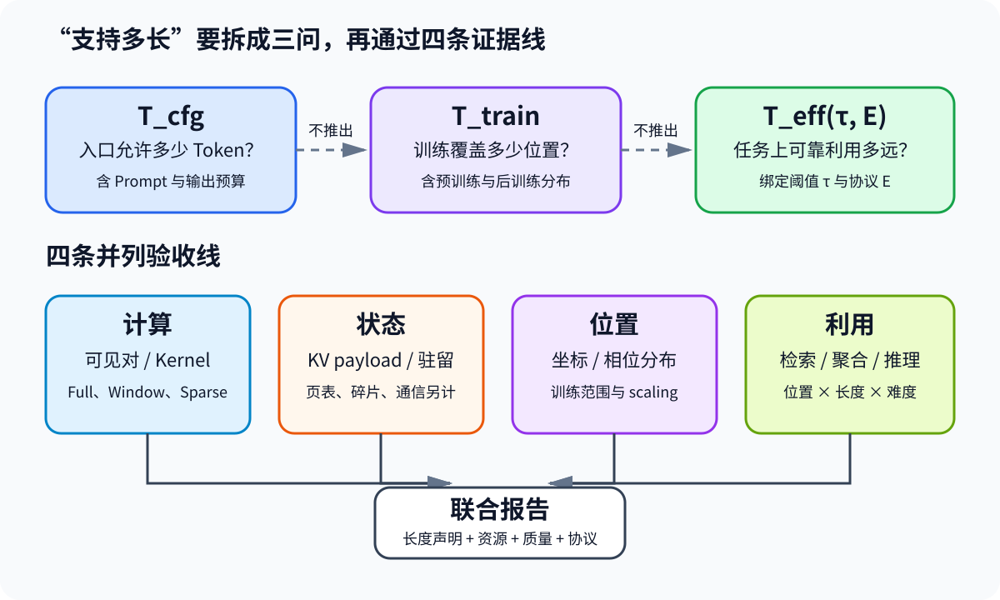
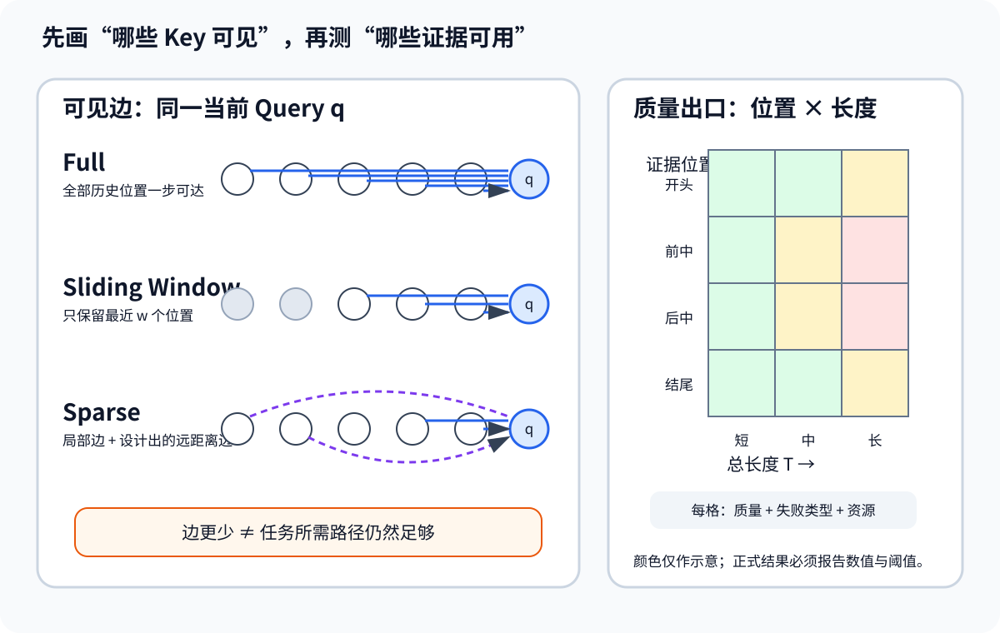
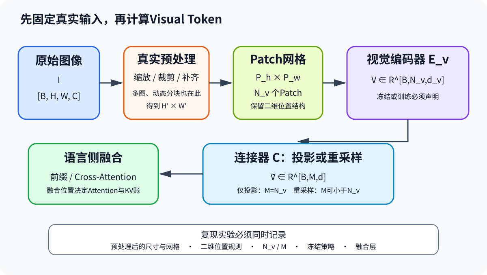
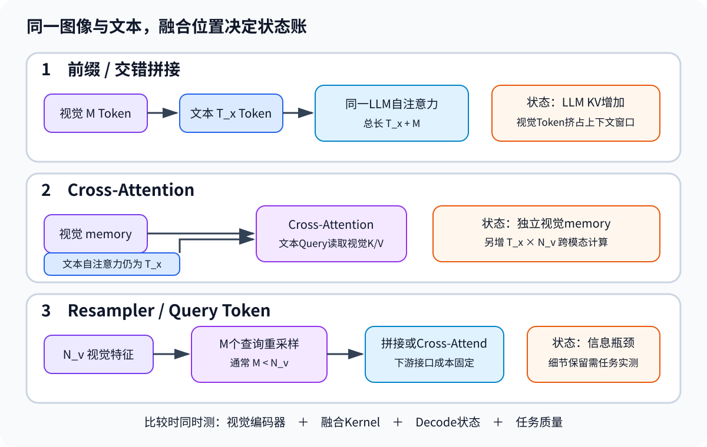
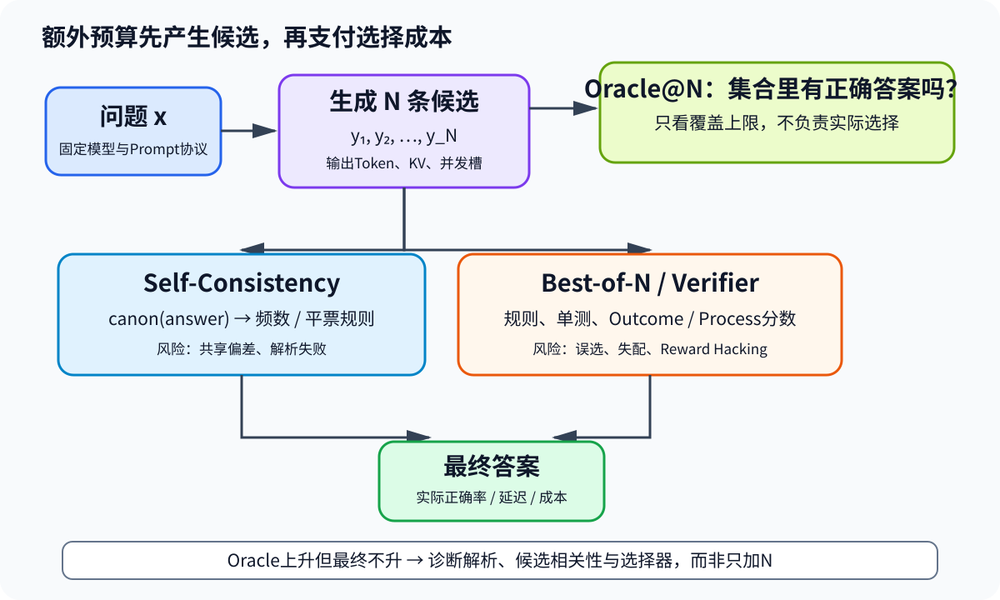
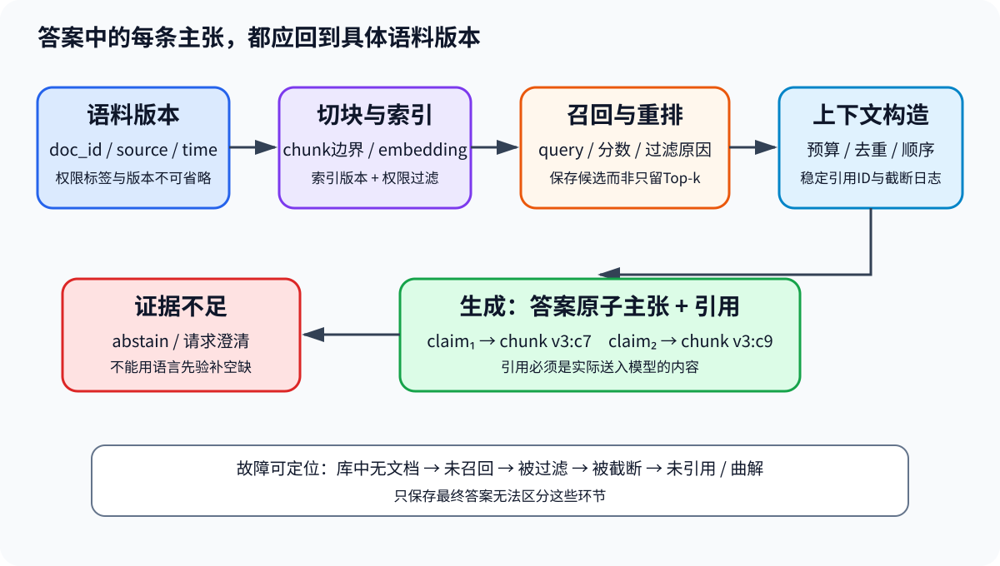
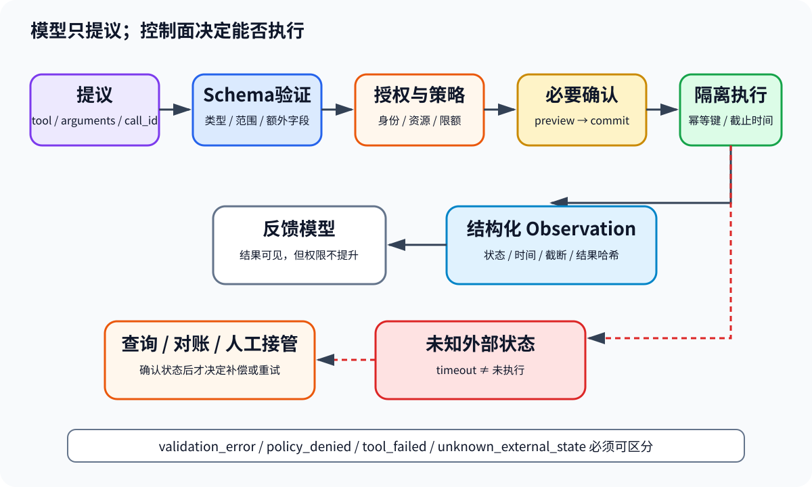
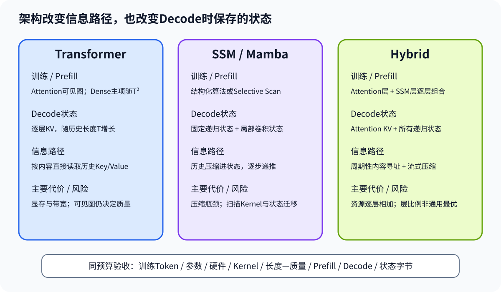

# 第 9 章 前沿模型技术专题（选修）

[总目录](../index.qmd) · 上一章：[第 8 章](08-post-training-evaluation.md) · 下一章：[第 10 章](10-projects.md)

一次技术评审同时摆出五份提案：把上下文扩到 128K、接入图像、增加测试时采样、让模型检索并调用工具、用新架构替换部分 Attention。每份提案都附着一个亮眼数字，却回答着不同问题——有的是接口长度，有的是论文任务分数，有的是渐近复杂度，还有的是特定硬件吞吐。若不先固定状态、成本、能力与证据边界，这些数字既不能彼此比较，也不能直接变成部署决策。

本章用同一套审查顺序阅读这些方向：9.1 从长度口径进入长上下文，9.2 把视觉输入换算成 Token 与 KV，9.3 追踪测试时计算的候选和选择成本，9.4 把检索、工具、权限与外部状态接回系统，9.5 再比较 SSM 与混合架构的递归状态和 Kernel。每节都先问“改变了什么”，再列解析账本、论文报告与待本机实测项。

<a id="learning"></a>

## 学习目标与前置知识

以下目标均可检验。学完本章后，读者应能够：

1. 区分配置窗口、训练位置范围与协议相关有效上下文，推导Full/Window可见对、KV容量和RoPE插值坐标，并设计位置—长度二维评测。
2. 用$[B,T,d]$行向量形状画出视觉编码器—连接器—语言模型数据流，计算Patch/Visual Token数及其Attention/KV增量，区分前缀、Cross-Attention与Resampler接口。
3. 区分CoT、Self-Consistency、Best-of-$N$和Verifier，计算候选Oracle覆盖与Token工作量，并以质量—延迟—吞吐—成本联合协议评测测试时计算。
4. 为RAG建立文档版本到引用的provenance链，为工具调用设计Schema、授权、确认、幂等、Observation与失败恢复边界。
5. 按行向量约定写出SSM状态递推及shape，比较Attention KV与固定递归状态，并解释Selective Scan为何仍受Kernel和任务质量约束。
6. 对任一新架构给出同预算验收表，明确解析账本、论文报告与本机实测三种证据，不用单一Benchmark或渐近复杂度宣称普遍优越。

必要前置是[第2章Transformer与RoPE](02-transformer.md#sec-2-1)、[第5章Context Parallel](05-distributed-training.md#sec-5-7-2)、[第6章分块Attention](06-efficient-attention.md#sec-6-3)、[第7章KV与服务指标](07-inference-serving.md#sec-7-2)及[第8章评测与安全](08-post-training-evaluation.md#sec-8-5)。本章整体为选修，公式仍采用全书固定的行向量、GQA、SwiGLU与绑定嵌入配置。

本章统一使用三类证据标签：**解析账本**来自公式推导或作者构造输入，只说明给定假设下的shape、数量级与字节；**论文报告**保留原研究的模型、任务、硬件与协议；只有按本书记录要求实际运行并保存原始输出，才称**本机实测**。没有执行的路线统一标为**未运行**，不把它写成第四类结果。

<a id="sec-9-1"></a>

## 9.1 长上下文语言模型

> **选修/扩展。** 本节把第 2 章的位置编码、第 5 章的 Context Parallel、第 6 章的分块 Attention 和第 7 章的 KV Cache 放到同一条长度轴上。以下复杂度与容量是解析账本；未运行长上下文模型、GPU Kernel、分布式训练或长文档 Benchmark。

设想一个上线评审：旧版只接收 32K Token，新版把入口放宽到 128K，一份 90K Token 的文档也确实能够完成生成。此时仍不能宣布“有效上下文达到 128K”——训练是否覆盖这些位置？长输入的 KV 与 Attention 账能否承受？放在文档中部的关键条件能否被稳定找到并参与多跳推理？本节沿着**长度口径 → 资源与可见性 → 位置映射与并行 → 质量协议**逐项回答。

“支持 128K 上下文”至少可能指三件不同的事：接口能接收多少 Token、模型训练时见过多少位置，以及模型在任务上能可靠利用多远的信息。为避免把它们混成一个窗口数字，本书记

- $T_{\mathrm{cfg}}$：配置或服务入口允许的最大输入长度；
- $T_{\mathrm{train}}$：预训练或后训练实际覆盖的位置范围；
- $T_{\mathrm{eff}}(\tau,\mathcal E)$：在评测协议$\mathcal E$下仍达到质量阈值$\tau$的最大长度。

$T_{\mathrm{cfg}}$大不推出$T_{\mathrm{train}}$同样大，更不推出对任意任务都有同样的$T_{\mathrm{eff}}$。Tokenizer、Prompt模板和输出预算也占用窗口，因此报告“文档字符数”而不报告实际Token数不可复现。

@fig-ch09-context-length-ledger 把声明与验收分开：三种长度是三个不同问题；算力、状态、位置和利用能力则是四条不能互相替代的证据线。

{#fig-ch09-context-length-ledger fig-alt="入口允许的配置长度、训练覆盖的位置范围和协议下达到质量阈值的有效长度依次排列，但没有自动推出关系。下方四条并列证据线分别是Attention计算、KV状态、位置分布和任务利用；只有在固定协议下联合报告，才能说明长上下文能力。"}

::: {.callout-important title="先问是哪一种长度"}
配置加载成功只证明入口和实现接受该形状；训练位置覆盖只说明模型见过相应坐标；有效上下文还必须绑定任务、阈值与协议。三者数值可以相同，但不能靠名称或配置互相推出。
:::

### 9.1.1 长度增长同时放大什么

设单条因果序列有$T$个Token。若实现跳过严格上三角，无窗口限制的每个头需要处理的可见Query–Key对数为$T(T+1)/2$。若固定滑动窗口最多包含当前Token及此前共$w-1$个Token，则可见对数为

<a id="eq-09-context-pairs"></a>

$$
N_{\mathrm{full}}=\frac{T(T+1)}{2}.
$$

当$T<w$时，

$$
N_{\mathrm{win}}=\frac{T(T+1)}{2}.
$$

当$T\ge w$时，前$w$个Query贡献$w(w+1)/2$个可见对，其余$T-w$个Query各贡献$w$个；合并同类项后得到等价的紧凑形式

$$
N_{\mathrm{win}}=Tw-\frac{w(w-1)}{2}.
$$

::: {.text-end}
（09-Context-Pairs）
:::

因此全注意力的score与Value聚合主项随$T^2$增长，固定$w$的窗口主项随$Tw$增长。这里数的是数学可见对，不是实际Kernel FLOPs：实现可能把因果Tile整块跳过，也可能仍计算部分被mask元素。

推理时，KV Cache则按长度线性增长。复用[式（07-KV-Cache-Memory）](07-inference-serving.md#eq-07-kv-cache-memory)，贯穿配置在$B=1$、$L=32$、$H_{kv}=8$、$d_h=128$、BF16时每Token为128 KiB；$T=4096$的逻辑KV payload为0.5 GiB，$T=32768$为4 GiB。长度扩大8倍时，KV payload扩大8倍，而全注意力可见对约扩大64倍。两者都不含权重、激活、workspace、页表、碎片和通信缓冲。

于是长度账本至少有四列：**Attention计算**核对可见对与实际Kernel，**KV状态**核对逻辑payload与物理驻留，**位置分布**核对训练范围与RoPE规则，**任务利用**核对不同位置、长度和难度下的质量。即使内存与算力足够，训练范围之外的相位或位置模式也未必可用；即使输入成功，模型仍可能忽略中部证据或无法完成跨文档多跳推理。四类瓶颈必须分别测量。

### 9.1.2 Full、Sliding Window与Sparse Attention

三类方法改变的是每个Query允许访问的Key集合，而不只是一个复杂度标签。

| 方式 | 因果可见集合 | 主项量级 | 直接长距离路径与边界 |
| --- | --- | --- | --- |
| Full Attention | 所有不晚于当前Token的Key | $O(T^2d_h)$ | 任意历史位置一步可达；代价最高 |
| Sliding Window | 最近至多$w$个位置 | $O(Twd_h)$ | 局部依赖直接可见；远距离信息需跨层传播，层数与窗口共同决定感受野 |
| Sparse Attention | 由局部、膨胀、随机或全局Token等图模式指定 | 依稀疏边数$|E|$而定 | 可用少量长边缩短路径；稀疏模式、Kernel支持和任务结构必须匹配 |

@fig-ch09-context-visibility-evaluation 先把三种机制画成“允许哪些边”，再把质量出口画成位置—长度网格。减少边数并不直接回答剩余路径是否覆盖任务依赖；单独测一个长度或一个证据位置也不能回答模型是否稳定利用窗口。

{#fig-ch09-context-visibility-evaluation fig-alt="左侧并列三种因果可见图。Full中当前Query连接全部历史Key；Sliding Window只连接最近四个Key；Sparse保留局部边并加入少量远距离虚线边。右侧是总长度从短到长、证据位置从开头到结尾的二维格，每格都需记录质量和失败类型，不能只报告一个最好点。"}

Longformer用局部窗口配合任务相关的全局注意力连接长文档；BigBird把局部、随机与全局连接组合为稀疏图。这些论文提供的是具体设计与实验，不证明任意稀疏模式都等价于Full Attention。窗口或稀疏模式还可能降低score矩阵的中间量，却不会自动缩小所有层的KV状态；若Decode仍需保留可能被后续访问的Key/Value，缓存策略要按可见图另行推导。

工程选择应先回答“哪些依赖必须一步可达”。局部语言建模可从窗口受益；跨全书检索、全局聚合或远距离代码引用则可能需要全局Token、分层摘要、检索或周期性Full层。最终仍要在目标任务上比较质量、TTFT/TPOT、峰值显存与吞吐，不能只比较渐近符号。

### 9.1.3 RoPE Position Interpolation与Scaling

第 2 章已定义RoPE：第$j$个二维子空间在位置$u$使用相位$u\omega_j$。若原训练范围为$T_{\mathrm{train}}$，目标窗口为$T'=sT_{\mathrm{train}}$且$s>1$，Position Interpolation（PI）的核心是把目标坐标压回原范围：

<a id="eq-09-rope-pi"></a>

$$
u'=\frac{u}{s}.
$$

于是第$j$个二维子空间使用$u'\omega_j$，等价地写成

$$
\theta_j(u)=\frac{u\omega_j}{s}.
$$

::: {.text-end}
（09-RoPE-PI）
:::

这样$u<T'$时的相位范围不超过原坐标范围，但相邻位置的角分辨率也被压缩。PI论文在插值后继续微调；它不是“改一个配置即可无损扩窗”的保证。更广义的RoPE scaling还会按频段、位置或目标长度调整频率，方法之间不可只用一个`rope_scaling=true`互换。复现实验至少要记录：原始与目标长度、scale factor、RoPE base、各频段规则、是否动态变化、微调数据/步数，以及评测时实际Token长度。

这也解释了“外推”和“插值”的差别：直接把$u$送到训练范围外是位置外推；PI先映射$u\mapsto u/s$，在坐标上是插值，但模型是否学会利用压缩后的远距离信息仍是经验问题。配置可加载、短样本不报错或困惑度没有爆炸，都不能单独证明长距离推理可靠。

::: {.callout-warning title="位置可表示，不等于信息会被利用"}
RoPE scaling处理的是坐标与相位分布；它不自动支付Attention/KV成本，也不保证模型在长距离检索、聚合或推理上达标。扩窗实验仍需回到位置—长度协议。
:::

### 9.1.4 Context Parallelism与Ring Attention

[5.7.2](05-distributed-training.md#sec-5-7-2)的 Context Parallelism（CP）把一条序列沿$T$维分到$p$个设备，每个设备保留约$T/p$个Query及本地激活。在Dense Attention中，本地Query仍需看到所有合法Key/Value；实现可以All-Gather K/V，也可以让K/V块在设备间流动。Ring Attention采用后一类思路：每个设备计算本地Query与当前K/V块，再沿环传递K/V块，直到覆盖全部块。

每轮的局部score块不能各自Softmax后直接相加，因为各块的归一化分母不同。正确合并须复用[Online Softmax统计量与输出合并](06-efficient-attention.md#eq-06-online-softmax-merge)：携带逐Query的最大值$m$、指数和$\ell$及同尺度的未归一化Value和$z$，再按共同最大值重缩放。因果掩码还必须使用全局绝对位置，不能把每个设备的局部下标都从零解释。

CP/Ring改变的是状态放置、通信方式和可承载长度，不减少Dense Attention的全局总算术量。其可扩展性取决于块大小、设备拓扑、K/V通信量、计算—通信重叠、负载均衡与数值归并；训练还要考虑反向通信和激活保存。论文报告的长度或速度必须保留其硬件与配置，不能写成本机结果。

::: {.callout-note title="并行改变放置，不改全局问题"}
CP回答“一条长序列如何分到多卡”，Ring回答“K/V块如何流动”；若可见图仍是Full，所有合法Query–Key关系仍需在某处完成。它们扩大可承载长度，却不等于把Dense Attention变成线性算术量。
:::

### 9.1.5 从“针”到有效上下文长度

长上下文评测至少包含三层，而不是只跑一次 Needle-in-a-Haystack（NIAH）：

1. **受控检索。** 在不同总长度和相对位置插入一个或多个可核验键值，改变干扰项、键数与措辞，报告位置—长度二维曲线。单针命中主要测检索，不等同长文档理解。
2. **聚合与推理。** 要求跨段计数、排序、状态跟踪、跨文档多跳问答或代码依赖分析；RULER把检索、multi-hop tracing、aggregation与QA放在统一合成长上下文评测中。
3. **真实长文档任务。** 固定文档、问题、答案判据与生成预算，检查证据引用、不可回答样本和污染；同时记录延迟、峰值内存与失败类型。

Lost in the Middle在多文档问答和键值检索中观察到相关证据位置改变会显著影响表现，常见现象是首尾强、中部弱。这是其被测模型与协议的结果，不应外推为每个模型必然呈同一曲线；但它说明只在开头放针会高估利用能力。

::: {.callout-important title="一根针只回答一个较窄的问题"}
NIAH命中可以证明某个长度与位置上的受控检索成功，却不能代替聚合、多跳推理、真实文档任务或全位置稳定性。把它作为协议的一层，而不是长上下文能力的总分。
:::

给定长度集合$\mathcal T$、证据位置集合$\mathcal P$、指标$M(T,p)$和门槛$\tau$，先定义长度$T$上跨位置的协议分数

$$
A_{\mathcal E}(T)
=\operatorname{Q}_{q}\bigl(\{M(T,p):p\in\mathcal P\}\bigr).
$$

再把“有效上下文”操作化为

<a id="eq-09-effective-context"></a>

$$
\begin{aligned}
T_{\mathrm{eff}}(\tau,\mathcal E)
&=\max\bigl\{T\in\mathcal T:\\
&\qquad A_{\mathcal E}(T)\ge\tau\bigr\}.
\end{aligned}
$$

::: {.text-end}
（09-Effective-Context）
:::

其中$\operatorname Q_q$是预先选定的分位数，例如用较低分位而非最好位置；$A_{\mathcal E}(T)$只是把原式中的跨位置聚合单独命名。协议$\mathcal E$必须固定Tokenizer、Prompt、长度生成方式、位置网格、解码参数、输出预算、指标与阈值；换协议就不能直接比较$T_{\mathrm{eff}}$。若最长测试点仍达标，只能报告“至少达到该点”，不能外推到更长。

**解析检查。** 取$T=32768$、$w=4096$，式（09-Context-Pairs）给出$N_{\mathrm{win}}=125{,}831{,}168$，而$N_{\mathrm{full}}=536{,}887{,}296$，可见对约为Full的23.44%。这不是运行时间或显存实测：稀疏Kernel效率、KV Cache、其他层与通信可能改变端到端比例。

**理解检查。** 某API从32K扩到128K且能成功生成，为什么还不能宣称“有效上下文为128K”？请至少从训练位置、证据位置切片、任务难度、输出预算和资源指标中列出四项补充证据。

<a id="sec-9-2"></a>

## 9.2 多模态大模型（Multimodal LLM）

> **选修/扩展。** 本节只建立图像—文本模型的结构与资源账本，不把“能生成有关图片的文字”等同于可靠感知或grounding。下列尺寸例是作者构造的解析算术；未加载视觉编码器、图像数据或多模态模型。

设想要为一张图表截图回答“哪一条曲线在中段反超”。方案A把全部视觉Token拼进LLM，方案B让文本通过Cross-Attention读取视觉memory，方案C先把图像压成固定数量的latent。三者都可能输出流畅答案，但窗口占用、KV状态、细节损失和视觉证据依赖并不相同。本节沿着**像素 → Visual Token → 融合接口 → 证据干预**拆开这条链。

一个常见的多模态LLM可以拆成三部分：视觉编码器$E_v$把像素变成视觉特征，连接模块$C$把特征压缩或投影到语言侧可消费的表示，语言模型$L$再根据视觉条件与文本历史生成Token。写成数据流是

$$
\mathbf I\xrightarrow{E_v}\mathbf V
\xrightarrow{C}\widetilde{\mathbf V}
\xrightarrow[\text{与文本融合}]{L}p(y_t\mid \mathbf I,x,y_{<t}).
$$

这里“多模态”不是单一架构名：$E_v$可能冻结或训练，$C$可以是线性/MLP投影、查询式重采样器或Cross-Attention，视觉信息可以作为LLM前缀Token，也可以作为独立memory被语言层读取。必须记录具体接口，不能只写“接入图片”。

### 9.2.1 图像如何成为Visual Tokens

设批量图像$\mathbf I\in\mathbb R^{B\times H\times W\times C}$，Patch大小为$P_h\times P_w$。若先把高宽补齐到Patch整数倍，再按不重叠网格切分，则

<a id="eq-09-visual-patch-tokens"></a>

$$
N_v=\left\lceil\frac{H}{P_h}\right\rceil
    \left\lceil\frac{W}{P_w}\right\rceil.
$$

记展平后的Patch矩阵为$\mathbf P(\mathbf I)=\operatorname{vec}(\operatorname{patch}(\mathbf I))$，则

$$
\mathbf Z_0=\mathbf P(\mathbf I)\mathbf W_{\mathrm{patch}}+\mathbf b.
$$

::: {.text-end}
（09-Visual-Patch-Tokens）
:::

其中$\mathbf Z_0\in\mathbb R^{B\times N_v\times d_v}$，按本书行向量约定，$\mathbf W_{\mathrm{patch}}\in\mathbb R^{(P_hP_wC)\times d_v}$。实际实现也可能裁剪/缩放到固定分辨率、加入CLS Token、使用卷积stem、动态分块或多尺度特征；此时$N_v$必须按预处理后的真实网格重新计算。ViT的关键抽象正是把图像Patch序列送入Transformer，而不是把每个像素直接当语言Token。

位置也不能省略。文本通常是一维顺序，图像Token来自二维网格；视觉编码器要通过二维位置嵌入、相对位置或其他结构保留空间关系。把网格展平只规定存储顺序，并不自动让模型知道“左上”和“右下”。

@fig-ch09-visual-token-pipeline 把shape变化放回数据流。预处理是模型接口的一部分：同一原图若采用不同缩放、裁剪、补齐或动态分块，后续$N_v$与可见细节都会改变。

{#fig-ch09-visual-token-pipeline fig-alt="输入批量图像形状为B乘H乘W乘C，先经缩放裁剪或补齐形成真实输入，再按Ph乘Pw网格得到Nv个Patch。视觉编码器输出B乘Nv乘dv，连接器投影或重采样后输出B乘M乘d；若只投影则M等于Nv，若重采样则M可小于Nv。图下强调预处理、二维位置和Token预算都必须记录。"}

::: {.callout-warning title="预处理不是无关紧要的前处理"}
报告原图尺寸却不记录送入编码器的实际尺寸、裁剪、补齐和多图拼接规则，无法复算$N_v$，也无法判断小目标或边缘证据是否在进入模型前已经丢失。
:::

### 9.2.2 连接模块与三种融合位置

若视觉编码器宽度$d_v$与LLM宽度$d$不同，最简单的行向量投影为

$$
\widetilde{\mathbf V}=\mathbf V\mathbf W_c+\mathbf b_c.
$$

其中shape为

$$
\mathbf W_c\in\mathbb R^{d_v\times d}.
$$

投影不改变Token数，因此

$$
\widetilde{\mathbf V}\in\mathbb R^{B\times N_v\times d}.
$$

LLaVA给出了一条代表性路线：连接预训练视觉编码器与语言模型，并通过视觉指令数据做阶段化训练。线性或MLP projector形状简单，但它既没有保证逐Token语义对齐，也没有自动解决分辨率、OCR与空间grounding。

另一类路线把视觉特征保留为独立memory。Flamingo用Perceiver Resampler把可变数量的视觉特征压到固定数量的视觉Token，并在冻结语言模型中插入门控Cross-Attention，以处理图文交错输入。由此可见，融合方式至少有三类资源语义：

| 融合方式 | 语言侧接口 | 主要资源后果 | 典型风险 |
| --- | --- | --- | --- |
| 前缀/交错拼接 | 投影后的视觉Token进入LLM自注意力序列 | 增加LLM序列长度和对应KV | 视觉Token过多挤占文本/输出窗口 |
| Cross-Attention | 文本Query读取独立视觉K/V | 文本自注意力长度不变，另增$O(T_xN_v)$跨模态计算与视觉memory | 插层位置、门控与缓存策略依实现 |
| Resampler/Query Token | 先把$N_v$压为$M$个latent，再拼接或Cross-Attend | 用信息瓶颈换取固定接口成本 | $M$过小可能丢细节，过大仍昂贵 |

@fig-ch09-multimodal-fusion-ledger 用同一文本Query对齐三条路线。区别不在于是否“看图”，而在于视觉状态进入哪一种序列、在哪些层被读取，以及Decode时哪些K/V需要保留。

{#fig-ch09-multimodal-fusion-ledger fig-alt="三行比较多模态融合。前缀拼接把M个视觉Token和Tx个文本Token放入同一LLM自注意力序列，增加总长度和LLM KV；Cross-Attention保持文本自注意力长度Tx，另存视觉memory并产生文本乘视觉的跨注意力；Resampler先将Nv个视觉特征压为M个latent，再选择拼接或跨注意力，成本固定但形成信息瓶颈。"}

::: {.callout-important title="Token更少只说明接口更窄"}
$M<N_v$能降低下游接口成本，却不能单独推出更快或更准：视觉编码器仍要处理输入，Cross-Attention还需额外Kernel，而压缩可能丢失OCR、小目标或空间关系。
:::

训练时还要声明冻结策略和目标：只训连接器、解冻视觉编码器、解冻LLM，或分阶段进行，优化问题与显存都不同。图文配对预训练、caption/VQA和多模态指令微调的数据目标也不等价；语言回答流畅不证明视觉证据被正确使用。

### 9.2.3 Visual Token的Attention与KV账本

若把$N_v$个视觉Token作为前缀直接放进decoder-only LLM，文本侧有$T_x$个Token，总长度$T=T_x+N_v$。在标准稠密因果可见对口径下，视觉前缀带来的增量为

<a id="eq-09-multimodal-token-cost"></a>

$$
\Delta N_{\mathrm{pair}}
=T_xN_v+\frac{N_v(N_v+1)}{2}.
$$

$$
\Delta M_{\mathrm{KV}}=2L N_vH_{kv}d_hs_{kv}.
$$

::: {.text-end}
（09-Multimodal-Token-Cost）
:::

第二式复用第7章KV Cache口径：只算视觉前缀在全层的逻辑K/V payload；若框架不把视觉Token送入LLM自注意力、对视觉前缀采用不同缓存或只在部分层融合，就不能套用。第一式也不是Cross-Attention的公式。

**解析例。** 一张$336\times336$图像用$14\times14$ Patch且不加CLS Token，得到$N_v=24^2=576$；若文本长度$T_x=512$，拼接后为1088 Token。稠密因果可见对从131,328增至592,416，约为4.51倍。贯穿配置每Token全层KV为128 KiB，因此视觉前缀另加72 MiB逻辑KV payload。以上没有计视觉编码器、连接器、激活、workspace、物理填充或图像预处理。

分辨率每边扩大2倍且Patch大小不变时，$N_v$约扩大4倍；多图或视频帧数也通常使视觉Token近似线性增加，而拼接后的Dense Attention随总Token数平方增长。工程上常用更大Patch、裁剪/缩放、Token pruning/merging、Resampler、局部视觉Attention或分层特征控制成本，但压缩是否保留OCR、小目标和时序信息必须按任务实测。

### 9.2.4 训练与评测边界

多模态系统的错误可能来自视觉编码、连接器、语言先验或数据标注。诊断时应至少成对比较：有图与遮图、正确图与干扰图、问题所需证据所在区域，以及不同分辨率/裁剪；若遮图后答案几乎不变，模型可能主要依赖语言先验。评测还要分开记录感知、OCR、空间关系、知识问答、幻觉/grounding、安全与延迟显存，不能用一个聊天示例替代。

::: {.callout-note title="把答案变成可证伪的视觉利用声明"}
对开场的曲线反超问题，应同时保存原图答案、遮住交点区域后的答案、替换为干扰图后的答案，以及指向证据区域的grounding结果。只有输出随相关视觉证据按预期变化，才比“回答看起来合理”提供更强证据。
:::

**理解检查。** 同一张图像，方案A把576个视觉Token作为LLM前缀，方案B把它们重采样为64个latent后做Cross-Attention。为什么不能仅凭“64更少”断言B更准确或端到端更快？请分别列出自注意力、跨注意力、信息瓶颈、视觉编码器与Kernel实现五方面需要测量的量。

<a id="sec-9-3"></a>

## 9.3 推理模型与 Test-time Compute

> **选修/扩展。** Test-time Compute指在权重固定后，为单个问题分配更多生成、搜索、验证或工具计算。它与训练算力、模型参数量和“输出更长”都不是同义词。本节只给机制与解析账本，未运行推理模型、采样搜索、Verifier或Benchmark。

设想一道题单次直接回答失败，但系统还允许多花一份预算。预算可以用来把一条轨迹写得更长，也可以生成多条不同轨迹；有了候选后，又可以按答案频数投票、用规则执行，或交给学习型Verifier。真正的问题不是“算得越多是否越好”，而是额外工作落在哪一步、选择信号是否可信，以及质量增益能否覆盖延迟、KV和吞吐代价。

直接生成一次答案只是推理策略的一个点。额外预算可以沿两条轴分配：让一条轨迹更长，例如显式分解与反思；或生成多条轨迹，再投票、验证或搜索。是否收益取决于基础模型在该题上的非零成功概率、候选多样性、Verifier质量和预算分配；困难度不同，最佳策略也可能不同。因此必须画“质量—计算”曲线，而不是只比较一次最高分。

### 9.3.1 Chain-of-Thought：可见中间文本

Chain-of-Thought（CoT）提示用带中间步骤的示例或指令，引导模型在最终答案前生成一段推理文本。它可以把部分多步任务展开成更多自回归Token，使后续Token条件于已写出的中间状态。原始研究在特定大模型和算术、常识、符号任务上观察到收益；这不是所有模型、所有Prompt或所有任务的单调保证。

可见CoT有四个边界。第一，语法连贯的步骤仍可能含早期错误，且错误会沿后续Token传播。第二，生成文本是模型输出，不自动等同内部计算的忠实解释；正确答案可配错误理由，错误答案也可配貌似合理的理由。第三，更长轨迹增加Decode Token、延迟和暴露不必要内容的风险。第四，精确匹配评测必须从轨迹中稳定抽取最终答案，否则格式差异会污染分数。因此生产系统可把“用于求解的内部状态”“给用户的简洁依据”和“可审计的外部证据”分开设计。

### 9.3.2 Self-Consistency与Best-of-N

Self-Consistency从同一问题采样$N$条不同推理轨迹，把每条轨迹解析为规范化答案$a_i$，再选频数最高者：

$$
\widehat a=\arg\max_a\sum_{i=1}^{N}\mathbf 1[\operatorname{canon}(a_i)=a].
$$

它不要求选择一条“最漂亮”的推理，而是对不同路径边缘化后看答案一致性。若答案是开放文本，`canon`、等价类、平票规则和无法解析样本必须预先定义；多数一致也可能是共享偏差。

Best-of-$N$则用分数器$v(x,y_i)$从候选中选$arg\max_i v(x,y_i)$。分数器可以是规则执行器、单元测试、Outcome Reward Model或Process Reward Model。两者区别是：Self-Consistency依赖候选间的答案频数，Best-of-$N$依赖外部或学习到的选择信号。

@fig-ch09-test-time-candidate-tree 把“有没有正确候选”和“能不能选中它”拆开。Oracle只检查候选集合上限，实际系统还要经过答案解析、投票或Verifier，最后才能得到对用户可见的结果。

{#fig-ch09-test-time-candidate-tree fig-alt="同一问题分成N条候选轨迹，每条产生答案和Token工作量。候选集合一方面进入Oracle检查，判断是否至少包含一个正确答案；另一方面进入答案规范化与频数投票，或进入Verifier评分选择。两条实际选择路径汇合为最终答案，Oracle与最终正确率之间的差距由解析和选择错误造成。"}

若每条候选独立且单条正确概率为$p$，至少含一条正确候选的概率为

<a id="eq-09-candidate-coverage"></a>

$$
P_{\ge1}(N)=1-(1-p)^N.
$$

::: {.text-end}
（09-Candidate-Coverage）
:::

这是“候选集合覆盖正确答案”的理想账本，不是最终准确率：真实样本相关，且Verifier未必能选出正确候选。例：$p=0.3$时，$N=1,4,8$的理想覆盖率为30%、75.99%、94.24%；边际收益递减，而Token成本继续增加。

::: {.callout-important title="Oracle@N只给候选集合的上限"}
Oracle上升而最终准确率不升，说明瓶颈已经从“生成不到”转到答案解析、共享偏差或选择器误选。继续增大$N$会增加工作量，却不自动修复这条转换链。
:::

### 9.3.3 Verifier与过程/结果监督

Verifier接收问题与候选答案或步骤，输出有效性、奖励或排序信号。按监督粒度可分为：

- **Outcome监督**只判断最终答案，例如数学终值、代码测试或棋局结果；标签便宜且目标直接，但可能给“答案碰巧正确、过程错误”的轨迹高分。
- **Process监督**逐步判断中间推理；能更早定位错误并为搜索提供密集信号，但步骤边界、局部正确性与人工标签成本更复杂。

GSM8K的Verifier研究展示了生成多个解答再排名的具体路线；Let's Verify Step by Step在其MATH设定中比较了Outcome与Process监督。它们是任务相关证据，不证明学习型Verifier普遍可靠。Verifier会有分布外失效、长度/文风偏好、Reward Hacking及与生成器共错；规则检查器也只覆盖可形式化条件。验收必须同时报告候选覆盖率、Oracle@N、实际选择准确率、Verifier校准/误选率，以及没有正确候选时的行为。

### 9.3.4 推理成本不是一个Token数

令第$i$条候选输出$O_i$个Token，Verifier额外处理$V_i$个计费或计算Token。一个最小工作量账本是

<a id="eq-09-test-time-work"></a>

$$
W_{\mathrm{decode}}=\sum_{i=1}^{N}O_i.
$$

$$
W_{\mathrm{score}}=\sum_{i=1}^{N}V_i.
$$

::: {.text-end}
（09-Test-Time-Work）
:::

它仍不等于FLOPs、费用或延迟：独立调用会重复Prefill，Prefix Cache可复用部分Prompt状态；并行采样能降低墙钟延迟，却占用更多并发槽位、KV Cache和总Token吞吐；顺序早停可以省工作，但引入策略相关的尾延迟。长CoT还使每条序列的KV随长度增加，$N$条并发候选则近似把活跃KV乘以$N$。服务评测至少联合报告准确率/通过率、平均与分位输出Token、候选数、Verifier调用、TTFT、TPOT/E2E、峰值并发KV、completed token/s、请求goodput和单位正确答案成本。

::: {.callout-warning title="并行采样降低墙钟，不减少总工作"}
把$N$条候选同时解码可能缩短单请求等待，却会同时占用调度槽、KV和Token吞吐。必须分别报告单请求延迟与系统goodput，不能把并行度当作免费加速。
:::

例如4条候选分别输出120、180、160、140 Token，则$W_{\mathrm{decode}}=600$；若Verifier每条读取问题与候选共220、280、260、240 Token，则$W_{\mathrm{score}}=1000$。这只是Token工作量构造例，不代表任何API费用、GPU FLOPs或墙钟时间。

### 9.3.5 训练如何改变测试时策略

测试时搜索只能重排或扩展当前策略能产生的候选；训练则改变候选分布和Verifier。可验证奖励把单元测试、最终答案或形式化检查器作为结果信号，在线策略优化用新策略rollout继续更新权重；[8.4.3](08-post-training-evaluation.md#sec-8-4-3)已说明PPO、GRPO与RLVR的边界。过程监督还可以训练Process Reward Model，为测试时树搜索或逐步选择提供分数。

三者必须分账：SFT/RL训练是否改善单样本$p$，测试时增加$N$是否扩大候选覆盖，Verifier是否把覆盖转化为最终正确率。训练集可验证不等于开放世界回答可验证；若奖励只检查终值，模型也可能学会利用检查器漏洞。测试时计算扩展研究进一步表明，策略效果随题目难度变化，固定Best-of-$N$未必是计算最优分配；这一论文结论仍受其模型、任务与Verifier设置限制。

**理解检查。** 系统把$N$从1增到16后Oracle@N显著上升，但最终准确率几乎不变。请分别从候选相关性、答案解析、Verifier误选、分布外题目和并发资源竞争提出诊断，并说明为何不能仅继续增大$N$。

<a id="sec-9-4"></a>

## 9.4 RAG 与工具调用

> **选修/扩展。** RAG给模型提供外部文本证据，Tool Calling允许系统产生外部动作；前者不自动保证事实正确，后者也不能把模型输出直接当授权。本节是架构与验收设计，未连接向量数据库、外部API、账户或真实工具。

设想用户问“这笔订单是否符合取消政策，并在符合时帮我取消”。系统先要从一个有版本和权限的知识库中找到适用条款，再把证据交给模型；若进入取消动作，还必须验证参数、身份、资源权限与副作用确认。**检索到一段文字**和**获准改变外部状态**是两种不同能力，本节分别建立证据链与执行状态机，最后再联合评测。

### 9.4.1 RAG：从语料版本到回答证据

一个最小Retrieval-Augmented Generation（RAG）链路为：文档摄取与版本化$\rightarrow$切块/元数据$\rightarrow$向量或稀疏索引$\rightarrow$query改写$\rightarrow$召回$\rightarrow$过滤/重排$\rightarrow$上下文构造$\rightarrow$带证据生成。原始RAG研究把参数化生成器与显式非参数memory结合；现代工程实现可以替换任何模块，因此“用了RAG”不足以说明具体系统。

离线索引端必须保存文档ID、来源、版本/时间、权限标签、chunk边界与embedding模型版本。在线端则保存原始query、实际检索query、候选及分数、过滤原因、送入模型的chunk顺序、Prompt模板和最终引用。没有这条provenance链，就难以区分“库里没有”“没召回”“重排丢失”“Prompt截断”与“模型无依据生成”。

@fig-ch09-rag-provenance-chain 把离线版本与在线事件连到最终原子主张。引用ID只有在能回指具体版本、chunk和实际送入上下文的内容时，才是可审计证据，而不只是答案末尾的装饰链接。

{#fig-ch09-rag-provenance-chain fig-alt="离线侧保存来源文档、版本时间、权限和chunk边界，再用指定embedding或稀疏索引形成可版本化索引。在线侧保存原始query和改写query，记录召回候选、分数、过滤与重排，随后按Token预算构造带稳定引用ID的上下文。答案拆成原子主张，每个主张回指实际使用的chunk；无充分证据时进入拒答。"}

### 9.4.2 Embedding、相似度与检索边界

Dense Retriever通常分别编码查询与文档chunk：$\mathbf q=f_q(x)\in\mathbb R^{d_r}$，$\mathbf e_j=f_d(c_j)\in\mathbb R^{d_r}$。若用余弦相似度，必须明确是否已归一化：

<a id="eq-09-retrieval-score"></a>

$$
s_{\cos}(x,c_j)=\frac{\mathbf q\mathbf e_j^{\mathsf T}}
{\lVert\mathbf q\rVert_2\lVert\mathbf e_j\rVert_2}.
$$

$$
\widehat{\mathcal C}_k=\operatorname{TopK}_{j}\;s_{\cos}(x,c_j).
$$

::: {.text-end}
（09-Retrieval-Score）
:::

这里$\mathbf q,\mathbf e_j$都是行向量；若二者预先做L2归一化，余弦排序才与点积排序相同。未归一化内积会同时受方向和向量范数影响。DPR给出双编码器Dense Passage Retrieval的代表性路线，但其特定开放域问答结果不代表Dense必然优于BM25；专名、数字、低资源语言和新领域可能需要稀疏/稠密混合及reranker。

Chunk不是越小或越大越好。过小会丢标题、表格与跨段关系，过大会降低检索分辨率并占Prompt；overlap提高召回机会，却造成重复证据和索引膨胀。评测应在固定语料版本上分别报告Recall@k/命中、MRR或nDCG、权限过滤正确率、重排后证据覆盖，以及端到端答案正确性、引用支持率和不可回答识别。只有最终答案分数无法定位检索故障。

### 9.4.3 Context Construction不是字符串拼接

送入模型前要处理总Token预算$T_{\mathrm{ctx}}$：系统指令、对话历史、query、chunk标题/正文/元数据与预留输出共享同一窗口。构造器应去重、保留来源边界、按query相关性与文档结构排序，并对每段分配稳定引用ID；截断必须在可记录的chunk/字段边界发生，而非静默切掉证据末尾。

检索文本属于**不可信数据**。即使它写着“忽略先前指令”也不应改变系统策略、权限或工具参数；模型需要明确的数据定界，执行层仍须Schema校验、Allowlist与最小权限。RAG只让证据可见，不保证模型引用它、不曲解它或拒绝库外问题。可用“答案中的原子主张是否被所引chunk支持”做grounding检查，并保留无充分证据时的abstain路径。

### 9.4.4 Tool Calling：提议、验证、执行、观察

工具调用的安全接口是状态转换，而不是让模型输出任意代码。模型先生成结构化候选

```json
{"tool":"lookup_order","arguments":{"order_id":"A-104"},"call_id":"c7"}
```

编排器再按版本化JSON Schema解析并校验类型、范围、必填字段与额外字段；随后做身份认证、资源级授权、策略检查、速率/金额限制和必要的用户确认。只有验证通过才由隔离执行器调用工具，返回带`call_id`、状态、时间和截断标记的Observation，模型才能继续生成。Toolformer研究了模型何时、如何调用API及利用结果的训练路线；它不替代运行时权限控制。

@fig-ch09-tool-call-state-machine 把模型输出限制为“提议”。验证、授权、确认和执行都属于模型外控制面；超时后外部状态未知时，状态机必须先查询或对账，不能把重试当成默认成功路径。

{#fig-ch09-tool-call-state-machine fig-alt="模型先提出带tool、arguments和call_id的结构化候选。编排器依次进行Schema校验、身份与资源授权、高影响操作用户确认，再交给隔离执行器。成功或明确失败都返回结构化Observation；超时导致未知外部状态时进入查询和对账，只有幂等或已确认未执行的操作才可重试。Observation再反馈模型，但不能提升权限。"}

::: {.callout-important title="模型提出动作，不授予动作"}
Schema有效只说明结构正确；身份认证、资源级授权、风险策略和用户确认必须在执行层独立成立。检索文本或工具Observation中的指令也不能越过这些门。
:::

读操作也可能泄露数据，写操作还可能不可逆。高影响调用要区分`preview/plan`与`commit`，对转账、发送、删除或发布使用明确确认；幂等键防止超时重试造成重复副作用。工具错误必须是结构化状态，例如`timeout`、`rate_limited`、`validation_error`、`permission_denied`，不能让模型把失败文本想象成成功。

### 9.4.5 Agentic Workflow与失败恢复

Agent工作流把多次“观察$\rightarrow$决策$\rightarrow$动作$\rightarrow$新观察”连成有界状态机。ReAct是交错生成推理痕迹与动作的代表性研究范式；生产编排还需要模型之外的控制面：最大步数/总Token/工具调用/墙钟预算，状态持久化，循环检测，取消，checkpoint，以及补偿或人工接管。

令一条串行关键路径包含$S$次模型调用、$R$次检索和$K$次工具调用，其端到端延迟账本为

<a id="eq-09-agent-latency"></a>

$$
\begin{aligned}
L_{\mathrm{e2e}}
&=\sum_{i=1}^{S}L^{(i)}_{\mathrm{model}}
+\sum_{j=1}^{R}L^{(j)}_{\mathrm{retrieval}}\\
&\quad+\sum_{k=1}^{K}L^{(k)}_{\mathrm{tool}}
+L_{\mathrm{queue}}+L_{\mathrm{orchestration}}.
\end{aligned}
$$

::: {.text-end}
（09-Agent-Latency）
:::

该式只适用于未重叠的串行关键路径；并行工具取关键路径最大值而非简单相加，重试则新增调用与排队。构造例中两次模型调用80/120 ms、一次检索35 ms、两次工具50/200 ms、排队40 ms、编排15 ms，总延迟为540 ms。这不是本机或网络实测。

恢复策略必须按副作用分类。纯读取可在退避和截止时间内重试；带幂等键的写入可查询已有结果；非幂等且状态未知时应停止并对账，不能盲目重放。每一步保存输入摘要、工具版本、权限决策、调用ID、结果哈希和状态，但日志要脱敏并限制访问。

### 9.4.6 联合评测与威胁边界

系统至少同时测四层：检索层的证据召回与权限过滤，生成层的正确/引用支持/拒答，工具层的Schema有效率、授权拒绝、幂等与副作用正确性，工作流层的任务成功、步数、延迟、成本和恢复率。Prompt Injection测试要覆盖用户直接注入与检索页面/工具Observation中的间接注入，并验证攻击即使影响模型文本，也不能越过执行层权限。

建议保存失败归因矩阵：`retrieval_miss`、`context_truncated`、`unsupported_claim`、`bad_arguments`、`policy_denied`、`tool_failed`、`loop_budget_exceeded`与`unknown_external_state`。只有端到端“成功/失败”会掩盖改进方向；只看检索Recall也不能证明最终回答可靠。

**理解检查。** 某Agent在工具超时后自动重试三次，最终报告订单已取消。为什么仍不能据此认定状态正确？请从幂等键、超时后的未知外部状态、资源级授权、Observation真实性与审计对账说明所需证据。

<a id="sec-9-5"></a>

## 9.5 新型模型架构与计算范式

> **选修/扩展。** 本节用State Space Model（SSM）说明Attention之外的序列混合路线，并讨论混合架构。所有容量例都是统一口径下的解析账本；未实现或运行S4、Mamba、Jamba、Selective Scan或对应Kernel。

设想为32K流式会话选择骨干：Dense Attention保留全部可寻址KV，SSM把历史压进固定状态，Hybrid只在部分层保留Attention。选择不能只看$O(T^2)$与$O(T)$标签；还要问训练如何并行扫描、Decode保存什么、Kernel在目标硬件上是否高效，以及压缩状态能否保留任务所需信息。本节沿着**信息路径 → 递推shape → 状态字节 → Kernel → 质量协议**比较。

### 9.5.1 Transformer的成本与能力来自同一机制

Dense causal Attention让当前Query可按内容直接读取任意历史Key/Value，这提供短信息路径与显式内容寻址，但训练/Prefill的可见对为$O(T^2)$，Decode还要保存并读取随$T$增长的KV Cache。Sliding/Sparse Attention降低边数，却改变可见图；线性Attention改变核或归一化；循环/SSM则把历史压入固定尺寸状态。它们不是“同一Attention的更快实现”，信息路径与归纳偏置已经变化。

比较新架构至少要固定参数量/激活参数、训练Token、数据、上下文、精度、硬件和质量目标，再同时报告Prefill、Decode、显存与任务质量。仅凭渐近量级无法判断短序列Kernel开销、并行度、内存布局或训练稳定性。

### 9.5.2 离散State Space递推

设单Token输入$\mathbf x_t\in\mathbb R^{1\times d}$、状态$\mathbf h_t\in\mathbb R^{1\times n}$、输出$\mathbf y_t\in\mathbb R^{1\times d}$。按本书行向量方向，一个离散状态空间层可写成

<a id="eq-09-ssm-recurrence"></a>

$$
\mathbf h_t=\mathbf h_{t-1}\overline{\mathbf A}_t^{\mathsf T}
+\mathbf x_t\overline{\mathbf B}_t^{\mathsf T}.
$$

$$
\mathbf y_t=\mathbf h_t\mathbf C_t^{\mathsf T}
+\mathbf x_t\mathbf D^{\mathsf T}.
$$

::: {.text-end}
（09-SSM-Recurrence）
:::

其中$\overline{\mathbf A}_t\in\mathbb R^{n\times n}$、$\overline{\mathbf B}_t\in\mathbb R^{n\times d}$、$\mathbf C_t\in\mathbb R^{d\times n}$、$\mathbf D\in\mathbb R^{d\times d}$，所以两项都分别落到$1\times n$与$1\times d$。上横线常表示连续系统离散化后的参数，但本节从离散递推本身出发。

当$\overline{\mathbf A},\overline{\mathbf B},\mathbf C$与输入和时间无关时，递推可展开为卷积核$\mathbf C\overline{\mathbf A}^{k}\overline{\mathbf B}$；训练可利用卷积或结构化算法并行，逐Token生成则保留最终状态递推。S4通过结构化参数化提高长序列SSM计算的可行性。固定状态意味着Decode无需保存全部历史KV，但过去信息被压入$n$维状态，不能像Attention那样按内容直接随机读取任意旧Token。

### 9.5.3 Mamba的选择性与硬件扫描

语言Token往往要求根据当前内容决定“保留什么、忘记什么”。Mamba让部分SSM参数成为输入的函数，使状态更新具有选择性；代价是不能直接使用一条固定的全序列卷积核。其实现使用面向硬件的Selective Scan，在训练时并行组织扫描、在Decode时递归更新状态，并尽量减少慢速内存往返。

“序列长度线性”描述的是该层随$T$的主项，不等于任意GPU、batch和长度上更快。扫描含数据依赖，实际性能还受状态宽度、扩展维度、融合Kernel、并行前缀算法、重计算、dtype和内存带宽影响。论文报告的吞吐或百万长度结果只属于其模型、任务与硬件，不能写成本机结果。

若实现每层维护$\mathbf H\in\mathbb R^{B\times d_s\times n}$的递归状态，其理想payload为

<a id="eq-09-recurrent-state-memory"></a>

$$
M_{\mathrm{state}}=B L d_s n s_{\mathrm{state}}.
$$

::: {.text-end}
（09-Recurrent-State-Memory）
:::

它对已处理长度$T$为$O(1)$，但不含局部卷积状态、门控激活、权重、workspace、对齐或混合Attention层KV。构造例取$B=1,L=32,d_s=8192,n=16$、BF16状态，理想payload为8 MiB；贯穿Transformer在32K Token下的逻辑KV为4 GiB。二者不是同质量、同参数或同实现模型的Benchmark，只展示“固定递归状态”与“随长度增长的KV”这一个结构差异。

### 9.5.4 训练扫描、Decode状态与长度能力

SSM训练仍要读取全部$T$个输入，并保存或重算反向所需中间量；$O(T)$不能解读为常数训练内存。Decode每步更新固定状态可避免全历史KV读取，但状态更新、门控、MLP和词表头仍有成本。状态损坏或量化误差还会传播到未来步骤，流式会话的reset、截断、batch重排与状态迁移都要明确。

更重要的是，固定状态容量不自动等于无限有效上下文。长距离复制、任意关联回忆、精确计数和多跳推理会暴露不同瓶颈；必须像[9.1](#sec-9-1)一样在长度与证据位置上评测，而不能只证明模型接受更长输入。Attention的显式KV昂贵却便于内容寻址，递归状态便宜却形成压缩瓶颈，任务决定取舍。

### 9.5.5 Hybrid Architecture

混合架构在同一网络交错Attention与SSM/卷积层：SSM层承担大部分局部和流式混合，周期性Attention层提供全局内容寻址；也可混合MoE扩大总容量而控制每Token激活参数。Jamba是Transformer—Mamba—MoE混合的具体研究实例，但它的一种层比例或专家配置不是通用最优解。

混合方案的资源账本必须逐层相加：只有Attention层产生对应KV Cache，只有MoE层产生路由与All-to-All，SSM层产生递归/卷积状态。若$L_a$个Attention层沿用贯穿配置，则其KV是全$L=32$ Transformer的$L_a/32$，再加所有SSM状态；不能把整模型简单标成“无KV”或“线性”。质量评测还需分解局部建模、关联回忆、长文档推理和流式生成。

@fig-ch09-architecture-state-ledger 将训练路径、Decode状态和主要质量风险并排。Hybrid不是第三种免费方案，而是把各层账本相加，并用周期性内容寻址换取额外KV。

{#fig-ch09-architecture-state-ledger fig-alt="三列比较架构。Transformer训练使用全局或稀疏注意力图，Decode保存随长度增长的KV，支持按内容直接寻址；SSM训练使用扫描或结构化算法，Decode保存固定递归和局部卷积状态，形成信息压缩瓶颈；Hybrid逐层组合二者，只有Attention层增加KV，SSM层增加递归状态，资源必须逐层相加。底部共同要求同预算质量、Kernel与系统测量。"}

::: {.callout-warning title="固定状态不是无限有效上下文"}
状态字节不随$T$增长，只说明存储形态；它不保证任意旧信息仍可精确恢复。长度能力仍要在位置、任务难度和质量阈值上验证。
:::

### 9.5.6 展望：架构、Kernel与系统共同设计

未来系统更可能组合Dense/Sparse Attention、SSM、卷积、MoE、检索与工具，而不是由单一渐近复杂度胜出。架构决定信息可见性和状态，Kernel决定算子是否真正利用硬件，分布式布局决定状态如何分片通信，服务调度决定不同长度与状态的请求能否高效共存。

因此新架构验收表至少包含：数学递推与shape、训练/Decode算法、状态与缓存字节、目标硬件Kernel、长度—质量曲线、故障恢复/状态迁移，以及与同预算基线的端到端测量。没有可用Kernel时，较低理论FLOPs可能更慢；没有任务质量约束时，较小状态也可能只是丢失信息。

**理解检查。** 某模型宣称“SSM使上下文成本从二次降为线性，且Decode状态不随长度增长”。为什么仍不能推出它在128K检索任务上优于Transformer？请从状态容量、内容寻址、训练长度、Selective Scan Kernel、混合Attention层和有效上下文评测回答。

<a id="experiment"></a>

## 本章实验

本章不设独立运行实验；第10章把实现和测量拆成六个可执行项目。本章安排一份**前沿方案审计任务**：从9.1–9.5任选一个系统，提交不执行外部副作用的设计与证据包。

- **输入：** 固定的模型/论文版本、目标任务、长度/Batch/精度/硬件假设、质量与资源基线；若涉及RAG/工具，另给语料版本、权限矩阵和模拟工具Schema。
- **步骤：** 画数据流与状态边界；用本章公式复算至少一个shape/bytes/Token/延迟账本；列出解析主项、论文报告和待本机实测项；设计质量、系统和安全切片；给出失败停止与回滚条件。
- **正确性门槛：** 数学shape闭合，单位可追溯，基线同预算；不得把论文数字称本机实测，不得把可接收长度当有效上下文，不得真实调用写工具；所有假设和未运行项显式列出。
- **记录字段：** 方案ID、来源revision、配置、公式口径、构造输入、计算输出、评测矩阵、威胁模型、未测项、预期日志与复现命令。
- **低资源路线：** 只做纸面/脚本解析复算和模拟Observation；不下载模型、不建立外部索引、不连接账户。该任务当前未运行，没有性能或质量结果。

<a id="exercises"></a>

## 本章小结与习题

本章把前沿方向还原为可检查的状态、Token和系统边界：长上下文要区分窗口与有效利用，多模态要把Visual Token纳入Attention/KV账本，测试时计算要把候选覆盖与选择准确率分开，RAG/Agent要把外部数据与权限置于模型之外验证，SSM/混合架构则要同时看固定状态、内容寻址和Kernel。共同原则是：解析账本解释结构与数量级，论文报告界定已有证据，本机性能只能由本机实测支持。

1. 对$T=16384,w=2048$的因果序列，计算Full与Sliding Window可见对及比例。贯穿配置在该长度的逻辑KV是多少？为何这些数字仍不能给出有效上下文长度？
2. 一张$448\times448$图像使用$14\times14$ Patch，不加CLS Token，并与1024个文本Token拼接。求视觉Token、总Token、拼接前后稠密因果可见对比例及视觉前缀逻辑KV；列出两个未计成本。
3. 单候选正确概率$p=0.25$，独立生成$N=6$条时理想候选覆盖是多少？若每条输出100 Token，Decode工作量是多少？一个串行Agent另有两次模型调用90/110 ms、检索30 ms、工具150 ms、排队20 ms、编排10 ms，求延迟，并解释为何覆盖率和延迟都不能证明最终任务成功。
4. 一个Hybrid含8个Attention层与24个SSM层；Attention层沿用贯穿配置，在32K长度时全32层Transformer逻辑KV为4 GiB。SSM取$B=1,d_s=8192,n=16$、BF16。求Attention KV、SSM状态和二者理想和；说明为何不能称该模型“无KV且固定8 MiB状态”。

[答案与提示](../appendices/exercise-solutions.md#solutions-9)

第 10 章将把这里的审查框架变成六个可执行项目：不再只评价提案，而是要求配置、公式、脚本、原始结果和未运行边界能汇入同一份证据包。

<a id="references"></a>

## 参考资料

- 长上下文：[Position Interpolation](https://arxiv.org/abs/2306.15595)、[Ring Attention](https://arxiv.org/abs/2310.01889)、[RULER](https://arxiv.org/abs/2404.06654)、[Lost in the Middle](https://arxiv.org/abs/2307.03172)。
- 多模态：[Vision Transformer](https://arxiv.org/abs/2010.11929)、[Flamingo](https://arxiv.org/abs/2204.14198)、[LLaVA](https://arxiv.org/abs/2304.08485)。
- 测试时计算：[Chain-of-Thought](https://arxiv.org/abs/2201.11903)、[Self-Consistency](https://arxiv.org/abs/2203.11171)、[Let's Verify Step by Step](https://arxiv.org/abs/2305.20050)。
- RAG与Agent：[RAG](https://arxiv.org/abs/2005.11401)、[DPR](https://arxiv.org/abs/2004.04906)、[Toolformer](https://arxiv.org/abs/2302.04761)、[ReAct](https://arxiv.org/abs/2210.03629)。
- 新架构：[S4](https://arxiv.org/abs/2111.00396)、[Mamba](https://arxiv.org/abs/2312.00752)、[Jamba](https://arxiv.org/abs/2403.19887)。

完整书目信息、访问日期和所支持论点见[参考资料附录](../appendices/references.md)与来源台账。
