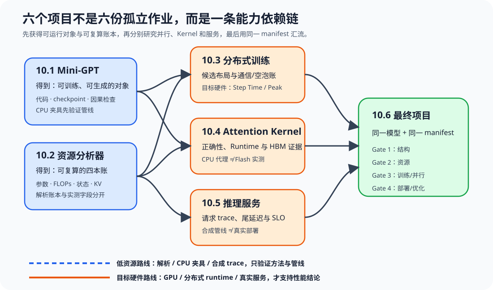
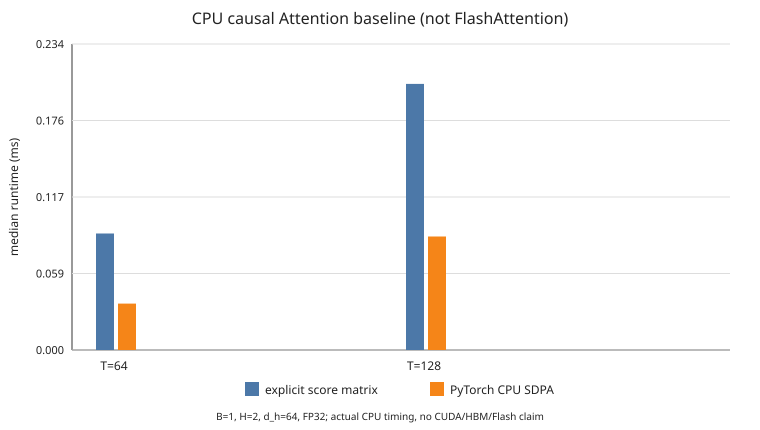
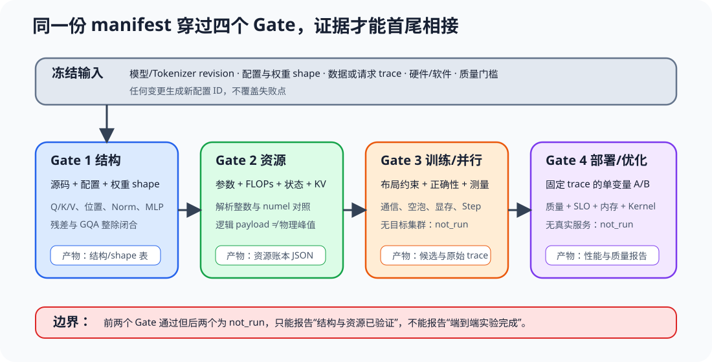

# 第 10 章 综合实践与课程项目

[总目录](../index.qmd) · 上一章：[第 9 章](09-frontiers.md) · 正文末章；之后按需查阅[前置知识附录](../appendices/prerequisites.md)

学期末，你已经能运行 MiniGPT、复算参数与显存、列出并行候选、比较 Attention 实现，还能从请求 trace 计算延迟与 SLO。现在真正困难的问题出现了：这些结果来自不同夹具，某个脚本的 PASS 能否和另一个脚本的 PASS 合起来，证明“一个 LLM 系统已经完成”？答案是否定的。你需要冻结同一个模型与 manifest，让结构、资源、训练设计和部署测量沿同一条证据链首尾相接。

本章先把这条长任务拆成五个能力项目，再在 10.6 重新汇流。@fig-ch10-project-roadmap 给出建议路线：10.1 和 10.2 是低资源起点；10.3–10.5 分别训练并行、Kernel 与服务测量能力；只有 10.6 要求它们回到同一个模型。

{#fig-ch10-project-roadmap fig-alt="项目一产出可训练MiniGPT，项目二产出参数、FLOPs、状态和KV账本；两者共同支持项目三分布式训练、项目四Attention Kernel和项目五推理服务。三个系统项目最终汇入项目六，用同一模型与manifest完成结构、资源、训练并行、部署优化四个Gate。底部虚线表示解析、CPU夹具和合成trace的低资源路线，实线表示目标GPU、分布式runtime和真实服务测量路线。"}

| 项目 | 完成后你会拥有 | 当前仓库提供的起点 | 不能越过的证据边界 |
| --- | --- | --- | --- |
| 10.1 Mini-GPT | 一个可训练、可生成、可保存检查点的最小模型 | CPU 字符夹具与失败/成功记录 | 拟合字符模式不等于自然语言泛化 |
| 10.2 资源分析 | 参数、FLOPs、状态与 KV 的机器可复算账本 | 贯穿模型与 MiniGPT 对照 | 逻辑字节不等于 GPU 物理峰值 |
| 10.3 分布式训练 | 约束闭合的布局候选与测量协议 | 单进程解析策略账本 | 假想带宽时间不等于多卡实测 |
| 10.4 Attention Kernel | 正确性—时间—内存—Profiler 矩阵 | CPU 显式/SDPA 代理 | CPU SDPA 不等于 FlashAttention |
| 10.5 推理服务 | 开放环/闭环 trace 与联合 SLO 报告 | 合成事件指标管线 | 合成 trace 不等于模型服务 |
| 10.6 最终项目 | 同一模型贯穿四个 Gate 的证据包 | manifest 与报告骨架 | 不同夹具的 PASS 不能相加成端到端 PASS |

<a id="learning"></a>

## 学习目标与前置知识

学完本章后，读者应能：

1. 实现并验证一个可训练、可逐Token生成、可保存检查点的Mini-GPT，而非只提交模型类骨架；
2. 为明确结构复算参数、FLOPs、训练状态与KV Cache，并区分逻辑账本和物理峰值；
3. 在固定global batch下比较分布式候选的计算、通信、空泡和显存，不从解析估算宣布实测最优；
4. 设计Attention Kernel正确性、同步计时、峰值与Profiler矩阵，识别CPU替代与FlashAttention证据的边界；
5. 设计开放环/闭环推理Benchmark，用TTFT、TPOT、吞吐、SLO goodput和GPU内存解释系统瓶颈；
6. 用同一开源模型manifest把结构、资源、训练设计和部署实验串成可复现报告。

前置知识为[第2章模型结构](02-transformer.md)、[第3章资源账本](03-compute-and-gpu.md)、[第4章训练](04-pretraining.md)、[第5章并行](05-distributed-training.md)、[第6章Attention Kernel](06-efficient-attention.md)和[第7章推理服务](07-inference-serving.md)；涉及SFT/LoRA或质量评估时再读[第8章](08-post-training-evaluation.md)。10.1与10.2是低资源核心实践；10.3–10.5均给出CPU/解析替代，但性能结论必须在目标GPU或真实服务上复测；10.6是综合项目任务书。

### 遇到失败时，先定位哪一层

严格门槛的目的不是给项目贴标签，而是把调试范围缩小。先保留失败记录，再按症状回到最早可能出错的层：

| 症状 | 常见原因 | 第一项检查 |
| --- | --- | --- |
| loss 非有限或不下降 | mask/目标错位、学习率、数据或数值范围 | 固定一个 batch，手算有效 Token NLL并检查梯度有限性 |
| 参数、FLOPs 或字节对不上 | 结构假设、权重绑定、bias、单位或完整/因果口径不同 | 按模块逐项列式，与配置和 `sum(numel)` 对照 |
| 多卡结果与单卡不等价 | global batch、归一化、初始化、通信组或更新语义不同 | 先做两 rank 小张量/单步参数更新对照 |
| 峰值下降但运行变慢 | fallback、occupancy、launch 开销或未计通信 | 先确认实际 Kernel，再分开看时间、内存与 Profiler |
| 吞吐上升但队列恶化 | offered load 超过稳定容量或尾延迟被平均值掩盖 | 同时报到达/完成率、P99、超时和联合 SLO goodput |
| 低资源路线 PASS、目标路线无结果 | 只验证了解析或管线，没有目标硬件/服务证据 | 将目标字段保留为 `not_run/null`，不要填 0 或外推 |

<a id="sec-10-1"></a>

## 10.1 项目一：从零实现 Mini-GPT

完成后，你会拥有一个从 Token 输入到训练更新、逐 Token 生成和 checkpoint round-trip 都可检查的最小模型，而不只是一个模型类骨架。

### 项目目标与交付物

实现一个能执行Next-token Prediction并逐Token生成文本的decoder-only Transformer，把[第2章前向定义](02-transformer.md#sec-2-1)和[第4章训练循环](04-pretraining.md#sec-4-2)连接成一个可运行程序。最低交付物包括：源代码、不可变配置、Tokenizer/语料说明、训练与验证loss、逐步生成记录、shape/因果检查、checkpoint schema、环境与完整命令、原始JSON及限制说明。只提交类定义或空函数骨架不合格。

本项目复用[第2章配套实现](../examples/ch02_transformer_shapes.py)，而不是复制另一套公式方向。结构固定为Token Embedding、Pre-RMSNorm、GQA形式的Causal Attention、Q/K RoPE、SwiGLU、顺序Residual Connection、final RMSNorm和绑定Embedding/LM Head。代码中PyTorch权重存为`[out,in]`，数学仍按全书行向量$\mathbf Y=\mathbf X\mathbf W$、$\mathbf W$为`[in,out]`解释。

### 实现清单与接口

| 模块 | 输入→输出 | 必须检查 |
| --- | --- | --- |
| Embedding | token ID `[B,T]` → `[B,T,d]` | ID范围、绑定LM Head |
| GQA Attention | `[B,T,d]` → Q `[B,H,T,d_h]`、K/V `[B,H_{kv},T,d_h]` → `[B,T,d]` | $H/H_{kv}$可整除、因果未来概率为0 |
| RoPE | Q/K形状不变 | 位置0恒等、旋转前后范数容限 |
| RMSNorm + Residual | `[B,T,d]` → `[B,T,d]` | Pre-Norm位置与两次顺序相加 |
| SwiGLU | `[B,T,d]` → Gate/Up `[B,T,d_{ff}]` → `[B,T,d]` | gate/up/down三矩阵与显式复算 |
| LM Head | `[B,T,d]` → `[B,T,V]` | 与Embedding共享同一参数对象 |

前向先通过shape与数值不变量，再进入训练。训练样本$\mathbf x=(x_0,\ldots,x_{T-1})$的输入为$x_{0:T-1}$、目标为$x_{1:T}$，损失复用[式（01-Loss）](01-foundations.md#eq-01-loss)；padding或角色mask存在时，必须按有效目标Token总数归一。每次成功更新遵循`zero_grad → forward/NLL → backward → unscale（如有）→ clip → optimizer.step → scheduler.step（如有）→ log/checkpoint`，非有限值时不得推进成功步。

### 数据、训练与生成协议

真实课程路线应选择许可明确的小语料，冻结train/dev/test划分和字符/BPE/Unigram Tokenizer revision，报告重复、污染与未知Token策略。训练前保存随机初始化的dev/test基线；用train更新、dev选学习率/停止点，配方冻结后才查看test。小语料loss下降主要证明管线能拟合，不能当作开放域语言能力。

生成必须是显式自回归循环：给定prompt，在第$t$步只把已有Token送入模型，从最后位置logits按冻结的greedy/temperature/top-k/top-p协议选择$x_{t+1}$，追加后再继续；遇EOS或`max_new_tokens`停止。测试应逐步保存context长度、所选Token ID和停止原因，并验证改变未来输入不会影响已生成前缀。当前参考实现为教学简洁而每步重算裁剪后的完整前缀，没有实现KV Cache，不能用于推理性能结论。

Checkpoint至少保存模型、optimizer、成功更新数、配置、Tokenizer映射和seed；精确续跑还应按[4.7](04-pretraining.md#sec-4-7)保存scheduler/loss-scaler、各随机源、数据sampler与游标。只验证`state_dict`重新加载后的logits一致，不能冒充中断后训练轨迹等价或崩溃安全原子提交。

### CPU字符夹具：已运行

[项目脚本](../examples/ch10_minigpt_project.py)使用内置重复字符夹具`to be or not to be.\n`，配置为$L=2,d=32,H=4,H_{kv}=2,d_h=8,d_{ff}=64,V=9,B=8,T=24$。它复用第2章模型，在CPU FP32上执行320次AdamW更新、两段学习率衰减、贪心生成、shape/因果检查和内存checkpoint round-trip。实际命令为：

```bash
/home/liu/anaconda3/envs/stock/bin/python doc/examples/ch10_minigpt_project.py
```

最终[原始JSON](../experiments/ch10_minigpt_project.json)记录Python 3.10.14、PyTorch 2.9.1+cu128、CPU两线程、CUDA不可用。主要结果为：

| 检查 | 观测 | 结果 |
| --- | ---: | --- |
| 固定验证loss | 27.86807 → 0.04277 | `<0.05`，PASS |
| 训练日志loss | 全部有限 | PASS |
| 因果前缀最大绝对差 | 0 | PASS |
| Q/K/V shape | `[2,4,24,8]` / `[2,2,24,8]` / `[2,2,24,8]` | PASS |
| 48步greedy生成 | 含`to be or not to be` | PASS |
| checkpoint重载logits最大差 | 0 | PASS |
| checkpoint字段 | model/optimizer/update/config/symbols/seed | PASS |

第一次180步运行的验证loss为0.08873，未达到预注册门槛，状态为FAIL并保存在[失败记录](../experiments/ch10_minigpt_project_failed_attempt_01.json)；没有通过降低门槛改成成功。随后把更新数增至320并在第121/241次更新降低学习率，完整确定性重跑后才得到上述PASS。

**证据边界。** 这是`cpu_character_minigpt_pipeline_check`：重复字符夹具证明实现可训练、可按argmax逐步生成、shape/因果与内存重载正确，也展示记忆训练模式；它不是独立自然语言test，不证明泛化、事实性或大模型质量。没有运行GPU、混合精度、KV Cache、吞吐/显存Benchmark、原子磁盘checkpoint或中断续跑等价。

### 验收矩阵与扩展路线

最低PASS要求：代码语法通过；所有记录loss有限且固定验证loss低于预先声明门槛；shape与未来不可见性通过；生成每步确由当步最后logits选择；checkpoint重载在dtype容限内一致；原始输出含环境、seed、配置、数据、命令、失败记录和未运行项。真实语料扩展还须用独立test报告NLL/PPL与样本生成，防止只展示挑选文本。

无GPU可运行当前CPU夹具；无PyTorch可完成shape/参数/可见对纸面账本，但必须标为`not_run`。有GPU时另建独立配置，使用同步计时与allocated/reserved峰值；有KV Cache时逐Token比较缓存与重算logits，并验证RoPE绝对位置。任何速度、显存或质量结论都要来自对应路线的实际输出，不能从本次PASS外推。

<a id="sec-10-2"></a>

## 10.2 项目二：LLM 计算量和显存分析器

完成后，你会拥有一个能对明确结构输出参数、FLOPs、训练状态和 KV Cache 四本账的分析器，并知道哪些字段必须留给真实框架测量。

### 目标、输入Schema与证据分层

为指定的无偏置decoder-only Transformer构建可机器复算的资源分析器，分别输出参数量、完整序列前向/训练主项FLOPs、参数相关训练状态和推理KV Cache。工具回答“在明确结构与dtype假设下的逻辑账本”，不能把解析字节写成框架`allocated/reserved`峰值，也不能把FLOPs写成秒。

最低输入Schema包含：层数$L$、隐藏宽度$d$、Query头$H$、KV头$H_{kv}$、头维$d_h$、SwiGLU中间宽度$d_{ff}$、词表$V$、序列长度$T$、batch $B$，以及权重/梯度/主权重/optimizer/KV各自dtype字节。先校验$d=Hd_h$、$H$能被$H_{kv}$整除、所有维度为正；是否绑定Embedding、是否有bias、Norm参数数目、Attention是完整方阵还是有效因果三角也必须是显式选项，不能隐藏在模型名中。

[参考脚本](../examples/ch10_resource_analyzer.py)当前固定本书结构：Pre-RMSNorm、GQA、SwiGLU、绑定Embedding/LM Head、无bias；采用2 FLOPs/MAC、完整$T\times T$ Attention与全位置LM Head。它提供`book_reference`和`minigpt`两个配置，输出JSON中的假设字段是结果的一部分。

### 四类输出如何复用全书公式

1. **参数量。** 复用[式（03-Param）](03-compute-and-gpu.md#eq-03-param)，逐项输出绑定Embedding、Q/O、K/V、Gate/Up/Down、每层两个RMSNorm及final RMSNorm，再求总数。解除绑定、加入bias或改成MHA时必须改项。
2. **FLOPs。** 复用[式（03-Block-FLOPs）](03-compute-and-gpu.md#eq-03-block-flops)，分开报告单Block、全模型前向与“三倍前向”的训练主项。后者只是在输入/权重梯度均需计算时的近似，不含重计算、Norm、RoPE、Softmax及逐元素算子。
3. **训练状态。** 复用[式（03-State-Memory）](03-compute-and-gpu.md#eq-03-state-memory)，当前报告BF16权重+BF16梯度+FP32 Adam两状态的$12P$，以及再含FP32主权重的$16P$。激活、临时量、workspace、通信buffer和allocator均另列未知，不能相加成伪精确峰值。
4. **KV Cache。** 复用[式（07-KV-Cache-Memory）](07-inference-serving.md#eq-07-kv-cache-memory)，当前取BF16 K/V、等长batch、所有层且不含分页元数据、对齐、碎片、复制和量化元数据。

输出单位同时保留整数bytes/FLOPs和人类可读GiB/TFLOPs时，换算规则必须写明：GiB用$2^{30}$，TFLOPs数量用十进制$10^{12}$；不能把GiB与GB、FLOPs与FLOP/s混用。

### 验证矩阵

分析器先通过第3章的最小解析例，再验证贯穿配置精确整数；对能实际构造的小模型，还要比较公式总参数与`sum(parameter.numel())`。物理显存比较必须另外运行模型，固定框架/硬件/dtype/shape，在独立进程重置峰值后记录`max_memory_allocated`与`max_memory_reserved`；解析状态只应作为解释基线，二者不要求相等。

当前机器无CUDA，故GPU物理峰值字段明确为`not_run_no_cuda`、数值为`null`。这不是“实测为0”，也不能用CPU RSS替代GPU张量峰值。未来补测时还要记录失败/OOM配置、预热、同步、迭代时间点和峰值发生阶段。

### 已运行结果

实际命令为：

```bash
/home/liu/anaconda3/envs/stock/bin/python doc/examples/ch10_resource_analyzer.py
```

[PASS JSON](../experiments/ch10_resource_analyzer.json)记录Python 3.10.14、PyTorch 2.9.1+cu128、CPU、CUDA不可用。主要账本如下：

| 配置/项目 | 解析结果 | 验证 |
| --- | ---: | --- |
| 贯穿模型总参数 | 5,802,037,248 | 与03-Param精确一致 |
| 贯穿模型完整序列前向主项 | 56,324,201,119,744 FLOPs | 与第3章精确整数一致 |
| 贯穿模型三倍训练主项 | 168,972,603,359,232 FLOPs | 解析近似 |
| 贯穿模型$12P/16P$状态 | 69,624,446,976 / 92,832,595,968 bytes | 逻辑payload |
| 贯穿模型BF16 KV，$B=1,T=4096$ | 536,870,912 bytes = 512 MiB | 与07-KV一致 |
| MiniGPT解析/实际参数 | 20,640 / 20,640 | `sum(numel)`一致 |
| MiniGPT BF16 KV，$B=2,T=24$ | 6,144 bytes | 解析账本 |

首次运行把精确前向预期常数写少32,768 FLOPs，其他四项检查通过但整体返回FAIL；记录保存在[首次失败JSON](../experiments/ch10_resource_analyzer_failed_attempt_01.json)。核对第3章的精确整数后只修正预期常数，公式与输出不变，完整重跑才得到PASS。教材正文的56.324201 TFLOPs是显示舍入，不能倒推成精确整数。

### 交付与停止条件

最终成果至少包含可导入的`analyze(config)`、输入校验、逐项JSON、两个测试配置、实际参数对照、失败记录和证据类型。出现shape不闭合、单位不明、解析/实际参数不等、非正结果、把未测物理峰值填成0或把Profiler覆盖当完整FLOPs时应FAIL。

低资源路线可只运行CPU参数对照与解析算术；无PyTorch时保留纯公式单元测试并将实际模型/GPU字段标为未运行。有CUDA后再补物理峰值和Profiler，但Profiler仅覆盖受支持算子，时间还须单独同步Benchmark。当前PASS只证明公式实现与小模型参数对照，不证明容量可装卡、训练能运行或达到任何吞吐。

<a id="sec-10-3"></a>

## 10.3 项目三：分布式训练性能分析

完成后，你会拥有至少两个约束闭合的并行候选、计算/通信/空泡/显存四本账，以及一份能在目标 GPU 上执行的公平测量协议。

### 项目目标、两层证据与公平比较

本项目比较单GPU、Distributed Data Parallel（DDP）与Fully Sharded Data Parallel（FSDP），并在硬件允许时增加Tensor Parallelism（TP）和Pipeline Parallelism（PP）。目标不是证明“卡越多越快”，而是把计算、通信、流水线空泡、逻辑状态与物理峰值分别记账，再用同一global batch、有效Token、模型、精度和成功更新数判断方案是否可比。

交付物分成两层。**目标GPU路线**必须实际训练同一小模型并报告Step Time、Peak GPU Memory、有效Tokens/s和通信时间；**本机低资源路线**只运行解析模型和CPU代数正确性检查，所有由假想带宽、时延或算力得到的秒数均标为estimate。没有多GPU结果时，实测字段必须为`null/not_run`，不能把解析值搬进“实测”列。

实验前冻结以下输入：设备数$N$及节点映射，$p_{\mathrm{DP}},p_{\mathrm{TP}},p_{\mathrm{PP}}$与ZeRO stage，$b_{\mathrm{micro}}$、累积micro-batch数$m$、序列长度$T$、dtype，设备有效计算吞吐$\rho$，链路有效带宽$\mathcal B$、每轮时延$\alpha$和DP bucket大小。先验证

$$
N=p_{\mathrm{DP}}p_{\mathrm{TP}}p_{\mathrm{PP}},
\qquad
B_{\mathrm{global}}=b_{\mathrm{micro}}m p_{\mathrm{DP}},
$$

并检查$d,H,H_{\mathrm{KV}},d_{\mathrm{ff}}$对TP切法及$L$对PP的整除性。TP/PP只切一个模型副本，不进入global batch；padding或变长样本还须另报有效目标Token。

### 四本账与重叠边界

1. **计算账。** 复用[10.2的训练主项](#sec-10-2)，先按TP×PP理想均分每rank算术量，再除以显式的$\rho$。$\rho$若由峰值FLOP/s乘假设MFU得到，输出只是模型时间，不是测量。
2. **通信账。** DP梯度bucket复用[Ring All-Reduce成本式](05-distributed-training.md#eq-05-ring-allreduce)，分别保留逻辑payload、轮数、$\alpha$项和带宽项。TP账必须声明每层有多少次、每次多大；PP账必须声明前向激活与反向梯度经过哪些stage边界。FSDP还会发生参数All-Gather、梯度Reduce-Scatter和临时物化，不能拿“DDP梯度ring”冒充其完整通信。
3. **空闲账。** 对完全平衡、同步非交错pipeline，复用[式（05-Pipeline-Bubble）](05-distributed-training.md#eq-05-pipeline-bubble)：bubble比例为$(p_{\mathrm{PP}}-1)/(m+p_{\mathrm{PP}}-1)$。真实stage不均、数据等待和链路争用另计。
4. **显存账。** 无分片时每rank参数相关逻辑状态为$12P/(p_{\mathrm{TP}}p_{\mathrm{PP}})$；ZeRO-1与ZeRO-3的理想均匀分片按[式（05-ZeRO-State-Memory）](05-distributed-training.md#eq-05-zero-state-memory)复算。激活、临时参数聚合、communication buffer、workspace、CUDA上下文、allocator reserved和碎片不能省略后再称为Peak GPU Memory。

最后用[分布式步时间账本](05-distributed-training.md#eq-05-distributed-step-time)合并：当输入等待暂取0、bubble单列为$t_{\mathrm{idle}}$时，完全重叠下界是$\max(t_{\mathrm{comp}},t_{\mathrm{comm}})+t_{\mathrm{idle}}$，完全不重叠上界是$t_{\mathrm{comp}}+t_{\mathrm{comm}}+t_{\mathrm{idle}}$。实际$t_{\mathrm{overlap}}$必须由Profiler时间线或等价事件测量；不能默认通信全部隐藏，也不能把各Kernel用时无条件相加。

### GPU实现、测量协议与调试边界

[第5章GPU示例](../examples/ch05_gpu_parallel_demo.py)已经用相同初始化和rank局部batch执行DDP、FSDP一步更新，并用手工Row/Column Parallel验证TP布局。先运行这个正确性门槛，再把[MiniGPT项目](../examples/ch10_minigpt_project.py)的模型与数据接入独立性能驱动；不要用$4\times2$线性层的耗时代表LLM。2卡正确性命令为：

```bash
torchrun --standalone --nproc_per_node=2 \
  doc/examples/ch05_gpu_parallel_demo.py \
  --output doc/experiments/ch05_gpu_parallel.json
```

性能实验对single/DDP/FSDP使用相同模型、dtype、global batch、有效Token和optimizer语义；若单卡放不下，应报告OOM并改用一个三者都能运行的小配置，而不是悄悄改变模型。每方案独立进程启动，固定seed与数据顺序，至少5次warmup、20次稳态成功更新；每次计时前后同步设备，保存原始分布并报告中位数和P95。Tokens/s以成功更新的有效目标Token除以端到端时间；Peak Memory同时报告`max_memory_allocated`与`max_memory_reserved`，并说明峰值重置点。通信时间由Profiler/NCCL trace或显式事件区间取得，并注明与计算重叠，因此不要求分项之和等于Step Time。

正确性FAIL包括：DDP/FSDP完整参数更新超出预设容限，global batch或Token归一化不一致，任一rank失败，shape不可整除，loss非有限或结果文件缺失。性能FAIL包括：无同步计时、把warmup混入稳态、只报最好一次、OOM样本被静默删除、Peak Memory口径缺失，或把解析秒数标成实测。硬件允许时增加TP，但必须先过Dense等价检查，并把TP组放置和链路写入报告。

### 本机已运行的解析策略账本

[策略分析器](../examples/ch10_distributed_strategy_analyzer.py)以贯穿模型$P=5{,}802{,}037{,}248$、$L=32,d=4096,H=32,H_{\mathrm{KV}}=8,d_{\mathrm{ff}}=11008,T=4096$为输入。假想设备输入为300 TFLOP/s峰值、无通信时MFU 0.40、节点内/节点间有效带宽300/50 GB/s、时延5/20 $\mu$s；它们只是可修改参数，不对应本机产品。实际运行命令为：

```bash
/home/liu/anaconda3/envs/stock/bin/python \
  doc/examples/ch10_distributed_strategy_analyzer.py
```

[原始JSON](../experiments/ch10_distributed_strategy_analysis.json)状态为PASS。固定global batch为16时，单卡、8路DDP、8路理想ZeRO-3/FSDP的参数相关逻辑状态分别为64.842819、64.842819、8.105352 GiB/rank；后者不含临时参数物化。单卡解析计算时间为22.5297 s，DDP的部分模型区间为2.8162–3.2467 s；FSDP虽然显示相同的已建模基线，但其参数All-Gather/Reduce-Scatter尚未建模，`performance_comparison_eligible=false`，不得据此断言与DDP同速。

128卡扩展复算如下。两方案均取$p_{\mathrm{DP}}=8,b_{\mathrm{micro}}=1,m=16$，故global batch为128、每更新输入Token为524,288；每rank参数状态理想下界均为4.052676 GiB。

| 候选 | TP×PP×DP | 整除结果（$d/H/H_{kv}/d_{ff}/L$局部） | bubble | TP简化通信/rank/update | 重叠下界—不重叠上界 |
| --- | --- | --- | ---: | ---: | ---: |
| A | 4×4×8 | 1024/8/2/2752/8 | 15.789% | 36.0 GiB | 1.6721–1.8631 s（解析） |
| B | 8×2×8 | 512/4/1/1376/16 | 5.882% | 84.0 GiB | 1.4961–1.9347 s（解析） |

TP通信采用“每层Attention/MLP各一次隐藏状态大小ring、训练主项乘3”的教学近似；PP取关键stage相邻边的激活/梯度P2P。B以更小bubble和PP payload换来更宽、更频繁的TP collective。两个时间区间重叠，所以当前账本只能把A/B保留为候选，不能宣布B最优；改变节点内带宽、collective实现或Kernel效率可能翻转结论。

**实际证据边界。** 本机本次只运行了单进程CPU解析器；未运行GPU、多进程、DDP/FSDP封装、NCCL、Profiler或128卡训练，JSON中Step Time、Peak allocated/reserved、Tokens/s和实测通信时间均为`null/not_run_no_multi_gpu`。[第5章CPU代数JSON](../experiments/ch05_distributed_correctness.json)另已验证两rank梯度平均与Row/Column分解，但也不是distributed runtime或性能证据。最终分布式训练性能报告必须并列给出配置、正确性、原始测量、解析预测、差异解释、失败/OOM记录和复现命令。

**理解检查。** 为什么FSDP的理想状态字节可以是DDP的$1/8$，却不能从当前解析结果推断它的Step Time也与DDP相同？A的时间上界更小而B的时间下界更小，现有证据能否给出唯一排名？

<a id="sec-10-4"></a>

## 10.4 项目四：Attention Kernel 性能优化

完成后，你会拥有一张把数值正确性、稳态时间、物理峰值和 Profiler 证据并排的矩阵，能够说明某个 Kernel 在什么 shape 与硬件条件下获益或失效。

### 目标、输入与三层证据

本项目比较显式标准Attention、PyTorch Scaled Dot Product Attention（SDPA）以及选修Triton Kernel，目标是解释完整$T\times T$ score/probability中间量与HBM数据搬运为何值得优化。数学问题始终是[式（02-Attention）](02-transformer.md#eq-02-attention)；FlashAttention改变分块、驻留和重算策略，不把标准稠密Attention的$O(T^2d_h)$算术复杂度改成线性，也不是近似Attention。

交付必须区分三层证据：解析账本计算逻辑中间量；CPU替代路线检查显式实现与SDPA的数值和计时管线；目标GPU路线才允许比较Flash后端的Runtime、Peak GPU Memory和HBM Traffic。CPU SDPA不能标成FlashAttention，逻辑score字节不能标成物理峰值，Profiler结果也不能冒充无Profiler稳态时间。

每个样本使用`[B,H,T,d_h]`的Q/K/V并冻结seed、因果mask、dropout、梯度范围和输出dtype。基础矩阵至少改变Batch Size、Sequence Length、Head Dimension与数据精度；推荐$B\in\{1,2,4\}$、$T\in\{128,512,2048,8192\}$、$d_h\in\{64,128\}$、FP16/BF16，并按显存保留共同可运行子集。MHA与GQA不能混在同一行；GQA还要固定$H/H_{\mathrm{KV}}$及实际后端支持。

### 三种实现与正确性门槛

1. **显式基线：** 计算`Q @ K.transpose(-1,-2) / sqrt(d_h)`，用绝对位置构造因果mask，沿key维做Softmax，再乘V。只含一个score矩阵时，其逻辑容量为$BHT^2s$ bytes；实际实现还可能物化mask、概率、梯度与workspace。
2. **PyTorch SDPA：** 使用`scaled_dot_product_attention(..., dropout_p=0, is_causal=True)`。CPU运行只证明该环境所选CPU实现；GPU实验必须强制并记录`MATH`与`FLASH_ATTENTION`后端，fallback行不得标为Flash。
3. **选修Triton：** 按[Online Softmax合并式](06-efficient-attention.md#eq-06-online-softmax-merge)维护行最大值、指数和与未归一化输出。先通过非整除Tile、因果边界、全mask处理及输出/梯度测试，再谈性能；教学Kernel未实现或后端不支持时写`not_run`。

参考输出$y$与候选$\hat y$采用[6.5的统一指标](06-efficient-attention.md#eq-06-attn-bench-metrics)：最大绝对误差、相对L2误差和$t_{\mathrm{baseline}}/t_{\mathrm{candidate}}$。容限必须在运行前按dtype声明；非有限值、fallback、OOM或误差越界保留为FAIL记录，不能从图中删除。训练扩展还要分别比较$\nabla Q,\nabla K,\nabla V$。

### Runtime、Peak Memory与Profiler协议

每个GPU配置在独立进程中创建相同输入，预热至少20次，再以CUDA Event或前后同步测至少100次，保留原始分布并报告median/P10/P90。峰值测量在输入就绪后同步并重置统计，分别报告执行前基线、`max_memory_allocated`与`max_memory_reserved`的绝对值和增量；不同后端须使用相同的缓存清理策略。Runtime与Peak Memory必须分列，不能从较少的逻辑字节直接推导更短时间。

无Profiler运行负责最终计时；另选已通过正确性的代表shape，用PyTorch Profiler确认实际Kernel，并用硬件计数器记录DRAM read/write、Kernel duration、Compute/Tensor pipe、occupancy、寄存器/Shared Memory和spill。只有实际后端、误差、峰值与同步时间均有效的行才能进入FlashAttention性能对比图；横轴标$T$，按$B,d_h,dtype,causal$分面，纵轴同时保留原始毫秒，不能只画加速比。

[第6章GPU驱动](../examples/ch06_sdpa_gpu_benchmark.py)已经实现强制math/Flash后端、同步计时、allocated/reserved与误差记录。目标GPU路线对矩阵逐行运行，例如：

```bash
python doc/examples/ch06_sdpa_gpu_benchmark.py --allow-run \
  --batch 1 --heads 32 --length 2048 --head-dim 128 \
  --dtype bfloat16 --causal --warmup 20 --repeats 100 \
  --output doc/experiments/ch10_attention_gpu_B1_T2048_D128_bf16.json
```

### 本机低资源结果与图

[CPU基线脚本](../examples/ch10_attention_cpu_baseline.py)已在Python 3.10.14、PyTorch 2.9.1+cu128、CPU单线程且CUDA不可用的环境实际运行。矩阵为$B\in\{1,2\}$、$H=2$、$T\in\{64,128\}$、$d_h\in\{32,64\}$、FP32/FP64，共16行；每行预热3次、计时15次。[原始JSON](../experiments/ch10_attention_cpu_baseline.json)状态PASS，全部误差通过预注册容限，最大绝对误差为$4.7684\times10^{-7}$。

| CPU实际配置 | 显式score逻辑量 | 显式median | CPU SDPA median | 最大绝对误差 |
| --- | ---: | ---: | ---: | ---: |
| $B=1,T=64,d_h=64$, FP32 | 32,768 bytes | 0.085668 ms | 0.035519 ms | $3.5763\times10^{-7}$ |
| $B=1,T=128,d_h=64$, FP32 | 131,072 bytes | 0.198279 ms | 0.093056 ms | $4.7684\times10^{-7}$ |

长度翻倍时单个显式score矩阵的逻辑量恰为4倍，验证了$T^2$账本。当前机器没有可用CUDA allocator，物理Peak Memory为`not_available`而非0；Flash后端、GPU计时、Profiler、HBM计数器和Triton均为`not_run_no_cuda/not_run_optional`。因此下图只是CPU显式实现与CPU SDPA的低资源代理图，标题明确写明“not FlashAttention”，不能作为最终GPU加速图。

{#fig-ch10-attention-cpu-baseline fig-alt="两组 CPU 配置分别比较显式因果 Attention 与 PyTorch CPU SDPA 的中位时间，并标注 not FlashAttention；该图只说明本机 CPU 代理结果，不包含 GPU 显存、Kernel 或加速结论。"}

@fig-ch10-attention-cpu-baseline 只把两行代表配置变成可读入口；完整 16 行、原始重复时间与误差仍以链接的 JSON 为准。

### 报告、验收与适用边界

最终瓶颈分析报告至少包含环境指纹、完整矩阵、失败/OOM行、实际后端、误差、原始时间分布、allocated/reserved、Profiler/HBM证据、图生成脚本和复现命令。解释每个拐点时应同时检查：显式$T^2$中间量是否消失、是否仍为fallback、任务规模能否摊薄launch开销、occupancy与寄存器压力是否恶化，以及非Attention层是否已成为端到端瓶颈。

FlashAttention更可能在长序列、命中融合Kernel且显式基线受HBM往返限制时获益；短序列、小batch、不受支持的mask/dtype/head dimension、边界Tile、低occupancy或大量spill都可能限制收益。选修Triton实现还要承担autotuning、数值稳定性和多硬件维护成本，不能因“代码可运行”就声称优于生产Kernel。

**理解检查。** 若某配置的逻辑score容量下降、Peak allocated也下降，但median变慢，且Profiler显示DRAM bytes减少而occupancy显著降低，应如何限定结论？为什么当前CPU图既不能回答这个问题，也不能替代最终FlashAttention对比图？

<a id="sec-10-5"></a>

## 10.5 项目五：LLM 推理系统 Benchmark

完成后，你会拥有一套能保留到达、排队、首 Token、逐 Token、完成与失败事件的服务 Benchmark，并能用尾延迟和 SLO goodput 判断系统是否稳定。

### 目标、真实部署与公平基线

本项目使用现成推理框架部署一个许可证清楚、能够流式返回的小型开源decoder-only模型，在固定质量、资源预算和请求分布下分析延迟与吞吐。最终结论应回答系统何时开始排队、多少请求满足SLO、显存被权重还是KV占用，以及Batching、KV Cache或Quantization究竟改变了哪项瓶颈；只报一个最大tokens/s不合格。

先冻结模型权重与revision、Tokenizer/聊天模板、框架与commit、GPU/驱动/CUDA、权重和KV dtype、量化格式、TP/PP、最大上下文、采样/停止规则、客户端与网络。基线使用同一模型质量和请求trace；若某配置改变Token ID、停止原因或质量，应先说明质量—性能折衷，不能直接称为优化。

目标环境可选择vLLM、SGLang或TensorRT-LLM之一，先以该固定版本的`--help`核对参数，再保存服务启动命令、日志和环境manifest。以下仅是vLLM接口示意，不是本机已执行命令：

```bash
python -m vllm.entrypoints.openai.api_server \
  --model <LOCAL_MODEL_REVISION> --dtype bfloat16 \
  --max-model-len 1024 --max-num-seqs 4
```

服务启动后先用固定Prompt做有限值、流式事件、usage Token数与停止原因检查，再进入预热和正式窗口。当前机器没有CUDA，且未安装上述服务框架，也没有下载模型；因此真实部署状态为`not_run`，后续合成trace结果不能写成“模型服务实测”。

### 工作负载矩阵与指标口径

基础矩阵覆盖Prompt Length ${32,128,512}$ Token、Output Length ${16,64}$ Token、Server Batch上限${1,4,16}$，以及开放环Request Rate ${0.5,1,2,4}$ requests/s；按设备能力缩放但要保留饱和前后两侧。另以闭环并发${1,4,16}$检查固定Concurrency，不能把Concurrency当Request Rate。先固定`Prompt=128, Output=64, Batch=4`建立基线，再一次改变一个主变量；实际EOS提前停止时保存实际长度分布。

客户端以同一单调时钟记录arrival、first-token、每Token或last-token、completion、status与input/output Token数。每个配置预热至少20条，正式测量至少120 s或完成500条，以较大者为准；停止注入后排空并另报drain，所有在途、超时、拒绝和取消都必须保留。复用[式（07-Serving-Benchmark）](07-inference-serving.md#eq-07-serving-benchmark)计算offered load、completed requests/s、output tokens/s和联合SLO goodput；复用[7.1延迟定义](07-inference-serving.md#eq-07-inference-latency)计算每请求TTFT、TPOT与E2E，再报告P50/P95/P99、样本数和百分位算法。

GPU Memory Usage至少分列模型加载后基线、执行峰值`allocated/reserved`、KV逻辑/物理块、前缀缓存、临时workspace和OOM点。用`nvidia-smi`进程占用不能替代Tensor峰值；output tokens/s也不能与total tokens/s或单请求生成速率混用。开放环若到达率持续高于完成率，必须报告队列增长，不能用短窗口的完成吞吐掩盖不稳定。

### 三组优化A/B

1. **Batching。** 固定开放环trace，扫描最大request/Token预算与continuous batching；比较吞吐、TTFT/TPOT尾部、队列和KV峰值。更大Batch可能提高权重摊薄，也可能增加排队和容量压力。
2. **KV Cache。** 固定两组请求顺序，比较关闭/开启prefix caching或不同块配置；分别报告冷/热Cache、共享前缀Token、hit/eviction、TTFT和物理KV。无共享前缀时不能预设收益，跨租户共享还要检查隔离边界。
3. **Quantization。** 固定模型revision与trace，记录权重/KV的位宽、格式、group size、实际低精度Kernel与fallback；先过固定提示和代表性质量门槛，再比较内存、TTFT/TPOT与吞吐。模型文件更小但质量越界或Kernel回退不算成功。

每组至少重复3轮，并保存每轮原始分布。Profiler只用于代表窗口定位Prefill/Decode Kernel、HBM、主机空洞和通信，不把受扰动的Profiler时间混入无Profiler基准。瓶颈应由队列、Kernel、带宽、内存与网络证据共同判断，而不是仅看GPU utilization。

### 本机低资源指标管线：已运行

[第7章trace分析器](../examples/ch07_serving_trace_analysis.py)已复用到本项目；输入为[6条合成事件](../examples/ch07_synthetic_serving_trace.jsonl)，其中5条完成、1条timeout。实际命令为：

```bash
/home/liu/anaconda3/envs/stock/bin/python \
  doc/examples/ch07_serving_trace_analysis.py \
  --input doc/examples/ch07_synthetic_serving_trace.jsonl \
  --output doc/experiments/ch10_serving_trace_metrics.json \
  --window-start 0 --window-end 10 \
  --ttft-slo 1.5 --tpot-slo 0.4 --e2e-slo 4
```

[实际JSON](../experiments/ch10_serving_trace_metrics.json)在Python 3.10.14上状态PASS。10 s构造窗口的offered load为0.6 requests/s、完成吞吐0.5 requests/s、output throughput 1.4 tokens/s、联合SLO goodput 0.3 requests/s；TTFT P50/P95/P99为0.8/2.0/2.0 s，TPOT为0.3/0.5/0.5 s，E2E为1.3/3.0/3.0 s。1条timeout保留在状态计数中，3/5条完成请求满足联合SLO。

该PASS只验证schema、时间戳因果性、TPOT分母、nearest-rank百分位、窗口吞吐与联合SLO算术。JSON明确写明它不是模型、GPU、框架、网络或服务性能测量；真实服务、prefix cache和quantization字段均为`not_run`。合成点不得与将来的真实A/B点画在同一性能曲线上。

### 最终报告与停止条件

最终推理性能报告逐配置给出环境/启动命令、工作负载分布、到达/完成/拒绝/超时/取消、input/output/total tokens/s、TTFT/TPOT/ITL/E2E P50/P95/P99、联合SLO goodput、allocated/reserved与KV峰值、cache hit/eviction、实际Kernel/fallback、质量结果及原始日志路径。正文用“配置变化→资源变化→指标变化→瓶颈证据→代价”解释优化效果。

usage与事件Token数不一致、非有限输出、时钟错误、客户端先饱和、队列持续增长、OOM/fallback、质量越界、样本不足或失败请求被删除时，配置必须标为FAIL/受限。只有真实服务完成预热、重复、drain、质量与逐请求日志检查后，才能写“实测延迟/吞吐”；本机当前交付是可执行任务书与合成指标管线，不是部署完成证明。

**理解检查。** 两个配置的output tokens/s分别为220和250，但后者TTFT P99翻倍、队列持续增长且10%的请求超时。为什么不能仅据250宣布优化成功？还需比较哪些SLO goodput、长度、内存和质量字段？

<a id="sec-10-6"></a>

## 10.6 最终课程项目：端到端 LLM 系统分析

完成后，你会拥有一个以同一开源模型和不可变 manifest 为主键的证据包：每个结构、资源、并行与服务结论都能回到配置、命令、原始记录和适用边界。

### 项目目标、选型与证据链

选择一个许可证允许课程实验、配置与权重revision可冻结、且目标硬件能够部署的小型开源decoder-only LLM，完成“源码结构→资源账本→训练设计→推理部署→瓶颈优化”的完整技术实验。最终交付不是五份互不相干的作业，而是一条可追溯证据链：同一模型配置进入参数/FLOPs/KV公式、并行约束和服务manifest；每张性能图能回到原始记录、命令和环境。

选型报告先列许可证、模型卡、权重/Tokenizer revision、参数量级、上下文长度、架构字段、量化可用性、磁盘与目标GPU预算。必须从配置与实际权重shape核对架构，不能只凭模型名称推断。若完整权重不能在本地取得，低资源路线可以选择可下载的更小模型，或只完成已明确标为“解析/未部署”的结构与资源阶段；不得用本章字符MiniGPT夹具冒充所选开源模型。

建立一个不可变manifest，至少包含：模型与Tokenizer哈希、聊天模板、$L,d,H,H_{\mathrm{KV}},d_h,d_{\mathrm{ff}},V$、位置编码与Norm类型、权重/KV dtype、并行度、硬件/软件、随机种子、数据或请求trace、采样/停止规则、每阶段命令与产物路径。后续变更必须生成新配置ID，不覆盖原始失败记录。

@fig-ch10-project-gates 把四个阶段画成连续 Gate。前一个 Gate 的产物是后一个 Gate 的输入；后两个 Gate 若因缺少目标硬件保持 `not_run`，并不会抹掉前两个 Gate 的成果，但也不能把项目写成端到端完成。

{#fig-ch10-project-gates fig-alt="冻结的模型、Tokenizer、配置、数据或请求trace和硬件软件manifest先进入Gate 1，用源码、配置和权重shape验证结构；再进入Gate 2，产生参数、FLOPs、状态和KV账本；Gate 3需要训练与并行正确性及目标集群测量；Gate 4需要真实服务的固定trace、质量、SLO、内存和Kernel证据。缺少目标硬件时后两个Gate保持not_run，不能把前两个Gate的通过写成端到端完成。"}

### 阶段一：模型结构分析

沿一次完整Block前向解释四类实现，并附源码文件、类/函数或权重键证据：

- **Attention：** Q/K/V/O投影shape、MHA/GQA/MQA分组、因果mask和缓存时的绝对位置；对照[第2章定义](02-transformer.md#sec-2-2)。
- **Position Encoding：** RoPE/绝对/相对方案的坐标、作用于哪些通道、缩放或长上下文配置；不能把配置名当成推导。
- **Normalization：** LayerNorm或RMSNorm、Pre/Post-Norm、epsilon、可训练参数以及两次Residual的顺序。
- **MLP：** 激活/门控类型、Gate/Up/Down矩阵shape、中间宽度与bias；PyTorch存储`[out,in]`时转回全书数学方向`[in,out]`。

以一个最小真实输入运行shape hook或打印权重键，并选一层手工复算关键shape。Gate 1的PASS条件是：配置、源码与权重shape一致；$d=Hd_h$、GQA整除及残差shape闭合；未识别的自定义模块明确列为待查，不能硬套贯穿模型。

### 阶段二：资源分析

从模型真实结构逐项计算绑定/非绑定Embedding、Attention、MLP与Norm参数，并与`sum(numel)`核对；不能直接套用不匹配的[贯穿模型参数式](03-compute-and-gpu.md#eq-03-param)。按2 FLOPs/MAC分别给出单Block、完整前向与训练主项，声明Attention取完整方阵还是有效因果三角，逐元素/采样/重计算是否计入。训练显存至少分列权重、梯度、optimizer/主权重、保存激活、重计算、通信buffer与workspace；推理按[KV式](07-inference-serving.md#eq-07-kv-cache-memory)区分逻辑payload和分页/allocator物理峰值。

[10.2分析器](#sec-10-2)可作为结构相同模型的起点，但若目标模型有bias、非SwiGLU、局部Attention、MoE或未绑定LM Head，必须修改账本和测试，而不是只改模型名。Gate 2要求参数数目与框架精确一致，核心整数可独立复算，GiB/GB与FLOPs/FLOP/s不混用；容量结论另留安全余量，并以实际加载/OOM验证。

### 阶段三：训练与并行设计

给定GPU型号、每节点卡数、显存、节点内/节点间互连、目标序列长度和global batch，至少比较两种可行布局。每个候选列$p_{\mathrm{DP}},p_{\mathrm{TP}},p_{\mathrm{PP}},p_{\mathrm{CP}}$、ZeRO/FSDP stage、micro-batch与累积数，验证设备乘积、global batch以及层数/头数/KV头/宽度整除。复用[10.3四本账](#sec-10-3)估算计算、通信、空泡与显存，并给出重叠上下界；训练状态放不下时再选择分片、激活重计算、混合精度或offload，逐项说明新增通信/算术/主机流量。

Gate 3不是“预测最快”，而是候选约束闭合、关键payload可复算、未建模项与风险可见。有目标集群时先运行单卡loss/梯度基线，再做2卡等价和短程Profiler；没有GPU时只提交解析设计，时间字段写estimate，Step Time、Tokens/s和物理Peak Memory保持`not_run/null`。

### 阶段四：推理部署与优化

按[10.5](#sec-10-5)部署同一权重revision，先验证固定Prompt的Token数、停止原因与有限输出，再扫描Prompt/Output长度、Batch预算、开放环Request Rate和闭环Concurrency。基线同时报告TTFT、TPOT/ITL、E2E、output tokens/s、SLO goodput、拒绝/超时、allocated/reserved与KV；用客户端事件、服务trace与Profiler定位Prefill计算、Decode带宽、KV容量、调度/主机或网络瓶颈。

只选择证据支持的一到两项优化做单变量A/B，例如continuous batching、prefix cache、FlashAttention、权重/KV量化或PD分离。每项都回答：原始瓶颈是什么；改变了计算、通信、显存还是数据搬运；代价和无收益条件是什么。Gate 4要求相同请求trace、资源预算与质量门槛，至少3轮原始数据；fallback、OOM、质量越界与失败请求必须保留。

### 综合报告、图表与验收矩阵

报告建议按以下结构提交：

1. 研究问题、模型/许可证、硬件与不可变manifest；
2. 结构图、前向shape表与源码证据；
3. 参数/FLOPs/训练状态/KV账本及公式假设；
4. 两个训练并行候选、约束、通信/显存/空泡与风险；
5. 推理工作负载、基线、瓶颈证据、优化A/B与质量门槛；
6. 失败/OOM/fallback、未运行项、可复现命令和原始数据索引；
7. 结论：在哪个工作负载和资源范围内成立，以及改变条件后为何可能翻转。

每张图保留绝对轴、单位、样本数/误差条、配置ID与数据路径；解析估算、论文报告和本机实测使用不同图例。至少提供一张结构/shape图、一张资源账本图和一张真实性能/尾延迟图；若真实部署未运行，第三张改为“待测矩阵/合成管线验证”，标题不得出现实测加速。总验收要求四个Gate均有状态，结构与资源阶段可复算，训练与推理结论不越过证据，仓库从manifest中的命令可重建所有已声明结果。

### 本仓库提供的低资源起点

10.1–10.5已经提供MiniGPT管线、资源分析器、分布式策略账本、Attention CPU代理和服务trace分析器及各自JSON。这些产物能检查方法与报告格式，但来自不同教学夹具，**不是同一开源模型的端到端运行**。当前作者环境没有完成开源模型下载、GPU训练、分布式runtime或真实服务部署，因此本项目仅提供可执行任务书，目标实验仍未运行。学生或后续执行者必须以选定模型的新manifest和原始数据完成四个Gate，不能把已有PASS简单相加成最终项目PASS。

**理解检查。** 若资源分析器按目标配置算得参数与KV正确，分布式解析显示候选可行，合成服务trace也PASS，但没有加载目标权重或启动服务，最终项目哪些Gate可以通过、哪些只能保持`not_run`？为什么？

<a id="experiment"></a>

## 本章实验

本章不另造第七套实验；10.1–10.6各节就是逐级任务书。当前仓库的运行状态如下：

| 项目 | 本机已运行证据 | 仍未运行/不能声称 |
| --- | --- | --- |
| 10.1 Mini-GPT | CPU字符夹具训练、生成、因果与checkpoint，PASS | 真实自然语言泛化、GPU、KV Cache、精确续跑 |
| 10.2 资源分析器 | 贯穿模型解析账本与MiniGPT实际参数对照，PASS | GPU物理峰值与容量装卡 |
| 10.3 分布式分析 | CPU解析候选与128卡约束，PASS | 多进程/GPU/NCCL/FSDP/128卡实测 |
| 10.4 Attention Kernel | 16行CPU显式/SDPA误差与时间代理，PASS | CUDA Flash、Peak GPU Memory、Profiler、Triton |
| 10.5 推理Benchmark | 6条合成trace指标管线，PASS | 开源模型服务、GPU、Prefix Cache、量化A/B |
| 10.6 最终项目 | 四Gate任务书已提供 | 同一开源模型的目标端到端实验 |

所有实际命令、输入、JSON、失败记录和判定标准均链接在对应项目节。复现时先使用原环境和小配置通过正确性，再扩大资源；缺硬件时提交解析/CPU路线并把目标字段保持`not_run/null`，不能用既有不同夹具的PASS拼成端到端PASS。

<a id="exercises"></a>

## 本章小结与习题

六个项目共享一条主线：**配置冻结 → 正确性门槛 → 资源/性能测量 → 失败保留 → 结论限界**。模型能前向不等于训练正确，解析显存不等于物理峰值，CPU SDPA不等于FlashAttention，合成trace也不等于真实服务。最终报告必须让读者从每个结论追到配置、公式、原始数据与复现命令。

- **你现在应该知道：** 六个项目各自改变或测量什么对象，为什么不同教学夹具的 PASS 不能拼成同一模型的端到端证据。
- **你现在应该能算：** 参数、FLOPs、状态、KV、global batch、pipeline bubble、通信近似、服务吞吐与 SLO goodput，并给出单位和遗漏项。
- **你现在应该能判断：** 一个结果属于解析账本、论文报告还是本机实测；目标硬件或真实服务未运行时，哪些 Gate 可以通过，哪些必须保持 `not_run`。

1. 某无偏置、绑定Embedding的贯穿结构缩小为$L=4,d=256,H=8,H_{\mathrm{KV}}=2,d_h=32,d_{\mathrm{ff}}=768,V=8192$。用全书参数式求参数总数；BF16 KV在$B=2,T=1024$时是多少MiB？列出公式不覆盖的两类物理显存。
2. 10.4某行解析得到显式score为128 MiB，CPU进程RSS峰值多110 MiB，GPU脚本未运行。哪些是解析、哪些是本机观测？可以写出哪些结论，不能画什么图？
3. 一个120 s开放环服务测试到达720条、完成660条、输出79,200 Token，其中594条满足联合SLO。求offered load、完成吞吐、output throughput和SLO goodput；还需报告哪些状态才能判断队列是否稳定？
4. 最终项目已核对目标模型配置/权重shape，参数公式与`sum(numel)`一致，并完成两个并行候选的解析账本；但没有目标GPU，也没有启动服务。判断Gate 1–4分别可以是什么状态，并说明最终报告能否标为“端到端实验完成”。

[答案与提示](../appendices/exercise-solutions.md#solutions-10)

正文学习到这里完成。遇到 shape、概率、优化、Python、单位或证据标签困难时，使用[必要前置知识](../appendices/prerequisites.md)做五分钟回顾；查全书统一变量与口径时转到[符号表](../appendices/notation.md)。这些附录是按需工具，不要求在开始项目之前从头背诵。

<a id="references"></a>

## 参考资料

本章以项目任务为主，模型公式与实现来源复用第 1–8 章使用的原始论文和官方文档。Attention 项目复用 REF-090、REF-098–101；推理 Benchmark 复用 REF-102–103、REF-121–123；具体版本、访问日期、所支持论点及未运行边界见来源台账，按章节与主题的入口见[参考资料附录](../appendices/references.md)。
