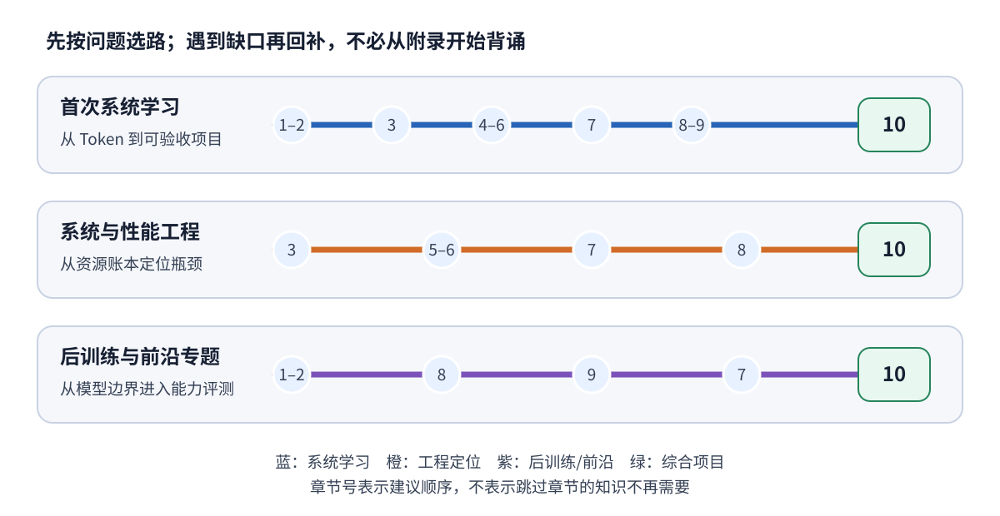

{fig-alt="《拆开大模型》封面，分层展示 Token、Transformer、GPU 与推理服务器" width="320px" fig-align="center"}

本书由 Qiauil 与 ChatGPT 共同创作。

教材正文、附录和原创插图采用 [CC BY 4.0](https://creativecommons.org/licenses/by/4.0/)。`examples/` 下的原创示例代码和实验脚本采用 [MIT](https://opensource.org/license/mit)。第三方材料遵循其各自的许可条款。

# 从局部正确到端到端证据 {.unnumbered}

一个 Attention 公式写对了，不等于训练循环能精确恢复；一个 Kernel 更快，也不等于服务的尾延迟更低；不同教学夹具各自 PASS，更不能自动合成同一模型的端到端证据。本书沿一条可检查的链路连接 **Token → Transformer → 资源账本 → 训练与并行 → Kernel → 推理服务 → 后训练与评测 → 综合项目**。

正文包含十章、四个按需附录、可运行的示例脚本与已保存的实验记录。你不必先读完所有前置材料：选一条路线开始，遇到 shape、概率、优化、单位或符号困难时再回到附录。

## 先选一条路线

| 你现在更像哪类读者 | 建议路线 | 先得到什么 |
| --- | --- | --- |
| 首次系统学习 LLM | 第 1–8 章顺读 → 第 10 章；第 9 章按兴趣插入 | 从下一 Token 概率一路建立到训练、服务和评测的完整心智模型 |
| 做训练/推理系统或性能工程 | 第 3 章 → 第 5–7 章 → 第 10 章；缺结构时回补第 2/4 章 | 会列参数、FLOPs、显存、通信和服务 SLO 账本，并知道何时必须实测 |
| 关注后训练、评测与前沿专题 | 第 1–2 章 → 第 8–9 章 → 第 7/10 章 | 把能力、质量、安全、外部工具和系统成本放进同一验收框架 |

{#fig-index-learning-routes fig-alt="三类读者的建议章节顺序。所有路线最终汇入第十章项目，并提示遇到知识缺口时回补。" width="100%"}

@fig-index-learning-routes 中的章节号是建议顺序，不是先修资格。三条路线最终都进入第 10 章，因为项目会迫使结构、资源、正确性、性能与证据边界在同一交付物中对齐。

## 十章地图

| 章节 | 这一章回答什么问题 | 学完后带走的产物 |
| --- | --- | --- |
| [第 1 章](chapters/01-foundations.md) | 文本怎样变成下一 Token 概率？ | Token、损失、采样与停止条件链 |
| [第 2 章](chapters/02-transformer.md) | Decoder-only Transformer 怎样得到 logits？ | GQA/RoPE/RMSNorm/SwiGLU 的 shape 与执行图 |
| [第 3 章](chapters/03-compute-and-gpu.md) | 参数、FLOPs、显存和性能上界怎样分账？ | 可复算的四本资源账 |
| [第 4 章](chapters/04-pretraining.md) | 一次训练更新怎样可追溯、可恢复？ | 数据—更新—checkpoint 状态机 |
| [第 5 章](chapters/05-distributed-training.md) | 状态和计算放不下一张卡时怎样切分？ | 并行布局、collective 与通信账本 |
| [第 6 章](chapters/06-efficient-attention.md) | 如何不改数学结果而减少慢层级 IO？ | Tile、Online Softmax 与测量协议 |
| [第 7 章](chapters/07-inference-serving.md) | 怎样把 Token 稳定交付为在线服务？ | 请求—Token—KV 状态机与 SLO 账本 |
| [第 8 章](chapters/08-post-training-evaluation.md) | 怎样把 Base 模型训练和验收为 Assistant？ | 训练、质量、安全与系统四类门槛 |
| [第 9 章](chapters/09-frontiers.md) | 面对前沿方法，怎样避免把论文数字当部署结论？ | 状态、成本、能力与证据的审查框架 |
| [第 10 章](chapters/10-projects.md) | 怎样把全书知识变成可复现交付？ | 六个项目、四道 Gate 与报告模板 |

## 实验与结果

阅读数字或图表时，先看它属于哪一层证据：

| 标签 | 表示什么 | 不能推出什么 |
| --- | --- | --- |
| **解析账本** | 从明确公式、shape、dtype 与配置得到的数量或上界 | 不能单独证明墙钟时间、物理峰值或质量 |
| **论文报告** | 原论文或官方材料在其环境与协议下报告的结果 | 不能直接改称本机结果或当前模型结论 |
| **本机实测** | 在记录的软件、硬件、输入与测量协议下实际运行 | 不能越过该环境和工作负载无条件外推 |
| **未运行（not_run / null）** | 目标路线尚未执行或没有观测值 | 不是 0，也不是失败结果 |

::: {.callout-warning title="先对齐对象，再比较数字"}
只有模型、输入分布、dtype、后端、硬件、资源预算和统计口径足够一致时，性能数字才适合直接比较。正文会明确保留 CPU 夹具、GPU 路线、合成 trace 与真实服务之间的边界。
:::

各章的可运行脚本位于 `examples/`，已保存的结果位于 `experiments/`。章节中会明确区分理论推导、CPU 已运行结果、未运行的 GPU/分布式路线，避免把设计方案误当成实测结论。

## 卡住时去哪里

- 不确定 shape、概率、优化、Python 或单位：做[必要前置知识](appendices/prerequisites.md)的五分钟自测。
- 忘记变量、贯穿模型配置或统一单位：按任务查[统一符号表](appendices/notation.md)。
- 完成章末题后核对分母、单位与证据边界：看[习题答案与提示](appendices/exercise-solutions.md)。
- 想追到论文、官方文档、版本和阅读范围：按章节/主题查[参考资料](appendices/references.md)。

准备好后，从[第 1 章：大语言模型基础](chapters/01-foundations.md)开始；如果你已经有明确工程问题，也可以直接进入上面的对应路线。

