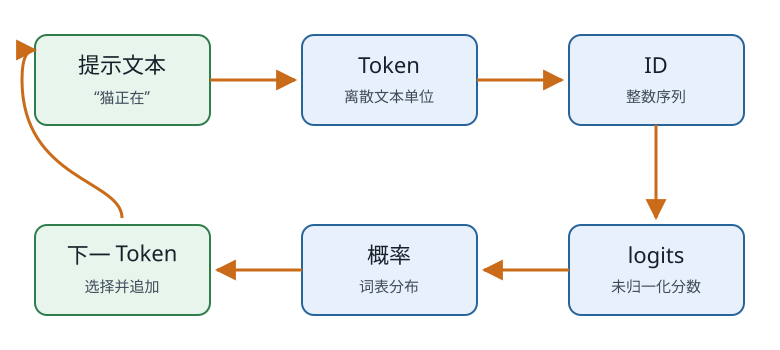
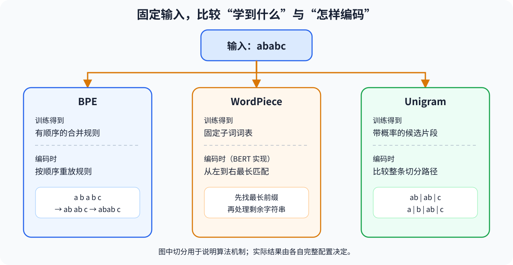
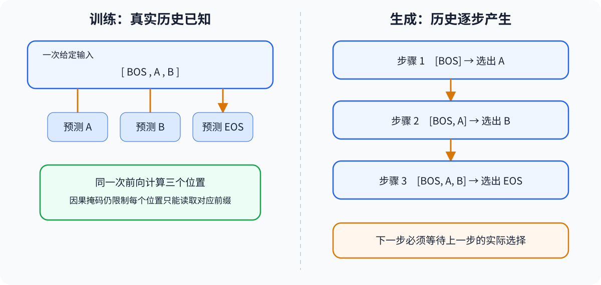
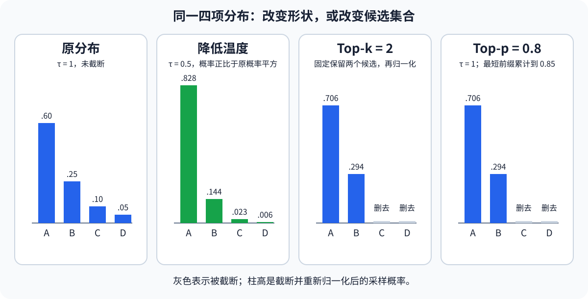

# 第 1 章 大语言模型基础

[总目录](../index.qmd) · 上一章：无（本章为首章） · 下一章：[第 2 章](02-transformer.md)

你在终端里输入“猫正在”，片刻后屏幕上出现“睡觉”。这看似是一次从文本到文本的直接变换，模型真正执行的却是一串可检查的步骤：先把文本切成离散单位并映射为整数，再计算整个词表的分数，将分数变成概率，选出一个单位并把它接回前缀。只要还没有遇到停止条件，这个过程就会继续。理解这条短链，是进入模型结构、训练和推理系统的共同起点。

本章沿着 @fig-ch01-next-token-loop 前进：1.1 先把语言模型的任务和生命周期放进全景图，1.2 追踪文本如何变成 ID，1.3 回到训练端推导概率与损失，1.4 再走到生成端考察选择和停止。读完后，你不仅能说出流程，还能手算其中的关键步骤。

{#fig-ch01-next-token-loop fig-alt="提示文本依次经过 Token、ID、logits 和概率，选出的下一 Token 追加回提示，形成逐步生成循环。" width="100%"}

<a id="learning"></a>

## 学习目标与前置知识

学完本章后，读者应能：

1. 用条件概率说明下一 Token 预测任务，并区分预训练、后训练、推理与服务。
2. 把一段文本的分词、ID 映射与反解码过程写成可检查步骤，并说明特殊 Token 和对话模板的边界。
3. 从概率链式法则推导自回归序列似然，根据有效目标计算 NLL、平均交叉熵和困惑度。
4. 对齐输入 Token 与下一位置目标，解释为何教师强制训练可按位置并行而自回归生成仍有步间依赖。
5. 对给定 logits 执行温度、Top-k 或 Top-p 选择，并核对 EOS、长度与停止序列的终止条件。

前置知识是基础概率、对数与 Python 序列操作；需要回顾时可查看[前置知识附录](../appendices/prerequisites.md)。本章均为基础路线，第 2 章将进入实现这些概率的 Decoder-only Transformer。

<a id="sec-1-1"></a>

## 1.1 大语言模型概述

<a id="sec-1-1-lm"></a>

### 语言模型预测什么

先把分词器和模型内部暂时看成两个黑箱，只问一个问题：给定“猫正在”这样的开头，下一个离散单位可能是什么？“睡”与“跑”都说得通，但并非同样可能。语言模型（Language Model，LM）用概率表达这种差异。本书主要研究自回归语言模型：它根据已有上下文预测下一个 Token，再把选中的 Token 加入上下文，重复同一任务。Token 可能对应字、词或词的一部分；模型实际接收它的整数 ID，分词细节留到 [1.2](#sec-1-2)。

设词表大小为 $V$，参数为 $\theta$；$x_t$ 是序列第 $t$ 个 Token 的 ID，$x_{<t}$ 表示此前全部 Token。这里序列位置从 1 起，候选 ID 则约定从 0 起。下一 Token 的条件概率写作式（01-Next），其中 $j$ 只在本式中表示候选 ID：

<a id="eq-01-next"></a>

$$
p_\theta(x_t=j\mid x_{<t}),\qquad j\in\{0,\ldots,V-1\}.
$$

对固定上下文，这些概率都非负、总和为 1；首个位置须约定使用序列起始标记 BOS 或空上下文。模型先给出整个词表上的分布，再由生成策略选一个 ID。概率分解与训练损失在 [1.3](#sec-1-3) 推导，选择策略在 [1.4](#sec-1-4) 讨论。

**局部玩具例子。** 假设词表只有四项，并人为给定前缀“猫”之后的分布；这不是实际模型输出，也不是完整的训练语料。

| 候选 ID | Token | 条件概率 |
| --- | --- | ---: |
| 0 | 猫 | 0.05 |
| 1 | 狗 | 0.05 |
| 2 | 睡 | 0.60 |
| 3 | 跑 | 0.30 |

四项相加为 1。选择概率最大项会得到“猫 睡”；按此分布随机抽样也可能得到“猫 跑”。后续分布须按新的前缀计算，详见 [1.4](#sec-1-4)。概率高表示模型认为续写较合适，不能据此断言文本事实正确。

::: {.callout-warning title="概率不是事实校验"}
条件概率回答的是“在模型和当前上下文下，哪个 Token 更可能出现”，不是“这句话在现实中是否为真”。增大模型或选择最高概率项，都不会自动增加一个外部事实核验步骤。
:::

<a id="sec-1-1-evolution"></a>

### 从有限上下文到 Transformer

下一 Token 预测并不是 Transformer 才能完成的任务。N-gram 模型只用前面最多 N−1 个 Token 估计下一项概率，例如 trigram 只保留两个历史 Token。计数方法容易检查，但上下文一长，可能的组合迅速增多，许多组合在语料中从未出现，只能再用平滑等方法处理。循环神经网络（Recurrent Neural Network，RNN）则用递推隐藏状态汇总历史，不必预先把历史截成固定的 N−1 项；代价是当前位置依赖前一步，序列内部形成逐位置的计算链，远距离信息也不一定能稳定保留。[Mikolov 等，2010，§1–2](https://www.isca-archive.org/interspeech_2010/mikolov10_interspeech.pdf)

Transformer 以注意力（Attention）建立位置之间的信息联系。同一层中的多个位置可以直接读取允许访问的位置，减少了沿序列逐步传递信息的路径；已知整段训练文本时，可以用矩阵运算并行计算各位置。训练并行与生成依赖的区别见 [1.3](#sec-1-3)。大规模矩阵运算便于利用 GPU，是它适合扩展训练的重要工程原因；标准稠密 Attention 的位置对数量随序列长度平方增长，长文本仍然昂贵，具体账本见第 3 章。[Vaswani 等，2017，§1、§3、§4 与表 1](https://arxiv.org/html/1706.03762v7)

大语言模型（Large Language Model，LLM）强调模型、数据与训练计算的规模，没有一个适用于所有场景的参数量门槛。规模扩大也不会把下一 Token 预测自动变成事实校验。本书用一组固定的 [教学配置](../appendices/notation.md) 分析结构与成本，并不将它当作某个实际模型。

<a id="sec-1-1-architectures"></a>

### 三类 Transformer 架构

Attention 解决了“位置之间怎样交换信息”，但模型仍需决定哪些位置可见、输入和输出怎样组织。由此得到三类常见 Transformer 架构。下表比较它们典型的信息流和训练方式；用途栏是常见选择，不是能力边界。

| 架构 | 典型信息流与训练方式 | 例子与用途 |
| --- | --- | --- |
| Encoder-only（仅编码器） | 输入中的非填充位置可双向交互；BERT 用左右上下文预测被遮蔽项 | [BERT，§3–3.1](https://arxiv.org/html/1810.04805v2)，常用于分类、抽取等表示任务 |
| Encoder-Decoder（编码器—解码器） | 编码器读取完整输入；解码器读取此前输出，并通过交叉注意力访问编码器表示 | [T5，§2.1、§3.2.1](https://arxiv.org/html/1910.10683v4)，将任务统一为文本到文本，适合输入到输出的条件生成 |
| Decoder-only（仅解码器） | 在本书讨论的因果形式中，每个位置只读取自身及此前位置，将提示与续写连成一个序列 | [GPT-3，§2–2.1](https://arxiv.org/html/2005.14165v4)，通过提示组织不同生成任务 |

GPT 类模型采用 Decoder-only 的一个直接理由是：大规模文本的下一项预测与给定提示的续写使用同一条计算路径，无需额外建立输入编码器和交叉注意力模块。提示还能包含任务说明与示例；GPT-3 的上下文学习在推理时使用这些示例而不更新权重。这里的结构解释是对上述目标与信息流的归纳，不构成它在所有任务上优于另两类架构的结论。T5 的架构比较也说明，结果需要连同训练目标和资源条件一起判断。

<a id="sec-1-1-lifecycle"></a>

### 从训练到在线服务

到这里，我们仍只把模型看成一个给出下一 Token 分布的函数。要让它成为用户可调用的系统，还要区分四个经常被混在一起的环节：哪些环节更新权重，哪些只使用权重，哪些处理单次计算，哪些组织多个请求。

| 环节 | 主要输入与产物 | 本书位置 |
| --- | --- | --- |
| 预训练（Pre-training） | 从大量文本构造预测目标，更新参数，得到基础模型 | 第 4 章；规模扩大后的训练并行见第 5 章 |
| 后训练（Post-training） | 使用指令回答、偏好等数据继续调整参数，使行为更符合任务要求 | 第 8 章 |
| 推理（Inference） | 给定提示和固定权重，执行前向计算与生成，得到 Token 序列；通常不更新参数 | 第 1、2、7 章 |
| 服务（Serving） | 接收多个请求，组织排队、批处理、缓存与输出，向用户提供服务 | 第 7 章 |

例如 InstructGPT 从预训练模型出发，先使用示范回答进行监督微调，再利用回答比较数据和强化学习调整行为；这是后训练的一条具体路线，并非所有模型都必须照搬。指令遵循得到改善也不保证消除错误。[Ouyang 等，2022，摘要、§1 与§3.1](https://arxiv.org/html/2203.02155v1)

推理描述一次请求的模型计算，服务还要决定多个请求如何共享资源。因此，即使模型权重完全相同，调度也会改变排队时间、显存使用与吞吐量。现在，全章地图中的任务边界已经齐全：下一节从流程最左端开始，拆开“文本如何变成 Token 和 ID”。

<a id="sec-1-1-check"></a>

### 理解检查

1. 玩具例子中，“睡”的概率为 0.60，是否表示每次都必须选它？
2. Transformer 训练时可以并行处理多个位置，为什么不能据此断言一次生成所有未来 Token？
3. 将示例写进提示、用指令数据更新权重、改变请求批处理，分别属于哪种环节？

提示：第一题区分分布与选择规则；第二题区分已知训练序列和未知的未来输出；第三题依次是推理中的上下文使用、后训练、服务调度。完整训练与生成机制将在后续小节展开。

<a id="sec-1-2"></a>

## 1.2 Tokenization

<a id="sec-1-2-pipeline"></a>

### 从文本到离散 ID

现在回到章首的“猫正在”。模型不能直接接收这三个汉字组成的字符串；它需要一串落在固定词表中的整数。分词（Tokenization）正是这座桥：先按既定规则把文本切成 Token，再把每个 Token 映射为 ID。模型随后查询输入嵌入表，把 ID 变成向量。ID 只标识词表位置，数值接近不表示含义接近。

沿着一次完整编码，文本可能依次经过规范化、预切分、子词切分、ID 映射和特殊标记处理；解码则按配套规则将 ID 还原为文本。规范化可能统一大小写或字符形式，预切分可能按空白和标点划定边界，并非每个分词器都使用相同流程。只要前面一步丢失信息，后面的子词切分再可逆也无法找回原文。例如先把 `A` 统一为 `a`，解码时便无法判断原来的大小写。SentencePiece 将规范化规则和切分模型一起保存，并区分恢复规范化文本与恢复原始文本。[Kudo 与 Richardson，2018，§2、§3.1、§3.4–3.5](https://aclanthology.org/D18-2012.pdf)

<a id="sec-1-2-methods"></a>

### 切分粒度与三种子词方法

如果每个字符都单独成项，词表容易控制，序列却可能很长；如果每个完整词都成项，常见词很紧凑，稀有词和新词又难以覆盖。子词方法在两端之间选择常见片段，使“见过的片段”能够组合成“没见过的整词”。三种粒度的取舍如下。

| 粒度 | 直接做法 | 收益与代价 |
| --- | --- | --- |
| 字符级（Character-level） | 以字符为单位；“字符”须明确是 Unicode 码点还是其他单位 | 词表较小，但文本序列较长；未收录的字符仍可能未知 |
| 词级（Word-level） | 按语言规则划分词并建立词表 | 常见词表示紧凑，但稀有词、变形和新词容易超出词表；中文等语言还需确定词边界 |
| 子词级（Subword-level） | 常见片段可成为一个 Token，罕见组合拆成更小片段 | 在词表大小与序列长度之间折中；切分结果不必对应语言学上的词或词根 |

要比较子词方法，不妨固定输入 `ababc`，分别问两个问题：训练时怎样得到词表，编码时怎样在既有词表中选切分。@fig-ch01-tokenization-compare 把这两个阶段分开；图中的候选切分只用于展示决策机制，并不声称三种方法会从同一词表得到同一结果。

{#fig-ch01-tokenization-compare fig-alt="输入 ababc 分成三条路径：BPE 重放训练所得的有序合并规则，WordPiece 在固定词表中从左到右做最长匹配，Unigram 比较多种候选切分的片段概率乘积。" width="100%"}

- **字节对编码（Byte Pair Encoding，BPE）**从一组初始单位开始，反复统计相邻符号对，合并频次最高的一对并保存合并顺序。编码 `ababc` 时不是重新统计这一个输入，而是重放训练所得的有序规则。名称含“字节”并不表示所有实现都从字节开始；初始单位可能是字符，也可能是字节，必须另行声明。[Sennrich 等，2016，§3.2](https://aclanthology.org/P16-1162.pdf)
- **WordPiece**在训练阶段选择词表的依据不同于 BPE 的原始相邻频次。固定词表后，BERT 官方实现从 `ababc` 左端开始寻找词表中最长的可匹配片段，再从剩余位置继续；词内延续片段用 `##` 标识，匹配失败可产生 `[UNK]`。`##` 是实现约定，最长匹配是编码算法，二者都不能替代对词表学习目标的说明。[Wu 等，2016，§4.1](https://arxiv.org/html/1609.08144v2)；[BERT 官方 WordpieceTokenizer](https://github.com/google-research/bert/blob/master/tokenization.py)
- **Unigram**从较大的候选词表出发，估计子词概率，再根据移除候选对语料似然的影响逐步裁剪。编码 `ababc` 时可能同时考虑 `ab|ab|c`、`a|b|ab|c` 等合法路径，按各片段概率乘积评分，通常用动态规划选择最佳切分，也可按概率采样供训练使用。这里的片段概率属于分词模型，不是 1.1 中根据上下文预测下一 Token 的语言模型概率。[Kudo，2018，§3.2–3.3](https://aclanthology.org/P18-1007.pdf)

所以，BPE 的核心是重放有顺序的合并，WordPiece 的上述实现核心是固定词表上的最长匹配，Unigram 的核心是比较整条切分路径的概率。SentencePiece 则是训练、编码和解码工具，支持 BPE、Unigram 等模型，不是第四种并列目标。

::: {.callout-important title="分词器是模型的一部分"}
与模型一起交付的规范化配置、词表、合并规则或概率、特殊 Token 和对话模板共同决定 ID 序列。仅知道“使用 BPE”，不足以复现输入；把另一套分词器接到既有权重前，ID 的含义也不会自动对齐。
:::

<a id="sec-1-2-example"></a>

### 可手算的训练、编码与解码

现在沿着图中的 BPE 路径手算一次。**局部玩具例子**的训练词型只有 `abab`（出现 3 次）、`abac`（出现 1 次）。以字符为初始符号，不跨词边界合并；为简化手算，不加词尾、空白和特殊标记。此例仅支持 `a`、`b`、`c` 组成的单词，不声称能编码任意文本。

| 轮次 | 当前词型及频次 | 相邻对的加权计数 | 本轮合并 |
| --- | --- | --- | --- |
| 1 | `a b a b` ×3；`a b a c` ×1 | `(a,b)=7`，`(b,a)=4`，`(a,c)=1` | `a+b → ab` |
| 2 | `ab ab` ×3；`ab a c` ×1 | `(ab,ab)=3`，`(ab,a)=1`，`(a,c)=1` | `ab+ab → abab` |

第一轮 `(a,b)` 的 7 次来自前一词型的 2×3 次与后一词型的 1 次。两轮后，词表保留基础符号并新增两个符号；本例自行指定 ID 为 `a:0`、`b:1`、`c:2`、`ab:3`、`abab:4`，因此局部词表大小 $V=5$。ID 排列并非 BPE 必然给出的数值。

训练结束后固定规则。编码未在训练词型中出现的 `ababc`：

```text
字符：        a b a b c
应用规则 1：  ab ab c
应用规则 2：  abab c
映射 ID：     [4, 2]
解码：        abab + c = ababc
```

这说明整个 `ababc` 虽未作为词型出现，仍可由已知片段表示；若输入含词表无法覆盖的 `d`，还需未知标记或回退策略。解码本例只需按 ID 查字符串后连接，不必逆向逐次拆开合并。实际分词器还必须处理空白、边界与规范化；完整 UTF-8 字节回退可以覆盖有效 Unicode 文本，但不能凭“子词”二字假定所有字符都已覆盖。

本书 Mini-GPT 采用更直接的 UTF-8 字节分词：256 个字节值分别作为 ID。例如 `中A` 的十六进制字节为 `E4 B8 AD 41`，ID 序列是 `[228, 184, 173, 65]`，合并完整字节序列后可解码回 `中A`。单个字节 Token 可能不是完整字符，流式输出应处理尚未凑齐的字节。这个方案便于复现，却可能产生较长序列；256 个 ID 已全部分配给字节，没有额外的 BOS/EOS/PAD ID，项目实现须另行规定边界、掩码与停止方式，不能直接挪用某个字节值。

<a id="sec-1-2-special"></a>

### 特殊 Token 与对话模板

| 名称 | 通常表达的含义 | 使用时要核对什么 |
| --- | --- | --- |
| BOS（Beginning of Sequence） | 序列开始 | 模型是否需要、由哪一步插入；不要重复添加 |
| EOS（End of Sequence） | 序列结束 | 训练是否包含、生成器是否将其视为停止条件 |
| PAD（Padding） | 为批处理补齐长度 | 填充位置的注意力与损失掩码需正确设置，不能只填入 ID 就假定自动忽略 |
| UNK（Unknown） | 无法按已有规则表示的输入 | 不同原文可能映射为同一项，原始信息无法据此恢复 |

特殊项的拼写、ID、是否启用及能否共用 ID 都依具体模型而定；不是每个分词器都具备四个独立标记。SentencePiece 的相关 ID 可配置，说明它们不是跨模型统一的常数。[SentencePiece，§3.3](https://aclanthology.org/D18-2012.pdf)

对话模板（Chat Template）把角色和消息边界组织成模型训练时采用的 Token 序列。例如 `〈user〉你好〈end〉〈assistant〉` 只是结构示意；真实标记必须使用对应模型的配置，角色名本身也未必是一个特殊 Token。消息结束与整个生成结束未必使用相同标记。更换模板会改变输入序列；若模板已添加必要边界，再次自动插入 BOS/EOS 可能造成重复。[Transformers 4.57.1 官方说明](https://huggingface.co/docs/transformers/v4.57.1/en/chat_templating)

<a id="sec-1-2-cost"></a>

### 分词怎样改变计算成本

增大词表通常能让常见文本使用更少的 Token，但也扩大嵌入与输出词表维度；固定隐藏维度 $d$ 时，输入嵌入表有 $Vd$ 个参数，绑定输出权重也不会消除其词表规模。词表与计算成本因此不能只选一端最小。

相同长度的原文在不同语言、不同训练语料构造的分词器下，可能得到很不一样的 Token 数量。应实际统计代表性文本，并明确按字符、字节还是等义内容比较，不能固定套用“一个 Token 等于几个字”。Token 数增大会占用更多上下文位置；其他条件固定时，逐位置线性层的计算随长度增长，标准稠密 Attention 的位置对数量按长度平方增长，逻辑 KV Cache 则随已缓存 Token 数线性增长。精确计数见第 3、7 章。

例如同一篇文本若从 1000 个 Token 变为 2000 个，在仍能放入上下文且保持其他配置相同的假设下，位置相关线性层主项约为 2 倍、完整方阵 Attention 的位置对为 4 倍、缓存 2000 个而非 1000 个 Token 的逻辑容量为 2 倍。这些是理论比例，不是运行时间或质量结论。已有模型的权重已与词表和 ID 含义配套，不能仅更换分词器就期待模型正确工作。

<a id="sec-1-2-check"></a>

### 理解检查

1. 玩具例子将 `ababc` 编码为 `[4,2]`。为什么无需把整个单词先加入词表？
2. 若先把 `A` 转成 `a`，再进行可逆子词切分，能否保证还原原始大小写？
3. 字节分词器对 `中A` 使用几个 Token？若模型只允许 256 个 ID，能否再直接给 EOS 分配 ID=256？

提示：第一题沿着固定合并规则和词表复算；第二题检查信息是否在切分前已丢失；第三题分别得到 4 和不能，增加独立 ID 会改变词表与模型配置。

<a id="sec-1-3"></a>

## 1.3 自回归语言建模（Autoregressive Language Modeling）

### 先把输入与目标错开一位

分词器已经给出 ID 序列，训练的下一步不是让模型复述当前位置，而是用当前位置之前的内容预测下一项。看一个带边界的**局部玩具例子**：序列为 `[BOS, A, B, EOS]`，模型读取前三项，分别预测后三项。

| 代码输出位置（从 0 起） | 该位置可见的输入前缀 | 目标 |
| --- | --- | --- |
| 0 | BOS | A，即 $x_1$ |
| 1 | BOS、A | B，即 $x_2$ |
| 2 | BOS、A、B | EOS，即 $x_3$ |

因此代码常用 `tokens[:, :-1]` 作为输入、`tokens[:, 1:]` 作为目标：输出位置 i 预测原数组位置 i+1。若数据没有 BOS，首个文本 Token 只作为上下文，损失从第二项开始计算；若框架内部已经位移，调用者不能再移一次，否则目标会错开两项。

### 从下一项预测到序列概率

三个目标对应三个条件概率。条件概率定义给出 $p(a,b)=p(a)p(b\mid a)$；对更长序列重复拆分后缀，就得到式（01-LM）。这个变换不要求各 Token 相互独立，恰恰保留了每一项对历史的依赖。

<a id="eq-01-lm"></a>

$$
\begin{aligned}
p_\theta(x_{1:T})
&=p_\theta(x_1)\,p_\theta(x_{2:T}\mid x_1)\\
&=p_\theta(x_1)\,p_\theta(x_2\mid x_1)\,p_\theta(x_{3:T}\mid x_{1:2})\\
&=\prod_{t=1}^{T}p_\theta(x_t\mid x_{<t}).
\end{aligned}
$$

式（01-LM）首位置以空上下文为条件；若提供 BOS，就把它视为给定条件，不计作需要预测的文本 Token。变长文本的概率还应包括 EOS 等结束约定，不能只给无限续写分布而忽略何时结束。实际窗口有限时，模型可能只使用历史的一部分；链式分解仍成立，参数化模型对条件分布的表示能力则受限。

### Teacher Forcing 与并行训练

教师强制（Teacher Forcing）指训练时使用真实历史，而不是把模型此前抽到的 Token 接回输入。因为 `[BOS,A,B]` 一开始就已知，因果 Transformer 可以在一次前向中计算三个预测位置；掩码仍保证每个位置只能读取对应前缀。@fig-ch01-teacher-forcing 把这种“位置并行”与生成时的“步间依赖”并排画出。

{#fig-ch01-teacher-forcing fig-alt="左侧训练时间线显示 BOS、A、B 均已知，三个目标 A、B、EOS 可在一次前向中计算；右侧生成时间线显示每一步选出的 Token 必须追加后才能进行下一步。" width="100%"}

并行的是多个已知前缀上的条件预测，并不是让当前目标提前流入输入。生成时未来目标未知，历史又包含模型先前的实际输出，因此必须逐步扩展，也可能走进训练数据中较少出现的历史。[Bengio 等，§2](https://arxiv.org/html/1506.03099v3)；[Transformer，§3.1](https://arxiv.org/html/1706.03762v7)

### Logits、Softmax 与交叉熵

模型怎样把“提高真实目标的条件概率”变成一个可以优化的数？一次前向输出 $\mathbf Z\in\mathbb R^{B\times T\times V}$。这里局部用 $z_j$ 表示某个预测位置对候选 ID $j$ 的未归一化分数（logit），真实目标 ID 为 $y$。分数可为任意实数；Softmax 将它们变为和为 1 的概率：

<a id="eq-01-softmax"></a>

$$
p_\theta(y\mid\text{该位置的前缀})
=\frac{e^{z_y-c}}{\sum_{j=0}^{V-1}e^{z_j-c}},\qquad c=\max_j z_j.
$$

同减 $c$ 不改变指数比值，却避免直接计算很大的指数。若真实目标是 one-hot 分布，它与预测分布的交叉熵就是 $-\sum_j\mathbf 1[j=y]\log p_\theta(j\mid\text{前缀})=-\log p_\theta(y\mid\text{前缀})$，也就是负对数似然（Negative Log-Likelihood，NLL）。对式（01-LM）取负对数，概率乘积变成各位置 NLL 之和；最大化真实序列似然便等价于最小化这个和。固定数据集下，再用所有有效目标的总数作平均：

<a id="eq-01-loss"></a>

$$
\mathcal L=-\frac{\sum_{b,t}m_{b,t}\log p_\theta(x_{b,t}\mid x_{b,<t})}{\sum_{b,t}m_{b,t}}.
$$

式（01-Loss）中 $b$ 是样本索引，$m_{b,t}\in\{0,1\}$ 标记目标是否计入损失；PAD、没有上下文而被排除的首项等不参与，分母必须大于 0。注意力可见性掩码限制“能读取什么”，损失掩码决定“哪些目标计分”，二者不能混为一个对象。实际计算宜用 log-softmax 或 log-sum-exp 形式，避免先算极小概率再取对数。

### 手算与困惑度

回到 `[BOS,A,B,EOS]`。若 A、B、EOS 的目标概率依次为 0.5、0.25、0.5，那么给定 BOS 的序列概率是三项乘积 $1/16$；总 NLL 为 $\log16$，除以三个有效目标后，平均损失为 $\log16/3\approx0.924196$。本节都采用自然对数。另看一个单位置例子：logits 为 $(\log2,0)$ 时，Softmax 得到 $(2/3,1/3)$；若真实目标是第二项，损失就是 $\log3$。

<a id="eq-01-ppl"></a>

$$
\operatorname{PPL}=\exp(\mathcal L).
$$

式（01-PPL）定义困惑度（Perplexity），上述三目标例子为 $16^{1/3}\approx2.519842$。它等于目标概率几何平均数的倒数；若模型在 V 项上始终给均匀分布，每目标困惑度就是 V。这个数只概括指定评测口径下的预测概率：较低 PPL 不直接意味着回答更正确或更有用。跨模型比较必须固定 tokenizer、语料、目标掩码与可用上下文；固定窗口的切块方式也会改变条件信息。[Transformers 4.57.1：PPL 评测口径](https://huggingface.co/docs/transformers/v4.57.1/en/perplexity)

变长批次要先合计 NLL，再除以有效目标总数。例如一组只有 1 个有效目标、概率为 1/2，另一组有 3 个有效目标、概率均为 1/4，合并损失为 $(\log2+3\log4)/4\approx1.213008$；直接平均两组损失得到约 1.039721，会把第一组权重放大。后续梯度累积也必须保持这一口径。

**理解检查。** 为什么不能让某位置读取原始 Token，又把这个 Token 本身当作同一位置的目标？先判断模型最容易学到什么，再展开答案：目标已经出现在可见输入中，模型可以直接学习复制；只有输入与目标错开一位，才构成真正的下一项预测。

<a id="sec-1-4"></a>

## 1.4 大语言模型的生成过程

### 由条件概率构成生成循环

训练解释了概率从哪里来，现在让章首的“猫正在”真正向前走一步：先用与模型配套的 tokenizer 和模板编码提示，模型给出下一 Token 分布；选出一个 Token 并追加到前缀，再计算新的分布。后一步必须以实际选出的历史为条件，[1.3](#sec-1-3) 的序列概率分解并不允许把各步当成互不相干的抽样。[Bengio 等，§2.3](https://arxiv.org/html/1506.03099v3)

下面是**概念伪代码**，`model`、`choose` 和停止配置都需由实际实现提供；它用完整前缀重复前向，便于理解，尚未使用第 7 章的 KV Cache：

```text
context = 编码后的非空提示（空提示需约定 BOS 或其他起始输入）
generated = []
重复至多 max_new_tokens 次：
    若 context 已达允许上下文长度：按事先规定停止
    logits = model(context) 的最后一个预测位置
    next_id = choose(logits, 策略与随机状态)
    context.append(next_id)
    generated.append(next_id)
    若 next_id 是有效结束标记，或已匹配非空停止序列：退出
返回 generated，并按约定处理结束标记与停止文本
```

### 从 logits 到选择规则

模型给出分布之后，系统还要决定“总选第一名，还是保留随机性”。贪心解码（Greedy Decoding）每步选择最大 logit 对应的 ID；并列时规定固定次序即可复现。但局部第一名未必组成全局概率最高的序列：若首项 A、B 概率为 0.6、0.4，A 之后最优项概率为 0.51，B 之后为 0.99，则贪心得到两项概率 0.306，走 B 分支却可达到 0.396。即使找到概率最高的整段续写，也不能直接等同于任务质量最高。

采样允许其他候选被选中。先用正温度 $\tau$ 调整局部 logits $z_j$，再决定保留哪些候选。式（01-Sampling）中 $q_j$、$\widehat q_j$ 只表示当前一步的采样分布，$S$ 是非空保留集合：

<a id="eq-01-sampling"></a>

$$
q_j=\frac{\exp((z_j-c)/\tau)}{\sum_\ell\exp((z_\ell-c)/\tau)},\quad
\widehat q_j=\frac{\mathbf1[j\in S]q_j}{\sum_{\ell\in S}q_\ell},\qquad \tau>0,
$$

其中 $c=\max_jz_j$，候选索引遍历词表。温度低于 1 通常使分布更集中，高于 1 更平坦；当最大项唯一时，趋近 0 的极限集中于该项，但公式不能直接代入零。贪心可作为独立分支实现。

| 策略 | 如何选 S | 代价与边界 |
| --- | --- | --- |
| 完整温度采样 | 全词表 | 保留尾部候选；高温可能增加不合适输出 |
| Top-k | 保留本步概率最高的 $k_{\mathrm{samp}}$ 项 | 固定候选数量；尖峰与平坦分布下同一个 k 含义不同 |
| Top-p / 核采样 | 按概率降序取最短前缀，使累计质量至少达到 $p_{\mathrm{nuc}}$，阈值在 (0,1] | 候选数量动态变化；须保留使累计值跨过阈值的那一项 |

这里固定先温度、后截断、再归一化的次序；同时使用多种截断时，也必须声明顺序。截断后的分布通常不同于原始模型分布，不能宣称仍在无偏抽取原模型。Top-k、Top-p 与温度的设计可见 [Holtzman 等，§3.1–3.3](https://arxiv.org/html/1904.09751v2)。

先别看结果，试着预测：对分布 `(0.60,0.25,0.10,0.05)`，降低温度会让候选更多还是更少？固定 Top-k=2 与 Top-p=0.8 是否总会留下相同数量的候选？

**局部数值例子。** 温度为 1 时，Top-k=2 或 Top-p=0.8 都保留前两项，累计质量为 0.85；归一化后为 `(12/17,5/17)`。若先把温度降到 0.5，各项概率正比于原概率的平方，第一项约为 0.827586，此时 Top-p=0.8 只需保留第一项。@fig-ch01-sampling-controls 展示了同一分布经过这些操作后的变化：温度改变整条分布的形状，Top-k 固定候选数量，Top-p 则让候选数量随概率集中程度变化。

{#fig-ch01-sampling-controls fig-alt="四个并列柱状图比较候选 A、B、C、D：原分布为 0.60、0.25、0.10、0.05；温度 0.5 后约为 0.828、0.144、0.023、0.006；Top-k=2 和温度 1 下的 Top-p=0.8 均只保留 A、B，并重归一化为约 0.706、0.294。" width="100%"}

随机采样的复现还需固定随机状态；相同提示和参数不自动保证跨硬件逐比特一致。

### 停止与训练的区别

选出 Token 还不等于知道何时结束。EOS 必须与具体模型和模板的有效结束 ID 对应；消息结束也不一定意味着整次生成结束。最大新增 Token 数只限制回答，提示长度仍会占用上下文。Stop Sequences 可以是 Token 序列或文本串，两者口径不同：文本停止串可能横跨多个 Token 或流式输出块，需要保留足够尾部进行匹配，并明确是否返回停止文本。空停止串应拒绝配置，以免立即触发。所有这些条件都只控制推理循环，不会更新模型权重。

训练通常在完整的真实输入/目标序列上并行计算多个位置的损失、反向传播并更新参数；生成通常只使用前向计算，取当前最后一个预测位置，再扩展前缀。即便反复完整前向产生了所有前缀位置的 logits，本轮也只据最后一项继续生成。Cache 改变重复计算量，不取消这种数据依赖。

**理解检查。** 在上述数值例子中，如果 Top-p=0.8 时只保留累计质量尚未超过 0.8 的第一项，会出现什么问题？提示：温度为 1 时只保留 0.60，不满足核集合的质量条件；必须包括第二项。

<a id="experiment"></a>

## 本章实验

这个实验把本章两端接起来：先观察一组文本怎样变成 Token，再观察生成策略怎样从概率分布中选 Token。目标是用同一个现有 tokenizer 记录四条简短陈述的 Token 数，并用与它配套的小型因果语言模型比较 Temperature 和 Top-p 改变时的续写。由于本机没有所需 checkpoint，目前只有理论字节基线实际运行；现有 tokenizer 计数和生成网格没有运行。

::: {.callout-note collapse="true" title="实验协议与证据状态"}
**输入。** [实验脚本](../examples/ch01_tokenizer_generation.py)内置中、英、德、西四条大致平行的短句。它们不是经严格语义标注的平行语料，因此要同时报告 Unicode 码点数、UTF-8 字节数和 Token 数，不能将单句比例概括为整种语言的固定效率。

**环境与命令。** 本机为 Python 3.11.5、Transformers 4.32.1、tokenizers 0.13.3、PyTorch 2.5.1+cu124，仅有 CPU 路线。默认禁止下载，会尝试从本地缓存读取 `sshleifer/tiny-gpt2`：

```bash
HF_HOME=/tmp/ch01-hf-cache TRANSFORMERS_OFFLINE=1 \
python docs/examples/ch01_tokenizer_generation.py \
  --model sshleifer/tiny-gpt2 \
  --output docs/experiments/ch01_tokenizer_generation.json
```

若课程已审核某个本地小型 CausalLM checkpoint，将 `--model` 改为该目录。只有在允许网络访问、已核对许可和下载大小时才加 `--allow-download`。Tokenizer 的编码接口和 `generate` 的 `temperature`/`top_p` 语义固定参照 [Transformers 4.32 tokenizer](https://huggingface.co/docs/transformers/v4.32.0/en/main_classes/tokenizer) 与 [text generation](https://huggingface.co/docs/transformers/v4.32.0/en/main_classes/text_generation) 文档。

**步骤与记录。** 脚本先保存模型标识、tokenizer 类、词表大小、每句的码点/字节/Token 数、ID、Token 字符串和反解码。然后固定英文提示，遍历 Temperature `{0.7,1.0}`、Top-p `{0.8,1.0}`与种子 `{20261102,20261103}`；显式设 `top_k=0`，每次最多生成24个新 Token。记录续写 ID/文本和是否命中 EOS。两个种子只用于显示随机性，不足以估计质量分布；本实验也不对不同模型作质量排名。

**正确性与边界。** 要求 tokenizer 与模型来自同一 checkpoint；Token 数必须由 `add_special_tokens=False` 的 ID 长度得到；原始 JSON 保存真实环境、参数网格与种子。随机生成不要求跨版本、硬件逐字节一致；比较时只解释本 checkpoint、本提示和本种子下的现象。Temperature 与 Top-p 同时变化时存在交互，不能把单个续写当成因果效果。

**低资源路线与实际状态。** 无 checkpoint 时，脚本仍会实际记录四句的码点数、UTF-8 字节数和“一字节一 Token”的理论基线；该基线不是现有 tokenizer 实测。本机预检查已运行，[原始记录](../experiments/ch01_tokenizer_generation.json)的状态为 `not_run_missing_checkpoint`：理论字节基线**已运行**，现有 tokenizer 计数和预训练模型生成网格**未运行**。不将缺少 checkpoint 解释为生成质量或采样策略结论。
:::

<a id="exercises"></a>

## 本章小结与习题

从“猫正在”到下一个 Token，现在可以用一条因果链回收：分词器先按固定配置产生 ID；Decoder-only 模型为下一位置输出 logits；Softmax 把分数变成概率；训练用真实下一项的平均 NLL 调整参数；生成则用选择规则取出一个 Token，追加到前缀，直到命中停止条件。

| 层次 | 学完本章后的检查标准 |
| --- | --- |
| 你现在应该知道 | Token、ID、logits 和概率各是什么；训练、推理与服务分别改变什么 |
| 你现在应该能算 | BPE 两轮合并计数、序列概率、平均交叉熵、困惑度，以及 Top-k/Top-p 重归一化 |
| 你现在应该能判断 | 分词器能否与权重配套、损失分母是否正确、采样顺序和停止条件是否说明完整 |

下面四题依次检查概念边界、成本比例、训练目标和生成策略。

1. **边界与环节。** 将下列行为分别归入预训练、后训练、推理或服务：用大量原始文本更新参数；用指令回答继续更新参数；把示例放入提示且不更新参数；合并多个请求的队列。哪一项只凭“模型生成了文本”无法判断？
2. **Token 成本。** 两个 tokenizer 把等义文本分成 750 与 1200 个 Token。在其他配置相同、序列均未超上下文上限时，逐位置线性层主项与完整方阵 Attention 位置对分别变为多少倍？为何不能把这两个比例直接当成墙钟时间比？
3. **似然与损失。** 序列 `[BOS,A,B,EOS]` 的三个目标条件概率依次为 0.8、0.5、0.25。计算给定 BOS 的序列概率、总 NLL、平均损失与困惑度。若中间目标被掩码，分母应如何改变？
4. **采样与停止。** 某步原分布为 `(0.60,0.25,0.10,0.05)`。温度为 1、Top-p=0.8 时保留哪些候选，重归一化概率是多少？若先把温度降到 0.5，再用同一 Top-p，结果如何？选中 EOS 与匹配文本停止串在流式输出中还需分别处理什么？

[答案与提示](../appendices/exercise-solutions.md#solutions-1)给出复算路径。

本章把模型内部暂时视作“ID 序列到 logits”的黑箱。第 2 章将拆开这个黑箱，跟随同一个 batch 经过嵌入、Attention、MLP、残差与 LM Head，并为这里出现的每个 logit 找到具体的张量计算路径。

<a id="references"></a>

## 参考资料

本章资料按主题整理在 [1.1 参考资料](../appendices/references.md#refs-1-1)、[1.2 参考资料](../appendices/references.md#refs-1-2)和[自回归与采样资料](../appendices/references.md#refs-p1-batch)；具体版本、使用位置与证据边界见来源台账。
