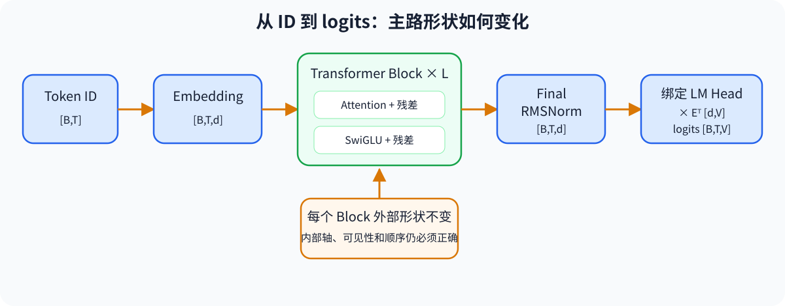
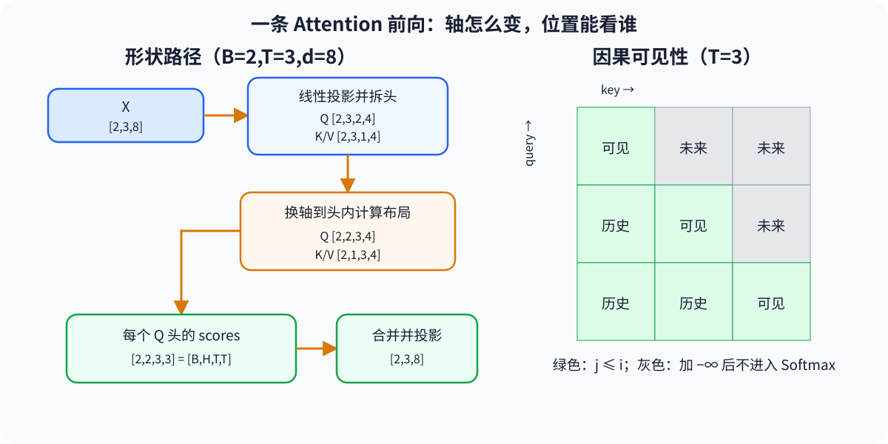
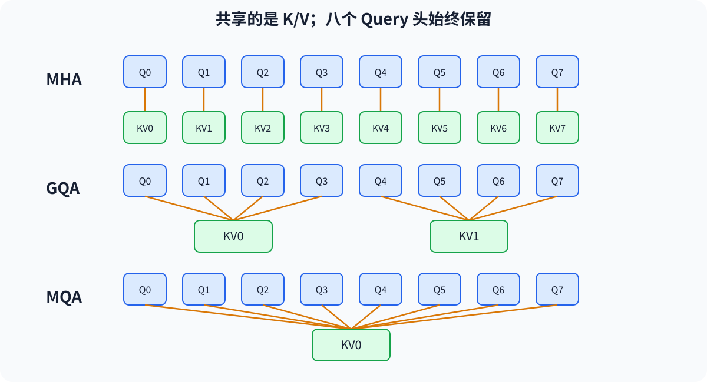
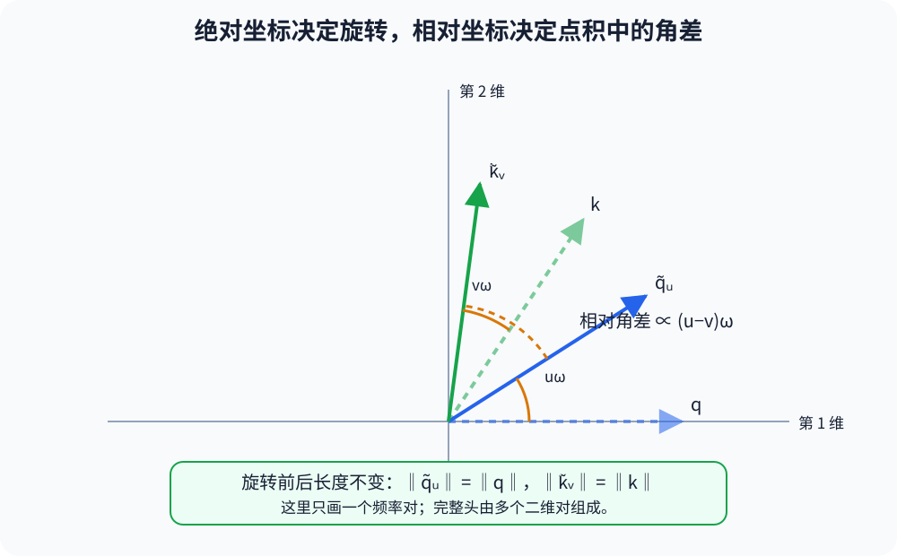
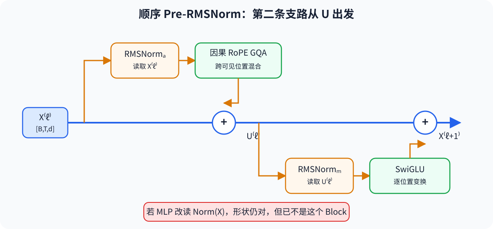

# 第 2 章 Transformer 模型结构

[总目录](../index.qmd) · 上一章：[第 1 章](01-foundations.md) · 下一章：[第 3 章](03-compute-and-gpu.md)

你把两条各含三个 Token 的序列送进模型，调试器最后打印出 logits 形状 `[2,3,10]`。形状看起来没错，输出却会随着未来 Token 改变。问题可能藏在因果掩码，也可能来自头轴换位、RoPE 坐标或残差分支的连接顺序。仅凭“程序跑通”和“末维等于词表大小”，无法判断这个 Transformer 是否真的实现了下一 Token 预测。

本章沿着 @fig-ch02-forward-map 拆开这个黑箱。2.1 先建立从 ID 到 logits 的整条前向路径；2.2 进入 Attention，逐轴追踪 Q/K/V、可见性和 KV 共享；2.3 加入位置信息；2.4–2.5 分别处理特征尺度与逐位置变换；2.6 把它们重新装成一个顺序 Pre-RMSNorm Block。2.7 的 MoE 是可选扩展，不改变本书贯穿的 Dense 模型。

{#fig-ch02-forward-map fig-alt="输入 ID 形状为 B×T，嵌入后为 B×T×d；L 个 Transformer Block 依次更新同形状主路，最终 RMSNorm 后乘嵌入表转置，输出 B×T×V 的 logits。" width="100%"}

<a id="learning"></a>

## 学习目标与前置知识

学完本章后，读者应能：

1. 从 Token ID 开始，逐步写出嵌入、$L$个 Pre-RMSNorm Block、最终归一化与绑定 LM Head 的前向路径，并标注每步形状。
2. 根据$B,T,d,H,H_{\mathrm{KV}},d_h$推导 Q/K/V、Attention 分数与输出形状，构造正确的因果可见性掩码，并比较 MHA、MQA 与 GQA。
3. 从二维旋转推出 RoPE 点积的相对位置性质，说明 Q/K 配对、频率缓存与长度扩展的实现边界。
4. 对给定向量手算 LayerNorm 与 RMSNorm，并按全书行向量约定写出标准 MLP、SwiGLU 和顺序 Pre-RMSNorm 残差 Block。
5. 对给定路由概率执行 MoE top-k 分发与回收，区分总参数、每 Token 激活参数、专家容量与跨设备通信代价。

必需的前置知识是第 1 章的下一 Token 目标、Softmax 和输入/目标位移；线性代数中的矩阵乘法、转置和向量范数可在遇到困难时查阅[前置知识附录](../appendices/prerequisites.md)。本章 2.1–2.6 是基础路线；2.7 MoE 为扩展，贯穿配置仍是 Dense GQA 模型。

<a id="sec-2-1"></a>

## 2.1 Transformer 整体架构

### 沿着一次前向计算阅读模型

第 1 章把模型当作“前缀→下一项分布”的函数。现在从 @fig-ch02-forward-map 左端出发：Token Embedding 将 ID 变为向量，多个 Transformer Block 依次更新隐藏状态，最终归一化后通过语言建模输出层（LM Head）得到 logits，再由 [Softmax](01-foundations.md#eq-01-softmax) 转成概率。输入/目标的位移仍按第 1 章约定，网络不会自动替我们纠正错位目标。

本节局部用 $\mathbf E\in\mathbb R^{V\times d}$ 表示输入嵌入表，第 j 行对应 ID=j。位置 t 的初始隐藏状态是查表结果；绑定输入输出权重时，输出层复用同一张表的转置。式（02-Embedding）省略 batch 索引：

<a id="eq-02-embedding"></a>

$$
\mathbf X^{(0)}_t=\mathbf E[x_t,:],\qquad
\mathbf Z=\operatorname{FinalNorm}(\mathbf X^{(L)})\mathbf E^\top.
$$

层上标表示经过多少个 Block，不覆盖层数符号 L；位置与 batch 维在这些逐位置映射中保留。查表结果是实数向量，ID 本身不是向量坐标。

### 结构与信息可见性

编码器中的典型双向 Attention 让输入位置相互读取，适合从完整输入提取表示；自回归解码器必须屏蔽未来输入。编码器—解码器还含访问编码器输出的交叉注意力；本书 Decoder-only 不含这条支路，直接把提示和回答放在一个因果序列中。[原始 Transformer，§3.1–3.2](https://arxiv.org/html/1706.03762v7)

贯穿模型采用 **Pre-RMSNorm**：每个 Attention 或 MLP 分支先归一化，再计算分支输出，最后加回残差主路；MLP 采用 SwiGLU，Attention 采用 GQA 并对 Q/K 使用 RoPE。可以先给两个分支分工：Attention 让一个位置读取可见位置的信息，MLP 则在每个位置内部改变特征；残差主路保存并累积两次更新，RMSNorm 调节进入分支的尺度。精确推导分散在 2.2–2.6，本节先把它们视为保持外部 `[B,T,d]` 形状的模块。原始 Transformer 的归一化位置和激活并不与本书配置完全相同。

### 统一线性层方向与形状账本

对最后一维的线性映射，本书统一使用式（02-Linear）：

<a id="eq-02-linear"></a>

$$
\mathbf Y=\mathbf X\mathbf W,\qquad
\mathbf W\in\mathbb R^{d_{\mathrm{in}}\times d_{\mathrm{out}}}.
$$

前面的 batch/序列维不变。对照 PyTorch 时要注意 `Linear.weight` 存为 `[out_features,in_features]`，计算使用它的转置；贯穿模型还须关闭线性层偏置，而不能沿用默认偏置设置。[PyTorch 2.9 Linear 文档](https://docs.pytorch.org/docs/2.9/generated/torch.nn.Linear.html)

**局部玩具配置**取 B=2、T=3、L=2、d=8、H=2、KV 头数=1、每头维度=4、中间维度=16、V=10。这不是贯穿模型，也不是实际训练记录。

| 步骤 | 输入或输出形状 | 如何理解 |
| --- | --- | --- |
| ID | `[2,3]` | 两条序列，每条三个输入 Token |
| 嵌入表 | `[10,8]` | 十个词表项各有八维向量 |
| 查表后的隐藏状态 | `[2,3,8]` | 每个位置得到 d 维特征 |
| 每层 Q / K / V | Q=`[2,3,2,4]`；K/V=`[2,3,1,4]` | Query 有两个头，KV 只一组；稍后解释共享 |
| Attention 输出及残差相加 | `[2,3,8]` | 合并各 Q 头后回到 d 维 |
| MLP 中间 / 输出 | `[2,3,16]` / `[2,3,8]` | 中间扩展后投影回主路；门控有两条扩展支路 |
| 两个 Block 后及最终归一化 | `[2,3,8]` | 不改变序列长度或隐藏维度 |
| 绑定 LM Head | `[2,3,8]` 乘 `[8,10]` | 得到 logits `[2,3,10]` |

可以用小向量复核绑定方向：若嵌入表三行为 `(1,0)`、`(0,1)`、`(1,1)`，隐藏向量为 `(1,2)`，三个 logits 就是与各行的点积 `(1,2,3)`。这是另一个 d=2、V=3 的局部例子。

L 控制堆叠深度，d 控制主路宽度，H 与 $d_h$ 满足 $d=Hd_h$，$H_{\mathrm{KV}}$ 决定共享多少组历史 K/V，$d_{\mathrm{ff}}$ 控制 MLP 中间宽度。这些结构选择影响参数与计算；B、当前 T 则是本次工作负载，不是模型层数或宽度。贯穿模型对应 32 层、d=4096、H=32、KV 头=8、$d_h=128$、中间宽度 11008、V=32000，其统一配置见 [符号表](../appendices/notation.md)。

**理解检查。** 把词表从 10 改为 12 而保持隐藏宽度 8，哪些形状会变？提示：嵌入表变为 `[12,8]`、输出 logits 末维变为 12，Block 主路仍为 `[2,3,8]`；已有权重也必须与新的词表对应。

<a id="sec-2-2"></a>

## 2.2 Attention 基础

在一个 Block 内，Attention 要同时回答四个不同问题：怎样给历史位置打分，怎样拆成多个头，哪些位置允许读取，以及多个 Query 头是否共享 K/V。@fig-ch02-attention-shapes 先固定贯穿小配置的轴变化，再分别进入 [单头计算](#sec-2-2-1)、[多头拼接](#sec-2-2-2)、[因果可见性](#sec-2-2-3)和 [MHA/MQA/GQA](#sec-2-2-4)。

贯穿模型采用因果 GQA：H=32、KV 头=8，所以每四个 Q 头共享一组 K/V。学习时可先按 MHA 的等头数布局核对矩阵乘法，再按共享映射缩小 K/V 头轴；位置轴与因果可见性不随这一步改变。以下单头数值例子先用零掩码展示加权含义，进入真实 Decoder 前必须加入 2.2.3 的约束。第 6 章将优化同一数学计算的数据搬运，不在这里把结构选择混同为 Kernel 加速。

{#fig-ch02-attention-shapes fig-alt="左侧显示 X 的 B×T×d 形状投影为 Q 的 B×H×T×d_h 和 K/V 的 B×H_KV×T×d_h，再得到 B×H×T×T 分数；右侧三乘三矩阵中只有对角线及左下区域允许读取。" width="100%"}

<a id="sec-2-2-1"></a>

### 2.2.1 Scaled Dot-Product Attention

#### 从查询到加权输出

若要让某个位置从上下文中取信息，可以先为每个候选位置打分，再对其内容向量加权求和。自注意力（Self-Attention）的查询、键和值都来自同一组隐藏状态，但通过不同的可学习投影表示不同职责：Query 描述要找什么，Key 用于匹配，Value 提供实际聚合的内容。这是计算解释，不意味着某个坐标必须有固定的语言学含义。

先省略 batch，只看一个头和长度 T。令 $\mathbf X\in\mathbb R^{T\times d}$，三个本节局部权重 $\mathbf W_Q,\mathbf W_K,\mathbf W_V\in\mathbb R^{d\times d_h}$，则 $\mathbf Q=\mathbf X\mathbf W_Q$、$\mathbf K=\mathbf X\mathbf W_K$、$\mathbf V=\mathbf X\mathbf W_V$，形状均为 $T\times d_h$。Q/K 点积给出匹配程度；对每一行沿 key 位置做 Softmax，得到非负且和为 1 的权重，再乘 V：

<a id="eq-02-attention"></a>

$$
\begin{aligned}
\mathbf S&=\frac{\mathbf Q\mathbf K^\top}{\sqrt{d_h}}+\mathbf M,
&\mathbf S&\in\mathbb R^{T\times T},\\
\mathbf A&=\operatorname{softmax}_{\mathrm{key}}(\mathbf S),
&\mathbf A&\in\mathbb R^{T\times T},\\
\operatorname{Attn}(\mathbf Q,\mathbf K,\mathbf V)&=\mathbf A\mathbf V,
&\mathbf A\mathbf V&\in\mathbb R^{T\times d_h}.
\end{aligned}
$$

式（02-Attention）中 $\mathbf S$、$\mathbf A$ 分别是本节的分数和概率矩阵；行 i 的输出为各 $\mathbf V_j$ 按 $A_{ij}$ 加权的和。$\mathbf M$ 是加性掩码，此处数值例子先取全零，[2.2.3](#sec-2-2-3) 再加入因果约束。Softmax 沿列而不是 query 行归一化，否则“这个位置从哪些历史位置取信息”的含义会错。若有 T 个 query、不同数量的 key，则分数为 query 长度×key 长度，不要求方阵。

#### 为什么除以平方根

作一个尺度分析：假设同一头的 Q/K 坐标彼此独立、均值为 0、方差为 1，且 Q 与 K 独立。一个坐标乘积的方差为 1，不同坐标乘积不相关，故点积的方差为 $d_h$，标准差为 $\sqrt{d_h}$。除以该标准差后，方差约为 1。否则头维度增大时，分数差异容易扩大，使 Softmax 很尖；其局部导数 $A_i(1-A_i)$ 等项可能趋近零。真实学习特征未必满足独立假设，所以这是缩放动机，并非所有训练阶段分数都严格服从同一分布。[Transformer，§3.2.1 及脚注](https://arxiv.org/html/1706.03762v7)

#### 可复算的小矩阵与执行方法

**局部玩具例子**取 $d_h=2$，Q 与 K 都为二阶单位矩阵，V 的两行为 `(2,0)`、`(0,4)`。第一行原始点积分数为 `(1,0)`，缩放后为 `(0.707107,0)`；概率约为 `(0.669762,0.330238)`，输出约为 `(1.339523,1.320954)`。第二行对称，输出约为 `(0.660477,2.679046)`。输出混合的是 Value 的行，并不是把分数当作输出特征。

直接实现可逐 query 遍历所有 key，再计算稳定 Softmax；矩阵形式将这些点积一次组织成 GEMM。以下是**概念伪代码**，不假称某个框架 API 已执行：

```text
Q, K, V = 三个输入投影
scores = matmul(Q, transpose_last_two_dims(K)) / sqrt(head_dim)
weights = stable_softmax(scores + additive_mask, axis=key_position)
output = matmul(weights, V)
```

Softmax 减去每行最大值不改变概率，能避免指数溢出。全掩码行须单独处理；不能依赖普通 Softmax 把全为负无穷的输入变成有效分布。

矩阵化提高可并行性，但这两个稠密乘法主项仍约为 $4T^2d_h$ FLOPs（一次乘加计 2），显式 S/A 各有 $T^2$ 项；还未计 Q/K/V 投影及 Softmax。短序列时调度和小矩阵效率可能比主项更重要，矩阵化不等于固定加速倍数；如何减少中间矩阵的显存搬运留在第 6 章。

**理解检查。** 若第一行分数同时加 1000，权重应不应改变？提示：不改变；稳定 Softmax 会减回公共偏移，数值验证也应满足这一性质。

<a id="sec-2-2-2"></a>

### 2.2.2 Multi-Head Attention（MHA）

#### 多个投影空间如何组合

一个头对所有 Value 使用一套位置权重，容易把不同关系压在同一混合结果中。多头注意力（Multi-Head Attention，MHA）使用不同的 Q/K/V 投影，让多个头能够形成不同的匹配与内容空间，再由输出投影组合。它提供不同关系的表达机会，不保证每个头都对应可解释且互不重复的功能。[Transformer，§3.2.2](https://arxiv.org/html/1706.03762v7)

先讨论 MHA，令 Q、K、V 头数都为 H，且每头宽度均为 $d_h=d/H$。本节局部头索引 h 从 0 到 H−1，每个头的权重 $\mathbf W_{Q,h},\mathbf W_{K,h},\mathbf W_{V,h}\in\mathbb R^{d\times d_h}$。用 [单头式](#eq-02-attention) 独立计算后，按特征轴拼接：

<a id="eq-02-mha"></a>

$$
\begin{aligned}
\mathbf O_h&=\operatorname{Attn}(\mathbf X\mathbf W_{Q,h},\mathbf X\mathbf W_{K,h},\mathbf X\mathbf W_{V,h}),\\
\operatorname{MHA}(\mathbf X)&=\operatorname{Concat}_{\mathrm{feature}}(
\mathbf O_0,\ldots,\mathbf O_{H-1})\mathbf W_O,\\
\mathbf W_O&\in\mathbb R^{Hd_h\times d}.
\end{aligned}
$$

式（02-MHA）中的拼接保留每个头的输出，而不是先把头平均。各头仍能读取同一段可见上下文，“多头”没有把序列分给不同头。

#### 张量实现与参数量

可以把同类的各头投影沿输出维拼成一个 $d\times Hd_h=d\times d$ 权重，一次投影后再拆头；Q/K/V 还可在实现中融合为更宽的一次矩阵乘法，但仍代表三组不同参数。典型布局变化为：

```text
X                         [B,T,d]
Q/K/V 各自投影             [B,T,H*d_h]
拆开末维                   [B,T,H,d_h]
交换序列轴与头轴            [B,H,T,d_h]
各头 scores / probabilities [B,H,T,T]
各头 output                [B,H,T,d_h]
先换回                     [B,T,H,d_h]
再合并末两维并作输出投影      [B,T,d] → [B,T,d]
```

不能把 `[B,H,T,d_h]` 直接按 `[B,T,d]` 重解释，否则会混淆时间与头的顺序。这里是概念布局，不承诺 `reshape` 在特定框架中一定零拷贝；转置后的步长与连续性还会影响实际执行。

无偏置且 $Hd_h=d$ 时，Q 投影共有 $Hdd_h=d^2$ 个参数，K/V 各自同样为 $d^2$，输出投影为 $Hd_hd=d^2$，总计 $4d^2$。**局部玩具例子**取 d=4、H=2、$d_h=2$：每个头的每种输入投影为 `[4,2]`，各头合起来每种为 `[4,4]`，四种投影共 64 个参数。贯穿宽度 d=4096 若采用 MHA，Attention 四投影合计 67,108,864 个参数；实际贯穿模型采用 GQA，不能套用这一 MHA 总数。

可以在玩具例子中令三个合并输入投影和输出投影均为单位矩阵，输入两行为 `(1,0,0,1)`、`(0,1,1,0)`。每头得到两维特征，分别做注意力后，第一位置拼接结果约为 `(0.669762,0.330238,0.330238,0.669762)`；这同时检验拆头、头内聚合与换回布局。

固定 d 时增加 H 会减小 $d_h$，四投影参数量不变，两个主要 Attention 矩阵乘法的算术主项仍为 $4BT^2d$。但概率矩阵共有 $BHT^2$ 项，Softmax 工作量、每头表示宽度、Kernel 可用形状和执行效率都会变，不能只按“头更多”推断更快或更强。批量投影减少调度次数的机会，也以布局与实现复杂度为代价。

**理解检查。** 将上例 H 从 2 改为 1、保持 d=4，参数是否减半？提示：不会；每头投影变宽，四个总投影仍有 64 个参数。

<a id="sec-2-2-3"></a>

### 2.2.3 Causal Attention

#### 掩码阻断的是哪条信息流

第 1 章的输入已经向目标错开一项。若输入位置 i 仍能读取 i+1 位置的隐藏状态，就可能提前读到它要预测的目标。因果 Attention 因此只允许读取当前和此前的输入位置；允许读取自己不构成泄漏，因为自身输入尚不是下一项目标。该约束必须存在于每个 Attention 层，而不仅是最后一层。[Transformer，§3.1、§3.2.3](https://arxiv.org/html/1706.03762v7)

无填充且 query/key 对应同一段序列时，[式（02-Attention）](#eq-02-attention) 的加性掩码为式（02-Causal）。行是 query 位置 i，列是 key 位置 j，二者这里从 1 起：

<a id="eq-02-causal"></a>

$$
\begin{aligned}
M_{ij}&=\begin{cases}0,&j\leq i,\\-\infty,&j>i,\end{cases}\\[4pt]
\mathbf M_{T=3}&=\begin{pmatrix}
0&-\infty&-\infty\\0&0&-\infty\\0&0&0
\end{pmatrix}.
\end{aligned}
$$

在 Softmax 前加掩码，使不可见项的指数为 0，从而不参与分母或加权输出。在 Softmax 后简单乘零会丢掉概率质量；例如 `(0.5,0.5)` 屏蔽第二项后变成 `(0.5,0)`，没有得到期望的 `(1,0)`。加性掩码的 0 表示允许，负无穷表示禁止；不同 API 的布尔掩码语义可能相反，不能照抄某个布尔值而不核对文档。

::: {.callout-warning title="形状正确不等于因果正确"}
一个 `[B,H,T,T]` 分数张量即使形状完全正确，也可能把未来位置留在 Softmax 分母中。最小验证不是只打印 shape，而是修改未来 K/V 后确认此前位置的输出保持不变。
:::

#### 训练仍然可以一次算完

所有真实前缀输入在训练前已知，所以可一次生成整个分数矩阵，再对未来项加掩码。每层的 i 位置只依赖此前及自身位置；逐位置归一化、MLP 和残差也不会跨时间引入未来信息，因此层层堆叠仍保持因果性。训练并行与可见性是两个独立问题；生成所需的新 Token 尚未知，不能套用这一并行理由。

典型双向 Attention 不使用这条未来屏蔽约束，能够利用完整输入，例如编码已知文档或预测遮蔽位置；若将它直接用于同样的移位下一项训练，则会泄漏未来，无法与自回归目标匹配。双向与因果没有脱离任务的优劣之分。

#### 缓存与填充不能只看矩阵三角

有缓存时，query 行号未必等于序列绝对位置。令本节局部的 $u_i$、$v_j$ 分别为 query/key 的零起点绝对坐标，允许条件改为 $v_j\leq u_i$，并与 key 的非 PAD 条件合取。例如 query 坐标为 `[4,5]`、key 坐标为 `[0,1,2,3,4,5]`，正确可见性为：

```text
query=4: 1 1 1 1 1 0
query=5: 1 1 1 1 1 1
```

对这个 2×6 矩阵机械使用从左上角开始的下三角，会只允许第一行一个 key、第二行两个 key，掩码严重错误。填充 query 的损失应排除；若某个 query 没有任何有效 key，普通 Softmax 的“负无穷减负无穷”会产生 NaN。本书简单参考计算约定此行输出为零并排除其损失；真实实现应显式处理或不生成这些无效 query。有效 query 至少应保留一个合法 key，不能靠极大的有限负数掩饰全掩码错误。

**数值与理解检查。** 取三位置 Q/K 行为 `(1,0)`、`(0,1)`、`(1,1)`，V 行为 `(2,0)`、`(0,4)`、`(9,9)`。因果情况下第一位置只能输出 `(2,0)`。将最后一个 Value 改成 `(999,-999)` 后，前两个位置应保持不变；这比只检查形状更能检验未来信息是否被屏蔽。进一步修改未来 K 也不应影响前两位置。

<a id="sec-2-2-4"></a>

### 2.2.4 Attention 结构变体：MHA、MQA 与 GQA

#### 共享 K/V，但保留不同 Query

自回归推理需要保留各层历史 K/V，供新增 Token 读取。MHA 为 H 个 Query 头分别保存 H 组 K/V；当历史较长时，这部分缓存容量与读取量会很大。多查询注意力（Multi-Query Attention，MQA）让全部 Query 头共用一组 K/V；分组查询注意力（Grouped-Query Attention，GQA）则把 Query 头分组，每组共享一组 K/V，在两端之间提供折中。[MQA，§3](https://arxiv.org/html/1911.02150v1)；[GQA，§2.2](https://arxiv.org/html/2305.13245v3)

设 KV 头数为 $H_{\mathrm{KV}}$，本书要求 H 可被它整除。Q 投影输出宽度仍为 $Hd_h=d$，K/V 输出宽度改为 $H_{\mathrm{KV}}d_h$。因此 Q 形状为 `[B,T,H,d_h]`，K/V 为 `[B,T,H_KV,d_h]`；转置后的头内计算布局分别为 `[B,H,T,d_h]` 与 `[B,H_KV,T,d_h]`。

本节局部头索引 h 从 0 起，采用连续分组，映射如式（02-GQA）。省略 batch 与序列位置，不改变头内 Attention 的定义：

<a id="eq-02-gqa"></a>

$$
\begin{aligned}
g(h)&=\left\lfloor\frac{h}{H/H_{\mathrm{KV}}}\right\rfloor,\\
\mathbf O_h&=\operatorname{Attn}(\mathbf Q_h,\mathbf K_{g(h)},\mathbf V_{g(h)}),\\
P_{\mathrm{attn}}&=2d^2+2dH_{\mathrm{KV}}d_h.
\end{aligned}
$$

其中 $P_{\mathrm{attn}}$ 是本节局部的无偏置四投影参数数目：Q、O 各贡献 $d^2$，K、V 各贡献 $dH_{\mathrm{KV}}d_h$。Q 头数量不变，所以每个 Query 仍产生独立的注意力权重；减少 KV 头并未减少 query-key 配对所需的 H 组概率矩阵。

#### 贯穿配置的可复算比较

固定 d=4096、H=32、$d_h=128$，只改变 KV 头数：

@fig-ch02-head-sharing 用八个 Query 头画出三种结构。每个 Query 头仍然存在；变化的是它读取哪一组 K/V，而不是把 Query 头本身删掉。

{#fig-ch02-head-sharing fig-alt="三行各有八个 Query 头。MHA 一对一连接八个 KV 头；GQA 每四个 Query 头连接一个 KV 头；MQA 的八个 Query 头全部连接同一个 KV 头。" width="100%"}

| 结构 | Q 头 / KV 头 | 每组 Q 头数 | 四投影参数 | 相对 MHA 的逻辑 KV 容量 |
| --- | --- | ---: | ---: | ---: |
| MHA | 32 / 32 | 1 | 67,108,864 | 1 |
| GQA（贯穿配置） | 32 / 8 | 4 | 41,943,040 | 1/4 |
| MQA | 32 / 1 | 32 | 34,603,008 | 1/32 |

逻辑缓存按保存的 KV 头数线性变化：它同时保存 Key 与 Value 的每个历史元素，不需要按 Q 头重复保存。固定 B=1、L=32、历史长度4096、BF16、未分片且无前缀共享时，上表三者分别为 2048、512、64 MiB；完整公式在第 7 章推导。这里只是理论容量，不包含元数据、分页浪费或工作空间。

**局部玩具例子。** H=4、KV 头=2、每头维度=2 时，d=8，头映射为 `[0,0,1,1]`。若 B=1、T=3，Q 为 `[1,3,4,2]`，K/V 各为 `[1,3,2,2]`。概念计算可以写成：

```text
对 h = 0..H-1：
    g = floor(h / (H/H_KV))
    O[h] = attention(Q[h], K[g], V[g], 同一位置掩码)
将各 O[h] 按原 Q 头次序拼接并作输出投影
```

正确性参考可先把 K/V 复制为 H 组后调用 MHA；直接按组索引计算应得到同一输出。性能实现则应尽量直接利用共享布局，避免不必要的展开搬运；若长期把缓存复制回 H 组，就丢掉相应容量收益，临时展开也可能增加工作空间和带宽开销。

#### 收益与结构代价

降低 KV 头数可减少 K/V 投影参数、持久缓存及读取的逻辑数据量，但两个 Attention 矩阵乘法仍围绕 H 个 Query 头展开，稠密算术主项并未按缓存比例下降。实际加速还取决于缓存是否为瓶颈、批量、Kernel 与硬件。共享限制了 K/V 表示的自由度，质量权衡需训练和评测检验；不能把任意 MHA 权重简单改成少量 KV 头就保证效果不变。GQA 论文的转换流程包含权重合并后的适应训练，本书不将其结果直接外推到教学配置。[GQA，§2.1–2.2](https://arxiv.org/html/2305.13245v3)

**理解检查。** 如果 H=6、KV 头=4，能否按本节的等大小连续分组直接计算？提示：不能，6 不能被 4 整除；需更改配置或另行定义不等大小映射，不能沿用本书公式。

<a id="sec-2-3"></a>

## 2.3 位置编码（Positional Encoding）

Attention 已经知道“可以看哪些位置”，却还需要区分“这些位置相隔多远”。本节依次回答三个问题：[没有位置机制时注意力保留什么对称性](#sec-2-3-1)、[绝对正弦特征怎样表示位置差](#sec-2-3-2)、[RoPE 怎样把这种关系直接放进 Q/K 点积](#sec-2-3-3)。第一节的置换证明限定无掩码，第二节是对比方法，第三节才对应贯穿模型；三者不是同时叠加在输入端的三道步骤。

| 要核对的约定 | 正弦位置编码 | 本书 RoPE |
| --- | --- | --- |
| 作用对象 | d 维输入嵌入相加 | 投影后的每个 $d_h$ 维 Q/K 向量旋转 |
| 位置坐标 | u=t−1 | u=t−1；缓存中继续使用历史绝对坐标 |
| 相对位置结论 | 位置特征支持固定偏移线性表达 | 同频配对的旋转点积显式出现坐标差 |
| 长度泛化 | 函数有定义，能力仍需验证 | 旋转有定义，插值/缩放及能力仍需验证 |

这些位置机制给注意力提供顺序或距离信息，不负责损失掩码，也不代替缓存内存管理。读完后应能用一个带符号二维例子检查旋转方向，并说明为什么完整前向与缓存生成必须使用同一坐标约定。后续 2.4 将讨论特征尺度与归一化，保持这一前向接口不变。

<a id="sec-2-3-1"></a>

### 2.3.1 为什么需要位置编码

#### 先明确“没有顺序信息”的条件

“狗 咬 人”和“人 咬 狗”含有同一批 Token，但角色关系不同。仅把每个 Token 的内容向量交给**无位置机制、无掩码**的自注意力，缺少一种独立标识“谁在第几个位置”的方式。准确性质是对位置置换等变，而不是所有输出都完全不变：输入行交换，输出会以相同方式交换。

本节省略 batch，令 $\boldsymbol\Pi$ 为 $T\times T$ 的置换矩阵；局部用 F 表示单头自注意力映射，关闭 dropout 等随机操作，投影在所有位置共享。置换后的 Q/K/V 分别为 $\boldsymbol\Pi\mathbf Q$、$\boldsymbol\Pi\mathbf K$、$\boldsymbol\Pi\mathbf V$，于是分数同时交换行列。按行 Softmax 与这种交换相容：

<a id="eq-02-permutation"></a>

$$
\begin{aligned}
\operatorname{softmax}_{\mathrm{key}}(\boldsymbol\Pi\mathbf S\boldsymbol\Pi^\top)
&=\boldsymbol\Pi\operatorname{softmax}_{\mathrm{key}}(\mathbf S)\boldsymbol\Pi^\top,\\
F(\boldsymbol\Pi\mathbf X)
&=\boldsymbol\Pi F(\mathbf X).
\end{aligned}
$$

式（02-Permutation）第二行由第一行再乘置换后的 V 得到，因为 $\boldsymbol\Pi^\top\boldsymbol\Pi=\mathbf I$。因此一个给定 Token 在这些无位置、全可见的上下文中，无法仅凭自身得到其他 Token 的排列顺序；后续逐位置运算不会凭空破坏这种对称性。[Transformer 的位置机制动机，§3.5](https://arxiv.org/html/1706.03762v7)

**局部数值验证**可取 X 三行为 `(1,0)`、`(0,2)`、`(1,1)`，令 Q=K=V=X，再把三行按 `[2,0,1]`（代码零起点）重排。分别计算 Attention，第二次输出应恰好等于第一次输出的同样重排。若固定因果掩码后再这样换输入，则通常不满足这一等式；掩码本身已引入方向和可见前缀结构，不能错误地说因果模型也“完全没有任何顺序线索”。不过可见性约束不等于显式表示位置或相对距离，因此仍需要位置机制。

#### 绝对位置与相对位置

绝对位置方法把第几个位置的信息提供给模型，例如给嵌入加一个与位置有关的向量；向量可以学习，也可以由正弦函数固定生成。相对位置方法在交互中表达“相隔多少位置”，例如给位置差对应的注意力分数增加偏置。两者并非只能二选一：RoPE 用各自的绝对坐标旋转 Q/K，旋转后的点积却呈现相对位置差，这将在 2.3.3 推导。

设计位置机制要同时考虑三点：能否区分所需的次序/距离；遇到未训练过的长度时是否仍有效；位置表、旋转或分数修正增加多少参数、计算和缓存。可学习绝对位置表的新增行没有自动受过训练；固定函数虽能计算任意坐标，也不保证模型会利用未见过的长距离。训练、完整前向与缓存生成必须对同一 Token 使用一致的位置坐标。

**理解检查。** 输入置换后输出也置换，为什么不等于“模型已经学会第几个位置”？提示：等变说明它随内容一起移动；若没有额外机制，位置标签并没有作为独立信息加入。证明的无掩码条件也不能省略。

<a id="sec-2-3-2"></a>

### 2.3.2 Sinusoidal Positional Encoding

#### 用不同频率标记位置

一种不学习位置表的方法是把每个位置映射为不同频率的正弦、余弦向量，再加到输入嵌入。令隐藏宽度 d 为偶数，Token 的数学位置 t 从 1 起，位置坐标 $u=t-1$ 从 0 起；本节局部的配对索引 $i=0,\ldots,d/2-1$，频率 $\omega_i=10000^{-2i/d}$。坐标维度也从 0 起，定义式（02-Sinusoidal）：

<a id="eq-02-sinusoidal"></a>

$$
\begin{aligned}
\operatorname{PE}(u)_{2i}&=\sin(u\omega_i),\\
\operatorname{PE}(u)_{2i+1}&=\cos(u\omega_i),\\
\mathbf X_t^{(0)}&=\mathbf E[x_t,:]+\operatorname{PE}(t-1).
\end{aligned}
$$

相邻两个坐标用相同频率，频率随 i 增大而减小，角度以弧度计。较快与较慢的相位变化提供不同尺度的位置特征。它与词向量都为 d 维，所以逐项相加不会改变外部形状。[Transformer，§3.5](https://arxiv.org/html/1706.03762v7)

**局部例子**取 d=4，则两个频率分别为 1 和 0.01。u=0 的位置向量是 `(0,1,0,1)`；u=1 时约为 `(0.841471,0.540302,0.010000,0.999950)`。注意这里分母中的 d 是隐藏宽度，不是下一节 RoPE 的每头维度 $d_h$。本节是位置方法对比，贯穿模型仍采用 RoPE，不额外把这组向量加到输入。

#### 为什么固定偏移可以线性表达

对任意固定位置差 $\Delta$，用三角加法公式展开：

$$
\begin{aligned}
\sin((u+\Delta)\omega_i)
&=\sin(u\omega_i)\cos(\Delta\omega_i)\\
&\quad+\cos(u\omega_i)\sin(\Delta\omega_i),\\
\cos((u+\Delta)\omega_i)
&=\cos(u\omega_i)\cos(\Delta\omega_i)\\
&\quad-\sin(u\omega_i)\sin(\Delta\omega_i).
\end{aligned}
$$

当偏移固定时，右侧系数与 u 无关，因此同一频率对在 u+Δ 的表示可以从 u 处的两个坐标线性得到。若只看未投影的位置向量，同频两项的点积又满足 $\sin(u\omega_i)\sin(v\omega_i)+\cos(u\omega_i)\cos(v\omega_i)=\cos((u-v)\omega_i)$，所以位置差能够通过这些特征表达。

这不意味着加到词向量后，任意学到的 Q/K 点积都只依赖位置差：内容与位置的交叉项、不同投影还会共同作用。这里证明的是位置特征的代数性质，不是已训练模型必然采用某一种关系。用 d=4、u=1、Δ=3 代入上述公式，应该得到与直接计算 u=4 相同的向量；该恒等式可作为实现检查。

#### 参数、计算与外推边界

固定正弦编码没有可训练的位置参数；可按需计算，也可预存长度×d 的表，以额外存储换取重复使用。可学习绝对位置表则需要对应的可训练行。固定函数在训练长度之外依然有数值定义，但模型未必见过这些相位组合、距离或任务；能计算不等于能可靠泛化。很长坐标的浮点精度与相位区分也需要检查。位置编码不改变稠密 Attention 的序列长度平方项。

**理解检查。** u=0 时所有正弦项为 0，是否意味着整个位置向量是零？提示：不是，每个余弦项为 1；d=4 时为 `(0,1,0,1)`。

<a id="sec-2-3-3"></a>

### 2.3.3 Rotary Position Embedding（RoPE）

#### 用旋转连接绝对坐标与相对位置

旋转位置编码（Rotary Position Embedding，RoPE）不必把一个位置向量加到输入，而是在 Q/K 投影之后，根据各自位置旋转其坐标对。这样单个向量使用绝对坐标，两个向量的点积却可以显式呈现坐标之差。本书保持行向量约定，必须把常见列向量旋转矩阵转置后再用于右乘。[RoFormer，§3.1–3.2](https://arxiv.org/html/2104.09864v5)

对本节局部二维行向量 $(a,b)$，定义式（02-Rotation），角度 $\phi$ 以弧度计：

<a id="eq-02-rotation"></a>

$$
\begin{aligned}
\mathbf R_\phi&=\begin{pmatrix}\cos\phi&\sin\phi\\-\sin\phi&\cos\phi\end{pmatrix},\\
a'&=a\cos\phi-b\sin\phi,\\
b'&=a\sin\phi+b\cos\phi,\\
(a,b)\mathbf R_\phi&=(a',b').
\end{aligned}
$$

它是正交矩阵，满足 $\mathbf R_\phi\mathbf R_\phi^\top=\mathbf I$，所以旋转保持向量长度；两个旋转复合时角度相加。只要前后一致，列向量写法可以等价转换，但不能在同一推导中混用两种矩阵方向。

#### 扩展到每个 Attention 头

要求每头维度 $d_h$ 为偶数，局部配对索引 $i=0,\ldots,d_h/2-1$，把坐标 `(0,1)`、`(2,3)` 等两两分组。以下教学频率采用 $\omega_i=10000^{-2i/d_h}$；具体模型的基数与缩放规则应读取其配置，不能从“使用 RoPE”推定所有细节相同。位置坐标仍为 $u=t-1$。将各对旋转组成块对角矩阵 $\mathcal R(u)$，式（02-RoPE）为：

<a id="eq-02-rope"></a>

$$
\begin{aligned}
\mathcal R(u)&=\operatorname{diag}\bigl(\mathbf R_{u\omega_0},\ldots,\mathbf R_{u\omega_{d_h/2-1}}\bigr),\\
\widetilde{\mathbf q}_u&=\mathbf q_u\mathcal R(u),\qquad
\widetilde{\mathbf k}_v=\mathbf k_v\mathcal R(v).
\end{aligned}
$$

其中 $\mathbf q_u$、$\mathbf k_v$ 是已经完成内容投影的行向量。对贯穿模型，只旋转 Q 与 K，不旋转 Value；RoPE 不改变头数或每头宽度，GQA 的共享映射也不变。投影后旋转与先旋转隐藏输入一般不等价，不能任意交换这两步。

#### 相对位置性质的推导

同一频率对有 $\mathbf R_{u\omega_i}\mathbf R_{v\omega_i}^\top=\mathbf R_{(u-v)\omega_i}$，因为转置等价于反向旋转。将它逐块代入，得到式（02-RoPE-Relative）：

<a id="eq-02-rope-relative"></a>

$$
\begin{aligned}
\widetilde{\mathbf q}_u\widetilde{\mathbf k}_v^\top
&=\mathbf q_u\mathcal R(u)\mathcal R(v)^\top\mathbf k_v^\top\\
&=\mathbf q_u\mathcal R(u-v)\mathbf k_v^\top.
\end{aligned}
$$

在本书行向量右乘定义下，中间矩阵的坐标差为 **u−v**；若改写成 q 与“旋转后的 k”的内积，会出现转置后等价的符号。判断正负应同时看矩阵方向与乘法次序，不能只记一句“相对距离”。这个结论指位置机制的显式依赖；内容向量自身仍随上下文变化，并不说明整个模型只依赖位置差。

@fig-ch02-rope-geometry 将上述代数关系画在一个二维频率对上：q 和 k 各自使用绝对坐标旋转，比较它们时留下的是角度差；旋转过程没有改变向量长度。

{#fig-ch02-rope-geometry fig-alt="坐标系中原始 q 和 k 以实线表示，按位置 u 和 v 旋转后的 q 波浪线和 k 波浪线以虚线表示；两条圆弧分别标出绝对旋转角，二者内积只保留相对角差 u−v。" width="90%"}

**局部二维例子。** 取第一对频率为 1，q=`(1,0)`、k=`(0,1)`，u=0、v=1。旋转后的 k 为 `(-sin(1),cos(1))`，点积约为 −0.841471；右侧 q 乘反向一弧度旋转，再与 k 点积得到同值。这个带符号例子能发现误用列向量矩阵的问题。对任意 q，旋转前后平方长度也应相等。

#### 配对、预计算与缓存位置

直接实现可缓存每个位置、每个频率对的 sin/cos，然后对旧值 a、b 同时计算新值：

```text
对每个位置 u、每个 Q 或 K 头、每对坐标 i：
    保存旧坐标 a = x[2*i], b = x[2*i+1]
    c, s = cos(u*omega[i]), sin(u*omega[i])
    x_new[2*i]   = a*c - b*s
    x_new[2*i+1] = a*s + b*c
```

这是概念伪代码。就地更新时若先覆盖 a，再拿覆盖后的值计算第二项，会算错；正确实现必须保留两项旧值。每个向量只需线性于 $d_h$ 的工作，不需要存储稠密旋转矩阵。相邻偶奇配对与某些实现的前后半维配对可以通过一致的维度排列对应，但不能在既有权重上不作匹配就切换约定。

在 Decode 中，新 Token 的坐标应从已有历史长度继续增长。例如已有 5 个位置 0–4，新 query/key 要用 u=5，而不是因为 query 矩阵只有一行就用 0。历史 K 在写入 Cache 时已按自己的坐标旋转，以后复用时不再随当前步重转；V 保存原内容。GQA 只需为实际的 KV 头生成和保存相应 K，不能把 Q 头数误当 KV 头数。确定性小矩阵验证应同时检查完整因果前向与逐步追加缓存的输出相等，而不只比较旋转函数的形状。

#### 长度扩展的边界

原始频率在更大位置仍可计算，但未训练过的相位、距离及任务可能造成泛化问题。位置插值（Position Interpolation）的一种做法是把扩展比为 $c_{\mathrm{ext}}>1$ 的新位置 u 映射为 $u/c_{\mathrm{ext}}$，把更长窗口压回较熟悉的坐标范围；这里 $c_{\mathrm{ext}}$ 仅为本段局部扩展比。它也压缩短距离的相位差，通常需要适应与评测，不能称为无损扩大可用长度。[PI 论文，§2.3](https://arxiv.org/html/2306.15595v2)

RoPE Scaling 泛指这类位置或频率调整，具体规则必须声明。无论采用哪种规则，都要检查原长度质量、扩展长度有效信息利用和数值精度；可用上下文还受 Attention 计算及 KV Cache 容量约束。位置调整本身没有消除这些系统成本。

**理解检查。** 为什么“每次把全部历史 K 按当前 query 的位置再旋转一次”是错误的？提示：历史 key 的绝对坐标应固定；再次旋转会改变式（02-RoPE-Relative）中的坐标差，使 Cache 路径偏离完整前向。

<a id="sec-2-4"></a>

## 2.4 Normalization

Attention 分支已经把可见位置的信息混回当前 Token，下一步要控制送入各分支的特征尺度。先用 [2.4.1](#sec-2-4-1) 区分“沿哪些维度归一化”和“放在残差哪一侧”，再在 [LayerNorm](#sec-2-4-2) 与 [RMSNorm](#sec-2-4-3) 中逐项检查统计量和参数。贯穿模型选择逐 Token、仅缩放的 Pre-RMSNorm；不要将 LayerNorm 的偏置或均值统计带入其参数账本。所有方法都保持外部 `[B,T,d]` 形状，正确的形状仍不足以证明数值公式和轴选择正确。

<a id="sec-2-4-1"></a>

### 2.4.1 为什么需要 Normalization

深层网络反复投影、非线性变换和残差相加，特征尺度会变化；某些分支过大或过小会影响激活及梯度。归一化（Normalization）按指定维度计算统计量，再重新缩放特征，使尺度更可控。它不能代替合适的初始化、学习率或精度处理，也不保证梯度永不消失或爆炸。

| 方法 | 典型统计范围 | 训练/推理与主要边界 |
| --- | --- | --- |
| BatchNorm | 每个特征在一批样本上的统计；序列场景还须明确是否合并时间维 | 训练依赖批内其他样本，通常用累计统计推理；变长、填充与小批量需处理 |
| LayerNorm | 每个 Token 自身的 d 个特征 | 不依赖其他样本；中心化后按标准差缩放 |
| RMSNorm | 每个 Token 自身的 d 个特征 | 不减均值，只按均方根缩放；本书只保留可学习缩放 |

归一化轴与放置位置是两个选择。局部用 N 表示逐 Token 归一化、F 表示 Attention 或 MLP 子层，式（02-Norm-Order）比较同形状残差分支：

<a id="eq-02-norm-order"></a>

$$
\begin{aligned}
\operatorname{PreNorm}(\mathbf X)&=\mathbf X+F(N(\mathbf X)),\\
\operatorname{PostNorm}(\mathbf X)&=N(\mathbf X+F(\mathbf X)).
\end{aligned}
$$

Pre-Norm 的主路加法保留直接恒等通道，子层读取的是归一化输入；Post-Norm 的整个残差和都经过 N。以微扰看，前者包含未经该 N 的输入微扰项，后者必须经过外层 N 的微分。两者梯度尺度与初始化条件有关；不能把 Pre-Norm 的经验优势写成任何网络、任何学习率都稳定。[Xiong 等，§3](https://arxiv.org/html/2002.04745v2)

**局部例子**取向量 `(1,3)`，N 为无仿射的 LayerNorm、暂忽略 epsilon，F 为乘 2。Pre-Norm 得 `(-1,5)`，Post-Norm 得 `(-1,1)`，说明两种顺序不是可自由交换的实现细节。贯穿模型选择 Pre-RMSNorm，并在所有 Block 后另做最终 RMSNorm。[LayerNorm §3](https://arxiv.org/html/1607.06450v1)、[BatchNorm §3.1](https://arxiv.org/html/1502.03167v3)

**理解检查。** Pre-Norm 是否保证每次残差相加后的主路均值为零？提示：否，归一化作用在分支入口，主路本身不受这一结论约束。

<a id="sec-2-4-2"></a>

### 2.4.2 Layer Normalization

对每个 Token 的 d 维特征独立归一化，可避免其表示依赖同批其他样本。省略 batch/位置索引，局部用 $a_j$ 表示一行隐藏特征，$j=0,\ldots,d-1$。先减均值移除公共偏移，再除以标准差调节尺度，最后用可学习仿射参数恢复适合任务的尺度与偏移：

<a id="eq-02-layernorm"></a>

$$
\begin{aligned}
\mu&=\frac1d\sum_j a_j,\\
\sigma^2&=\frac1d\sum_j(a_j-\mu)^2,\\
\operatorname{LN}(\mathbf a)_j&=\gamma_j\frac{a_j-\mu}{\sqrt{\sigma^2+\epsilon}}+\beta_j.
\end{aligned}
$$

式（02-LayerNorm）的 $\epsilon>0$ 在根号内，用于避免常量向量等情况除以零；此处方差分母为 d，而非 d−1。$\boldsymbol\gamma$、$\boldsymbol\beta$ 各为 d 维，在 batch 和时间轴广播，共有 2d 个可学习参数。未做仿射、忽略 epsilon 时，归一化向量均值为零、方差为一；加入仿射后不能再笼统声称输出必有这些统计量。[LayerNorm，§3](https://arxiv.org/html/1607.06450v1)

**手算例子**取 `(1,3)`，均值2、方差1，忽略 epsilon、γ为1、β为0时得到 `(-1,1)`。若 epsilon=10⁻⁵、γ=`(2,0.5)`、β=`(0.1,-0.2)`，输出约为 `(-1.899990,0.299998)`。常量向量 `(2,2)` 在正 epsilon 下的中心化输出为零；若β不为零，最终输出就是β。这个例子中的 epsilon 是局部数值设置，不替具体模型选定超参数。

对 `[B,T,d]` 输入，统计结果可视作 `[B,T,1]`，不跨 B/T 轴求均值。不同序列长度或 Batch Size 因而不改变一个固定 Token 的归一化规则；训练与推理都用该 Token 自身的统计量，无需为其维护批次均值。相比之下，若简单把 B×T 合并做 BatchNorm，填充、批量构成和推理累计统计都要另行处理；把未来时刻纳入当前统计还可能破坏因果约束。这里比较的是常见方案，不宣称无法设计适用于序列的 BatchNorm 变体。

直接实现要沿最后一维做均值与平方偏差的 Reduction，再逐元素缩放。每行工作量 O(d)、总量 O(BTd)，但多个遍历或中间张量会产生访存开销；融合可减少搬运，收益仍依实际布局和实现。数值实现需注意低精度平方与求和的误差，可采用较高精度累积或稳定的方差算法，不能假定低 FLOPs 就没有性能成本。

**理解检查。** 把第二条样本替换为完全不同的文本，第一条某个固定隐藏向量的 LayerNorm 输出会改变吗？提示：不会，前提是保持该向量与参数不变，统计轴确实只在最后一维。

<a id="sec-2-4-3"></a>

### 2.4.3 RMSNorm

若主要目的是控制特征尺度，可以不减均值，而直接用平方平均后的根作为尺度。对本节局部的 d 维行向量 $\mathbf a$，均方根（Root Mean Square）为 $\sqrt{\sum_j a_j^2/d}$；本书稳定化后的 RMSNorm 定义为：

<a id="eq-02-rmsnorm"></a>

$$
\operatorname{RMSNorm}(\mathbf a)_j
=\gamma_j\frac{a_j}{\sqrt{\frac1d\sum_{i=0}^{d-1}a_i^2+\epsilon}},\qquad \epsilon>0.
$$

式（02-RMSNorm）仅有 d 维缩放参数γ，没有均值中心化，也没有偏置；这一约定固定用于贯穿模型。原始均方根定义不含 epsilon，本书将稳定项明确置于根号内。与 LayerNorm 相比，少了均值统计与中心化步骤，但失去平移不变性。[RMSNorm，§4](https://arxiv.org/html/1910.07467v1)

**局部例子**取 `(1,3)`，忽略 epsilon、γ为1时，均方根为√5，输出约为 `(0.447214,1.341641)`，均值约0.894427，显然不为零。对非零向量乘正数 c，分子与均方根都乘 c，忽略 epsilon 时输出不变；正 epsilon 存在时只是近似成立。将所有输入加同一个常数则通常改变输出，不能从 LayerNorm 直接移植平移不变性结论。

若输入特征均值为零，且两种方法使用相同 epsilon、缩放并且 LayerNorm 的偏置为零，它们在该行上相同。否则用 RMSNorm 替换已有 LayerNorm 可能改变模型行为，并不是无条件等价优化。

实现可先以较高精度累积平方均值，计算一次倒平方根，再逐元素乘输入与γ；全零输入在正 epsilon 下输出零。其复杂度仍为 O(BTd)，减少步骤是否带来可见加速取决于融合、访存和数值类型，不能只按少一次均值就声称固定速度提升。平方和可能上溢、低精度仍会舍入，epsilon 也不能防止输入已经是 NaN/Inf。

贯穿模型把 RMSNorm 放在 Attention 和 SwiGLU 分支入口，残差加法后的主路不保证均值零或均方根为一；全部 Block 后还有一次最终 RMSNorm。它对训练稳定性有帮助的设计动机，不构成质量总优于 LayerNorm 的保证。

**理解检查。** `(1,3)` 与 `(11,13)` 的 RMSNorm 输出是否相同？提示：一般不同；只有忽略 epsilon 的正比例缩放，才满足上述不变关系。

<a id="sec-2-5"></a>

## 2.5 Feed-Forward Network（FFN / MLP）

Attention 负责跨位置取信息，FFN/MLP 则对每个位置已经汇集到的特征作独立变换。本节先在 [标准 MLP](#sec-2-5-1) 中建立逐位置两矩阵变换，再在 [SwiGLU](#sec-2-5-2) 中增加乘性门控。两者都保持主路 `[B,T,d]`，但矩阵数、参数与中间激活不同。贯穿模型使用无偏置 SwiGLU，参数项为 $3dd_{\mathrm{ff}}$；标准 MLP 的 $2dd_{\mathrm{ff}}$ 仅作对照，不能混入后续统一账本。比较效果时要固定参数/计算预算或明确差异，而不只固定中间宽度。

<a id="sec-2-5-1"></a>

### 2.5.1 标准 MLP

Attention 在位置间混合信息，前馈网络（Feed-Forward Network，FFN，亦称 MLP）则在每个位置独立变换特征，所有位置共享同一套权重。它通常先扩展到中间宽度，再经非线性投影回主路；若没有非线性，两次线性层可以合并，无法表达同样的非线性变换。

本节先采用无偏置标准形式，局部权重 $\mathbf W_1\in\mathbb R^{d\times d_{\mathrm{ff}}}$、$\mathbf W_2\in\mathbb R^{d_{\mathrm{ff}}\times d}$，激活函数逐元素应用：

<a id="eq-02-mlp"></a>

$$
\operatorname{MLP}(\mathbf X)=f_{\mathrm{act}}(\mathbf X\mathbf W_1)\mathbf W_2.
$$

式（02-MLP）使 `[B,T,d] → [B,T,d_ff] → [B,T,d]`，不增加 Token 数。扩展比为 $d_{\mathrm{ff}}/d$，常见的4只是一种选择；中间层不必须比主路宽，也不必固定为整数倍。[GLU 变体论文，§1](https://arxiv.org/html/2002.05202v1)

<a id="eq-02-activations"></a>

$$
\begin{aligned}
\operatorname{ReLU}(a)&=\max(0,a),\\
\operatorname{GELU}(a)&=a\Phi(a),\\
\operatorname{SiLU}(a)&=a\,\frac1{1+e^{-a}}.
\end{aligned}
$$

式（02-Activations）中 a 是本节局部标量，Φ 为标准正态分布的累积分布函数。ReLU 把负输入置零，正区间保持线性；GELU 和 SiLU 平滑地调节输入，负区间仍可能有非零输出。GELU 的 tanh 等近似不等于精确定义，比较数值误差时须固定版本；本书不以函数更平滑就推断所有任务质量更好。[GELU，§2](https://arxiv.org/html/1606.08415v5)

无偏置参数量为 $dd_{\mathrm{ff}}+d_{\mathrm{ff}}d=2dd_{\mathrm{ff}}$；每个位置两次矩阵乘法主项各为 $2dd_{\mathrm{ff}}$，全批次为 $4BTdd_{\mathrm{ff}}$ FLOPs，另计激活成本。若加偏置，参数再增加 $d_{\mathrm{ff}}+d$，不能继续使用无偏置账本。

**局部例子**取输入 `(1,-1)`，W₁ 两行为 `(1,0,1)`、`(0,1,1)`，W₂ 三行为 `(1,0)`、`(0,1)`、`(1,1)`。扩展结果 `(1,-1,0)` 经 ReLU 成为 `(1,0,0)`，再投影得 `(1,0)`；共有12个参数，矩阵乘法按乘加口径记24 FLOPs。它展示逐位置特征变换，不涉及序列混合。

**理解检查。** 如果只增大 T，参数量是否增加？提示：不增加；相同 MLP 在更多位置复用，但计算量和中间激活量随 T 增长。

<a id="sec-2-5-2"></a>

### 2.5.2 Gated MLP 与 SwiGLU

门控 MLP 用两条输入相关的投影相乘：一条提供内容，另一条经激活后逐特征调节内容。门控线性单元（Gated Linear Unit，GLU）的门激活为 sigmoid；换成 GELU 得 GEGLU，换成 SiLU 得 SwiGLU。本书采用最后一种，不把门值当概率，也不将这类逐特征调节与 2.7 的专家选择混淆。[GLU 变体，§2](https://arxiv.org/html/2002.05202v1)

局部权重 $\mathbf W_{\mathrm{gate}},\mathbf W_{\mathrm{up}}\in\mathbb R^{d\times d_{\mathrm{ff}}}$，$\mathbf W_{\mathrm{down}}\in\mathbb R^{d_{\mathrm{ff}}\times d}$；三者无偏置，定义式（02-SwiGLU）：

<a id="eq-02-swiglu"></a>

$$
\begin{aligned}
\mathbf G&=\operatorname{SiLU}(\mathbf X\mathbf W_{\mathrm{gate}}),\\
\mathbf U&=\mathbf X\mathbf W_{\mathrm{up}},\\
\operatorname{SwiGLU}(\mathbf X)&=(\mathbf G\odot\mathbf U)\mathbf W_{\mathrm{down}}.
\end{aligned}
$$

式（02-SwiGLU）中的 $\mathbf G$、$\mathbf U$ 是本节局部门支路和内容支路，符号⊙表示形状相同的逐元素乘法。Gate/Up 都从同一输入投影，但权重不同；相乘前各为 `[B,T,d_ff]`，Down 后回到 `[B,T,d]`。GLU、GEGLU 的同类 FFN 只需替换门支路的激活，不能给 Up 也默认加一次 SiLU。Gate/Up 可以融合为一次更宽投影，再按确定次序拆分，但实际参数和计算仍是两条支路。

**局部例子**令输入 `(1,-1)`，Gate 权重为单位阵，Up 权重为 `diag(2,3)`，Down 为单位阵。Gate 原分数为 `(1,-1)`，Up 为 `(2,-3)`，乘积输出约 `(1.462117,0.806824)`。负的门激活与负内容相乘可得正数，门值也不限于[0,1]。

三矩阵共有 $3dd_{\mathrm{ff}}$ 参数，矩阵乘法主项 $6BTdd_{\mathrm{ff}}$ FLOPs，另有激活与逐元素乘法。为公平比较，若标准 MLP 的中间宽度为 m，门控宽度应取约2m/3，使三矩阵与两矩阵的参数/主项预算相当；m在本段仅为对照宽度。比如 d=2 时，标准宽度3、门控宽度2都需12参数。若固定相同中间宽度直接比较，门控层会多一半线性参数和主项计算，不能把质量差异只归因于门控。

贯穿模型 d=4096、中间宽度11008，SwiGLU 为135,266,304参数；标准宽度4d的两矩阵 MLP 为134,217,728，二者接近而非严格相等。门控提供乘性特征交互，也增加分支、激活与实现复杂度；即便线性预算相近，运行时间、激活显存和任务效果仍需实际验证。

**理解检查。** 能否将 Gate 与 Up 相加再送入 Down 来复现 SwiGLU？提示：不能，逐元素乘法是定义中的关键非线性交互。

<a id="sec-2-6"></a>

## 2.6 Residual Connection 与完整 Transformer Block

前面各节分别解释了分支内部计算，现在要确认它们怎样接回同一条主路。@fig-ch02-prenorm-block 先给出顺序：Attention 分支读取 `Norm(X)`，第一次相加得到 U；MLP 分支必须读取 `Norm(U)`，第二次相加才得到下一层 X。两个分支的输入都在归一化之后，残差主路本身不被替换。

{#fig-ch02-prenorm-block fig-alt="蓝色残差主路从 X 出发，第一条支路依次经过 RMSNorm、因果 RoPE GQA 后加回得到 U；第二条支路从 U 经过另一 RMSNorm 和 SwiGLU 后加回，得到 X 的下一层状态。" width="100%"}

残差连接把子层要学习的映射写为输入上的修正。若目标接近恒等映射，分支可学习接近零，而不必从头构造恒等变换。局部令 F 的输入输出同形状，式（02-Residual）及其微分为：

<a id="eq-02-residual"></a>

$$
\mathbf Y=\mathbf X+F(\mathbf X),\qquad
\delta\mathbf Y=\delta\mathbf X+DF_{\mathbf X}[\delta\mathbf X].
$$

微扰或梯度传播有直接恒等通路，减轻了必须只经非线性分支传递的困难；但两项仍可能抵消，例如 F(X)=−X 时输出恒零。残差不是梯度稳定的无条件保证。跨维度时要投影捷径，本书等宽主路无需额外捷径参数。[残差原论文，§3.1–3.2](https://arxiv.org/html/1512.03385v1)

将前面各节组合，令层索引 $\ell=0,\ldots,L-1$，本节局部中间状态 $\mathbf U^{(\ell)}$ 与主路同为 `[B,T,d]`：

<a id="eq-02-block"></a>

$$
\begin{aligned}
\mathbf U^{(\ell)}&=\mathbf X^{(\ell)}+
\operatorname{GQA}_{\ell,\mathrm{RoPE,causal}}
\bigl(\operatorname{RMSNorm}_{\ell,a}(\mathbf X^{(\ell)})\bigr),\\
\mathbf X^{(\ell+1)}&=\mathbf U^{(\ell)}+
\operatorname{SwiGLU}_\ell\bigl(\operatorname{RMSNorm}_{\ell,m}(\mathbf U^{(\ell)})\bigr).
\end{aligned}
$$

式（02-Block）的 a、m 区分两个独立的归一化缩放参数；GQA 包含 Q/K/V 投影、Q/K 旋转、因果 Attention、拼接与 O 投影。MLP 读取的是第一次残差相加后的 U，而不是最初 X。所有分支先变回 d 维，才与主路相加。这里省略 dropout，遵循已冻结的精简结构。

整模型依次执行嵌入查表、L 个上述 Block、**一次最终 RMSNorm**、绑定的 E 转置输出层，见 [2.1](#eq-02-embedding)。每层两次 Norm 不能代替最后一次 Norm；层间权重也不因为结构相同就自动绑定。

**局部数值验证**采用B=1、两位置、两层，d=4、H=2、KV头=1、每头2维、MLP宽4。Q/O/Gate/Up 为单位阵，K取前两维、V取后两维，Down为0.1倍单位阵；各Norm缩放为1、epsilon=10⁻⁵，位置为0和1。输入为 `(1,2,3,4)`、`(2,-1,1,0.5)`。为简化本例，两层采用相同数值权重；这不是贯穿模型的跨层绑定规定。实验记录保留每个分支的实际中间值、两层输出和最终归一化值。

把未来位置换为不同向量，首位置跨两层的结果应不变；再把 O 与 Down 权重置零，整个 Block 应退化为恒等映射。这些检验同时检查因果性和两次残差连接，而不只是形状。

典型 Decoder 还可能改用 Post-Norm、LayerNorm、标准 MLP，或让 Attention/MLP 从同一归一化输入并行产生分支。本书采用顺序 Pre-RMSNorm；改变组合会改变前向和参数，不能作为同一模型的随意重排。[Pre/Post 分析](https://arxiv.org/html/2002.04745v2)

**理解检查。** 若把 MLP 输入从 Norm(U) 换成 Norm(X)，外部形状没变，模型是否等价？提示：一般不等价，MLP失去了对本层 Attention 更新结果的读取。

<a id="sec-2-7"></a>

## 2.7 Mixture of Experts（MoE）（建议扩展）

::: {.callout-note title="扩展阅读：不改变贯穿模型"}
贯穿模型仍为 Dense，本节不把其参数或 FLOPs 改成 MoE。第一次阅读可以先跳到[本章实验](#experiment)，再在学习第 5 章 Expert Parallelism 前返回这里。
:::

密集（Dense）MLP 对每个 Token 使用同一组参数；专家混合（Mixture of Experts，MoE）准备多个专家网络，由路由器（Router）根据 Token 特征选择少量专家。这使总容量与每 Token 的专家调用量可以不同，但所有专家的权重、训练状态和负载问题仍需处理。[Switch Transformer，§2](https://arxiv.org/html/2101.03961v3)

本节局部专家数为 $n_{\mathrm{exp}}$，路由矩阵形状为 $d\times n_{\mathrm{exp}}$；对单 Token 行向量 a，先投影并做 Softmax，取最高的 $k_{\mathrm{route}}$ 项组成集合 S。采用“只在选中项内重新归一化”的教学约定：

<a id="eq-02-moe"></a>

$$
\begin{aligned}
\boldsymbol\rho&=\operatorname{softmax}(\mathbf a\mathbf W_{\mathrm{router}}),\\
w_e&=\frac{\rho_e}{\sum_{j\in S}\rho_j},\\
\mathbf y&=\sum_{e\in S}w_e\operatorname{Expert}_e(\mathbf a).
\end{aligned}
$$

式（02-MoE）的每个专家输入输出均为 d 维，内部可用标准或门控 MLP。实际 MoE 对选中权重是否重新归一化有不同约定；例如 Switch 的 top-1 保留选中概率作为门值，不等同于这里将单一选中项归一化为1。离散选择、路由梯度和辅助目标也须与具体训练方案一致。

**局部例子**中三个专家分别返回 a、2a、−a，路由概率为 `(0.6,0.3,0.1)`。top-2 后权重为 `(2/3,1/3)`；若 a=`(1,2)`，合并输出为 `(4/3,8/3)`。假设各专家均有12个参数，则全专家共36个，而单 Token 只调用24个专家参数；路由器及共享层另计，不能用24替代总模型参数量。

执行过程是：记录原 Token 索引和选中权重→按专家分组/分发 Token→专家批量计算→按原索引加权回收。top-k时一个 Token 可发往多个专家；回收不能遗漏某份结果，也不能把专家内的批次顺序直接当原序列顺序。

负载不均会让某些专家拥挤、另一些空闲。例如四个 Token 的 top-1 目的地为 `[0,0,0,1]`，三个专家负载为 `[3,1,0]`；若每专家容量为2，会有一个 Token 溢出。丢弃分支、重新路由或动态扩容都带来不同代价，必须规定策略。训练可用辅助损失鼓励路由概率与实际负载更均衡，但不能保证完全均匀。[Switch 的容量与负载损失，§2.2–2.3](https://arxiv.org/html/2101.03961v3)

当专家分布到不同 GPU，Token Dispatch/Combine 需要跨设备搬运，常涉及 All-to-All；第5章再讲 Expert Parallelism。稀疏调用可减少相对于全部专家计算的算术量，却增加路由、打包、通信和小批次效率损失。总参数仍需存放；批次中不同 Token 也可能合计访问全部专家。因此不能把总参数直接代入 Dense 的训练 FLOPs 近似，也不能按激活专家比例声称显存或时间同比下降。

**理解检查。** 负载 `[3,1,0]` 的总容量是6，为什么仍会溢出？提示：容量按专家分别约束，空闲专家的槽位不会自动转移给过载专家。

<a id="experiment"></a>

## 本章实验

本章实验把“形状正确”和“语义正确”分开检查：先保存两层 Mini-GPT 的关键张量形状，再主动修改未来 Token、复算 RoPE 与 SwiGLU，检查实现是否满足前文的不变量。本机记录已经完成 CPU 正确性验证，没有进行训练质量或性能测量。

::: {.callout-note collapse="true" title="实验协议、命令与证据状态"}
**目标与输入。** 从零实现一个两层 Decoder-only Mini-GPT，保存各个关键张量的形状，并用数值不变量检查 Causal Mask、RoPE 和 SwiGLU。[实验脚本](../examples/ch02_transformer_shapes.py)采用 $L=2,d=32,H=4,H_{\mathrm{KV}}=2,d_h=8,d_{\mathrm{ff}}=64,V=64,B=2,T=6$，使用 Pre-RMSNorm、GQA、只对 Q/K 使用 RoPE、无偏置 SwiGLU、顺序残差和绑定 Embedding/LM Head；随机种子为 20261102。

**环境与命令。** 本机实际使用Python 3.11.5、PyTorch 2.5.1+cu124、CPU FP32：

```bash
python docs/examples/ch02_transformer_shapes.py
```

脚本将结果写入[原始JSON](../experiments/ch02_transformer_shapes.json)。PyTorch `Linear.weight` 存为`[out,in]`，脚本使用`F.linear`时由框架应用转置，与全书行向量$\mathbf Y=\mathbf X\mathbf W$、$\mathbf W$为`[in,out]`一致。

**步骤、记录与判定。** 首先记录Token、Embedding、Q/K/V、旋转后Q/K、Attention分数/概率、合并输出、Gate/Up/乘积、残差主路、最终归一化与logits的形状。然后执行四项数值检查：

1. 把两个样本第4–6个Token换成其他ID，前3个位置logits的最大绝对差须不超过$10^{-7}$。
2. 因果Softmax在未来位置的最大概率必须为0。
3. RoPE在位置0不改变向量（最大差$\le10^{-7}$），所有位置旋转前后范数差$\le10^{-5}$。
4. 模块SwiGLU与用三个权重显式复算的最大差须$\le10^{-7}$。

**本机结果。** 形状账本完整通过：Q为`[2,4,6,8]`，K/V为`[2,2,6,8]`，分数为`[2,4,6,6]`，Attention与Block输出为`[2,6,32]`，logits为`[2,6,64]`。前缀因果差、位置0 RoPE差和SwiGLU复算差均为0；RoPE范数最大差为$2.3842\times10^{-7}$；未来概率为0。这些是**本机CPU正确性实测**，不是训练质量、GPU速度或大模型数值稳定性证据。

**低资源路线。** 无GPU时直接运行上述CPU命令；无PyTorch时按2.1–2.6的形状表手工填写账本，并将数值检查标为未运行。若后续改成CUDA，应另行记录设备、dtype和容差；本实验没有性能计时，不得据此宣称GPU加速。
:::

<a id="exercises"></a>

## 本章小结与习题

回到章首的 `[2,3,10]` logits：`[2,3]` ID 先查表成为 `[2,3,8]` 隐状态；每个 Block 用因果 GQA 跨位置取信息，用 SwiGLU 逐位置变换特征，并通过两次残差保持主路形状；RoPE 只旋转 Q/K，RMSNorm 只沿每个 Token 的特征轴计算。全部 Block 后，最终 RMSNorm 与绑定 LM Head 才把末维从 d 变为 V。形状、可见性和执行顺序共同定义了模型，只核对外部形状不能证明实现等价。

| 层次 | 学完本章后的检查标准 |
| --- | --- |
| 你现在应该知道 | Attention 与 MLP 的分工；RoPE、RMSNorm、残差和绑定 LM Head 在前向中的位置 |
| 你现在应该能算 | Q/K/V 与 scores 的 shape、因果可见位置、MHA/GQA 参数、RoPE 二维旋转和两种归一化 |
| 你现在应该能判断 | 未来信息是否泄漏、头轴是否换对、历史位置是否复用正确坐标、Block 顺序是否与模型配置一致 |

下面四题依次检查形状、可见性、归一化顺序和结构参数。

1. **GQA形状。** 取$B=2,T=8,d=4096,H=32,H_{\mathrm{KV}}=8,d_h=128$。写出按头排列的 Q/K/V、Attention 分数和合并后输出形状；每个 KV 头服务多少个 Query 头？
2. **可见性与位置。** 不含填充的$T=4$因果 Attention 有多少个可见的 Query–Key 位置对？若把第4个 Token 的内容改掉，前三个位置的输出应否变化？RoPE 为 Q/K 加入位置后，是否可以取消因果掩码？
3. **归一化与顺序。** 对$\mathbf x=(3,4)$，取$\epsilon=0$。手算无仿射 LayerNorm 和 RMSNorm 的输出；若 RMSNorm 缩放为$\boldsymbol\gamma=(2,0.5)$，再给出结果。在顺序 Pre-RMSNorm Block 中，MLP 应读取 Attention 残差相加前还是之后的主路？
4. **MHA与GQA参数。** 忽略偏置，对$d=4096,H=32,H_{\mathrm{KV}}=8,d_h=128$，计算一层 GQA 的 Q/K/V/O 投影参数；再与$H_{\mathrm{KV}}=H$的 MHA 比较。减少的参数能否直接当成质量无损或墙钟加速倍数？

[答案与提示](../appendices/exercise-solutions.md#solutions-2)给出复算路径。

本章回答了“模型怎样算出 logits”，还没有回答“这次前向要做多少运算、占多少显存、在 GPU 上可能卡在哪里”。第 3 章会沿用相同权重形状，把参数、FLOPs、显存和带宽拆成四本可以逐项复算的账。

<a id="references"></a>

## 参考资料

Transformer、GQA/MQA、RoPE/位置插值与线性层方向的资料见[参考资料附录](../appendices/references.md#refs-p1-batch)；2.4–2.7 使用的归一化、门控与资源资料见[归一化、门控与资源资料](../appendices/references.md#refs-norm-compute)。具体版本、使用位置和证据边界保留在来源台账中。
