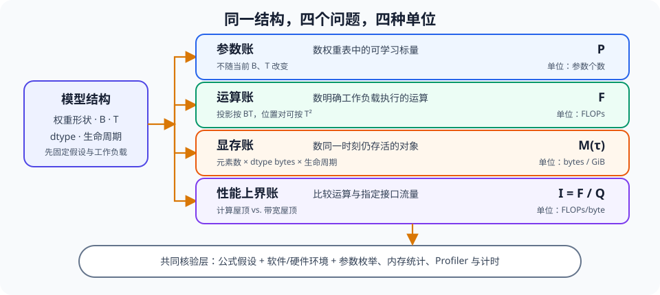
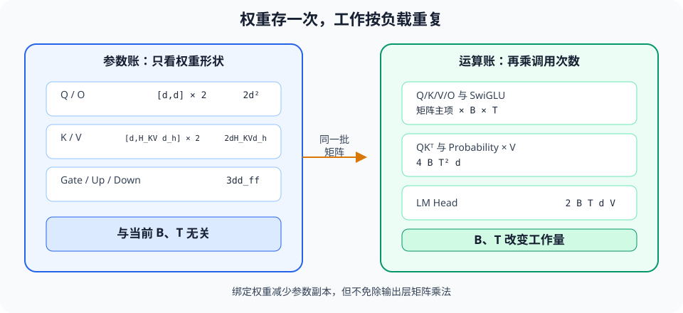
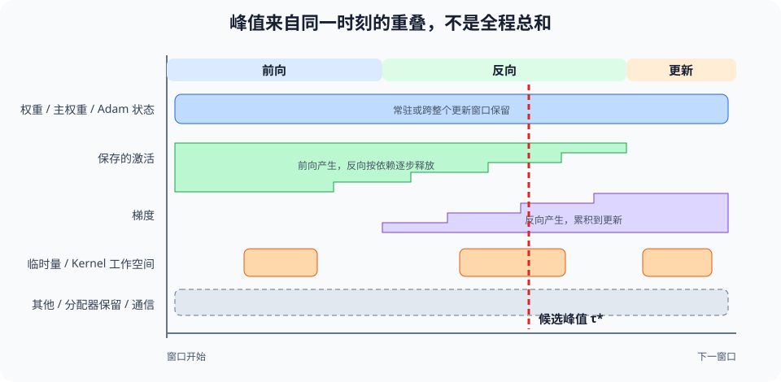
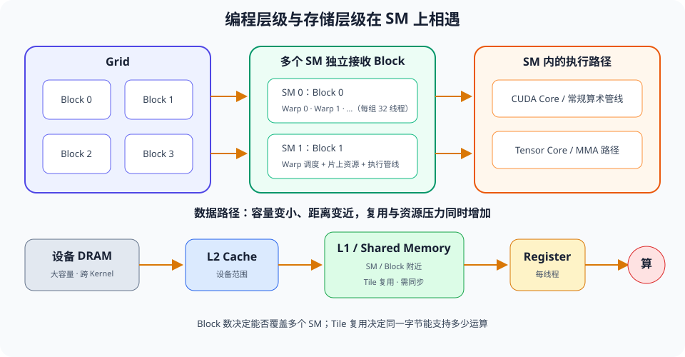
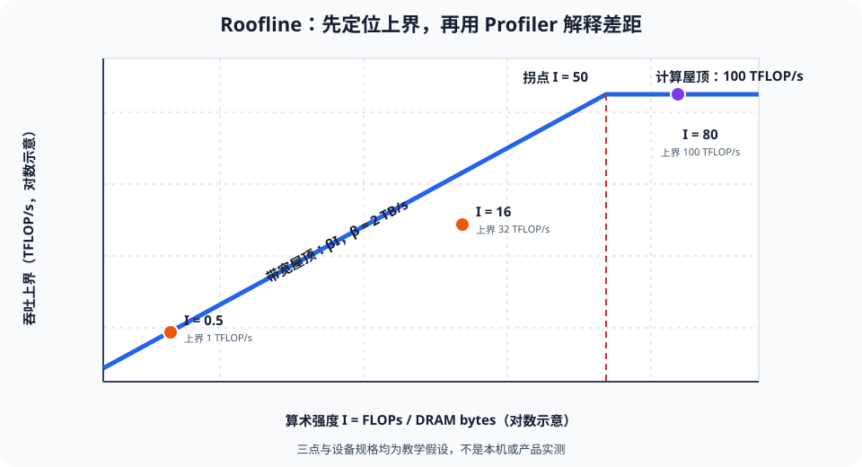

# 第 3 章 模型计算复杂度与 GPU 计算基础

[总目录](../index.qmd) · 上一章：[第 2 章](02-transformer.md) · 下一章：[第 4 章](04-pretraining.md)

同一个模型可以同时被描述为“约 58 亿参数”“一次完整前向约 56.324 TFLOPs”“未分片训练状态至少 64.84 GiB”，也可以说“小批量 Decode 常从带宽侧遇到上界”。这些说法并不矛盾：参数量在数可学习标量，FLOPs 在数运算，显存在数某一时刻仍存活的字节，Roofline 则在给定硬件接口上比较运算与搬运。

本章沿用第 2 章的同一组权重形状，把它们依次翻译成 @fig-ch03-ledgers 中的四本账。3.1 先固定 MAC、FLOPs、bytes 和生命周期的口径；3.2–3.4 分别建立参数、运算和显存账；3.5 解释这些工作怎样映射到 GPU；3.6 再把 FLOPs 与跨设备内存接口的 bytes 放进同一个 Roofline 上界。每一步都先列假设，最后才谈时间。

{#fig-ch03-ledgers fig-alt="同一组权重形状向右分成四条路径：参数账输出可学习标量，运算账输出 FLOPs，显存账输出同一时刻存活字节，性能账以 FLOPs 每字节连接计算峰值和带宽；底部标出假设、环境与 Profiler 是共同的核验层。" width="100%"}

<a id="learning"></a>

## 学习目标与前置知识

完成本章后，读者应能：

1. 从权重形状独立复算贯穿模型的参数量，并解释绑定嵌入、GQA和SwiGLU如何改变分项；
2. 按统一的2 FLOPs/乘加口径估算完整序列前向、训练主项和缓存Decode的主要计算量，并写明省略项；
3. 分别声明权重、梯度、主权重、优化器状态和激活的dtype与生命周期，构建逻辑显存峰值账本；
4. 用Grid、Block、Warp、SM及存储层级解释一个GPU Kernel的并行映射和数据复用代价；
5. 在给定计算峰值、带宽与搬运量时计算Roofline拐点，判断模型上界属于计算屋顶还是带宽屋顶，并说明为何仍需Profiler验证。

前置知识是 [第2章的完整Block与张量形状](02-transformer.md#sec-2-6)，以及附录中的基础线性代数回顾。本章全部为核心内容；硬件型号和具体框架实测留在实验任务中，不把架构概念当作性能结果。

<a id="sec-3-1"></a>

## 3.1 计算复杂度与内存复杂度基础

### 先计数，再讨论时间

大 O 记号描述输入规模增长时的主导趋势，会隐藏常数及低阶项。例如长度 T 的逐位置操作可为 O(T)，所有位置两两交互可为 O(T²)；它没有说明一次操作需要多少周期。本章先给完整主项与假设，再说明忽略什么，避免把“同为O(T²)”误读为相同速度。

本节局部矩阵 $\mathbf A\in\mathbb R^{m\times k}$、$\mathbf B\in\mathbb R^{k\times n}$，输出 $\mathbf C=\mathbf A\mathbf B$。输出有 mn 个元素，每个是长度 k 的点积。一次乘加（Multiply-Accumulate，MAC）对应一次乘法和一次加法，按本书口径计2 FLOPs，故式（03-GEMM）为：

<a id="eq-03-gemm"></a>

$$
\begin{aligned}
C_{ij}&=\sum_{\ell=0}^{k-1}A_{i\ell}B_{\ell j},\\
\mathrm{MACs}&=mkn,\\
F_{\mathrm{GEMM}}&\simeq2mkn\ \mathrm{FLOPs}.
\end{aligned}
$$

求和索引ℓ仅用于本式。精确地数一个不从零累加的数学点积，是k次乘法、k−1次加法，合计mn(2k−1)；通用 GEMM 主项约定则按2mkn，不在不同章偷偷换口径。硬件融合乘加虽可在一条指令中完成，仍按2 FLOPs计；整数操作与浮点操作也不应只按指令数混算。

**局部例子**为 `[2,3]×[3,4]→[2,4]`：共24 MACs，主项48 FLOPs；若按最低数学加法次数则为40次运算。参考三重循环从零累计，每个乘积都执行一次加法，实际循环计数为24乘、24加。两种说明并不矛盾，后文统一采用48。

### 区分存储对象与生命周期

输入和输出矩阵总元素数为mk+kn+mn；若三者同时驻留、每元素占s字节，张量存储量为s(mk+kn+mn)。上例BF16取s=2时为52字节；它是逻辑张量存储量，不是一次真实Kernel的HBM流量或分配器峰值。

| 类别 | 例子 | 生命周期与含义 |
| --- | --- | --- |
| 参数 | 投影矩阵、嵌入表 | 多个批次复用，与当前T/B无直接关系 |
| 需保存的中间结果 | 反向所需激活、生成时的KV | 跨后续步骤保留，不能任意覆盖 |
| 临时结果/工作空间 | 分数矩阵、布局转换、Kernel临时缓冲 | 可在消费后释放或重用，是否保存取决于算法 |

峰值应按某一时刻**同时存活**的对象求和，而不是把程序产生过的所有张量相加；“临时”也可能很大。训练状态、激活与推理缓存分别在3.4和第7章详述。

FLOPs 是运算数，FLOP/s 是实际或峰值吞吐率。理想估时可用运算数除以可达到的吞吐率，但真实时间还受数据搬运、矩阵形状、启动/同步、通信和利用率影响。两个同为48 FLOPs的运算，若一个已有连续数据、另一个需复制/换布局，时间就可能不同；大矩阵和许多小矩阵的总FLOPs相同，也不意味着相同效率。后文Roofline将把运算与字节量联系起来，这里不凭CPU微型例子宣称GPU加速。

::: {.callout-warning title="先核对单位，再比较数字"}
参数量是标量个数，FLOPs 是一次明确工作负载的运算数，bytes 是对象或接口流量，FLOP/s 与 byte/s 才是速率。把“56 TFLOPs”写成“速度”，或用“64 GiB”直接除以计算峰值，都会把不同账本混在一起。
:::

**理解检查。** 把输入序列长度翻倍、模型结构不变，为什么参数量不翻倍？提示：位置间复用同一权重；变化的是执行次数、激活与可能的缓存，而非权重矩阵形状。

<a id="sec-3-2"></a>

## 3.2 Transformer 参数量分析

参数量是可学习标量的数量，不是当前批次的张量元素总量。下面逐个枚举第2章的权重形状，固定无偏置、GQA、SwiGLU、每层两个仅缩放的 RMSNorm、最终 RMSNorm，并绑定输入嵌入与 LM Head。与其他架构比较时必须先改变相应项，不能只套一个“几倍d²”的经验式。

### 从单层矩阵到整模型

| 对象 | 权重形状或数量 | 参数项 |
| --- | --- | --- |
| 绑定嵌入/LM Head，全模型一次 | `[V,d]`，输出使用转置 | Vd |
| 每层 Q / O | 各`[d,d]` | 各d² |
| 每层 K / V | 各`[d,H_KV*d_h]` | 各dH_KVd_h |
| 每层 Gate / Up / Down | `[d,d_ff]`、`[d,d_ff]`、`[d_ff,d]` | 合计3dd_ff |
| 每层两个 RMSNorm | 各d个缩放参数 | 2d |
| 最终 RMSNorm，全模型一次 | d个缩放参数 | d |

嵌入查表没有消除整张词表的存储；权重绑定只让输入输出共享同一组参数，输出矩阵乘法仍需执行。将每层项相加再乘L，得到式（03-Param）：

<a id="eq-03-param"></a>

$$
\begin{aligned}
P={}&Vd\\
&+L\left(
2d^2+2dH_{\mathrm{KV}}d_h
\right.\\
&\left.\qquad
+3dd_{\mathrm{ff}}+2d
\right)\\
&+d.
\end{aligned}
$$

若使用标准两矩阵 MLP，替换3dd_ff为2dd_ff；若使用带缩放与偏置的 LayerNorm，每个Norm为2d，而非d。RoPE的旋转频率与sin/cos缓存在本书结构中不可训练，不计参数；激活函数、掩码、Softmax也不额外引入可学习权重。

### 贯穿配置逐项复算

代入L=32、d=4096、H=32、KV头=8、每头128、中间11008、词表32000：

| 分项 | 参数数目 |
| --- | ---: |
| 绑定嵌入，一次 | 131,072,000 |
| 每层 Q / O，各自 | 16,777,216 |
| 每层 K / V，各自 | 4,194,304 |
| 每层 Gate / Up / Down，各自 | 45,088,768 |
| 每层两个 RMSNorm | 8,192 |
| 每层合计 | 177,217,536 |
| 最终 RMSNorm，一次 | 4,096 |
| 全模型 | **5,802,037,248** |

总数为131,072,000+32×177,217,536+4,096。解除嵌入绑定再加Vd，成为5,933,109,248。所有Norm合计266,240个参数，虽小但本书精确账本未省略。若只存BF16权重，总字节数为2P，约10.807137 GiB；这不包含梯度、优化器、激活或工作空间，不是训练峰值显存。

@fig-ch03-weight-work 将同一批矩阵的两种读法并排放置。参数账只看每张权重表中有多少标量；运算账还要乘上它被多少 Token、多少位置对调用。因而改变 B 或 T 不会改变参数量，却会改变下一节的 FLOPs。

{#fig-ch03-weight-work fig-alt="左侧列出 Q/O、K/V、Gate/Up/Down 权重形状并标注只存一次；右侧显示线性投影乘 BT，Attention 位置对乘 B 和 T 平方；中间箭头强调同一权重形状因问题不同得到参数数与 FLOPs。" width="100%"}

固定d和每头维度，MHA、GQA、MQA的区别只在此处的KV投影宽度：KV头取32、8、1时，四投影参数分别为67,108,864、41,943,040、34,603,008。Q/O没有因为共享KV而缩小；缓存收益见 [2.2.4](02-transformer.md#sec-2-2-4)。

**局部校验例子**另取L=2、d=4、H=2、KV头=1、每头2、中间8、V=10。嵌入40；每层Q/O各16，K/V各8，三个MLP各32，Norm共8，每层合计152；最终Norm4，总参数348。逐矩阵枚举与整式相等，是分析器应先通过的最小检查，不代表已构造框架模型实测。

**理解检查。** 将当前序列长度从4096改为2048，式（03-Param）为何不变？提示：本模型没有长度相关的可训练绝对位置表，权重矩阵形状未改变；缓存、激活和计算量会变。

<a id="sec-3-3"></a>

## 3.3 Transformer FLOPs 分析

### 把每个矩阵乘法独立计账

使用 [03-GEMM](#eq-03-gemm) 的2mkn口径，B条等长序列、当前长度T，d=Hd_h。先数一次完整序列前向的主要矩阵乘法，采用贯穿的GQA与SwiGLU；以下均不是逐算子的精确总指令数。

| 每层运算 | 矩阵规模的依据 | FLOPs主项 |
| --- | --- | --- |
| Q投影 | BT个d维向量到d维 | $2BTd^2$ |
| K、V投影，各自 | d维到H_KVd_h维 | $2BTdH_{\mathrm{KV}}d_h$ |
| O投影 | 拼接后的d维回到d维 | $2BTd^2$ |
| QK转置 | BH个`[T,d_h]×[d_h,T]` | $2BHT^2d_h$<br>$=2BT^2d$ |
| Attention Probability乘V | BH个`[T,T]×[T,d_h]` | $2BT^2d$ |
| Gate、Up、Down，各自 | d与d_ff之间的映射 | $2BTdd_{\mathrm{ff}}$ |

GQA减少了KV投影宽度，但每个Q头仍产生自己的匹配与加权输出，不能在最后两个T²项中将H替换为KV头数。把各项相加得式（03-Block-FLOPs），输出层另计：

<a id="eq-03-block-flops"></a>

$$
\begin{aligned}
F_{\mathrm{block}}
&=4BTd^2+4BTdH_{\mathrm{KV}}d_h\\
&\quad+6BTdd_{\mathrm{ff}}+4BT^2d,\\
F_{\mathrm{model}}
&\simeq L F_{\mathrm{block}}+2BTdV.
\end{aligned}
$$

这里F为本节局部运算计数。最后一项假定全部T个位置均计算LM Head logits；嵌入查表、归一化、RoPE、Softmax、激活与逐元素门控/残差等另计。它们的低阶算术项不意味着访存或执行时间可以忽略。权重绑定让参数只存一份，不免除输出层的$2BTdV$计算。

**局部账本**采用3.2的L=2、d=4、H=2、KV头=1、每头2、中间8、V=10，另取B=1、T=3。每层Q/O各96，K/V各48，Gate/Up/Down各192，QK与PV各72；每层1008 FLOPs，两层加全位置LM Head的240，共2256 FLOPs。这个例子可以逐矩阵核对，不依赖训练框架的Profiler口径。

### 因果有效运算与实际稠密执行

T×T方阵有T²个位置对，因果可见对只有T(T+1)/2个。若算法确实跳过不可见块，QK与PV两项的有效主项之和可写为$2BdT(T+1)$；前述完整方阵主项为$4BT^2d$。两者之比为(T+1)/(2T)，并非任何长度都精确1/2。局部T=3例子的两项和从144变为理想有效96。

若先做完整GEMM再加掩码，执行仍可能付出完整方阵算术。报告理论有效FLOPs与硬件实际执行FLOPs时须分开，不能把有效三角计数除以完整矩阵计时而不说明。第6章会继续区分算术、IO和墙钟时间。

### 反向传播的主项从哪里来

对Y=XW，已知输出梯度G，输入与权重梯度分别为GW转置、X转置G，两个乘法各与前向2mkn同阶；当两者都需要时，反向主项约为前向两倍，前反向合计约三倍。冻结部分参数、选择性求导、激活重计算和算子实现会改变实际开销。

这解释了Dense训练常用的$6PD_{\mathrm{tok}}$主项近似，但其P口径、Attention长序列项、有效Token/填充和重计算必须声明。本书P含绑定嵌入与Norm，而某些文献只用非嵌入参数N；不能直接混用。第4章再给资源估算的完整适用条件。[Scaling Laws，§2.1、表1](https://arxiv.org/html/2001.08361v1)

### 已有缓存时的一步 Decode

若历史KV已缓存，本步只处理一个新增输入位置。令T为**追加后**缓存总长度、各序列等长，投影与MLP每条只执行一次，QK/PV分别为`[1,d_h]×[d_h,T]`与`[1,T]×[T,d_h]`。式（03-Decode-FLOPs）为：

<a id="eq-03-decode-flops"></a>

$$
\begin{aligned}
F_{\mathrm{decode}}\simeq{}&
L\left(
4Bd^2+4BdH_{\mathrm{KV}}d_h
\right.\\
&\left.\qquad
+6Bdd_{\mathrm{ff}}+4BTd
\right)+2BdV.
\end{aligned}
$$

此处只数本步新query，历史K/V不重新投影；其存储和读取量仍随T增长。Prefill需对整段提示计算Block，但若只需末位分布，可只对末位执行LM Head，而非计算全位置logits。Prefill末位已经能产生第一个输出Token的分布，不能把输出Token数无条件当作Decode调用次数。

贯穿配置B=1、T=4096时，完整方阵、全位置输出的前向主项为 **56.324201 TFLOPs**；按三倍粗估前反向主项约168.972603 TFLOPs，尚未加重计算和上述遗漏算子。相同总缓存长度下，一个新增位置的Decode主项约 **13.751026 GFLOPs**。TFLOPs/GFLOPs在这里是十进制运算数，不是TFLOP/s速度或本机实测。

长上下文昂贵，是因为完整序列Attention有T²项、缓存Decode每步读取更长历史；生成多步时累计成本还会继续增长。但T²项不保证在每个配置下都压过线性投影算术，显存、带宽和计算瓶颈也未必同时出现。应先看各分项，再讨论优化。

**理解检查。** 将KV头从8减为1，是否能把整个Attention计算量除以8？提示：只能缩小对应K/V投影与存储项；Q头、QK与PV主项仍按H计算。

<a id="sec-3-4"></a>

## 3.4 Transformer 显存消耗分析

### 不用“每参数若干字节”隐藏配置

显存不足通常不是某一个张量过大，而是反向或优化器更新时多类对象同时存活。先把每类对象的元素数、dtype、生命周期列出，再求时间轴上的峰值。令参数总数为 $P$；权重、梯度、可选主权重、AdamW 一阶与二阶状态的每元素字节数分别为 $s_{\mathrm w},s_{\mathrm g},s_{\mathrm master},s_m,s_v$。不存在的副本对应项取零，则参数相关常驻量为式（03-State-Memory）：

@fig-ch03-memory-timeline 先给出时间视角：权重和优化器状态跨更新窗口常驻，保存的激活从前向延续到相应反向，临时量和工作空间只在局部出现。峰值发生在这些区间重叠最多的时刻，而不是把整个迭代中出现过的对象全部相加。

{#fig-ch03-memory-timeline fig-alt="横轴依次为前向、反向和更新；常驻状态贯穿全程，保存激活从前向延伸并在反向逐步释放，梯度在反向产生并保留到更新，临时量和工作空间只占局部区间；一条竖线标出重叠最多的候选峰值。" width="100%"}

<a id="eq-03-state-memory"></a>

$$
\begin{aligned}
M_{\mathrm{state}}=P\bigl(
&s_{\mathrm w}+s_{\mathrm g}+s_{\mathrm master}\\
&+s_m+s_v
\bigr).
\end{aligned}
$$

权重是前向和反向读取的参数副本；梯度在反向中产生，梯度累积时跨 micro-batch 保留；FP32 主权重是某些混合精度方案用于更新的可选副本，并非“BF16 训练”必然存在。AdamW 为每个被优化参数维护一阶矩 $m$ 和二阶矩 $v$，权重衰减与损失梯度更新解耦；它没有因此消除这两份状态。[AdamW 原论文，算法 2](https://openreview.net/pdf?id=Bkg6RiCqY7)  自动混合精度会按算子选择计算精度，也不等于把所有参数、梯度和状态统一改成某个 dtype。[PyTorch AMP 文档](https://docs.pytorch.org/docs/main/notes/amp_examples.html)

### 贯穿模型的参数状态账本

复用 [3.2](#sec-3-2) 的 $P=5{,}802{,}037{,}248$，下面是**单设备、未分片、所有参数均训练**的理论逻辑容量；$1\,\mathrm{GiB}=2^{30}$ bytes。表中示例采用 BF16 权重和梯度（各2 bytes），AdamW 的 $m,v$ 各用 FP32（各4 bytes）。

| 对象 | bytes/参数 | 字节数 | GiB |
| --- | ---: | ---: | ---: |
| BF16 权重 | 2 | 11,604,074,496 | 10.807137 |
| BF16 梯度 | 2 | 11,604,074,496 | 10.807137 |
| 可选 FP32 主权重 | 4 | 23,208,148,992 | 21.614273 |
| AdamW 一阶状态 $m$（FP32） | 4 | 23,208,148,992 | 21.614273 |
| AdamW 二阶状态 $v$（FP32） | 4 | 23,208,148,992 | 21.614273 |

无主权重时合计 $12P=69{,}624{,}446{,}976$ bytes，即 **64.842819 GiB**；有 FP32 主权重时合计 $16P=92{,}832{,}595{,}968$ bytes，即 **86.457092 GiB**。这两个数字都还没有激活、临时缓冲和运行时开销，因此不能据此宣称模型能装入某张卡。若梯度为 FP32、状态被量化、参数被冻结或状态被分片，都必须重新代入各项，不能沿用 12 或 16 bytes/参数。

### 激活、临时结果与工作空间

反向传播只需保存其导数公式实际需要的前向张量，但“需要哪些”取决于算子实现、融合、是否重计算和是否保留计算图。自动微分系统会保存反向所需中间量；保存、卸载或重算会用带宽/计算换显存。[PyTorch autograd mechanics](https://docs.pytorch.org/docs/main/notes/autograd.html)

若所有仍存活的激活张量元素数为 $n_j$、每元素 $s_j$ bytes，则 $M_{\mathrm{act}}=\sum_j n_js_j$。为显示尺度而不是假装精确，定义本节局部系数 $c_{\mathrm{act}}$：若某一明确实现的保存清单等价于每层 $c_{\mathrm{act}}$ 个形状 `[B,T,d]` 的 BF16 张量，则

<a id="eq-03-activation-memory"></a>

$$
\begin{aligned}
M_{\mathrm{act}}
&=c_{\mathrm{act}}LBTd\,s_{\mathrm a}.
\end{aligned}
$$

贯穿配置在 $B=1,T=4096,s_{\mathrm a}=2$ 时，每个 $c_{\mathrm{act}}=1$ 对应恰好 **1 GiB**；假设清单给出 $c_{\mathrm{act}}=8$ 才可写8 GiB。这里的8只是可复算情景，不是任何框架的实测或通用常数。实际清单还可能含 $BTd_{\mathrm{ff}}$、Attention 中间量、掩码和非张量元数据；变长批次应按有效形状与填充策略逐项计数。

临时结果是算子执行期间产生并可在消费后释放的张量；工作空间是库或 Kernel 为算法选择申请的额外区域。二者都可能在激活仍存活时出现。缓存分配器还会保留已经释放给框架、尚未归还驱动的块，因此“张量已分配量”和“分配器保留量”不是同一指标；PyTorch 分别提供 allocated 与 reserved 的峰值统计。[CUDA memory management](https://docs.pytorch.org/docs/main/notes/cuda.html#memory-management)

### 统一峰值预算与适用边界

不能把整个迭代中曾出现过的对象全部相加。令 $\tau$ 表示执行时刻，其他常驻运行时内存为 $M_{\mathrm{other}}$，则逻辑峰值预算为：

<a id="eq-03-peak-memory"></a>

$$
\begin{aligned}
M_{\mathrm{peak,logical}}
=\max_{\tau}\bigl[
&M_{\mathrm{state}}(\tau)+M_{\mathrm{act}}(\tau)\\
&+M_{\mathrm{temp}}(\tau)+M_{\mathrm{workspace}}(\tau)\\
&+M_{\mathrm{other}}(\tau)
\bigr].
\end{aligned}
$$

例如“有FP32主权重 + 上述 $c_{\mathrm{act}}=8$ 情景”仅前两项就为 **94.457092 GiB**；工作空间与其他项未知，所以94.46 GiB是下界式情景账本，不是峰值预测。实际设备规划还要留出分配粒度、碎片、通信缓冲、CUDA上下文及并发流余量，并记录峰值发生在前向、反向还是更新阶段。分片、Activation Checkpointing 与卸载会改变对象所在设备和生命周期，代价分别可能是通信、重计算或传输；不能只看节省量而忽略新增瓶颈。

::: {.callout-important title="逻辑容量不是“这张卡一定装得下”"}
式（03-Peak-Memory）只在对象清单、dtype、设备位置和生命周期完整时给出逻辑峰值。分配器保留量、碎片、库工作空间、通信缓冲和 CUDA 上下文仍要单独测量并留余量。
:::

**理解检查。** 两个实现都报告“BF16训练”，为什么一个可能接近12 bytes/参数、另一个接近16 bytes/参数？提示：逐项检查是否存在FP32主权重，并继续核对梯度及Adam状态的真实dtype；该口径仍不包含激活和工作空间。

<a id="sec-3-5"></a>

## 3.5 GPU 体系结构基础

上一节回答“对象占多少显存”，本节回答“运算和数据如何在GPU上流动”。阅读时沿两条线索：先在 [3.5.1](#sec-3-5-1) 从Grid/Block/Warp映射到SM及计算管线，再在 [3.5.2](#sec-3-5-2) 追踪数据从设备DRAM经过Cache和片上暂存到执行单元。前者决定可暴露多少并行工作，后者决定计算管线能否及时得到数据；两者共同约束实际性能。

本节讲稳定的编程抽象与定性权衡，不建立某个型号的规格表。SM数量、片上容量、Tensor Core支持dtype、HBM带宽及库Kernel选择都会随架构和版本改变。判断一个具体算子时，应先给形状、dtype、数据布局、硬件和软件版本，再测量；[3.6](#sec-3-6) 将用Roofline给出计算上界与带宽上界的统一分析框架。

@fig-ch03-gpu-map 把两条线索放到一张图中：Grid 的 Block 被分派到不同 SM，Block 内线程以 Warp 为调度组；数据则从设备 DRAM 经 L2 进入 SM 附近的 Cache、Shared Memory 和 Register，再到执行管线。编程层级不是存储层级，但二者在 SM 上相遇。

{#fig-ch03-gpu-map fig-alt="左侧是 Grid，含四个可独立调度的 Block；中间两个 SM 各接收 Block，并把线程组成 32 线程 Warp；底部数据路径从设备 DRAM 经 L2、L1 或共享内存与寄存器，最终送入常规或矩阵乘加执行管线。" width="100%"}

<a id="sec-3-5-1"></a>

### 3.5.1 GPU 的计算架构

#### 吞吐优先，而不是“更多更快”的口号

CPU与GPU是互补的处理器。CPU核心侧重让少量串行线程以低延迟完成复杂控制；GPU用大量轻量线程覆盖等待时间，让高度并行工作获得高总吞吐。GPU单线程可能更慢，带分支、规模小或频繁在主机与设备间搬运的数据也可能没有收益。CUDA官方的对比同样把CPU描述为少量线程的低延迟执行，把GPU描述为用大量并发线程换总吞吐；这不是“所有程序上GPU都会更快”的保证。[CUDA Programming Guide 1.1.2](https://docs.nvidia.com/cuda/cuda-programming-guide/01-introduction/introduction.html#the-benefits-of-using-gpus)

LLM中的大矩阵乘法、逐元素运算和归约通常暴露大量相似工作，适合GPU；Tokenizer、动态调度、文件读取等控制或IO任务常由CPU负责。一次训练步骤因此是异构流水线，瓶颈可能落在任一侧。

#### 从Grid到SM，再到执行管线

CUDA Kernel启动一个Grid（网格），Grid含多个Thread Block（线程块），Block含多个Thread（线程）。一维情况下，线程常用

```text
global_index = blockIdx.x * blockDim.x + threadIdx.x
```

找到自己的数据。一个Block在一个Streaming Multiprocessor（SM，流式多处理器）上执行；一个SM可以驻留多个Block，Grid中的Block由可用SM调度，通常不能假定跨Block的先后顺序。SM内部包含Warp调度、寄存器/共享内存（下一节）及多类执行管线。

Block会被划分为Warp；当前CUDA编程模型中一个Warp为32个连续线程，调度器从就绪Warp发射指令。SIMT（Single Instruction, Multiple Threads）让同一Warp的线程运行同一Kernel代码，但线程可走不同分支；分支路径不一致时，部分Lane会在各路径上不活跃，通常降低有效利用率。[CUDA Programming Guide：hardware multithreading](https://docs.nvidia.com/cuda/cuda-programming-guide/03-advanced/advanced-kernel-programming.html#hardware-multithreading)

两个常被混淆的名词位于SM内部：

| 单元 | 教学层面的职责 | 不能据此推出什么 |
| --- | --- | --- |
| CUDA Core | 执行常规整数/浮点算术的管线或Lane；精确数量、支持指令和吞吐依架构 | 不能用“Core数×频率”直接预测任意Kernel时间 |
| Tensor Core | 执行特定数据类型与形状的矩阵乘加（MMA）路径，通常由一组线程协作发起 | 不能断言任意矩阵或任意dtype都会走该路径 |

“SM、CUDA Core、Tensor Core”不是从大到小的三个线程层级：前者是调度与执行资源集合，后两者是其中不同计算路径。具体比例会随GPU架构变化；本节只固定编程抽象，不把某一型号规格冒充通用事实。

#### 局部线程映射例子

假设对长度1000的数组做逐元素变换，每Block启动256线程，则Grid需 $\lceil1000/256\rceil=4$ 个Block。每个完整Block含8个Warp。第四个Block仍启动256线程，其中232个索引有效，余下24个线程通过 `if (global_index < 1000)` 不写数据。四个Block可按任意顺序被不同SM执行；若只启动一个Block，即使其中线程很多，也只能把这个Block交给一个SM，无法覆盖整卡所有SM。

这个映射说明两个代价：Block太少可能没有足够并行工作；问题尺寸不能整除Block尺寸时会有边界Lane。它只是整数映射推演，没有运行CUDA，也没有给出性能结论。

#### Tensor Core为什么关心形状与dtype

Tensor Core面向分块矩阵乘加。库通常把输出矩阵切成Tile分配给Block，再沿归约维度装入输入分块并累加。矩阵过小会产生太少Tile，难以填满SM；维度与底层指令/内存对齐不合适时，库可能填充、选择别的Kernel，或虽能使用Tensor Core却效率较低。支持的输入与累加dtype也决定可选指令、数值范围和吞吐路径。[NVIDIA Matrix Multiplication Guide，§2.1–2.3](https://docs.nvidia.com/deeplearning/performance/dl-performance-matrix-multiplication/)

以贯穿模型的线性层为例，数学仍是 `[BT,d]×[d,d_out]`；将 $B$ 或 $T$ 改小不会改变参数量，却会改变输出Tile数和形状。`d=4096`对很多常见低精度Tile很规整，但这不保证达到峰值：还要看 $BT$、$d_{\mathrm{out}}$、布局、融合、数据搬运、库版本和具体GPU。官方指南也指出对齐建议随dtype、库版本和架构而变，因此教材不把“维度必须是8的倍数”写成跨版本定律。

**理解检查。** 一个Kernel有1024个线程，但全部放在单个Block中，为什么不能据此说它会使用所有SM？提示：Block是分配给SM的基本单位；同一个Block在一个SM上执行，跨SM并行需要足够多可独立调度的Block。

<a id="sec-3-5-2"></a>

### 3.5.2 GPU 存储层级

计算管线只有拿到操作数才能工作。GPU用多级存储在“小而近、可复用”和“大而远、可共享”之间取舍；“快”是延迟、带宽、并发访问模式与命中率共同作用，不是单一排序。

| 层级 | 典型作用域与用途 | 主要限制 |
| --- | --- | --- |
| Register（寄存器） | 每线程私有的标量、地址和累加器，位于SM片上 | 数量有限；单线程使用过多会降低可同时驻留的Warp，溢出还可能落到设备内存中的local memory |
| Shared Memory（共享内存） | 一个Block内线程显式协作的片上暂存区，生命周期通常随Block | 容量有限、需同步；访问映射不当会有Bank Conflict，也会限制驻留Block数 |
| L1 Cache | 通常靠近/属于单个SM，缓存近期设备内存访问；与Shared Memory的资源组织依架构 | 容量与策略依架构，命中不可当作算法保证 |
| L2 Cache | 设备范围、位于SM与设备DRAM之间，为多个SM的访问提供复用与合并机会 | 仍有限；工作集过大或访问局部性差时会反复回到DRAM |
| GPU DRAM / Global Memory | 所有SM可寻址的大容量设备内存；数据跨Kernel保持 | 相对片上存储延迟高，带宽虽高但不是无限；访问合并与复用决定有效带宽 |

训练加速卡的设备DRAM常采用HBM（High Bandwidth Memory，高带宽内存），但并非所有GPU都用HBM；CUDA的编程抽象称其为global memory。具体容量、带宽、Cache大小和L1/Shared配置必须绑定型号与架构，本节不填一个“通用纳秒/GB/s”表。CUDA指南确认每个SM有自己的寄存器文件与共享内存，而设备DRAM作为所有SM可访问的global memory。[CUDA Programming Guide：on-chip memory](https://docs.nvidia.com/cuda/cuda-programming-guide/pdf/cuda-programming-guide.pdf)

### 分块为何减少数据搬运

考虑局部玩具GEMM：计算一个$32\times32$输出Tile，归约维也取32，输入为BF16。把A、B两个$32\times32$ Tile各从global memory读一次，共$2\times32^2\times2=4096$ bytes；Block内复用后完成$32^3$次乘加，即65,536 FLOPs，忽略输出写回时算术强度为16 FLOPs/byte。

若概念上的直接实现让每个输出点独立读取长度32的A行和B列，则1024个输出要读$1024\times64\times2=131{,}072$ bytes，算术强度只有0.5 FLOPs/byte。两者算术量相同，逻辑输入流量却相差32倍。真实Cache可能自动减少部分重复读，所以后一个数字是算法访问上界式示意，不是HBM计数器实测。

共享内存分块的直接代价是占用片上容量、增加装载与同步，并可能发生Bank Conflict；Tile过大还会降低Occupancy。相邻线程访问连续地址时，硬件更容易把global memory请求合并；数据复用不足、跨步或随机访问则可能浪费传输。NVIDIA Best Practices也以共享内存Tile减少冗余global load，并强调合并访问与资源占用的权衡。[CUDA Best Practices，§10.2](https://docs.nvidia.com/cuda/cuda-c-best-practices-guide/index.html#device-memory-spaces)

这解释了为什么“HBM带宽很高”仍会成为瓶颈：若同一中间张量反复从HBM读入，而每字节只触发很少运算，计算单元会等待数据。融合算子、分块、Cache复用或重计算都可能减少HBM往返，但会分别增加实现复杂度、片上资源压力或算术。下一节用Roofline把FLOPs与实际需要搬运的bytes联系起来；第6章再把这一视角用于Attention。

**理解检查。** 把Shared Memory Tile增大是否总会更快？提示：复用可能增加，但共享内存/寄存器占用也会增加，Tile数和驻留Block可能减少，还需检查Bank Conflict、边界填充与具体架构。

<a id="sec-3-6"></a>

## 3.6 Roofline Model 与计算瓶颈分析

### 把运算与数据搬运放到同一本账上

只报FLOPs无法判断时间：同样的运算量可能对应完全不同的设备DRAM流量。对某个明确Kernel和某一层存储接口，令工作量为$F$ FLOPs、跨该接口搬运$Q$ bytes，算术强度（Arithmetic Intensity）定义为$I=F/Q$ FLOPs/byte。原始Roofline论文称Operational Intensity，并把bytes限定为经过Cache过滤后到DRAM的流量；若分析L2或主机互连，必须重新说明接口，不能混用分母。[Williams、Waterman与Patterson，§3](https://digicoll.lib.berkeley.edu/record/136692/files/EECS-2008-134.pdf)

设所选dtype与执行路径的峰值计算吞吐为$C_{\mathrm{peak}}$ FLOP/s，所选接口可持续带宽为$\beta$ bytes/s。理想可达吞吐$C$受两个上界限制：

<a id="eq-03-roofline"></a>

$$
\begin{aligned}
C&\leq\min\!\left(C_{\mathrm{peak}},\;\beta I\right),\\
I_{\mathrm{ridge}}&=\frac{C_{\mathrm{peak}}}{\beta}.
\end{aligned}
$$

单位会自行核对：$(\mathrm{bytes/s})(\mathrm{FLOPs/byte})=\mathrm{FLOPs/s}$。当$I<I_{\mathrm{ridge}}$时，带宽斜线较低，称为Memory-bound（带宽受限）；提高复用、融合或减少搬运才可能抬高上界。当$I>I_{\mathrm{ridge}}$时，水平计算屋顶较低，称为Compute-bound（计算受限）；应关注计算管线、指令路径和矩阵形状。等号附近只是交界，不意味着实测一定达到屋顶。

### 可复算的假想设备例子

假设某条明确低精度路径的$C_{\mathrm{peak}}=100$ TFLOP/s，设备DRAM的可持续带宽$\beta=2$ TB/s；两者都按十进制单位，则拐点为50 FLOPs/byte。复用 [3.5.2](#sec-3-5-2) 的两个逻辑流量情景：

| 情景 | $I$ | 带宽屋顶$\beta I$ | 模型判定 |
| --- | ---: | ---: | --- |
| 分块并理想复用输入 | 16 FLOPs/byte | 32 TFLOP/s | 低于100，带宽屋顶 |
| 概念直接重复读取 | 0.5 FLOPs/byte | 1 TFLOP/s | 低于100，带宽屋顶 |
| 假想$I=80$的Kernel | 80 FLOPs/byte | 160 TFLOP/s | 计算屋顶限制为100 TFLOP/s |

这些只是代数演示：100 TFLOP/s与2 TB/s不对应本机或指定产品，3.5.2的bytes也不是计数器结果。真实Roofline要使用同一硬件、dtype、功耗/频率状态下测得或严谨标注的计算峰值、可持续带宽和Kernel流量；不同精度的Tensor Core峰值不能与另一条路径的$I$随意拼接。

@fig-ch03-roofline 将三种情景画在同一坐标上。$I=0.5$ 与 $I=16$ 都落在拐点左侧，减少 DRAM 流量能抬高带宽上界；$I=80$ 已越过拐点，模型上界由 100 TFLOP/s 的计算屋顶给出。

{#fig-ch03-roofline fig-alt="横轴为对数尺度的算术强度，纵轴为可达吞吐上界；斜线代表 2 TB 每秒带宽，水平线代表 100 TFLOP 每秒计算峰值，二者在强度 50 处相交；三个点分别标在 0.5、16、80。" width="100%"}

::: {.callout-note title="Roofline 给上界，不给实测时间"}
图中的屋顶只排除了不可能超过的区域。Kernel 仍可能因形状、占用率、分歧、启动、同步或依赖链远低于屋顶；最终判断必须回到同一环境下的 Profiler 与计时。
:::

### GEMM、逐元素与归约为何位置不同

大GEMM把输入Tile装入片上存储后反复用于许多乘加，$M,N,K$足够大且实现良好时$I$可以较高；小矩阵、窄维度或低Batch会减少复用和并行度，因此“GEMM必然Compute-bound”不成立。RMSNorm需要读输入、计算平方和、缩放并写输出；Softmax需要最大值与指数和归约；若每个元素只有少量运算而至少读写一次，它们通常强度较低。融合可避免中间张量落回DRAM，提高实现层面的$I$，但会增加寄存器/共享内存压力，且不改变必须读入原始输入、写出最终输出的下界。

Roofline只给上界，不解释所有差距。未合并访问、Bank Conflict、Warp分歧、占用率不足、启动/同步、依赖链、指令混合和通信都能让实测点落在屋顶下方。看到Kernel远低于Roofline，应结合Profiler而不是仅凭“左边/右边”下结论。

### Attention与Decode的分析入口

标准Attention若显式把$T\times T$分数与概率写到设备DRAM，会增加随$T^2$增长的流量；IO感知分块可在片上完成部分统计与输出累积，减少外存往返，但标准稠密Attention的渐近算术量仍是$O(T^2d)$。这为第6章FlashAttention的“减少IO而非宣称消除全部二次算术”提供判断基线。

缓存Decode每步读取权重和不断增长的KV，却只为每条序列产生一个新位置；小Batch时权重复用有限，常呈较低算术强度。扩大Batch可能提高权重复用，却增加KV流量、延迟与调度压力。Prefill的大矩阵通常更容易形成高强度，但长序列Attention和实现选择仍会改变位置。因此“Prefill计算受限、Decode带宽受限”只能作为带工作负载条件的常见分析起点，不能替代测量。

**理解检查。** 某优化把FLOPs不变、DRAM bytes减半，Roofline预测一定加速2倍吗？提示：$I$会翻倍，带宽屋顶会抬高；若已经越过拐点、或实际受启动/依赖/占用率等其他因素限制，墙钟收益会小于2倍甚至没有收益。

<a id="experiment"></a>

## 本章实验

::: {.callout-note collapse="true" title="实验协议、命令与证据状态"}
**目标。** 用规范中的Mini-GPT配置复算参数量、参数相关训练状态与每步主要FLOPs，再用PyTorch Profiler观察实际算子。理论公式、Profiler估算和硬件计数器是三种不同证据，不能因数值接近就视为相互等价。

**输入与实现。** [实验脚本](../examples/ch03_profile_mini.py)实现$L=2,d=128,H=4,H_{\mathrm{KV}}=2,d_h=32,d_{\mathrm{ff}}=352,V=256,T_{\max}=128$的Pre-RMSNorm、RoPE、GQA、SwiGLU、无偏置、权重绑定模型。默认$B=2,T=32$，随机种子20261031；代码注明PyTorch `Linear.weight`与数学行向量权重互为转置。输入为随机字节Token ID，仅测试计算图，不代表语言数据训练。

**环境与命令。** 本机记录为Python 3.11.5、PyTorch 2.5.1+cu124；CUDA不可用且`nvidia-smi`无法连接驱动。已实际执行CPU路线：

```bash
python docs/examples/ch03_profile_mini.py \
  --device cpu --batch 2 --seq 32 --warmup 3 --steps 3 \
  --output docs/experiments/ch03_cpu_profile.json
```

有可用CUDA的环境再执行以下命令；本机**未运行**，不得引用CPU结果证明GPU性能：

```bash
python docs/examples/ch03_profile_mini.py \
  --device cuda --batch 2 --seq 32 --warmup 10 --steps 20 \
  --output docs/experiments/ch03_cuda_profile.json
```

**步骤与记录字段。** 先核对脚本理论参数量与`sum(p.numel())`相等；再记录前向主要FLOPs、三倍训练主项、逐dtype参数状态字节。Profiler启用`record_shapes=True`、`profile_memory=True`和`with_flops=True`，保存环境、配置、Loss、聚合算子CPU时间、张量内存变化和受支持算子的FLOPs。官方文档说明`with_flops`只估算部分算子，shape/memory追踪也会引入开销，因此该运行用于结构核对，不作为严谨吞吐Benchmark。[torch.profiler 2.5文档](https://docs.pytorch.org/docs/2.5/profiler.html)

**本机结果与判定。** [原始CPU记录](../experiments/ch03_cpu_profile.json)显示理论与实际参数均为402,048；每步理论前向主项53,477,376 FLOPs，三倍训练主项160,432,128 FLOPs。Profiler支持算子的每步估算为161,104,960 FLOPs；差异来自Profiler覆盖范围、逐元素项及本书主项近似，不能解释为测量误差。教学BF16权重/梯度加FP32 Adam两状态、无主权重时参数相关逻辑状态为4,824,576 bytes（4.601074 MiB）；本次CPU FP32权重/梯度/两状态为6,432,768 bytes（6.134766 MiB），均不含激活、临时量与运行时。

正确性标准：参数数目必须精确相等；Loss有限；输出JSON保存真实环境；Profiler部分FLOPs不得冒充完整计数。性能测量若在GPU补做，需同步、记录预热/重复次数、报告中位数和离散度，并固定GPU、驱动、PyTorch、dtype与形状。本次CPU时间受Profiler和系统负载影响，不据此作优化结论。

**低资源路线。** 无GPU时运行上述CPU命令并完成理论账本；无PyTorch时仍可依据3.2–3.4手算配置，并把框架核对标为未运行。当前状态：CPU理论与Profiler路线**已运行**；CUDA/GPU路线**未运行**。
:::

<a id="exercises"></a>

## 本章小结与习题

本章建立了同一套资源账本：参数量来自权重形状，FLOPs来自实际矩阵规模，显存来自对象dtype与同时存活时间，性能上界则把FLOPs和跨指定接口的bytes合并为算术强度。GPU的计算层级决定并行工作如何映射，存储层级决定数据能否被复用。Roofline能指出优先减少搬运还是提高计算利用率，但不能代替对具体Kernel的测量。

| 层次 | 学完本章后的检查标准 |
| --- | --- |
| 你现在应该会列账 | 从权重形状列出参数项，从矩阵规模列出主要 FLOPs，从对象生命周期列出显存项 |
| 你现在应该会换算 | 在 FLOPs、bytes、FLOP/s、byte/s 与 FLOPs/byte 之间保持单位一致 |
| 你现在应该会判断 | 区分参数量与工作负载、逻辑容量与设备峰值、带宽屋顶与计算屋顶 |
| 你现在应该会验证 | 用框架参数枚举、内存统计、Profiler 与计时核对理论账本，并保留环境与证据边界 |

1. **参数与显存。** 贯穿模型解除输入嵌入与LM Head绑定后，参数量增加多少？若新增权重、梯度、AdamW一/二阶状态分别为BF16、BF16、FP32、FP32，且无FP32主权重，新增逻辑状态是多少GiB？
2. **FLOPs边界。** 对固定$B,d,H_{\mathrm{KV}},d_h,d_{\mathrm{ff}}$，将$T$翻倍。式（03-Block-FLOPs）中的线性项和完整方阵Attention项分别变为多少倍？为什么实际运行时间不一定按二者之一严格缩放？
3. **线程与复用。** 长度2050的逐元素Kernel采用256线程/Block。需要多少Block？最后一个Block有多少有效线程？再说明为何把Block增到1024线程不保证更快。
4. **Roofline。** 假想设备峰值120 TFLOP/s、可持续带宽3 TB/s。Kernel A强度10 FLOPs/byte，Kernel B强度80 FLOPs/byte。分别计算上界与瓶颈类别；若A通过融合把DRAM bytes减半、FLOPs不变，新上界是多少？

[答案与提示](../appendices/exercise-solutions.md#solutions-3)给出复算路径。所有题目都是理论账本，不代表GPU实测。

本章把第 2 章的静态结构变成了资源账本，但还没有把一次训练更新拆成数据、前向、反向、同步与优化器状态转换。第 4 章将沿用这里的参数、FLOPs、显存与证据口径，进入可重放的预训练流程。

<a id="references"></a>

## 参考资料

3.1–3.6按本书固定口径独立推导。结构、计算、显存、GPU与Roofline资料见[参考资料附录](../appendices/references.md#refs-norm-compute)，具体版本、使用位置和证据边界保留在来源台账中。本章CPU框架实验已运行，CUDA/GPU实验未运行。
