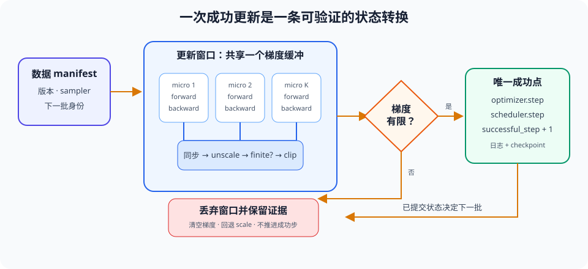
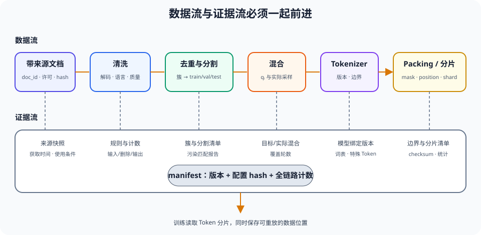
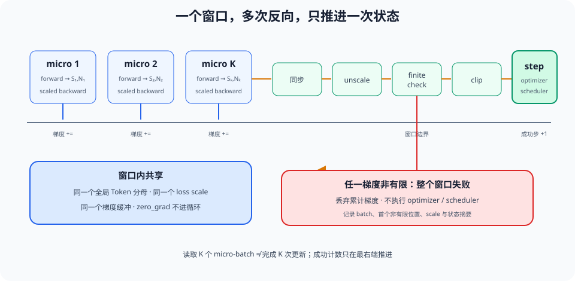
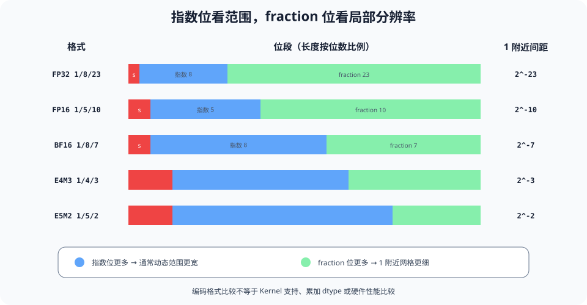
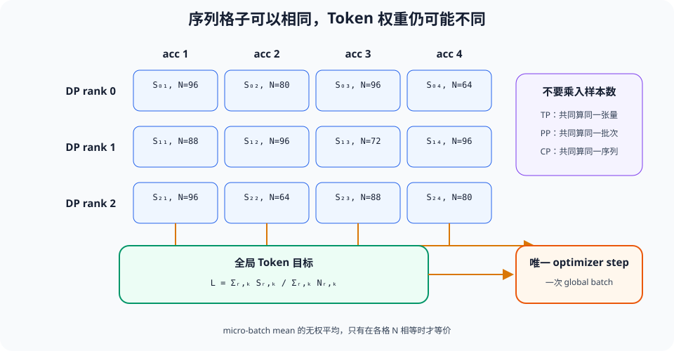
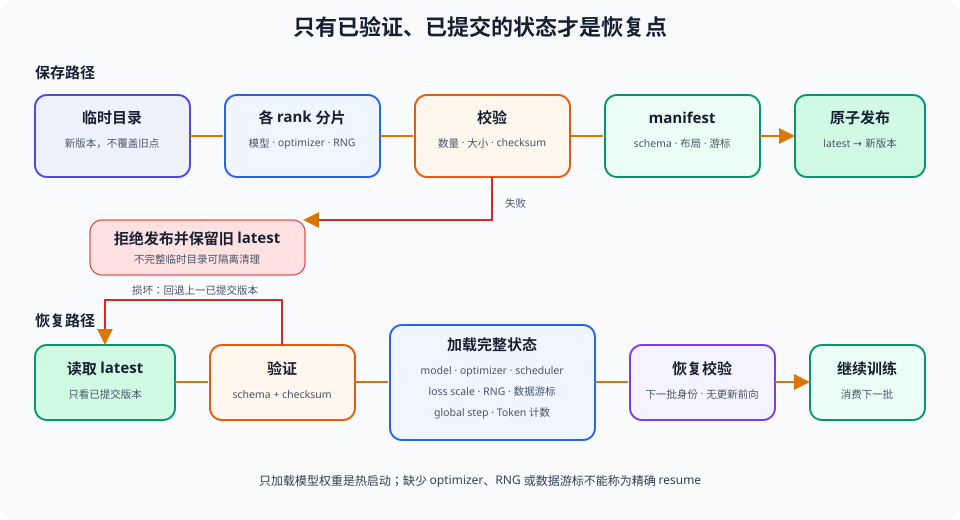

# 第 4 章 大语言模型的预训练原理与训练流程

[总目录](../index.qmd) · 上一章：[第 3 章](03-compute-and-gpu.md) · 下一章：[第 5 章](05-distributed-training.md)

训练作业已经读入一批 Token，前向与反向也都完成，却在更新前发现一个梯度为 Inf。此时不能只问“要不要降低学习率”：这批数据是否算已消费？动态 loss scale 是否回退？optimizer、scheduler 和成功步能否推进？若进程随后退出，checkpoint 应让下一次运行从哪里恢复？

本章沿着 @fig-ch04-training-loop 回答这些问题。4.1 把原始文档变成可追溯的 batch；4.2 定义一个更新窗口的目标和唯一成功点；4.3–4.5 分别决定更新方向、数值执行策略以及多个 micro-batch 如何合成同一个全局目标；4.6 估算整段训练所需资源；4.7 再把模型、优化器、随机性和数据进度一起提交为可验证 checkpoint。主线不是“loss 下降就算训练完成”，而是每一次状态推进都能说明输入、口径和恢复边界。

{#fig-ch04-training-loop fig-alt="左侧数据 manifest 产生 batch；中间更新窗口包含多个 micro-batch 的前向、损失与反向，共享梯度缓冲；有限性检查通过后只执行一次 optimizer 和 scheduler，失败则丢弃窗口；右侧日志与 checkpoint 保存成功步并指向下一批。" width="100%"}

<a id="learning"></a>

## 学习目标与前置知识

学完本章后，读者应能：

1. 为来源、清洗、去重、混合、分词与Packing建立可追溯的数据账本，并区分读取Token、处理槽位与有效目标Token；
2. 按一个成功更新窗口说明前向、Token加权loss、反向、同步、反缩放、有限性检查、裁剪、optimizer与scheduler的顺序；
3. 从浮点格式、loss scaling与autocast职责解释数值风险，不把计算dtype等同于全部状态存储dtype；
4. 用$6PD_{\mathrm{tok}}$、MFU、理论峰值和显存生命周期账本做带假设的资源估算，并指出近似遗漏项；
5. 设计包含完整状态、原子提交、日志和恢复演练的checkpoint方案，区分精确续跑、数值复现与统计复现。

前置知识是[第1章](01-foundations.md)的目标位移与有效Token损失、[第2章](02-transformer.md)的Decoder-only结构，以及[第3章](03-compute-and-gpu.md)的FLOPs/显存/Roofline账本。本章均为基础内容；硬件性能数字只有在明确环境和测量协议下才可视为实测。

<a id="sec-4-1"></a>

## 4.1 预训练数据与数据处理

预训练数据管道把外部文档变成可重放的Token序列。“抓到很多文本”不等于“得到可用训练集”：来源、清洗、去重、混合、分词和分片的每一步都会改变模型实际看到的分布，必须留下版本、参数和计数证据。

@fig-ch04-data-pipeline 把“数据本身”和“为什么得到这份数据的证据”并排表示。每一步既产生下一阶段的输入，也要留下版本、规则和计数；最终训练读取的是带 manifest 的 Token 分片，而不是一个无法追溯来源的 `.bin` 文件。

{#fig-ch04-data-pipeline fig-alt="上方数据流从多个带来源标识的文档开始，经清洗、去重与训练验证测试分割、按权重混合、tokenizer 和 Packing，输出训练分片；下方证据流逐步记录版本、删除计数、去重簇、混合采样计数、tokenizer 哈希、边界语义与分片清单，汇入 manifest。" width="100%"}

### 来源、溯源与清洗

常见来源包括网页、书籍、学术或专业文本、代码仓库、对话和结构化记录。它们在格式、语言、重复率、授权和质量上不同，不应先拼成一个无来源的大文件。The Pile 将网页、书籍、GitHub、PubMed、arXiv、Wikipedia等多个组件分别统计，是“保留组件身份再混合”的一个文献案例；本书不把它的具体规模或权重当成通用配方。[The Pile，§2–3](https://arxiv.org/html/2101.00027v1)

每个原始文档至少应有稳定`doc_id`、来源组件、获取时间/快照、语言、内容哈希、许可或使用条件和处理日志。清洗再按明确顺序处理解码错误、HTML/模板噪声、编码与Unicode规范化、语言识别、过短/过长或异常字符文档、明显垃圾与质量规则。每条规则要记录输入数、删除数和少量抽样；“像书面英语”之类代理指标可能误伤其他语言、口语或专业文本，不应被当成普遍质量定义。

### 去重、切分与数据混合

精确去重可对规范化后文本取哈希，适合完全相同的文档；近似去重可用n-gram指纹、MinHash/LSH或长公共子串找到镜像页面和局部复制。阈值过松会留下重复，过严则可能删除合法的引用、模板或同一主题的独立文档。因此要保存代表文档、相似度、保留规则与簇ID，而不是只留一个“已去重”布尔值。Lee等分别研究了近似文档和长重复子串，并将训练集重复与记忆/评测重叠风险联系起来；这支持“去重是必须检查项”，不意味着任何一组阈值都通用。[Lee等，2022，§3–6](https://aclanthology.org/2022.acl-long.577/)

应先完成组间去重，再按文档或去重簇划分训练/验证/测试，避免同一文档的副本跨分割。还要将预定评测集做精确与近似匹配；发现重叠时记录并移除污染项，不在看过测试结果后才临时调阈值。

数据混合决定下一个训练Token来自哪个组件。设组件$i$清洗后有$N_i$ Token，训练目标采样率为$q_i$且$\sum_iq_i=1$；$q_i$ 可不等于$N_i/\sum_jN_j$，但必须保存选择理由和实际采样Token计数。例如网页900M、代码100M Token，若1B Token训练计划按$q_{\text{web}}=0.7,q_{\text{code}}=0.3$采样，期望看到700M网页和300M代码：网页覆盖约$0.778$轮，代码则约3轮。这会强调代码，也增加重复暴露和过拟合风险；混合权重是训练配置，不是数据集的自然属性。

### Tokenization、Packing与文档边界

清洗文本用与模型绑定的tokenizer转为ID，再构造长度不超过$T_{\max}$的训练序列。文档结束应有明确EOS或边界记录；超长文档的截断/滑窗和重叠策略会改变上下文分布，必须进入配置。Packing把多个短序列放入同一固定长度张量以减少PAD；它不能丢失文档边界。实现须在两种语义中明选一种：

- **连续流**：用EOS连接文档，后文允许注意前文；边界后第一Token的目标是合法的下一项预测。
- **独立样本打包**：除因果掩码外再屏蔽跨文档注意力，并按约定屏蔽边界处损失；位置ID是否重置也要声明。

可复算例子：$T_{\max}=8$，两个已含EOS的序列长度为5和3。分开补齐需要16个槽位、有8个有效Token，利用率50%；合法打包后用8个槽位，利用率100%。这只是逻辑Token槽位比，不是墙钟加速2倍；复杂掩码、形状和数据加载也有代价。

### 治理、污染与可重放产物

数据治理不是训练前的一次性声明。应对每个组件保存来源、许可/使用条件、版权与授权审查、个人信息检测与隐私保护策略、访问控制、删除/退出流程、保留期和负责人。法律与许可判断依来来源和适用法域，本书不用“网上可访问”推导“可训练”。The Pile Datasheet展示了为组件记录动机、构成、采集、预处理、使用与风险的做法，同时也说明文档化不会自动消除数据问题。[Datasheet for the Pile，§3–9](https://arxiv.org/html/2201.07311v1)

最终可重放产物应包含：原始快照或可重取版本、处理代码与配置哈希、每步输入/输出/删除计数、去重簇、分割清单、tokenizer版本、混合权重、分片清单与污染检查报告。只保存最终`.bin`分片无法解释某个Token为何进入训练。

**理解检查。** 100M Token的代码池在1B Token训练中被采样300M次，能否因为最终训练Token总数是1B就说“整个数据只训练了1轮”？提示：各组件的重复暴露由$q_i$ 与$N_i$共同决定，代码组件约为3轮。

<a id="sec-4-2"></a>

## 4.2 预训练目标与训练步骤

预训练的直接目标仍是[1.3的有效Token平均NLL](01-foundations.md#eq-01-loss)，但训练系统必须把数据、前向、损失、反向和更新组成一个无歧义的状态转换。“调用一次`model()`”只是前向，不是完整Training Step。

@fig-ch04-update-window 先固定状态顺序：一个窗口可含多个 micro-batch，但只在窗口末做一次反缩放、有限性检查、裁剪、optimizer 和 scheduler。任何非有限梯度都会让整个窗口走失败分支；读取了数据或完成了 backward 都不等于成功更新。

{#fig-ch04-update-window fig-alt="时间轴左侧有三个 micro-batch，每个执行 forward、loss sum 和 backward，箭头汇入同一梯度缓冲；窗口末依次同步、unscale、finite check 和 clip；通过分支执行 optimizer、scheduler、successful step 加一，失败分支清空梯度并记录证据。" width="100%"}

::: {.callout-warning title="尝试窗口不等于成功更新"}
数据加载次数、backward 次数和成功参数更新次数是三种计数。若有限性检查失败，本章默认不推进 optimizer、scheduler 或成功步；数据游标如何处理必须由可恢复的数据协议明确规定。
:::

### 从Token到加权损失

数据加载器给出`tokens` `[B,T+1]`及必要的边界/有效性信息。按全书约定，`tokens[:, :-1]`作输入，`tokens[:, 1:]`作目标；Decoder-only Transformer输出logits $\mathbf Z$ `[B,T,V]`。对每个有效目标用稳定log-softmax/交叉熵得到NLL，再用损失掩码$m_{b,t}$排除PAD、无目标位置或任务规定的非训练部分。注意力掩码控制“可以读什么”，损失掩码控制“哪些目标计分”，两者不可互换。

为了正确合并变长micro-batch，局部令第$k$个micro-batch的NLL和与有效目标数为$S_k,N_k$。一个优化器更新窗口含$K$个micro-batch时，必须先合计分子和分母：

<a id="eq-04-token-weighted-loss"></a>

$$
\begin{aligned}
S_k&=-\sum_{b,t}m_{k,b,t}\log p_\theta(y_{k,b,t}\mid x_{k,b,<t}),\\
N_k&=\sum_{b,t}m_{k,b,t},\\
\mathcal L_{\mathrm{win}}&=\frac{\sum_{k=1}^{K}S_k}{\sum_{k=1}^{K}N_k}.
\end{aligned}
$$

式（04-Token-Weighted-Loss）要求总有效目标数$\sum_kN_k>0$。它是式（01-Loss）在更新窗口上的分块形式，不是新的训练目标。可以对各$S_k$反向累加，再在更新前把累计梯度除以$\sum_kN_k$；或者在已知总分母时对$S_k/\sum_jN_j$反向。不能无条件平均$S_k/N_k$，因为那会让短批次的每个Token权重更大。4.5将把这个口径扩展到梯度累积与数据并行。

**可复算例子。** 第一个micro-batch有2个有效目标，每个NLL为$\log2$；第二个有6个，每个NLL为$\log4$。正确损失为$(2\log2+6\log4)/8\approx1.213008$；两个micro-batch均值再平均得$(\log2+\log4)/2\approx1.039721$，错误地将前两个Token各赋予后六个Token的3倍权重。

### 前向、反向与参数更新

完整前向从Embedding开始，经过$L$个Block、最终RMSNorm和绑定LM Head得到logits，再计算$S_k,N_k$。前向只读参数$\theta$，不应在未明示的情况下更新它们。训练模式中的随机操作还需可重放的随机状态；本书贯穿结构暂省dropout，但不将“本配置没有”写成“所有模型没有”。

反向传播从标量损失出发，用链式法则求每个可训练参数的梯度。自动微分（Autograd）在前向时记录运算关系，并按实现需要保存某些中间量；反向求梯度不等于已经更新权重。中间量的具体清单依算子和框架实现，不能用一个固定“激活倍数”代替实测。[PyTorch Autograd mechanics，Saved tensors](https://docs.pytorch.org/docs/main/notes/autograd.html#saved-tensors)

参数更新是优化器的独立动作：它读取当前参数、已聚合梯度、学习率与优化器状态，写回新参数/状态。AdamW等细节见4.3，混合精度下的unscale见4.4。关键边界是：梯度有限性检查、反缩放、累积完成和分布式同步必须在裁剪/更新前按配置完成；否则裁剪的不是真实更新梯度。

### 一个无歧义的Training Step

下面是**概念伪代码**。它展示单个更新窗口，未展开4.4的混合精度和第5章的分布式同步：

```text
batch_or_micro_batches = data_loader.next()       # 含 tokens 与有效性信息
optimizer.zero_grad(set_to_none=True)             # 新更新窗口开始
total_valid = 本窗口有效目标数（必须 > 0）
for micro_batch in batch_or_micro_batches:
    inputs, targets, loss_mask = 位移与构造掩码(micro_batch)
    logits = model(inputs)                         # Forward
    loss_sum = masked_cross_entropy_sum(logits, targets, loss_mask)
    (loss_sum / total_valid).backward()            # Backward，只累加梯度
assert gradients_are_finite()
grad_norm_before = global_grad_norm()
clip_gradients_if_configured()
optimizer.step()                                  # 唯一参数/优化器状态更新点
scheduler.step_if_defined_for_successful_update()
record_metrics_and_advance_successful_step()
```

`zero_grad` 也可放在成功更新后，但必须确保下一窗口不继承旧梯度。如果因NaN/Inf跳过优化器更新，是否推进scheduler和“成功step”计数也要显式约定。数据加载完成不等于更新成功；断点恢复时两种位置都需记录。

### 训练指标的测量边界

- **Training Loss**：在固定更新窗口中报告$\sum S_k/\sum N_k$；不对micro-batch均值再做无权平均。它使用训练模式与当前参数，受采样混合和随机性影响。
- **Validation Loss**：在固定、未参与更新的验证集上使用评估模式和无梯度前向，仍按全部有效Token聚合。只有tokenizer、切块、掩码和上下文口径一致时才能比较。
- **Gradient Norm**：声明是全局还是分组范数、L2还是其他范数、反缩放/累积/同步后的哪个时刻，并区分裁剪前与裁剪后。单卡局部分片范数不是全模型范数。
- **训练吞吐**：有效Token/s的分子是$\sum m_{b,t}$，不含PAD；分母须声明是纯计算、稳态训练还是含数据加载/检查点的端到端时间。GPU计时需同步，并报告预热、重复次数和统计量；本节没有性能实测。

Loss下降只说明当前数据/目标口径下的NLL改变；它不保证知识正确、无污染、下游任务更好或生成更安全。吞吐与收敛也是两个轴：更多Token/s不代表达到同一Validation Loss所需的Token更少。

**理解检查。** 两个micro-batch分别有2和6个有效目标，若先各求mean loss再除2，与式（04-Token-Weighted-Loss）何时等价？提示：只在两个$N_k$相等（或显式按$N_k$加权）时等价。

<a id="sec-4-3"></a>

## 4.3 优化器与学习率调度

4.2得到当前更新窗口的损失梯度$\mathbf g_t=\nabla_{\boldsymbol\theta}\mathcal L_t$后，优化器决定“沿什么方向走”，学习率$\eta_t$决定“走多远”。这里$t$按**成功的参数更新**从1计数；若有限性检查失败并跳过`optimizer.step()`，本书默认也不推进优化器、scheduler和$t$。框架配置若采用其他语义，必须在断点与日志中声明。

### SGD、Momentum与状态

最基础的随机梯度下降为$\boldsymbol\theta_t=\boldsymbol\theta_{t-1}-\eta_t\mathbf g_t$。它只使用当前窗口的梯度；较大的$\eta_t$可能越过狭窄的低损失区域甚至发散，过小则可能在给定Token预算内进展很慢，但“最佳学习率”还依批量、优化器、模型尺度和训练阶段，不能脱离配置比较。

Momentum引入跨步状态。本书为避免实现歧义，基础定义采用不含dampening和Nesterov的Heavy-ball形式：

<a id="eq-04-sgd-momentum"></a>

$$
\begin{aligned}
\mathbf v_0&=\mathbf0,\\
\mathbf v_t&=\mu\mathbf v_{t-1}+\mathbf g_t,\\
\boldsymbol\theta_t&=\boldsymbol\theta_{t-1}-\eta_t\mathbf v_t,
&0\le\mu<1.
\end{aligned}
$$

$\mathbf v_t$与参数同形状，是优化器状态而不是梯度本身。不同库可能把$(1-\mu)$、学习率或Nesterov前瞻放进不同位置；恢复训练必须同时恢复参数、动量状态和成功步计数，不能只加载权重。

**标量复算。** 取$\theta_0=1,v_0=0,\mu=0.9,\eta=0.1$，两步梯度$g_1=2,g_2=-1$。则$v_1=2,\theta_1=0.8$；$v_2=0.9\times2-1=0.8,\theta_2=0.72$。第二步虽有负梯度，历史动量仍使参数继续减小；这展示“状态记忆”，不代表该超参数适合真实模型。

### Adam与AdamW

Adam为每个参数元素维护梯度的一阶指数矩$\mathbf m_t$和平方梯度的二阶指数矩$\mathbf v_t$，并校正从零初始化带来的早期偏差：[Kingma与Ba，算法1](https://arxiv.org/abs/1412.6980)

<a id="eq-04-adamw"></a>

$$
\begin{aligned}
\mathbf m_t&=\beta_1\mathbf m_{t-1}+(1-\beta_1)\mathbf g_t,\\
\widehat{\mathbf m}_t&=\frac{\mathbf m_t}{1-\beta_1^t},\\
\mathbf v_t&=\beta_2\mathbf v_{t-1}+(1-\beta_2)(\mathbf g_t\odot\mathbf g_t),\\
\widehat{\mathbf v}_t&=\frac{\mathbf v_t}{1-\beta_2^t},\\
\mathbf u_t&=\frac{\widehat{\mathbf m}_t}{\sqrt{\widehat{\mathbf v}_t}+\epsilon},\\
\boldsymbol\theta_t&=(1-\eta_t\lambda)\boldsymbol\theta_{t-1}-\eta_t\mathbf u_t.
\end{aligned}
$$

其中$0\le\beta_1,\beta_2<1$、$\epsilon>0$，开方、除法和$\odot$均逐元素。最后一行在$\lambda=0$时是这里采用的Adam更新；$\lambda>0$时是AdamW的解耦权重衰减：$\mathbf g_t$只来自训练损失，衰减不进入矩估计。[AdamW算法2](https://openreview.net/pdf?id=Bkg6RiCqY7) 若把$\lambda\boldsymbol\theta$先加进梯度再送入Adam，矩状态也会被改变，那是L2正则化的另一语义，不应与AdamW混称。实践中常按参数组排除偏置或归一化缩放量；是否排除属于必须保存的配置。

当$t=1$、$m_0=v_0=0$且标量$g_1=2$时，偏差校正给出$\widehat m_1=2,\widehat v_1=4$，所以$u_1\approx1$（忽略很小的$\epsilon$），而不是直接走2个梯度单位。这个例子只核对公式；它不证明AdamW必然比SGD收敛更好。

### Warmup与Cosine Decay

学习率调度必须绑定明确的计数单位：成功更新步、有效Token或样本不能混用。下面给出本书后续例子采用的“线性warmup + 单段cosine decay、无restart”定义：

<a id="eq-04-lr-schedule"></a>

$$
\begin{aligned}
\rho_t&=\frac{t-T_{\mathrm w}}{T_{\mathrm{end}}-T_{\mathrm w}},\\
\eta_t&=
\begin{cases}
\eta_{\max}\,t/T_{\mathrm w},\\[2mm]
\eta_{\min}+\dfrac{\eta_{\max}-\eta_{\min}}{2}
\left[1+\cos(\pi\rho_t)\right].
\end{cases}
\end{aligned}
$$

式中第一支的完整区间是$1\le t\le T_{\mathrm w}$，第二支是$T_{\mathrm w}<t\le T_{\mathrm{end}}$；并有$0<T_{\mathrm w}<T_{\mathrm{end}}$且$0\le\eta_{\min}\le\eta_{\max}$。Warmup让初始若干步从较小步长升到峰值；原始Transformer也使用先线性上升、后下降的步数函数，但下降段是反平方根而非这里的余弦。[Transformer，§5.3](https://arxiv.org/abs/1706.03762) 余弦函数来自SGDR的退火形式；本式不采用其周期重启，因此不能仅凭“cosine”推断有restart。[SGDR，§2](https://arxiv.org/abs/1608.03983)

例如$T_{\mathrm w}=2,T_{\mathrm{end}}=6,\eta_{\max}=10^{-3},\eta_{\min}=10^{-4}$：$\eta_1=5\times10^{-4}$，$\eta_2=10^{-3}$，余弦段中点$\eta_4=5.5\times10^{-4}$，终点$\eta_6=10^{-4}$。改变梯度累积步数后若仍按micro-batch推进scheduler，实际每个参数更新看到的曲线会改变；本书一律按成功更新推进。

### 梯度裁剪与稳定性诊断

对所有待更新参数展平得到全局梯度向量$\mathbf g$。在混合精度反缩放、梯度累积和所需分布式同步完成后，若梯度有限，可在`optimizer.step()`前做全局L2范数裁剪：

<a id="eq-04-grad-clip"></a>

$$
\mathbf g_{\mathrm{clip}}=
\begin{cases}
\mathbf g, & \lVert\mathbf g\rVert_2\le c,\\
\dfrac{c}{\lVert\mathbf g\rVert_2}\mathbf g, & \lVert\mathbf g\rVert_2>c,
\end{cases}
\qquad c>0.
$$

这保留方向并把过大范数缩到$c$；例如范数10、阈值1时所有分量乘0.1。该策略与Pascanu等提出的范数裁剪一致，但其论文针对循环网络的分析并不证明裁剪能修复任意Transformer故障。[Pascanu等，§3.2.1](https://proceedings.mlr.press/v28/pascanu13.html)

训练稳定性应按证据分层排查，而不是见到Loss Spike就调小学习率：

1. 先保存触发步、数据分片/样本ID、loss分子和有效Token数、学习率、裁剪前后梯度范数、loss scale与优化器状态摘要；确认是单批数据难度/污染、分母变化，还是持续趋势。
2. 若loss或任一梯度出现NaN/Inf，不应先裁剪——非有限数参与范数与优化器状态后仍会污染。跳过更新并定位首次非有限算子、溢出/除零、异常输入、过大学习率或损坏状态；混合精度动态缩放见4.4.2。
3. 梯度范数有限但突然增大时，裁剪可限制当步更新，却可能掩盖数据错误或错误的损失归一化。若异常持续，应核对4.2的有效Token加权、scheduler步数、断点恢复和参数组配置。

本节所有数字均为公式复算，没有运行模型训练，也没有测得某个优化器的收敛速度或稳定性排名。

**理解检查。** 若梯度累积由4个micro-batch改为8个，但每个micro-batch后都推进一次按“成功更新步”设计的scheduler，会发生什么？提示：参数尚未更新时学习率计数已前进，warmup和衰减相对真实更新被压缩。

<a id="sec-4-4"></a>

## 4.4 浮点数与数值精度

数值精度要沿“编码格式→缩放与有限性控制→逐算子/逐状态执行策略”理解。[4.4.1](#sec-4-4-1)先给出FP32、FP16、BF16与两种FP8的范围/分辨率账本；[4.4.2](#sec-4-4-2)只处理Loss Scaling如何移动FP16反向数值区间；[4.4.3](#sec-4-4-3)再把存储、算子输入、累加、归约、梯度和优化器状态组合成混合精度策略。三者不能互相替代：更宽范围不等于更细精度，Loss Scaling不修复前向NaN，autocast也不保证峰值或吞吐收益。

<a id="sec-4-4-1"></a>

### 4.4.1 浮点数基础

浮点数用有限位宽近似实数，核心取舍是：更多指数位扩大动态范围，更多fraction/significand位提高同一数量级内的分辨率。位宽相同并不意味着范围或精度相同；“用FP16训练”也没有说明哪些张量以何种格式存储、哪些算子用何种输入与累加精度。

#### 符号、指数与有效数字

对含1位符号$s$、$w$位指数域$e$和$p$位显式fraction整数$f$的常见二进制格式，偏置为$b$时，有限非零值的基本解释是：

<a id="eq-04-binary-float"></a>

$$
x=
\begin{cases}
(-1)^s2^{e-b}\left(1+\dfrac{f}{2^p}\right),
&\substack{0<e<2^w-1\\\text{（normal）}},\\[3mm]
(-1)^s2^{1-b}\left(\dfrac{f}{2^p}\right),
&\substack{e=0,\ f\ne0\\\text{（subnormal）}}.
\end{cases}
$$

Normal数有一个不存储的前导1，因此有效精度为$p+1$个二进制位；subnormal取消前导1，让数值逐步靠近0，但相对精度随之下降。$e=0,f=0$表示带符号零。对IEEE式FP16/FP32/BF16，最大指数域通常编码Inf/NaN；不能把这条特殊值规则机械套到所有FP8变体，例如下表E4M3的论文格式没有Inf且只保留特定NaN编码。[FP8论文，§3](https://arxiv.org/abs/2209.05433)

#### 格式账本：范围不等于精度

下表的“1附近间距”指1与下一个更大可表示数的差，不是十进制有效位数；最小值均指正数。FP8采用REF-050定义的E4M3/E5M2，其他同名硬件格式若特殊值或饱和规则不同，必须另报。

@fig-ch04-float-formats 用两条轴读同一格式：指数位主要决定可覆盖的数量级，fraction 位主要决定同一数量级内的网格间距。BF16 与 FP32 的指数位相同，却只有 7 个 fraction 位；FP16 的 fraction 更细，但指数范围更窄。图只比较编码取舍，不表示任何设备上的吞吐。

{#fig-ch04-float-formats fig-alt="五行位段条都从一个符号位开始，随后是不同宽度的指数段和 fraction 段；FP32与BF16指数段同为8位但fraction分别23和7位，FP16为5和10位，E4M3与E5M2在范围与分辨率间取舍；底部明确编码比较不等于性能比较。" width="100%"}

::: {.callout-note title="dtype 名称不是完整数值策略"}
参数存储、算子输入、乘加累积、归约、梯度缓冲和优化器状态可以使用不同 dtype。只写“BF16 训练”既不能推出全部状态占 2 bytes/元素，也不能推出 Loss Scaling、Tensor Core 路径或实际加速倍数。
:::

| 格式 | 符号/指数/fraction位 | 指数偏置 |
| --- | ---: | ---: |
| FP32 | 1/8/23 | 127 |
| FP16 | 1/5/10 | 15 |
| BF16 | 1/8/7 | 127 |
| FP8 E4M3 | 1/4/3 | 7 |
| FP8 E5M2 | 1/5/2 | 15 |

| 格式 | 最大有限值 | 1附近间距 |
| --- | ---: | ---: |
| FP32 | $\approx3.403\times10^{38}$ | $2^{-23}$ |
| FP16 | $65504$ | $2^{-10}$ |
| BF16 | $\approx3.390\times10^{38}$ | $2^{-7}$ |
| FP8 E4M3 | $448$ | $2^{-3}$ |
| FP8 E5M2 | $57344$ | $2^{-2}$ |

最小正数另列如下；拆表只为避免在窄屏上把“范围”和“分辨率”挤在同一行，数值口径不变。

| 格式 | 最小normal |
| --- | ---: |
| FP32 | $2^{-126}\approx1.175\times10^{-38}$ |
| FP16 | $2^{-14}\approx6.104\times10^{-5}$ |
| BF16 | $2^{-126}\approx1.175\times10^{-38}$ |
| FP8 E4M3 | $2^{-6}=0.015625$ |
| FP8 E5M2 | $2^{-14}\approx6.104\times10^{-5}$ |

| 格式 | 最小subnormal |
| --- | ---: |
| FP32 | $2^{-149}\approx1.401\times10^{-45}$ |
| FP16 | $2^{-24}\approx5.960\times10^{-8}$ |
| BF16 | $2^{-133}\approx9.184\times10^{-41}$ |
| FP8 E4M3 | $2^{-9}=0.001953125$ |
| FP8 E5M2 | $2^{-16}\approx1.526\times10^{-5}$ |

FP16与BF16同为16位：FP16把更多位给fraction，所以1附近间距更细；BF16保留FP32的8位指数，normal动态范围接近FP32，但1附近分辨率更粗。Arm手册给出BF16最小normal $2^{-126}$和最大normal $(2-2^{-7})2^{127}$。[Arm BF16格式](https://support.arm.com/documentation/ddi0487/mc/-Part-A-Arm-Architecture-Introduction-and-Overview/-Chapter-A1-Introduction-to-the-Arm-Architecture/-A1-4-Supported-data-types/-A1-4-6-BFloat16-floating-point-format) FP16的1/5/10字段及有限范围见NVIDIA混合精度指南；这只是格式事实，不代表任何GPU一定加速该格式。[NVIDIA FP16格式](https://docs.nvidia.com/deeplearning/performance/mixed-precision-training/index.html)

FP8更不能只写“8位浮点”：E4M3用更细的significand换取较窄范围，E5M2范围更宽而1附近间距更粗。使用FP8通常还需明确缩放、溢出策略、算子和累加格式，这些是执行配置而非编码名称自动给出的性质。

#### 舍入、上溢与下溢

实数结果落在两个可表示数之间时必须舍入。若采用round-to-nearest, ties-to-even，恰在中点时选择最低有效位为偶数的候选；其他模式会有不同偏差。舍入意味着浮点加法一般不满足结合律：先把很小量加到很大量上，它可能先被舍掉；改变归约顺序就可能改变末位结果。

可复算例子：FP16在1附近的间距是$2^{-10}$，所以$1+2^{-10}$是下一个数；$1+2^{-11}$恰为中点，在ties-to-even下舍入回1。BF16的相应间距为$2^{-7}$，因此同一个$2^{-10}$增量加到1上会被舍掉。这里比较的是编码网格，不是运行某个框架算子。

- **Overflow**：精确结果的幅值超出最大有限值。结果可能成为Inf、饱和到最大有限值或触发其他行为，依格式、舍入/饱和模式与算子实现；不能从“FP8”三个字符推断。
- **Underflow**：结果进入最小normal以下。若支持subnormal，可逐步失去相对精度；更小会舍入为零。有的硬件/执行模式采用flush-to-zero，边界还会变化。
- **NaN/Inf传播**：非有限值一旦进入4.3的矩状态或归约，常会扩散；因此要在unscale、裁剪和更新的正确边界检查，而不是把NaN当作“大梯度”。

#### 对训练计算的影响

低精度风险至少有四类：激活或损失中间量超出范围而overflow；小梯度成为subnormal或零；参数较大时微小更新小于其局部间距而被“吞掉”；长归约的舍入误差依累加精度与顺序积累。反过来，更宽指数范围也不等于更高精度：BF16减少FP16式范围压力，却可能丢失更多细粒度有效数字。

因此训练配置要逐项记录参数存储、主权重、激活、梯度、矩状态、矩阵乘输入、累加与归约的dtype。混合精度的要点正是让不同环节采用不同格式；4.4.2讨论Loss Scaling，4.4.3讨论autocast、主权重与累加边界。原始混合精度论文用FP32主权重和损失缩放处理FP16更新/梯度风险，但其特定实验结果不是本书实测。[Mixed Precision Training，§2–3](https://arxiv.org/abs/1710.03740)

本节表值来自编码定义并由公式复算，没有运行GPU、低精度Kernel或模型训练，也不声称任一格式在当前机器更快。

**理解检查。** 为什么BF16与FP32的最小normal相同量级，却不能说二者“精度相同”？提示：比较指数位决定的范围与fraction位决定的1附近间距。

<a id="sec-4-4-2"></a>

### 4.4.2 Loss Scaling

FP16的最小subnormal是$2^{-24}$；更小的梯度分量若直接写入FP16可能舍入为0。Loss Scaling在反向前把标量损失乘正系数$S$，借链式法则把反向路径上的梯度整体放大，再在使用梯度前除回去。它改变数值表示所处区间，不应改变理想实数算术下的更新。

<a id="eq-04-loss-scaling"></a>

$$
\begin{aligned}
\mathcal L'&=S\mathcal L,\\
\mathbf g'&=\nabla_{\boldsymbol\theta}\mathcal L'=S\mathbf g,\\
\mathbf g&=\frac{\mathbf g'}{S},&S&>0.
\end{aligned}
$$

反缩放必须在4.3的全局梯度范数、裁剪与`optimizer.step()`之前；否则阈值与有效学习率都会被$S$改变。梯度累积时，同一更新窗口若采用同一$S$，可累积缩放后的梯度并在窗口末统一反缩放；若中途改变$S$却不分别还原，各micro-batch权重就会错误。原始混合精度论文提出损失缩放以减少FP16梯度下溢，并同时保留FP32主权重。[Mixed Precision Training，§3.1](https://arxiv.org/abs/1710.03740)

**可复算例子。** 理想梯度分量$g=2^{-25}$小于FP16最小subnormal。若$S=8=2^3$，缩放梯度$g'=2^{-22}$可由FP16 subnormal表示；在更高精度中反缩放得到$2^{-22}/2^3=2^{-25}$。这只是编码边界例子：若前向损失本身已是NaN，或某个算子在缩放无法影响的位置溢出，增减$S$并不能修复根因。

#### Static Loss Scaling

静态策略在整个训练或一个明确阶段固定$S$：`scaled_loss = loss * S`，反向后执行`unscale`，检查全部待更新梯度有限，再裁剪和更新。$S$太小可能仍有下溢，太大则可能让反向中间量或梯度overflow；因此固定值是需记录和验证的超参数，不存在仅由“FP16”决定的通用安全值。

静态策略即使检测到NaN/Inf，也必须明确处置。把非有限梯度交给AdamW会污染一/二阶矩；本书约定丢弃整个更新窗口、清空梯度、不推进optimizer/scheduler/成功步，并记录样本与状态。反复失败时应定位数据、算子或学习率问题，而不是无限降低$S$。

#### Dynamic Loss Scaling

动态策略把$S$作为可恢复的训练状态。一个常见但非唯一的控制逻辑是：

```text
scaled_loss = loss * scale
scaled_loss.backward()
unscale_(gradients)
if any_gradient_is_nan_or_inf:
    discard_window_and_zero_grad()
    scale = max(scale * backoff_factor, scale_min)
    finite_streak = 0
    # 不执行 optimizer.step / scheduler.step / successful_step++
else:
    clip_if_configured()
    optimizer.step()
    successful_step += 1
    finite_streak += 1
    if finite_streak == growth_interval:
        scale = min(scale * growth_factor, scale_max)
        finite_streak = 0
```

初始值、回退/增长因子、增长间隔和上下限都是配置；框架还可能在`unscale_`内部完成非有限检测。只有成功更新才增加连续有限计数，可避免数据加载尝试次数与优化器步错位。断点必须保存当前scale与计数器，否则恢复后数值轨迹发生变化。PyTorch的AMP示例也要求先`unscale_`再检查/裁剪，并在检测到Inf/NaN时跳过`step`；本书不据此声称已运行该API。[PyTorch AMP examples](https://docs.pytorch.org/docs/main/notes/amp_examples.html)

动态回退只说明“在当前scale下观测到非有限梯度”，不自动证明根因是FP16 overflow。若未缩放loss已非有限、输入损坏或优化器状态已污染，降低scale仍会失败；诊断仍应遵循4.3的首次非有限位置与状态检查。

#### 与BF16的关系

BF16和FP32都有8位指数域，最小normal同为$2^{-126}$量级，远小于FP16的$2^{-14}$。因此BF16训练**通常不需要为了补偿FP16狭窄指数范围而采用同样的Loss Scaling策略**。这不是“BF16不会下溢/溢出”：它仍有有限范围，fraction只有7位，还可能出现舍入、非有限输入、危险归约或实现特定的flush-to-zero。是否使用缩放应由实际dtype路径与有限性日志决定，而不是把格式名称当保证。

本节没有运行FP16/BF16反向或触发真实overflow；$2^{-25}$例子与动态控制流都是可复算说明，不是训练实测。

**理解检查。** 若将loss乘1024后反向，却在裁剪阈值1之前忘记除1024，更新会发生什么？提示：范数和裁剪比例都基于放大后的梯度，结果不再等价于原损失。

<a id="sec-4-4-3"></a>

### 4.4.3 Mixed Precision Training

混合精度不是“把模型转成FP16”的同义词，而是一份逐环节数值策略：哪些张量以什么dtype存储，算子读入什么dtype，乘加用什么精度累加，输出写成什么dtype，归约和优化器状态又用什么dtype。目标是在保留必要动态范围和更新分辨率的前提下，减少部分存储/搬运，并在支持的硬件路径上使用低精度计算单元；性能收益必须实测。

#### 按算子而不是按模型选择精度

下面是常见设计理由，不是强制的跨框架allowlist：

- **矩阵乘法/卷积**占Transformer的大量计算，可让输入为FP16或BF16、乘积/累加使用硬件支持的更高或混合精度，再按策略写回。输入dtype、累加dtype和输出dtype必须分别记录；“BF16 matmul”不能推出累加也是BF16。
- **Softmax与交叉熵**包含取最大值、指数、求和、对数和小概率。应使用稳定形式（如减最大logit、log-sum-exp），并常将关键归约提升到FP32；因果全掩码行仍须按2.2.3的语义处理，提升精度不能修复非法掩码。
- **Normalization**要对特征维计算均值/方差或均方根。输入可为低精度，但统计归约与缩放常需要更高精度；$\epsilon$的位置仍遵守2.4，dtype选择不能改变公式。
- **Loss与统计量**通常聚合大量Token。4.2的$\sum S_k/\sum N_k$应保留足够的累加精度，并把分子/分母口径与最终展示dtype分开。把单个loss标量转成FP32，不能挽回此前已在低精度归约中丢失的信息。

同一算子在训练/推理、不同设备和不同输入形状下可能走不同Kernel。正确做法是记录框架版本、设备、autocast目标dtype和关键算子的实际输入/输出dtype，再用Profiler验证路径；不能从API名称推断Tensor Core、吞吐或精度。

#### Autocast的职责边界

Autocast在一个作用域内按框架维护的算子策略选择输入/输出dtype；它不是把模型参数永久改成半精度，也不是无条件把每个算子降精度。典型结构是：

```text
optimizer.zero_grad(set_to_none=True)
with autocast(device_type=..., dtype=fp16_or_bf16):
    logits = model(inputs)           # 各算子按策略选择dtype
    loss = token_weighted_loss(logits, targets, mask)
scaled_or_plain_loss.backward()      # 反向沿前向记录的dtype路径
unscale_if_needed()
finite_check_then_clip_then_step()
```

作用域应覆盖前向和loss；反向通常不再另开autocast，而是沿用前向图中各算子的选择。显式`dtype=`、原地算子或不在策略表中的算子可能绕过自动选择，具体规则随框架/版本变化。PyTorch官方AMP示例将autocast与GradScaler分工：前者选择算子精度，后者处理FP16梯度范围；是否需要scaler仍取决于4.4.2的数值路径。[PyTorch AMP examples](https://docs.pytorch.org/docs/main/notes/amp_examples.html)

#### 权重、梯度与优化器状态账本

至少区分以下对象，不能用一个“训练精度”字段概括：

| 对象 | 一种常见策略 | 必须核对的边界 |
| --- | --- | --- |
| 模型参数/主权重 | 参数保持FP32，autocast仅为算子生成低精度输入；或另有低精度副本+FP32主权重 | 是否存在副本、哪份被optimizer更新、checkpoint保存哪份 |
| 激活 | 受益算子输出FP16/BF16，敏感结果可FP32 | 反向保存的真实dtype与生命周期，而非只看模块声明 |
| 梯度 | 按前向路径产生，最终归并到参数梯度缓冲；FP16路径可配Loss Scaling | unscale、累积、同步、裁剪的顺序与缓冲dtype |
| AdamW状态 | 常保留较高精度的一阶/二阶矩；具体依实现 | $m,v$及step计数dtype、分片方式与checkpoint |
| 归约/指标 | loss、norm、统计量常用FP32或更高精度累加 | 局部/全局范围、累加顺序与最终转换 |

这也解释为何“半精度把训练显存减半”通常不成立。复用3.4的状态账本：若只有激活从每元素4字节降到2字节，参数、梯度、主权重和AdamW状态不会自动缩小；临时工作区和分配器峰值也可能不变。原始混合精度论文给出FP16模型副本与FP32主权重的方案，但现代autocast实现可以采用不同存储路径，必须以实际状态为准。[Mixed Precision Training，§3](https://arxiv.org/abs/1710.03740)

**理论字节例子。** 一个含1,000,000元素且确实以连续dtype存储的激活，FP32负载为4,000,000字节（约3.815 MiB），FP16或BF16为2,000,000字节（约1.907 MiB）。这是单张量逻辑存储减少50%，不是训练峰值显存减少50%；若该激活同时存在FP32副本，或Kernel产生更大workspace，峰值要按3.4的生命周期重新相加。

#### 性能收益、正确性与风险

FP16和BF16每元素通常都是2字节，可能减少某些张量的带宽与容量；但两者指数/fraction分配不同，数值行为不等价。实际吞吐还取决于硬件是否原生支持、矩阵维度与对齐、Kernel融合、数据加载、通信和是否受带宽限制。频繁cast、回退到慢路径或更大的batch也会改变结果，不能报告一个脱离设备与shape的“混合精度加速倍数”。

验收混合精度至少要同时做：与FP32参考比较短步loss/梯度或参数更新；记录非有限与跳步次数、scale轨迹；核对关键算子dtype；用相同有效Token、相同计时边界测峰值显存与吞吐。数值接近阈值应按任务设定，不能只以“训练没崩”为正确。

本节只给出策略和逻辑字节复算，没有运行autocast、GPU Kernel或FP16/BF16性能实验；因此不声称当前环境获得显存或速度收益。

**理解检查。** 参数和AdamW状态均保持FP32，只有部分激活改为BF16时，为什么不能用“BF16是2字节”直接把3.4的总峰值除以2？提示：逐项检查哪些生命周期项真正改变了dtype和同时存活集合。

<a id="sec-4-5"></a>

## 4.5 Batch Size 与梯度累积

一次前向能容纳的序列数受激活显存限制，而优化器希望用一个更大的数据集合估计更新方向。梯度累积（Gradient Accumulation）把多个micro-batch的反向结果加到同一梯度缓冲，只在窗口末更新一次参数；它改变每次更新覆盖的数据量，不会让单次前向凭空容纳更多序列。

### 三种Batch口径与有效Token

- $b_{\mathrm{micro}}$：每个数据并行（DP）副本一次前向处理的序列数。
- $a_{\mathrm{acc}}$：每个成功参数更新前，每个DP副本执行的micro-batch反向次数。
- $B_{\mathrm{global}}$：一次参数更新在全部DP副本上消费的独立序列数。

当所有DP副本和累积步的序列数相同，且没有丢弃/重复尾批时：

<a id="eq-04-global-batch"></a>

$$
B_{\mathrm{global}}
=b_{\mathrm{micro}}a_{\mathrm{acc}}p_{\mathrm{DP}}.
$$

这里$p_{\mathrm{DP}}$才复制数据流。张量并行、流水线并行和上下文并行共同计算同一批样本，因此$p_{\mathrm{TP}},p_{\mathrm{PP}},p_{\mathrm{CP}}$不乘入$B_{\mathrm{global}}$。例如$b_{\mathrm{micro}}=3,a_{\mathrm{acc}}=4,p_{\mathrm{DP}}=8$时，每次更新含$3\times4\times8=96$条序列；再加$p_{\mathrm{TP}}=2,p_{\mathrm{PP}}=4$仍是96条，而不是768条。

序列数不是语言模型最可靠的训练量口径。对DP秩$r$、累积步$k$和本地位置$b,t$，一次更新的全局有效目标数为

$$
N_{\mathrm{global}}=
\sum_{r=1}^{p_{\mathrm{DP}}}\sum_{k=1}^{a_{\mathrm{acc}}}
\sum_{b,t}m_{r,k,b,t}.
$$

只有固定长度、无PAD且每条序列恰有相同目标数时，才能把它简写成$B_{\mathrm{global}}T$（还须确认输入/目标位移后的$T$定义）。Packing、尾批和任务损失掩码都会破坏这个等式；训练预算、loss与吞吐应优先报告有效Token。

@fig-ch04-accumulation-grid 将 DP rank 和累积步画成网格。每个格子都可以有不同的有效目标数 $N_{r,k}$；全局 loss 必须先把所有 $S_{r,k}$ 与 $N_{r,k}$ 分别求和，再在网格外执行唯一一次更新。格子数量给出序列批量结构，却不能替代 Token 分母。

{#fig-ch04-accumulation-grid fig-alt="横轴是四个 accumulation step，纵轴是三个 DP rank；十二个格子中的 N 值并不相等，底部箭头把所有 S 与 N 汇总为 sum S 除以 sum N，右侧只画一个 optimizer step；TP、PP、CP 被标为不增加独立样本数。" width="100%"}

### 累积的是同一个全局目标

设第$r$个DP副本、第$k$个micro-batch的NLL和为$S_{r,k}$、有效目标数为$N_{r,k}$。4.2的全局目标是

$$
\begin{aligned}
\mathcal L_{\mathrm{global}}
&=\frac{\sum_{r,k}S_{r,k}}{\sum_{r,k}N_{r,k}},\\
\nabla\mathcal L_{\mathrm{global}}
&=\frac{1}{N_{\mathrm{global}}}\sum_{r,k}\nabla S_{r,k}.
\end{aligned}
$$

因此不能无条件让每个micro-batch先求mean再除以$a_{\mathrm{acc}}$：当$N_{r,k}$不同，它会给短批次中的每个Token更大权重。一个跨DP例子：秩0合计$S_0=8,N_0=10$，秩1合计$S_1=18,N_1=6$，正确loss为$26/16=1.625$；两个秩的局部mean再平均为$(0.8+3)/2=1.9$。

分布式reducer的语义也必须进入归一化账本。若同步操作**求和**各秩梯度，每个秩对$S_r/N_{\mathrm{global}}$反向即可；若框架返回各秩梯度的**平均值**，还需补偿$p_{\mathrm{DP}}$，或使用数学等价的加权局部目标。只有各秩$N_r$相等时，平均局部mean才恰好等于全局Token mean。第5章会结合All-Reduce/Reduce-Scatter具体展开。

### Loss Scaling、Backward与唯一更新点

下面是一个更新窗口的概念顺序；`reducer_correction`由“求和还是求平均”决定，不能照抄常数：

```text
optimizer.zero_grad(set_to_none=True)
global_valid = all_reduce_sum(各秩本窗口的有效目标数)
assert global_valid > 0

for k in 1..accumulation_steps:
    sync_gradients = (k == accumulation_steps)
    with optional_no_sync(enabled = not sync_gradients):
        with autocast_if_enabled():
            loss_sum = masked_nll_sum(micro_batch[k])
            normalized = loss_sum * reducer_correction / global_valid
        scale_if_fp16(normalized).backward()   # 每个micro-batch一次

synchronize_required_gradients()              # 窗口末必须形成全局梯度
unscale_once_if_needed()
assert_all_gradients_finite()
clip_once_if_configured()
optimizer.step_or_scaler_step()                # 每个窗口至多一次
scheduler.step_if_update_succeeded()
optimizer.zero_grad(set_to_none=True)
```

同一窗口应使用同一个loss scale；反缩放、全局范数裁剪和优化器更新各做一次。若任一micro-batch造成非有限梯度，应丢弃整个窗口，而不是保留先前一部分梯度继续更新。`zero_grad`若误放进循环会清掉累积；`optimizer.step`若放进循环则变成$a_{\mathrm{acc}}$次小更新，数学上不再是同一个global batch。

在PyTorch DDP中，`no_sync()`可让前$a_{\mathrm{acc}}-1$次forward-backward不触发梯度同步，退出后的首次forward-backward同步累计梯度；上下文需包住forward，不能只包backward。[PyTorch DDP `no_sync`](https://docs.pytorch.org/docs/stable/generated/torch.nn.parallel.DistributedDataParallel.html#torch.nn.parallel.DistributedDataParallel.no_sync) 这是API示例，不表示所有分片并行框架都有相同内存或通信行为。

### Batch Size的系统与优化影响

增大$b_{\mathrm{micro}}$通常增加同时存活的激活，可能提高矩阵尺寸与设备利用率，也可能更早OOM；增大$a_{\mathrm{acc}}$通常不让所有micro-batch激活同时存活，但增加一次更新的前反向次数。两者可得到相同$B_{\mathrm{global}}$，却有不同峰值显存、通信频率和墙钟时间。

更大的global batch平均更多样本，通常降低随机梯度估计的方差，但也减少固定Token预算内的优化器更新次数。例如总计消费9600条等长序列，$B_{\mathrm{global}}=96$时是100次更新，改成192后只有50次；若scheduler按step而非Token定义，warmup与decay的实际数据位置会随之改变。学习率、warmup、权重衰减暴露次数和checkpoint频率都应随口径复核，不能只改batch。

大batch的并行时间收益会逐渐受通信、数据加载和可用梯度噪声限制。Goyal等的线性学习率缩放与warmup来自ImageNet/SGD实验，不是AdamW语言模型的定理。[Goyal等，§2](https://arxiv.org/abs/1706.02677) McCandlish等用梯度噪声尺度建立计算效率与并行时间的经验模型，也明确“有用batch上限”随任务和训练阶段变化；本书不据此给贯穿模型指定临界batch。[McCandlish等，§2–3](https://arxiv.org/abs/1812.06162)

本节所有数字都是整数或loss账本复算，没有运行多GPU训练、测量吞吐/显存，也没有比较不同batch的收敛质量。

**理解检查。** 两个配置$(b_{\mathrm{micro}},a_{\mathrm{acc}},p_{\mathrm{DP}})=(4,8,2)$与$(2,4,8)$都有$B_{\mathrm{global}}=64$。它们是否必然具有相同峰值显存、通信次数和吞吐？提示：分别检查单次激活、同步策略及设备数。

<a id="sec-4-6"></a>

## 4.6 大语言模型训练资源估算

资源估算应是一组可追溯的假设，而不是“参数量乘一个常数”。至少同时固定模型结构与参数口径、有效训练Token数、序列长度、前反向/重计算策略、dtype、并行分片、设备理论峰值和端到端利用率。下面先给规划公式，再用贯穿模型和**假想设备**复算；所有结果都不是本机实测。

::: {.callout-important title="规划值不是实测结果"}
本节的“6PD”、理论峰值和假设 MFU 用于单位一致的早期规划。它们不包含全部算子、通信、检查点、故障恢复和排队时间，也不构成设备采购、训练排期或成本承诺。
:::

### 从逐层账本到$6PD_{\mathrm{tok}}$

3.3已经按Q/K/V/O、SwiGLU和Attention逐项计算主要FLOPs。若Dense Transformer的大部分计算来自参数矩阵乘法，则每个有效Token的前向参数主项约为$2P$ FLOPs；反向求输入梯度与权重梯度的矩阵乘主项合计常约为前向的两倍，于是训练前向+反向得到：

<a id="eq-04-train-approx"></a>

$$
C_{\mathrm{train}}\approx6P D_{\mathrm{tok}}.
$$

$P$是所采用口径下的参数数，$D_{\mathrm{tok}}$是累计**有效目标Token**。本书贯穿$P=5{,}802{,}037{,}248$包含绑定嵌入和Norm；Kaplan等的计算模型使用非嵌入参数等不同口径，不能只复制系数。[Scaling Laws，§2.1、表1](https://arxiv.org/abs/2001.08361)

式（04-Train-Approx）遗漏或简化了：$O(BT^2d)$的Attention分数/加权项、Embedding查表与逐元素算子、额外loss、激活重计算、稀疏/条件计算、padding上的实际计算、优化器和通信。长上下文时Attention项可能不可忽略；Activation Checkpointing会增加执行FLOPs；硬件实际执行了PAD位置也不能因为它们不计loss就从设备工作量中消失。因此精细规划应从3.3逐项公式按真实shape相加，$6PD$只作早期量级检查。

给定计算预算$C_{\mathrm{budget}}$，同一近似可反解训练Token预算：

$$
D_{\mathrm{tok}}\approx\frac{C_{\mathrm{budget}}}{6P}.
$$

这不是数据集大小：4.1的数据混合可能重复采样同一组件，Packing与loss mask又使读取Token数、模型处理槽位数和有效目标数不同。预算表应同时报告三者。

### MFU与训练耗时

模型FLOPs利用率（Model FLOPs Utilization, MFU）用规定模型公式在单位墙钟内完成的“有用模型FLOPs”，除以所有设备对相应dtype路径的理论峰值：

<a id="eq-04-mfu"></a>

$$
\mathrm{MFU}
=\frac{C_{\mathrm{model}}/t_{\mathrm{wall}}}
{n_{\mathrm{dev}}C_{\mathrm{peak}}}.
$$

$C_{\mathrm{peak}}$必须对应实际使用的数据类型、稠密/稀疏语义和设备规格；不能拿稀疏FP8峰值除BF16稠密工作。$C_{\mathrm{model}}$的公式也必须固定。MFU不是GPU计数器的“忙碌百分比”：重计算和非模型额外FLOPs会消耗硬件，却不增加固定口径的模型FLOPs分子；通信、输入停顿和空泡则增加墙钟时间。[PaLM，Appendix B](https://arxiv.org/abs/2204.02311)

若规划阶段假设$0<\widehat{\mathrm{MFU}}\le1$，同构设备的理想化训练耗时为：

<a id="eq-04-train-time"></a>

$$
\widehat t_{\mathrm{train}}
=\frac{C_{\mathrm{train}}}
{n_{\mathrm{dev}}C_{\mathrm{peak}}\widehat{\mathrm{MFU}}}.
$$

这里应使用端到端稳态MFU；若测量窗口排除了checkpoint、评估、故障恢复和启动，最终日历时间还要另加这些项。设备异构、弹性成员变化或阶段间shape不同则应分段求和，不能只用平均设备数。

**假想设备复算。** 令$D_{\mathrm{tok}}=10^{11}$，则贯穿模型的主项
$C\approx6\times5{,}802{,}037{,}248\times10^{11}=3.4812223488\times10^{21}$ FLOPs。假设64台同构设备、每台对应路径理论峰值$300\,\mathrm{TFLOP/s}=3\times10^{14}\,\mathrm{FLOP/s}$、端到端MFU估计0.40，则有效聚合吞吐为$7.68\times10^{15}$ FLOP/s，耗时约453,284.16秒，即5.2463天；对应约220,612有效Token/s。每设备模型吞吐120 TFLOP/s，恰为假想峰值的40%。这些数值只验证单位和代数，不对应任何产品、集群或报价。

### GPU显存预算必须沿生命周期相加

训练显存复用3.4的峰值公式，而不是从参数量直接判断：

$$
\begin{aligned}
M_{\mathrm{peak}}=\max_t\big(&M_{\mathrm{state}}(t)+M_{\mathrm{act}}(t)\\
&+M_{\mathrm{temp}}(t)+M_{\mathrm{workspace}}(t)\\
&+M_{\mathrm{other}}(t)\big).
\end{aligned}
$$

其中常驻状态逐项列权重、梯度、可选FP32主权重、AdamW一/二阶矩；激活依$b_{\mathrm{micro}},T,L,d$、保存清单和checkpointing；临时量包括logits、Attention中间量与通信bucket；workspace、分配器保留、上下文和碎片需由实现测量。

贯穿模型在“BF16权重+BF16梯度+FP32 AdamW两状态、无主权重、单设备未分片”情景下仅参数相关逻辑状态已是$12P=69{,}624{,}446{,}976$字节，即64.842819 GiB；若再有FP32主权重则为86.457092 GiB。两者都没包含激活和临时量，不能据此宣称能装入某张卡。数据并行复制、ZeRO/FSDP分片、TP/PP、卸载和重计算分别改变放置或生命周期，也会引入通信/计算代价，第5章再展开。

### Scaling Laws与Compute-optimal不是自然定律

Scaling Laws用一组受控训练实验拟合验证loss随参数、数据和计算变化的经验关系。一个常见示意形式是：

<a id="eq-04-scaling-law"></a>

$$
\begin{aligned}
\mathcal L(N,D)&=E+\frac{A}{N^{\alpha}}+\frac{B}{D^{\beta}},\\
A,B,\alpha,\beta&>0.
\end{aligned}
$$

$E$表示该拟合中的不可约项，$N$和$D$的精确定义、tokenizer、数据分布、架构、优化器、训练终止和拟合范围都属于模型的一部分。幂律是观测拟合，不保证跨语言、数据质量、上下文长度、MoE结构或更大尺度继续成立；不同研究的参数口径和结论也不能混合代入。

Compute-optimal Training是在固定计算预算与目标指标下，选择模型规模$N$和训练Token数$D$以最小化拟合loss，而不是“参数越多越好”或“固定20 Token/参数”的普遍规则。Hoffmann等在其模型、数据和训练范围内重新拟合，得到模型规模与Token数应更均衡增长的结论；这是规划证据而非对任意新语料的保证。[Hoffmann等，§3](https://arxiv.org/abs/2203.15556) 真正决策还可能加入数据可得性、训练风险、推理流量、延迟和部署成本，因此“训练compute-optimal”也不必等于全生命周期成本最优。

本节没有运行训练、Profiler或集群基准；MFU=0.40、300 TFLOP/s与64台设备均为显式假设，不能作为采购或排期承诺。

**理解检查。** 若开启Activation Checkpointing后实际执行FLOPs增加、墙钟变长，而MFU分子仍按固定$6PD_{\mathrm{tok}}$，MFU可能怎样变化？为什么这不一定表示硬件执行单元更空闲？

<a id="sec-4-7"></a>

## 4.7 训练可靠性与可复现性

长时间训练不应把“进程仍在运行”当作可靠性。最低目标是：任一已提交检查点（checkpoint）都能被验证、加载，并从一个定义清楚的成功更新边界继续；同时保留足够记录来判断恢复前后是否消费了重复或遗漏的数据。权重文件只是其中一部分。

@fig-ch04-checkpoint-state 把保存与恢复视为一个状态机：新分片先写临时目录，校验通过后生成 manifest 并原子发布；加载器只接受已提交版本，损坏或不完整版本必须回退。恢复状态后还要核对下一批身份并做不提交更新的校验，才能继续消费数据。

{#fig-ch04-checkpoint-state fig-alt="上方保存路径依次为临时目录、各 rank 分片、checksum、manifest 和原子 latest 指针，失败路径保留旧版本；下方恢复路径从 latest 读取并验证，加载模型、optimizer、scheduler、loss scale、RNG 与数据游标，核对下一批后才进入训练。" width="100%"}

### Checkpoint：保存完整状态并原子提交

在4.5的唯一更新点之后保存最容易定义边界：此时梯度窗口已完成，optimizer和scheduler要么都成功推进，要么都未推进。一个可精确续跑的训练检查点至少应含：

| 类别 | 必要状态 | 漏存后的典型后果 |
| --- | --- | --- |
| 模型与优化 | 模型参数/持久buffer、optimizer矩状态、成功更新步 | 只恢复权重会丢失AdamW动量与方差 |
| 调度与精度 | scheduler步、动态loss scale及其增长/回退计数 | 学习率或溢出处理回到错误阶段 |
| 随机性 | Python、NumPy、CPU及各设备RNG状态，数据worker派生规则 | dropout、采样或增强序列分叉 |
| 数据进度 | 数据版本/清单哈希、sampler状态、epoch/shard/样本游标、已消费有效Token数 | 重读或跳过样本；Token调度错位 |
| 配置与环境 | 模型/分词器配置、代码提交、依赖与硬件/并行拓扑、checkpoint schema版本 | 同名参数含义或分片布局不兼容 |

PyTorch的通用checkpoint教程也明确：恢复训练不能只存模型`state_dict`，还要保存optimizer状态和训练进度；本表在此基础上补齐本书训练循环所需状态。[PyTorch保存与加载教程](https://docs.pytorch.org/tutorials/beginner/saving_loading_models.html#saving-loading-a-general-checkpoint-for-inference-and-or-resuming-training)

写盘要采用“暂存—校验—提交”协议：各rank写入新的临时目录；同步并校验文件数、大小和checksum；最后由协调者写完整manifest，再以存储系统支持的原子操作发布`latest`指针。旧检查点在新版本提交成功前不得删除。分布式分片还需记录world size、布局与加载时reshard能力；这些能力依具体框架版本，不能假设任意拓扑都兼容。

保留策略通常同时保留最近若干恢复点、较稀疏的长期里程碑和独立的最佳验证点。周期按可接受的重算时间、写盘时间、存储预算和故障率权衡；“每$k$步”还要说明是尝试步还是成功更新步。本书统一采用成功更新步。

### Resume Training：加载后先验证，再继续消费数据

恢复顺序是：读取manifest并核对schema/checksum；重建兼容的模型与并行布局；加载模型、optimizer、scheduler和loss scaler；恢复RNG与数据游标；确认`global_step`、有效Token数和下一批身份；执行一个不提交更新的校验，最后才进入训练模式。缺少optimizer或数据游标的加载应标为“从权重热启动”，不能称为精确resume。

**可检验的恢复演练。** 设确定性CPU小模型连续运行20个成功更新步作为基线；另一条路线在第8步保存、退出、从checkpoint运行到第20步。两条路线应比较第9步的batch ID、学习率和loss scale，并对第20步模型/optimizer状态逐项比较；若环境只承诺数值一致，则预先给出误差容限而非强求逐bit相等。还应故意截断一个临时checkpoint，验证加载器拒绝它并回退到上一个已提交版本。以上是验收协议，本节没有实际运行这项故障注入。

### 日志是状态账本，不只是loss曲线

每个成功更新步至少记录：step、累计有效Token、数据位置、loss及其有效Token分母、学习率、loss scale、全局梯度范数、裁剪比例、非有限值/跳步计数、吞吐量及其测量窗口、峰值allocated/reserved显存、各rank健康状态和checkpoint ID。吞吐量与显存必须附设备、dtype、shape、软件版本和测量边界；否则不同运行不可比。

短暂尖峰先定位到原始样本和首个异常算子，不要只看平滑均值。日志与checkpoint要共享同一成功步ID：恢复后若日志已到1000而最新完整checkpoint仅到960，应从960另开run segment，不能把重算的40步静默拼成一条无重复曲线。

### 可复现性有层级

设置相同seed只固定了部分伪随机序列。还要固定数据版本与顺序、worker播种、软件/编译选项、硬件和并行归约顺序，并处理非确定算子。`torch.use_deterministic_algorithms(True)`可在有确定实现时选择它、无实现时抛错，但官方文档明确说明该开关本身不足以保证完整复现。[PyTorch确定性算法](https://docs.pytorch.org/docs/stable/generated/torch.use_deterministic_algorithms.html) 浮点加法不满足结合律，设备数或归约树变化就可能造成小差异，随后被优化轨迹放大。

因此报告应区分三层：同环境逐bit重放；给定容限的数值重放；不同seed下指标分布的统计复现。跨PyTorch版本、平台或CPU/GPU不承诺逐bit相同；官方可复现性说明也明确不存在跨release与平台的完整保证。[PyTorch可复现性说明](https://docs.pytorch.org/docs/stable/notes/randomness.html)

### 故障处理先保护证据

- **OOM：** 保存shape、batch ID和显存快照，确认是稳定超预算、碎片/临时峰值还是异常长样本；从上一个完整checkpoint重启并显式修改micro-batch、序列策略、checkpointing或分片配置。发生OOM后悄悄跳样本会改变数据分布。
- **NaN/Inf：** 按4.3–4.4先阻止optimizer/scheduler推进，保留首个非有限位置、输入ID、梯度范数和loss scale；回退到干净checkpoint复现。只降低学习率或loss scale可能掩盖坏数据、溢出或状态污染。
- **节点故障：** 让整个一致性组失败，终止未完成的分片写入，从最后一个manifest完整的checkpoint重新组队；若拓扑改变，必须验证框架的reshard语义和global batch/调度口径。

重试次数、退避、隔离坏节点和升级人工处理都应写入运行手册。自动恢复的正确性以“状态完整、数据边界一致、恢复演练通过”为准，而不是作业最终重新启动。本节没有运行长训练、分布式故障或OOM/NaN注入，不提供恢复成功率实测。

**理解检查。** 某次恢复加载了模型、optimizer和scheduler，却没有恢复sampler游标与RNG状态。它为什么可以继续产生loss，却不能称为精确续跑？

<a id="experiment"></a>

## 本章实验

::: {.callout-note collapse="true" title="实验协议、命令与证据状态"}
**目标。** 用同一Mini-GPT、初始化、数据顺序和全局有效Token数，对比FP32与BF16 autocast，以及$(b_{\mathrm{micro}},a_{\mathrm{acc}})=(8,1)$和$(2,4)$。检查梯度累积的loss等价性，记录速度、进程内存高水位和短loss轨迹；CPU结果不得外推为GPU结论。

**输入、环境与配置。** 脚本[ `ch04_train_matrix.py` ](../examples/ch04_train_matrix.py)复用第2章Mini-GPT结构，实验配置为$L=2,d=64,H=4,H_{\mathrm{KV}}=2,d_h=16,d_{\mathrm{ff}}=176,V=256,T=32$，全局batch为8，AdamW学习率$3\times10^{-3}$，固定seed 20261103。每组先运行一个不计时warmup更新，再从相同初始状态执行6个成功更新，共1536个有效目标Token。PyTorch文档说明CPU BF16混合精度可只使用`torch.autocast`，且autocast按算子选择dtype；这不等于所有状态都以BF16存储。[PyTorch AMP](https://docs.pytorch.org/docs/stable/amp.html)

运行命令：

```bash
python3 docs/examples/ch04_train_matrix.py
```

**正确性标准。** 四组loss与梯度范数均有限且末次loss低于首次；同dtype两种累积划分的loss曲线最大绝对差，FP32不超过$10^{-5}$、BF16不超过$10^{-2}$。BF16容限较宽是因为分块与低精度归约顺序可改变舍入，不能要求逐bit相同。第一轮以$5\times10^{-3}$为BF16容限时观测到0.006531并返回FAIL；复核后将明确容限改为0.01并完整重跑，不删除差异。

**本机实际运行结果。** 2026-11-16在Python 3.11.5、PyTorch 2.5.1+cu124、CPU四线程、CUDA不可用环境完整重跑，原始记录见[`ch04_train_matrix.json`](../experiments/ch04_train_matrix.json)：

| 路线 | micro×acc | 秒 | 有效Token/s | 进程峰值RSS（KiB） | 首次→末次loss |
| --- | ---: | ---: | ---: | ---: | ---: |
| CPU FP32 | 8×1 | 0.0538 | 28,536 | 510,232 | 62.18984→58.69332 |
| CPU FP32 | 2×4 | 0.1120 | 13,719 | 505,080 | 62.18984→58.69331 |
| CPU BF16 autocast | 8×1 | 0.0691 | 22,235 | 512,548 | 62.18962→58.69555 |
| CPU BF16 autocast | 2×4 | 0.1776 | 8,649 | 508,044 | 62.18962→58.70208 |

FP32两条loss曲线最大差$5.72\times10^{-6}$，BF16为0.006531，均在登记容限内。本次CPU、短时、小模型结果只说明脚本可运行及累积口径一致：它不能证明BF16更快或更省显存。RSS包含解释器和库内存，高水位差异不足以代表模型张量显存；速度也会受CPU指令、线程和形状影响。6步下降不是收敛质量证据。

**GPU扩展路线。** 有CUDA时应在独立进程运行FP32、BF16（硬件支持时）及不同micro-batch；使用CUDA事件并在计时边界同步，记录预热、重复次数、中位数/分位数、`max_memory_allocated`与`max_memory_reserved`，固定驱动、GPU、dtype、shape和功耗状态。若OOM，记录失败配置而非删行。当前机器未运行CUDA、GPU显存或Tensor Core实验。
:::

<a id="exercises"></a>

## 本章小结与习题

预训练是一条相互约束的流水线：数据处理决定有效Token与分布；训练步必须按Token口径聚合并以唯一成功更新点推进状态；混合精度、batch和并行选择同时改变数值、显存与墙钟；资源公式只有在参数、shape和利用率假设明确时才有意义；checkpoint与日志则让这些状态在故障后可验证地延续。

| 层次 | 学完本章后的检查标准 |
| --- | --- |
| 数据可追溯 | 能从一个 batch 反查来源、清洗/去重规则、混合权重、tokenizer、Packing 语义与分片版本 |
| 更新可定义 | 能按有效 Token 聚合多个 micro-batch，并指出唯一 optimizer、scheduler 与成功步推进点 |
| 数值可诊断 | 能区分格式范围、分辨率、Loss Scaling 与 autocast 职责，并在正确边界检查和裁剪梯度 |
| 状态可恢复 | 能列出 checkpoint 完整状态，解释原子提交、数据游标和恢复演练为何缺一不可 |

1. 两个micro-batch的NLL总和与有效Token数分别为$(S_1,N_1)=(12,8)$和$(S_2,N_2)=(9,3)$。求正确更新窗口loss，并与无权平均两个batch mean比较；解释差异。
2. 某FP16训练窗口把loss乘$S=1024$后反向，得到缩放梯度全局范数512，裁剪阈值为1。分别计算“先反缩放再裁剪”和“忘记反缩放直接裁剪”的缩放因子，并说明为何后者改变优化问题。
3. 贯穿模型取$P=5{,}802{,}037{,}248$、$D_{\mathrm{tok}}=2\times10^{10}$。按$6PD$估计训练FLOPs；若32台假想设备各有$250\,\mathrm{TFLOP/s}$理论峰值、预估MFU为0.35，估算天数，并列出至少三项该结果未覆盖的成本。
4. 一个checkpoint只含模型、optimizer与`global_step`。列出为“精确续跑”至少还需保存的四类状态，并设计一个中断恢复对照测试；说明何时只能称为热启动。

[答案与提示](../appendices/exercise-solutions.md#solutions-4)

本章定义了单个训练副本怎样形成一次成功更新，但尚未回答模型状态放不下一张卡、或目标 Token 预算无法在期限内完成时怎样切分。第 5 章将把这里的全局 loss、成功步和 checkpoint 状态扩展到多个 rank，并逐项说明每种并行策略切什么、通信什么、何时不划算。

<a id="references"></a>

## 参考资料

数据、优化、数值精度、资源估算与可靠性资料见[参考资料附录](../appendices/references.md)，具体版本、使用位置和证据边界保留在来源台账中。本章CPU实验已运行，CUDA/GPU路线未运行。
