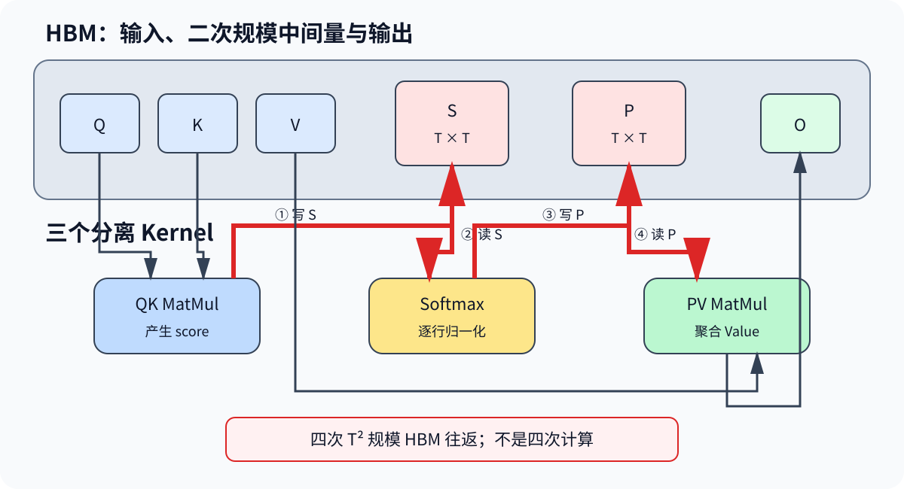
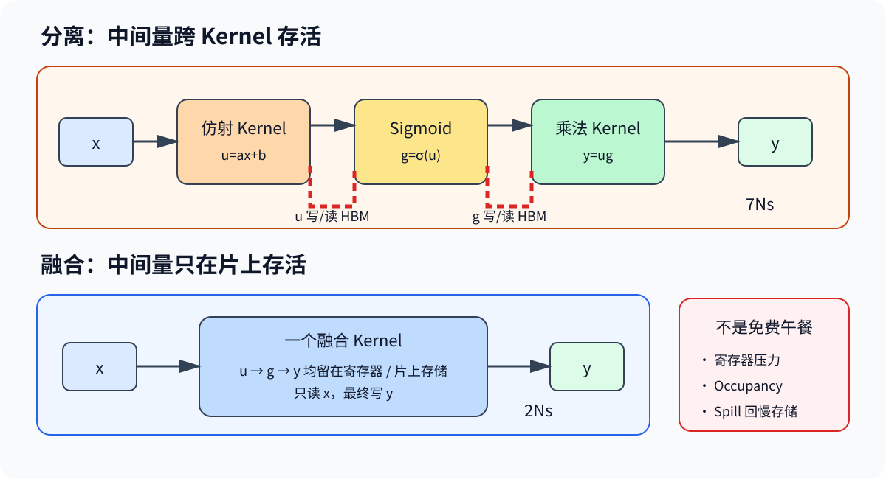
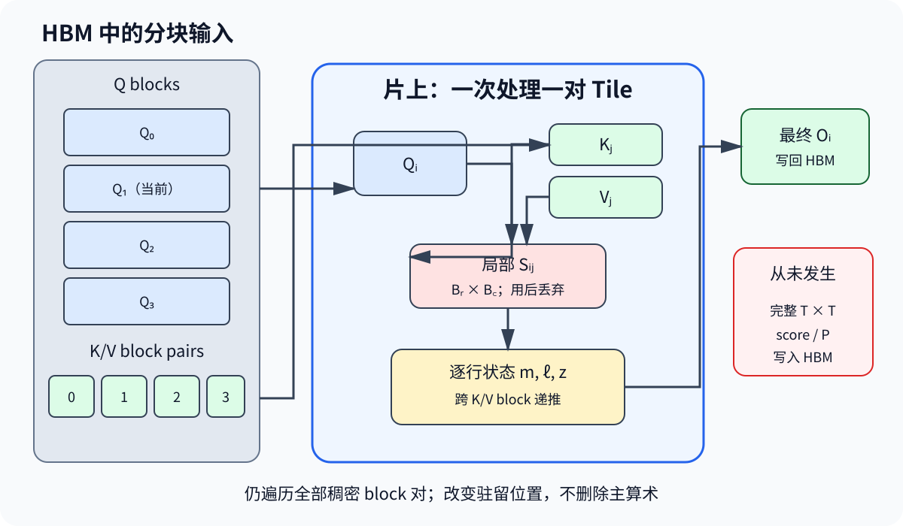
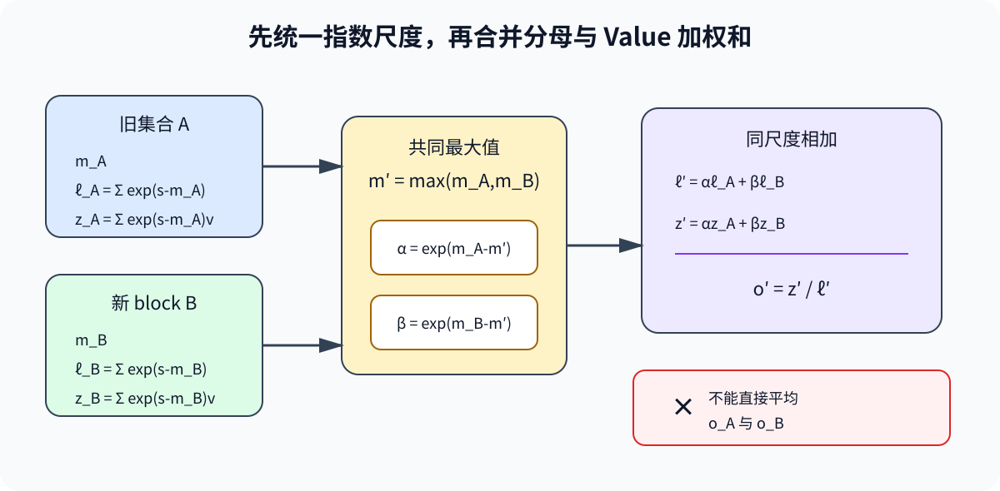
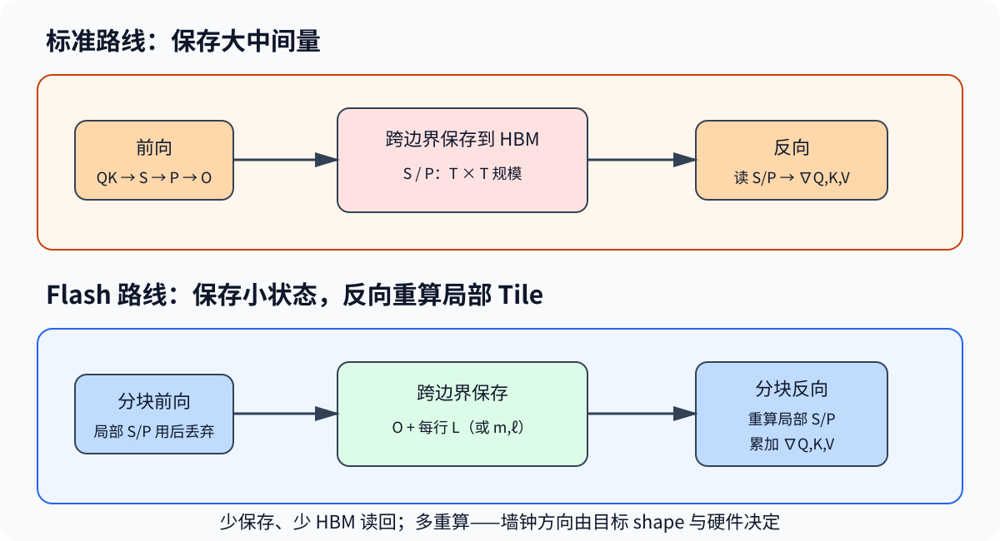

# 第 6 章 高性能 Attention 与 GPU Kernel 优化

[总目录](../index.qmd) · 上一章：[第 5 章](05-distributed-training.md) · 下一章：[第 7 章](07-inference-serving.md)

模型公式已经算对，GPU 时间线却被三段工作切开：QK 写出 score，Softmax 读回 score 又写出 probability，PV 再读回 probability。序列增长时，真正反复穿过 HBM 接口的不是输入 Q/K/V，而是两个 $T\times T$ 中间矩阵。此时继续少算几个标量未必有用；更关键的问题是：**每个中间量何时产生、在哪里停留、下一步能否在片上直接消费？**

本章沿一条 score 元素的生命周期推进：

1. [6.1](#sec-6-1)先画出显式 Attention 的 Kernel 边界和 HBM 往返，并建立容量、FLOPs 与逻辑 IO 三本账；
2. [6.2](#sec-6-2)说明 fusion、tiling 与 coalescing 怎样改变数据驻留，而不改变高层算子语义；
3. [6.3](#sec-6-3)让局部 score Tile 在片上被立即消费，用 Online Softmax 证明分块结果仍是全局 Softmax；
4. [6.4](#sec-6-4)把 FA2 及后续优化放回 thread block、warp、shape 与硬件约束；
5. [6.5](#sec-6-5)分别验证代数正确、峰值显存、真实时间和硬件指标，不让一种证据替代另一种。

::: {.callout-note title="数学目标不变，执行顺序改变"}
本章讨论的 FlashAttention 仍计算标准稠密 Attention。它主要减少慢存储层级之间的中间量搬运，并没有把 $O(T^2d_h)$ 主算术改成线性，也不保证任意 shape、硬件和后端都更快。
:::

## 学习目标与前置知识

教学目标：从 GPU 存储与数据搬运的角度理解 Attention 为什么会慢，以及 FlashAttention 如何在不改变标准 Attention 数学定义的前提下改善执行效率。

完成本章后，读者应能够：

1. 对给定$B,H,T,d_h$与dtype，复算标准Attention的score/probability容量、主FLOPs和显式物化逻辑HBM流量，并声明假设。
2. 区分PyTorch算子、GPU Kernel、launch、fusion、tiling与coalescing，用duration、bytes、throughput和occupancy解释而非猜测瓶颈。
3. 推导Online Softmax的running maximum、normalization sum与Value加权和合并式，验证分块结果等于标准Attention数学定义。
4. 逐步描述FlashAttention前向与反向重算，区分$O(T^2d_h)$算术、额外工作区、论文HBM IO模型和真实墙钟。
5. 为SDPA/FlashAttention设计可复现的正确性、峰值显存、计时与Profiler实验，识别causal、GQA、shape、后端fallback和硬件版本边界，不把未运行实验写成实测。

前置知识是[第2章Attention数学与GQA](02-transformer.md)、[第3章GPU存储/Kernel/Roofline](03-compute-and-gpu.md)以及基本PyTorch张量操作。6.1–6.3、6.5为核心；6.4版本演进为选修扩展。

## 6.1 标准 Attention 的执行瓶颈

标准Attention的数学定义仍是[式（02-Attention）](02-transformer.md#eq-02-attention)，但“一个公式”不等于“一个Kernel”。先考察单个Query头，省略batch与头索引：$\mathbf Q,\mathbf K,\mathbf V\in\mathbb R^{T\times d_h}$。一种直接实现会依次物化

$$
\mathbf S=\frac{\mathbf Q\mathbf K^\top}{\sqrt{d_h}}+\mathbf M,\qquad
\mathbf P=\operatorname{softmax}_{\mathrm{key}}(\mathbf S),\qquad
\mathbf O=\mathbf P\mathbf V.
$$

第一步QK MatMul产生$T\times T$ score；Softmax逐query行做最大值、指数和与归一化；第二个MatMul把probability与V相乘得到$T\times d_h$输出。QK和PV各约$2T^2d_h$ FLOPs，合计$4T^2d_h$主项；Softmax约为$O(T^2)$逐元素/归约操作。因果mask不改变数学输出shape；若实现仍写完整方阵，显存和IO仍按$T^2$计，只有真正跳过/压缩上三角时才能减少对应工作。

@fig-ch06-naive-hbm 把这个公式展开为三个 Kernel。粗红箭头不是计算依赖，而是中间矩阵跨越 HBM 边界的写入或读取：$S$ 写一次、读一次，$P$ 也写一次、读一次，共四次 $T^2$ 规模搬运。Q/K/V/O 的线性规模流量仍存在，但在长序列下不再主导这一本逻辑账。

{#fig-ch06-naive-hbm fig-alt="上方 HBM 保存 Q、K、V、S、P、O；下方依次是 QK、Softmax、PV 三个 Kernel。Q 和 K 进入 QK，S 写回 HBM；Softmax 读 S、写 P；PV 读 P 和 V、写 O。S 和 P 的读写用粗红箭头标为四次 T 平方规模往返。" width="100%"}

### 显式Attention矩阵的容量

若score与probability都以每元素$s_{\mathrm{attn}}$ bytes保存，则单个Query头仅这两个矩阵的逻辑容量为

$$
M_{\mathrm{score+prob}}=2T^2s_{\mathrm{attn}}.
$$

在$T=4096$、BF16存储$s_{\mathrm{attn}}=2$ bytes时，score与probability各为$4096^2\times2=32$ MiB，合计64 MiB/Query头。贯穿模型有$H=32$个Query头，$B=1$时合计2 GiB；GQA的$H_{\mathrm{KV}}=8$减少K/V投影和缓存，却不会把32组Query对应的score行自动减少为8组。训练反向所需张量、mask、dropout、临时归约和allocator另计，所以2 GiB不是峰值。

### 分离Kernel的HBM读写账本

把QK、Softmax、PV视为三个独立阶段，并作一个偏乐观的逻辑账本：每个输入只从HBM读一次、每个输出写一次，score/probability都用相同$s$，忽略mask、Softmax多遍归约、cache命中和反向。单头前向流量至少按下列项相加：

$$
\begin{aligned}
Q_{\mathrm{HBM,naive}}
&=\underbrace{(2T d_h+T^2)s}_{QK:\ \mathrm{read}\ Q,K;\ \mathrm{write}\ S}\\
&\quad+\underbrace{2T^2s}_{\mathrm{Softmax}:\ \mathrm{read}\ S;\ \mathrm{write}\ P}\\
&\quad+\underbrace{(T^2+2T d_h)s}_{PV:\ \mathrm{read}\ P,V;\ \mathrm{write}\ O}\\
&=4T^2s+4T d_hs.
\end{aligned}
$$

式（06-Standard-Attention-IO）是显式物化实现的逻辑HBM下界式情景，不是所有库的实际计数。$T=4096,d_h=128,s=2$时为132 MiB/Query头，其中128 MiB来自四次方阵读/写，Q/K/V/O项合计4 MiB；32个Query头为4.125 GiB。真实Softmax常用更高精度累加并多次扫描行，GQA可能复用K/V读取，cache和融合也会改变物理流量。

::: {.callout-warning title="逻辑 IO 不是硬件计数器"}
这里的 132 MiB 是在明确假设下把张量接口相加得到的逻辑下界式情景。Cache 命中、Softmax 多遍扫描、事务粒度、融合和数据复用都会改变 DRAM 实际字节；只有 Profiler 或硬件计数器才能回答目标实现真正搬了多少。
:::

### 算术强度（Arithmetic Intensity）为什么不能只看FLOPs

同一情景的两个MatMul主项为$4T^2d_h=8{,}589{,}934{,}592$ FLOPs。仅用上面的132 MiB作分母，整体逻辑算术强度约62.06 FLOPs/byte；但这是把高强度GEMM与低强度Softmax平均后的总数。执行时QK先把$S$写回HBM，Softmax再读写$S/P$，PV最后读$P$；Softmax本身每元素只有少量算术和行归约，可能先受带宽、同步或特殊函数单元限制。把不同Kernel的FLOPs和bytes总和平均，可能掩盖其中一个Kernel已经让流水线停顿。

复用[Roofline式](03-compute-and-gpu.md#eq-03-roofline)时，必须对明确Kernel、dtype和存储接口分别计算$I=F/Q$。减少QK/PV的FLOPs并不保证更快：若仍物化$T^2$中间矩阵，HBM往返和Kernel边界可能主导；反过来，即便重算少量score使FLOPs增加，只要大幅减少慢层级IO，墙钟仍可能下降。这正是IO-aware algorithm的设计动机。

[FlashAttention论文](https://arxiv.org/abs/2205.14135)把HBM与片上SRAM之间的读写纳入算法分析，并用分块避免在HBM物化完整Attention矩阵；它计算的仍是精确Attention，而不是通过近似降低标准稠密Attention的$O(T^2d_h)$算术主项。后续小节将先讲Kernel融合，再推导分块Online Softmax；本节不提前把论文速度数字当作本机结果。

瓶颈随shape改变：短序列时Kernel启动和小矩阵利用率可能更重要；长序列时$T^2$矩阵容量与IO迅速增长；较大$d_h$提高MatMul算术占比；因果跳过、dropout、mask稀疏性、dtype和硬件缓存都会改变实际点。因此“标准Attention一定memory-bound”也不是无条件结论，必须用目标shape的Profiler和HBM计数器验证。

本节没有运行GPU、Attention Kernel、Profiler或HBM计数器；2 GiB、132 MiB、4.125 GiB与62.06 FLOPs/byte均为明确假设下的理论逻辑账本。

**理解检查。** 在上述单头例中，把$T$从4096减半时，score+probability容量与MatMul FLOPs各变为多少倍？为什么即使总FLOPs不变，把QK、Softmax、PV融合后仍可能缩短时间？

## 6.2 GPU Kernel 与算子融合

GPU Kernel是一次在设备上执行的并行程序入口；框架“算子”是更高层语义，二者不保证一一对应。一个PyTorch算子可能调用库中的多个Kernel、做临时分配或触发布局转换；编译器也可能把多个算子融合成一个Kernel。分析性能时应从Profiler确认实际launch序列，而不是按Python代码行数推断Kernel数。

### Kernel launch与小算子问题

每次launch都需要主机提交、参数准备、依赖排序与设备调度。大GEMM的执行时间可能远大于launch开销；大量微小逐元素Kernel则可能很快做完设备工作，却在时间线上留下CPU提交间隙，使GPU等下一次launch。小batch、短序列和许多标量/shape操作更容易暴露这种问题。[PyTorch编译器Profiler指南](https://docs.pytorch.org/docs/stable/torch.compiler_profiling_torch_compile)建议从GPU Kernel之间的空隙识别launch/CPU overhead；这不等于所有空隙都由launch造成，还须排除同步、数据等待和图中断。

Kernel launch overhead通常近似按调用次数累积，但不能在教材中写一个跨驱动、硬件与语言绑定通用的微秒常数。融合把三个Kernel变成一个，可能减少两次launch；如果单个Kernel本来很长，节省可忽略；如果融合引入编译、guard或动态shape fallback，端到端甚至可能变慢。

### Operator Fusion改变了什么

考虑$N$个BF16元素的局部链：

$$
u_i=ax_i+b,\qquad g_i=\sigma(u_i),\qquad y_i=u_i g_i.
$$

若三个独立Kernel都把中间量写回HBM，且每个输入只读一次、输出只写一次，忽略标量$a,b$和cache，则逻辑流量为

$$
Q_{\mathrm{separate}}
=\underbrace{2Ns}_{x\to u}
 +\underbrace{2Ns}_{u\to g}
 +\underbrace{3Ns}_{u,g\to y}
=7Ns,
\qquad
Q_{\mathrm{fused}}=2Ns.
$$

式（06-Fusion-IO）中的融合Kernel读$x$，在寄存器/片上存储中保留$u,g$并直接写$y$，理想减少$5Ns$慢层级流量和两次launch。取$N=2^{24}$、$s=2$ bytes，分离/融合逻辑流量分别224/64 MiB，差160 MiB。这不是DRAM计数器结果：cache可能吸收分离Kernel的部分中间量，融合也可能因寄存器spill重新访问local/global memory。

@fig-ch06-fusion-lifecycle 画的是同一条逐元素链，而不是两个不同算法。分离路线让 $u$、$g$ 成为跨 Kernel 存活的 HBM 张量；融合路线只在片上保存它们，接口退化为“读 $x$、写 $y$”。右侧的资源压力提醒我们：省去中间写回并非免费，寄存器不足时 spill 会重新引入慢层级访问。

{#fig-ch06-fusion-lifecycle fig-alt="上方分离路线包含仿射、Sigmoid、乘法三个 Kernel，u 和 g 各写回并读出 HBM，总逻辑接口为 7Ns；下方融合路线只从 HBM 读取 x，在片上依次产生 u 和 g，最后写 y，总接口为 2Ns；旁注指出寄存器压力和 spill 可能削弱收益。" width="100%"}

融合不改变上述逐元素数学结果，但会改变浮点求值顺序、Kernel边界和中间dtype。正确性应对相同输入比较输出/梯度误差，并明确容限；不能只因loss最终下降就判定融合等价。

### Tiling与片上资源

Tiling把大Tensor划成能放入寄存器或Shared Memory的块。以GEMM为例，一个Block装入A/B Tile后可让多线程复用，再沿归约维循环；[3.5.2节](03-compute-and-gpu.md#sec-3-5-2)的$32\times32$例已展示逻辑输入流量可从重复读取情景的131,072 bytes降到4,096 bytes。Attention还要让Q Tile与多个K/V Tile交互，并维护Softmax统计量；具体分块留到6.3。

Tile越大不一定越快：它会增加每Block寄存器与Shared Memory，占满片上资源后可同时驻留的Block/Warp减少；寄存器不足还可能spill。Tile过小则复用不足、launch/循环控制占比高。边界Tile还需mask或padding。因此Tile形状必须同时考虑$d_h$、dtype、对齐、片上容量和目标GPU。

### Memory Coalescing

Memory Coalescing（合并访存）要求同一Warp的地址尽量落在少量内存事务覆盖的连续segment中，使“实际使用bytes/传输bytes”接近1。行主序矩阵中，让相邻lane访问相邻列通常容易合并；若相邻lane跨很大stride取同一列，可能触发更多事务。CUDA编程指南把coalesced global access列为关键性能因素，但具体segment、cache与事务合并规则依架构，不能把一种设备的事务数写成全书定律。[CUDA Kernel与访存指南](https://docs.nvidia.com/cuda/cuda-programming-guide/02-basics/writing-cuda-kernels.html)

合并访存与Tiling互相配合：先让线程协作连续加载到Shared Memory，再以适合计算的次序复用；代价是同步、Shared Memory布局与可能的bank conflict。数据连续也不保证高带宽，还要有足够并发请求隐藏延迟。

### 性能指标与诊断顺序

优化前后首先比较**绝对Execution Time**：相同输入、dtype、预热、同步和重复协议下的Kernel duration与端到端时间。随后用指标解释原因：

| 指标 | 能回答的问题 | 不能单独证明 |
| --- | --- | --- |
| launch数量与时间线空隙 | 是否有许多小Kernel/CPU提交间隙 | 空隙一定来自launch |
| DRAM bytes与Memory Throughput | 实际慢层级流量、带宽接近程度 | 高带宽利用率必然高效 |
| SM/Tensor pipe Compute Utilization | 计算管线忙碌程度 | 百分比越高墙钟一定越短 |
| Occupancy、寄存器、Shared Memory | 是否受驻留资源约束 | 高occupancy必然最快 |
| 输出/梯度误差 | 融合是否在容限内保持语义 | 性能收益 |

Nsight Compute文档强调throughput百分比表示接近相应峰值，不等同于效率；减少总工作后duration下降，利用率百分比反而可能降低。[Nsight Compute Profiling Guide](https://docs.nvidia.com/nsight-compute/ProfilingGuide/) 因此先确认结果正确和duration改善，再用DRAM、SM、occupancy与stall指标定位，不用单一“GPU利用率”打分。

融合可能无收益的情形包括：中间量已被cache保留；计算本来由大GEMM主导；融合后寄存器/Shared Memory压力导致occupancy下降或spill；动态shape造成反复编译；融合打断库中更优的专用Kernel；数值要求迫使高精度中间量。优化应回答“少了哪些launch和bytes、增加了哪些片上资源与实现约束”。

本节没有运行GPU Kernel、torch.compile、Profiler或Nsight；224/64/160 MiB是逻辑IO复算，不是实测带宽或加速比。

**理解检查。** 上例若分离Kernel的中间量全部命中cache，式（06-Fusion-IO）为什么会高估融合节省的DRAM bytes？若融合后duration下降但Compute Utilization也下降，能否据此判定退化？

## 6.3 FlashAttention 原理

前两节已经建立两个前提：标准实现的主要问题之一是$T\times T$中间矩阵在HBM中的物化与往返，[Kernel融合与Tiling](#sec-6-2)能够改变数据驻留方式。本节据此分三步回答“如何在不近似标准Attention的前提下省去完整矩阵”：

1. [6.3.1](#sec-6-3-1)先给出IO-aware目标、Q/K/V分块及Exact Attention边界；
2. [6.3.2](#sec-6-3-2)推导跨Key Block保持全局Softmax的在线统计量；
3. [6.3.3](#sec-6-3-3)串联前向、反向重算与算术/IO/墙钟三种口径。

阅读时应始终区分“局部$B_r\times B_c$矩阵暂驻片上”与“全局$T\times T$矩阵写入HBM”，也要区分论文的渐近IO模型与目标硬件的实测时间。这两组边界是后续版本演进和性能实验的基线。

### 6.3.1 FlashAttention 的核心思想

FlashAttention首先改变执行顺序，而不改变[标准Attention定义](02-transformer.md#eq-02-attention)。它是IO-aware Attention：设计时显式考虑HBM容量/带宽与片上SRAM的差异，目标是让昂贵层级之间少搬数据。这里的“少搬”不是泛指压缩Q/K/V，也不是删除某些注意力边；对于标准稠密Attention，QK与PV的$O(T^2d_h)$主算术仍然存在。

### 从完整矩阵到Q/K/V Block

仍看单个Query头，令$\mathbf Q,\mathbf K,\mathbf V\in\mathbb R^{T\times d_h}$。把Q按$B_r$行分为Query Block，把K、V按$B_c$行成对分为Key/Value Block。对一个$\mathbf Q_i\in\mathbb R^{B_r\times d_h}$与一个$\mathbf K_j,\mathbf V_j\in\mathbb R^{B_c\times d_h}$，Kernel在片上计算局部score

$$
\mathbf S_{ij}=\frac{\mathbf Q_i\mathbf K_j^\top}{\sqrt{d_h}}+\mathbf M_{ij}
\in\mathbb R^{B_r\times B_c}.
$$

同一个Query Block依次遍历所有Key/Value Block；局部score经分块Softmax统计量修正后立刻参与$\mathbf O_i$累加。$B_r,B_c$必须让Q/K/V Tile、局部score、输出累加器和Softmax统计量共同装入寄存器/Shared Memory；因此它们是受片上容量、dtype和Kernel布局约束的实现参数，不是模型配置中的新超参数。

若只比较概率/score工作区，显式实现需在HBM容纳$T^2s_{\mathrm{attn}}$ bytes的完整矩阵，而分块Kernel在任一时刻只需片上容纳约$B_rB_cs_{\mathrm{attn}}$ bytes的局部Tile：

$$
M_{\mathrm{matrix,HBM}}=T^2s_{\mathrm{attn}},
\qquad
M_{\mathrm{tile,on\mbox{-}chip}}\approx B_rB_cs_{\mathrm{attn}}.
$$

这不是完整峰值显存公式；Q/K/V/O、每行统计量、反向状态、mask和临时缓冲仍要另计。它表达的是关键执行差异：局部$\mathbf S_{ij}$用完即丢，不把完整score或Attention Probability Matrix写回HBM，再由下一个Kernel读回。[FlashAttention论文](https://arxiv.org/abs/2205.14135)将这种分块和跨慢/快存储层级的读写次数一起分析。

例如$T=8,B_r=2,B_c=4$时，完整单头矩阵有64个元素，而片上局部score一次只有8个元素。算法仍会遍历$4\times2=8$对Block、计算全部64个稠密score；“同时驻留8个”不等于“只计算8个”。这个区别也解释了为什么减少HBM IO不等于把算术复杂度从二次降为线性。

@fig-ch06-flash-tiles 把这次遍历放回存储层级：一个 Q Block 与一个 K/V Block 进入片上区域，局部 $S_{ij}$ 立即更新逐行 $m,\ell,z$，随后被丢弃；只有最终 $O_i$ 与小统计量返回 HBM。图中的“丢弃”指不把完整局部 score 留作全局矩阵，并不表示跳过这对 Block 的计算。

{#fig-ch06-flash-tiles fig-alt="左侧 HBM 中 Q 被分成多个行块，K 和 V 被分成多个列对应块；中间片上区域载入一个 Q 块和一对 K/V 块，计算局部 Sij，再更新每行 m、l、z，局部 score 用后丢弃；处理完所有 K/V 块后只把 Oi 和小统计量写回 HBM，完整 T 乘 T 矩阵从未落入 HBM。" width="100%"}

### 为什么仍是Exact Attention

若每个Query行在遍历Key Block时正确维护全局最大值、指数归一化和与加权Value和，那么最后得到的数学量仍是

$$
\mathbf O=\operatorname{softmax}_{\mathrm{key}}
\left(\frac{\mathbf Q\mathbf K^\top}{\sqrt{d_h}}+\mathbf M\right)\mathbf V.
$$

所以FlashAttention是Exact Attention，而不是低秩、稀疏或截断近似。困难在于Softmax分母跨越所有Key：不能对每个$B_r\times B_c$ Tile独立归一化后直接拼接。下一节将用running maximum与running normalization sum给出精确合并公式。

“数学上精确”也不承诺逐bit一致。分块改变浮点加法、最大值与指数累加顺序，混合精度、是否上转FP32、因果mask和dropout实现还会带来小误差；正确性测试应与同一定义的标准Attention比较输出和梯度，并声明dtype与容限。实际速度与显存收益则取决于$T,d_h$、batch、因果性、GQA、硬件和实现，不能由上面的工作区比例直接推出。

::: {.callout-important title="Exact 不等于逐 bit 相同"}
“Exact Attention”排除的是低秩、稀疏或截断等数学近似；它不固定浮点归约顺序。判断实现是否保持语义，应预先声明 dtype、mask、dropout 与输出/梯度容限，而不是要求跨 Kernel 逐 bit 一致。
:::

本节没有运行FlashAttention Kernel、GPU、Profiler或显存测量；$T=8$示例只是分块形状与元素数复算，不是性能实验。

**理解检查。** 在$T=4096,B_r=64,B_c=64$时，完整矩阵和单个局部score Tile各有多少元素？为什么二者相差4096倍，却不能据此声称Attention FLOPs也减少4096倍？

### 6.3.2 Online Softmax

对一条Query对应的score向量$\mathbf s\in\mathbb R^T$，普通Softmax为$p_k=e^{s_k}/\sum_t e^{s_t}$。直接求指数可能上溢，因此稳定实现先减去全局最大值$m=\max_k s_k$：

$$
p_k=\frac{e^{s_k-m}}{\ell},
\qquad
\ell=\sum_{t=1}^{T}e^{s_t-m}.
$$

减去同一常数不会改变比例，且所有指数输入不大于0。问题是分块时尚未看见后续Key Block，当前块最大值不一定是全局$m$。若分别对每块做Softmax，每块概率和都会等于1；这种“独立归一化后直接拼接”会使整行概率和等于块数，而不是1，并且丢失不同块之间的相对尺度。

### Running maximum与normalization sum

设已经处理集合$A$，其稳定统计量为

$$
m_A=\max_{k\in A}s_k,\qquad
\ell_A=\sum_{k\in A}e^{s_k-m_A}.
$$

新Block $B$也先在片上算$m_B,\ell_B$。合并前必须把两块都换到共同最大值$m'=\max(m_A,m_B)$的尺度：

$$
\boxed{
\begin{aligned}
m'&=\max(m_A,m_B),\\
\ell'&=e^{m_A-m'}\ell_A+e^{m_B-m'}\ell_B.
\end{aligned}}
$$

这是Online Softmax的核心递推。初始可取$m_A=-\infty,\ell_A=0$；mask位置视为score $-\infty$，对统计量贡献0。实际实现要特殊处理一整行都被mask的非法/约定情形，避免$-\infty-(-\infty)$产生NaN。

### 同尺度合并Attention输出

仅维护$m,\ell$还不够，因为目标是$\mathbf O=\mathbf P\mathbf V$。定义与$\ell_A$处在相同指数尺度的未归一化Value加权和

$$
\mathbf z_A=\sum_{k\in A}e^{s_k-m_A}\mathbf v_k,
\qquad
\mathbf z_B=\sum_{k\in B}e^{s_k-m_B}\mathbf v_k.
$$

合并时必须用与分母相同的缩放：

$$
\boxed{
\begin{aligned}
\mathbf z'&=e^{m_A-m'}\mathbf z_A+e^{m_B-m'}\mathbf z_B,\\
\mathbf o'&=\frac{\mathbf z'}{\ell'}.
\end{aligned}}
$$

@fig-ch06-online-merge 将递推中的三个状态放在同一尺度变换里。旧块 A 与新块 B 各自的 $\ell,z$ 都先乘以相对共同最大值 $m'$ 的指数因子，再做加法；若直接平均两块各自归一化的输出，就会同时丢掉块的总质量和相对最大值信息。

{#fig-ch06-online-merge fig-alt="左侧旧块 A 保存 mA、lA、zA，右侧新块 B 保存 mB、lB、zB；两路先求共同最大值 m 撇，再分别乘指数重缩放，在中间对 l 与 z 相加，最后得到全局 l 撇、z 撇和 o 撇等于 z 撇除 l 撇。图中叉号标出不能直接平均两个块内输出。" width="100%"}

也可以直接维护已归一化输出$\mathbf o_A=\mathbf z_A/\ell_A$，但每次更新仍要按旧、新归一化权重重新缩放；不能简单做两块输出的平均。对$B_r$条Query并行时，$m,\ell$各是长度$B_r$的逐行向量，$\mathbf z$是$B_r\times d_h$累加器，广播方向始终沿Key维归约。

### 两Block复算

取score分块$A=[1,2]$、$B=[0,3]$，对应标量Value为$[10,20]$、$[30,40]$：

- $m_A=2,\ell_A=e^{-1}+1\approx1.367879$，$z_A=10e^{-1}+20\approx23.678794$；
- $m_B=3,\ell_B=e^{-3}+1\approx1.049787$，$z_B=30e^{-3}+40\approx41.493612$；
- 共同$m'=3$，于是$\ell'=e^{-1}\ell_A+\ell_B\approx1.553002$，$z'=e^{-1}z_A+z_B\approx50.204554$；
- 最终$o=z'/\ell'\approx32.327428$。

直接一次性计算也得到分母$e^{-2}+e^{-1}+e^{-3}+1\approx1.553002$和相同输出。该恒等关系说明分块合并没有近似Softmax；有限精度下，两种归约顺序仍可能产生小差异。[FlashAttention论文](https://arxiv.org/abs/2205.14135)用这类统计量让局部概率在片上立即乘V并累加，无需把完整概率矩阵写入HBM。

本节数值由公式复算，没有运行GPU、FlashAttention实现或性能实验。指数近似值用于教学核对，不代表任何Kernel采用的内部精度。

**理解检查。** 若新Block最大值$m_B$远大于旧$m_A$，式（06-Online-Softmax-Merge）中的$e^{m_A-m'}$会怎样？为什么这正是对旧统计量所需的重缩放，而不是丢失旧Block？

### 6.3.3 FlashAttention 的完整计算流程

把前两节合起来，可把单个Query头的前向写成下面的Block流程。令$T_r=\lceil T/B_r\rceil$、$T_c=\lceil T/B_c\rceil$；边界Block用真实有效长度和mask处理，不要求$T$整除Block Size。

1. 在HBM中准备$\mathbf Q,\mathbf K,\mathbf V$，把Q/O按$B_r\times d_h$、K/V按$B_c\times d_h$分块；每条Query初始化$m=-\infty,\ell=0,\mathbf z=\mathbf0$。
2. 把一对$\mathbf K_j,\mathbf V_j$ Tile载入片上存储；再载入一个$\mathbf Q_i$及其$m_i,\ell_i,\mathbf z_i$。原论文Algorithm 1采用K/V外循环、Q内循环以复用K/V Tile；其他合法Kernel可改变循环顺序和驻留策略。
3. 片上计算$\mathbf S_{ij}=\mathbf Q_i\mathbf K_j^\top/\sqrt{d_h}+\mathbf M_{ij}$，shape为$B_r\times B_c$；因果或padding mask在Softmax前应用。
4. 逐行求局部最大值、指数和及$\widetilde{\mathbf P}_{ij}=\exp(\mathbf S_{ij}-\widetilde{\mathbf m}_{ij})$，再用[Online Softmax合并式](#eq-06-online-softmax-merge)更新$m_i,\ell_i$。
5. 计算$\widetilde{\mathbf P}_{ij}\mathbf V_j$并按共同最大值重缩放，与旧$\mathbf z_i$合并。处理完全部$j$后，写$\mathbf O_i=\mathbf z_i/\ell_i$；局部$\mathbf S_{ij},\widetilde{\mathbf P}_{ij}$不写成完整$T\times T$矩阵。

以$T=10,B_r=4,B_c=3$为例，$T_r=3,T_c=4$，共处理12对Block；最后一组Q有2行，最后一组K/V有1行。最大局部score缓冲仍按$4\times3$配置，但无效位置必须mask，不能当真实Token参与归一化。

### 反向：保存小状态，重算大中间量

训练反向需要Softmax概率来求$\nabla\mathbf Q,\nabla\mathbf K,\nabla\mathbf V$。显式实现可保存$T\times T$的$\mathbf S$或$\mathbf P$；FlashAttention前向只保存$\mathbf O$和每条Query的归一化统计量，例如$m,\ell$或等价的$L=m+\log\ell$。反向再次按Q/K/V Block计算局部score和概率，再与$\nabla\mathbf O$组合并累加三个输入梯度。这样增加重算FLOPs，却避免从HBM读回二次规模概率矩阵，是[第5章Activation Checkpointing](05-distributed-training.md#sec-5-10)“以算术换保存状态”在Attention内部的选择性形式。

重算必须复现前向语义：同一mask、缩放、dtype策略，以及dropout的同一随机掩码/可重建计数器状态。否则即使前向输出正确，梯度也不是同一个函数的梯度。保存哪些统计量、梯度Tile如何归约以及是否重算输出，随Kernel版本而变；教材只固定数学不变量，不把某个CUDA实现细节写成唯一流程。

@fig-ch06-forward-backward 对照了训练时真正跨越前反向边界的状态。显式路线保存大规模 $S/P$ 供反向读取；Flash 路线只保存 $O$ 与逐行统计量，反向时重新形成局部 score/probability Tile。后者同时减少保存量和 HBM 读回，却增加了重算，因此性能方向仍须测量。

{#fig-ch06-forward-backward fig-alt="上方标准路线在前向产生并保存大规模 S 和 P，反向从 HBM 读回它们计算 Q、K、V 梯度；下方 Flash 路线前向只保存 O 与逐行 L 或 m、l，反向重新按块计算局部 S 和 P 后累加梯度。下方标注少保存、少读回但多重算。" width="100%"}

### 三种“复杂度”不能混写

对标准稠密、单头Attention，论文算法的前向主算术和额外工作区可概括为

$$
F_{\mathrm{FA}}=O(T^2d_h),
\qquad
M_{\mathrm{extra}}=O(T),
$$

其中额外工作区不含输入$\mathbf Q,\mathbf K,\mathbf V$与输出$\mathbf O$；实际库还会有临时缓冲。反向重算提高常数FLOPs，但不改变稠密Attention关于$T$的二次主阶。

在论文的两层存储模型中，若片上SRAM可容纳$M$个标量且$d_h\le M\le Td_h$，标准实现与该FlashAttention调度的HBM访问量分别为

$$
Q_{\mathrm{standard}}=\Theta(Td_h+T^2),
\qquad
Q_{\mathrm{FA}}=\Theta\!\left(\frac{T^2d_h^2}{M}\right).
$$

这组渐近式用于解释“片上容量越大，可用更大Tile并减少慢层级往返”，不是任意GPU上的精确bytes公式：它忽略cache层级、事务粒度、数据类型bytes、融合细节和因果跳过。更少的渐近HBM IO也不自动给出固定加速比；墙钟还受矩阵单元利用率、寄存器压力、occupancy、launch、短序列开销和反向重算影响。只有在相同shape、dtype、mask、预热和同步协议下测量Kernel/端到端时间，才能报告实际性能。

[FlashAttention原论文§3与附录B](https://arxiv.org/abs/2205.14135)给出上述前向调度、重算反向和IO模型。本节没有运行CUDA、FlashAttention、GPU Profiler或计时；12对Block及复杂度式都是静态推导，不是实测。

**理解检查。** 为什么反向重新计算$\mathbf S_{ij},\mathbf P_{ij}$会增加FLOPs，却可能同时减少峰值显存和墙钟？回答时分别指出算术、HBM IO与目标硬件测量三个层次。

## 6.4 FlashAttention-2 与后续优化（建议扩展）

FlashAttention-2没有改写标准Attention的数学目标，也没有推翻Online Softmax；它重新安排相同工作，使更多时间落在GPU擅长的矩阵乘法上，并减少Thread Block与Warp之间不必要的数据交换。[FlashAttention-2论文](https://arxiv.org/abs/2307.08691)把改进归纳为三个层次。

### 少做非MatMul工作

GPU的MatMul与指数、除法、逐元素缩放并非“每个FLOP同价”。FA2维护未归一化输出累加器，只在遍历完全部Key Block后除以最终$\ell$，避免每轮都把输出归一化再重缩放；反向只需保存$L=m+\log\ell$，而非分别保存$m,\ell$。数学上仍对应[6.3.2的同尺度合并](#eq-06-online-attention-merge)，变化的是中间表示与执行次数。

这不意味着非MatMul操作可以全部删除：row max、指数、rowsum、mask和最终归一化仍是Softmax必需步骤。优化目标是减少重复标量/逐元素工作，并让它与MatMul流水线更好重叠。

### Thread Block与Warp的Work Partitioning

早期调度主要从batch和head维产生并行任务；长序列却常伴随小batch，$BH$个任务可能不足以填满GPU。FA2进一步沿Query序列分块，让不同Thread Block负责不同Query行块。忽略边界与分拆反向时，一个直观任务数为

$$
N_{\mathrm{TB,fwd}}\approx B H\left\lceil\frac{T_q}{B_r}\right\rceil.
$$

这只是解释并行网格的教学式，不是任一库的固定launch配置；真实Kernel还会受Split-K、因果区域、持久化调度和硬件资源限制。

Thread Block内部，FA1式的split-K方案让多个Warp分别持有K/V片段，随后需通过Shared Memory交换并归约部分输出。FA2前向改为在Warp之间切Q行、共享可访问的K/V Tile，使各Warp产生各自的输出行，减少Warp间归约与Shared Memory读写。反向依赖更复杂，仍可能需要同步或原子累加。Tile增大可以减少循环与Shared Memory往返，却增加寄存器和片上容量压力；出现spill或occupancy下降时会适得其反。

### Causal Mask如何改变Kernel

等长自回归Attention只保留下三角。完全位于未来区域的score Tile可跳过，穿过对角线的Tile仍需逐元素mask；因此工作网格从矩形变成带边界的三角区域。不同Query Block的有效Key Block数不等，若静态分配相同工作会产生负载不均；短序列、边界Tile、$T_q\ne T_k$时也不能简单宣称“计算恰好减半”。因果对齐约定还是接口语义：官方实现曾改变不等长Q/K下的mask对齐，调用者必须按所用版本的测试与文档核对。

### GQA/MQA如何改变复用

本书配置$H=32,H_{\mathrm{KV}}=8$，每个KV头服务$g=H/H_{\mathrm{KV}}=4$个Query头。官方实现以“$H$能被$H_{\mathrm{KV}}$整除”为GQA/MQA映射条件。K/V存储量与独立KV Tile数按$H_{\mathrm{KV}}$计，Kernel可在同组Query头之间复用K/V；但score、Softmax统计量和输出仍按32个Query头计算，不能把Attention算术直接除以4。复用能否落在寄存器、Shared Memory或cache，还取决于head布局与调度。

[官方FlashAttention仓库README](https://github.com/Dao-AILab/flash-attention/blob/main/README.md)在2026-11-05访问时列出causal、变长序列、MQA/GQA等接口，并明确支持矩阵随CUDA/ROCm后端、架构、dtype、head dimension与版本变化。本书据此只固定数学和shape约束，不承诺某环境一定选择某个Kernel。

### 适用边界：先看shape，再谈收益

| 维度 | 可能更有利 | 可能受限或需重新选Kernel |
| --- | --- | --- |
| Head Dimension $d_h$ | 受支持且与Tile/Tensor Core布局匹配 | 过大、非常规或不满足对齐，片上状态/寄存器压力上升 |
| Sequence Length $T$ | 较长时避免$T^2$矩阵落HBM的价值增大 | 很短时launch、调度与最终归约开销占比更高 |
| Batch/Head并行度 $BH$ | 足够任务或可沿序列拆分，较易填满设备 | 小batch、少head、短序列可能任务不足；过大batch还受总显存限制 |
| 硬件平台 | Kernel针对该架构、dtype和片上资源调优 | 不同CUDA/ROCm后端、Shared Memory、寄存器、矩阵单元与指数吞吐会迁移瓶颈 |

因此“FlashAttention总是更快”不是工程判据。还要把causal/非causal、训练/推理、dropout、GQA比例、变长padding浪费与后端fallback纳入测试矩阵；较低显存占用和较短时间也要分别测量，不能互相代替。

### 工程选型：优先表达语义，显式验证后端

PyTorch的`torch.nn.functional.scaled_dot_product_attention`（SDPA）以统一接口表达scaled dot-product Attention，并按输入、设备与构建自动选择可用实现；在线文档列出FlashAttention、memory-efficient与math等路径。一般代码先正确传入Q/K/V、`is_causal`、mask、dropout和`enable_gqa`，让框架选择；做归因实验时再用`torch.nn.attention.sdpa_kernel`限制候选后端，并记录实际选择或fallback警告。[PyTorch SDPA官方文档](https://docs.pytorch.org/docs/main/generated/torch.nn.functional.scaled_dot_product_attention.html)

强制某个后端不是优化本身：融合Kernel对device、dtype、shape、mask与构建均有约束，不可用时应显式失败或记录fallback，不能把math结果标成FlashAttention结果。不同后端因融合与归约顺序可能有数值差异；训练模式还必须显式传递正确`dropout_p`。在线API晚于本机PyTorch 2.5.1，本节未调用`sdpa_kernel`，具体代码以安装版本文档为准。

### 后续版本展示的共同方向

版本演进的主线是“随硬件瓶颈迁移而共同设计算法和流水线”，而不是版本号越大就对所有shape更快：

- [FlashAttention-3](https://arxiv.org/abs/2407.08608)面向Hopper，利用Warp Specialization与异步数据移动重叠MatMul、Softmax和搬运，并研究FP8分块量化的精度控制。
- [FlashAttention-4](https://arxiv.org/abs/2603.05451)面向Blackwell的非对称资源增长，围绕异步MMA、更大Tile、指数/条件重缩放、Tensor Memory与2-CTA协作继续减少非MatMul及Shared Memory瓶颈。

这些是论文所述的硬件特定设计方向，不是本机支持声明。迁移时应重新核对：目标架构与后端、dtype/head dimension、训练或推理、causal/GQA/变长支持、确定性要求、数值容限，以及目标shape的正确性与Profiler结果。

本节没有安装或运行FlashAttention任何版本，也没有GPU/Profiler结果；并行网格式与$g=4$仅为配置推导，未引用论文加速数字作本机结论。

**理解检查。** 对$B=1,H=32,T_q=4096,B_r=128$，教学网格给出多少个前向Thread Block任务？为什么这个数字既不能预测实际launch数，也不能说明causal GQA一定达到某个利用率？

## 6.5 FlashAttention 实验与性能分析

性能结论必须建立在“同一数学问题、确认实际后端、分别测正确性/显存/时间/硬件指标”之上。建议实验固定随机种子，并记录PyTorch、CUDA/ROCm、驱动、GPU型号、后端实现与版本；输入矩阵至少覆盖：$B\in\{1,4\}$，$T\in\{128,512,2048,8192\}$（按显存删减），$d_h\in\{64,128\}$，$H=32$，$H_{\mathrm{KV}}\in\{32,8\}$，FP16/BF16，causal/非causal，以及forward-only/forward+backward。一次只改变一个主维度，避免把shape与后端变化混成同一结论。

::: {.callout-tip title="四层证据不可互相替代"}
正确性回答“是不是同一个数学问题”；峰值显存回答“能否放下”；同步计时回答“是否更快”；Profiler 回答“为什么变化”。CPU 代数通过不能证明 GPU Kernel 驻留或加速，DRAM bytes 下降也不能单独证明墙钟下降。
:::

### Correctness Test

以显式$\operatorname{softmax}(QK^\top/\sqrt{d_h}+M)V$或SDPA math后端作参考，候选为明确强制并验证成功的fused后端。关闭dropout做确定性基础比较；训练路径还要对同一标量loss比较$\nabla Q,\nabla K,\nabla V$。至少记录

$$
e_{\max}=\max_i|y_i-\hat y_i|,
\qquad
e_{\mathrm{rel}}=\frac{\lVert y-\hat y\rVert_2}{\max(\lVert y\rVert_2,\epsilon)},
\qquad
S=\frac{t_{\mathrm{baseline}}}{t_{\mathrm{candidate}}}.
$$

输出和三个梯度分别报告两种误差，容限按dtype、长度和参考精度预先声明，不能看到结果后放宽。还要专测全mask/边界mask、$T_q\ne T_k$、GQA整除条件和极大score；若两后端dropout随机数消费方式不同，不应用逐元素相等作为随机训练路径的唯一标准。

### 峰值显存测试

每个shape/backend最好在独立进程运行，先创建相同输入并同步，再调用`reset_peak_memory_stats()`，执行目标forward或forward+backward并同步，分别读取`max_memory_allocated()`和`max_memory_reserved()`。allocated表示活跃Tensor占用，reserved还含caching allocator管理的池；两者不能与`nvidia-smi`进程占用混为一谈。[PyTorch CUDA内存文档](https://docs.pytorch.org/docs/stable/generated/torch.cuda.memory.max_memory_allocated.html)

报告输入创建后的基线与执行峰值之差，同时保留绝对峰值、是否OOM和失败位置。不要在候选之间随意调用`empty_cache()`却不给baseline同等待遇；也不要把理论$T^2$概率矩阵容量直接标成实测峰值。Sequence Length扫描应保持$B,H,d_h,dtype$不变，直到共同可运行上限；某后端OOM本身是结果，不用删掉。

### 性能测试

CUDA默认异步，Python调用返回时间不是Kernel完成时间。每个配置先预热至少20次，使lazy loading、allocator和Kernel选择稳定；再用CUDA Event或计时区间前后`synchronize()`测至少100次，报告median及P10/P90，而不是只报最快一次。[PyTorch CUDA异步执行说明](https://docs.pytorch.org/docs/stable/notes/cuda)

分别报告forward latency、forward+backward latency与由相同工作定义得到的吞吐；不把单Kernel TFLOPs/s与端到端Token/s混用。基线和候选必须使用同一Q/K/V布局、dtype、causal/mask、dropout、grad设置与同步协议。式（06-Attn-Bench-Metrics）的$S>1$才表示候选更快，但还应给原始毫秒与分布，避免小时间值放大比值。

### Profiler分析

先在无Profiler的独立运行中计时，再用少量代表shape做诊断，因为Profiler本身有扰动。PyTorch Profiler记录CPU/CUDA活动、Kernel名称/次数、shape和Tensor内存事件；确认候选实际出现fused SDPA/FlashAttention Kernel，若fallback到math则整行标为fallback而非Flash结果。[PyTorch Profiler官方教程](https://docs.pytorch.org/tutorials/recipes/recipes/profiler_recipe)

硬件计数器用[Nsight Compute](https://docs.nvidia.com/nsight-compute/ProfilingGuide/)等工具采集同一Kernel的duration、HBM Traffic（DRAM read/write bytes或throughput）、Compute/Tensor pipe利用率、occupancy、寄存器/Shared Memory与spill。比较时问四件事：完整score/probability相关的DRAM流量是否消失；Kernel数和launch空隙是否减少；MatMul管线是否更忙；是否因寄存器压力、低occupancy或边界Tile产生新瓶颈。不能用单一“GPU Utilization”替代这些证据，也不能把Profiler运行的时间与无Profiler基准混在一张加速比表中。

### 如何解释收益与受限

长序列、显式实现原本产生大$T^2$中间量、且候选shape命中优化Kernel时，IO减少通常更有价值；短序列、小head维/任务数不足、fallback、非标准mask、动态shape、极端$d_h$、寄存器spill或计算已由其他层主导时，收益可能受限。GQA减少K/V规模但不消除Query头的score；causal可跳过无效Tile却引入三角负载；两者都必须实测。

一条可信结论应能同时指向：正确性误差在预设容限内；峰值allocated/reserved如何变化；median/P10/P90时间如何变化；Profiler中哪些bytes、Kernel或资源指标解释变化。若四层证据矛盾，先检查后端选择、同步、OOM重试、缓存/编译预热与shape，而不是挑选有利指标。

当前本机PyTorch 2.5.1报告`torch.cuda.is_available()==False`、设备数0，因此本节未运行FlashAttention/SDPA CUDA、显存、计时、Profiler或Nsight，也没有生成性能图和加速比。以上是待执行协议；CPU Online Softmax正确性替代路线放在本章实验任务中，不能证明GPU性能。

**理解检查。** 若候选峰值allocated下降、median更慢、Profiler显示DRAM bytes减少但occupancy显著下降，应如何表述结论？还需要检查哪些shape与资源指标才能判断是短序列开销还是寄存器压力？

## 本章实验

**目标。** 先实现不融合的简化Online Softmax分块Attention，验证前向与Q/K/V梯度；有CUDA时再用PyTorch SDPA分别强制math和Flash后端，比较误差、峰值allocated/reserved与同步计时。Triton只作选修挑战，不把教学Kernel与生产实现作无条件性能比较。

**输入与环境。** CPU必做例固定seed 20261105、shape `[B,H,T,d_h]=[2,3,17,8]`、FP64、$B_r=4,B_c=5$，分别测试非因果与因果；$T=17$故同时覆盖非整除边界。GPU路线默认`[1,32,2048,128]`、BF16、dropout 0，并记录GPU、驱动/CUDA、PyTorch、dtype、causal、warmup、repeats与实际强制后端。扩大实验时按6.5矩阵改变$B,T,d_h,H_{\mathrm{KV}}$，每次只改一个主维度。

**本机CPU步骤与实际结果。** [正确性脚本](../examples/ch06_online_softmax_correctness.py)逐Q/K/V Block维护$m,\ell,z$，与显式稳定Attention和PyTorch CPU SDPA math比较。已实际运行：

~~~bash
python docs/examples/ch06_online_softmax_correctness.py \
  --output docs/experiments/ch06_online_softmax_correctness.json
~~~

[原始JSON](../experiments/ch06_online_softmax_correctness.json)为PASS。非因果时分块输出最大绝对误差$4.44\times10^{-16}$，Q/K/V梯度最大误差分别$1.22\times10^{-15}$、$8.88\times10^{-16}$、$4.44\times10^{-16}$；因果时输出误差$6.66\times10^{-16}$，三项梯度误差分别$6.66\times10^{-16}$、$6.66\times10^{-16}$、$8.88\times10^{-16}$。CPU SDPA对同一参考的输出/梯度也均不超过$1.11\times10^{-15}$，低于预设$10^{-12}$容限。

该结果只验证单进程CPU FP64代数和autograd；简化实现会在Python循环中物化局部张量，**不是FlashAttention Kernel**，没有证明片上驻留、线性额外显存或任何加速。

**GPU路线（当前未运行）。** [GPU脚本](../examples/ch06_sdpa_gpu_benchmark.py)要求显式`--allow-run`，分别强制`SDPBackend.MATH`与`FLASH_ATTENTION`，预热20次、CUDA Event测100次，并记录median/P10/P90、peak allocated/reserved、最大绝对误差与相对L2误差。目标环境运行：

~~~bash
python docs/examples/ch06_sdpa_gpu_benchmark.py --allow-run \
  --batch 1 --heads 32 --length 2048 --head-dim 128 \
  --dtype bfloat16 --causal --warmup 20 --repeats 100 \
  --output docs/experiments/ch06_sdpa_gpu_benchmark.json
~~~

默认正确性标准为最大绝对误差不超过0.05且相对L2误差不超过0.01；改变dtype/长度前须预先调整并记录容限。强制Flash不可用、出现fallback、OOM、非有限值或误差越界均不得计入加速比。Profiler另选已通过正确性的代表shape运行，记录Kernel名、HBM Traffic、duration、Compute/Tensor pipe、occupancy、寄存器/Shared Memory和spill；Profiler时间不并入上面的无Profiler基准。

本机`torch.cuda.is_available()`为False、设备数0，因此GPU命令**未运行**，没有`ch06_sdpa_gpu_benchmark.json`、显存、计时、Profiler、Nsight或加速比结果。两个脚本均已通过Python语法检查。

**记录字段与选修Triton。** 每行至少包含环境指纹、输入shape、dtype/mask/GQA/dropout、后端请求与实际后端、seed、容限、输出/梯度误差、warmup/repeats、median/P10/P90、allocated/reserved峰值、OOM/fallback和Profiler文件。选修Triton可实现Online Softmax Kernel，但必须先与同一参考做输出/梯度测试，再按相同协议计时；未实现或未运行时只写`not_run`，不能填估计速度。

## 本章小结与习题

高性能Attention的关键不是改变标准公式，而是改变中间量何时、在哪里驻留。回看 @fig-ch06-naive-hbm 与 @fig-ch06-forward-backward，同一条 score 生命周期从“写回完整矩阵再读出”变成“片上消费局部 Tile，跨前反向只保留小状态”。

| 层次 | 学完本章后的检查标准 |
|---|---|
| 你现在应该知道 | 显式 $T^2$ 中间量为何制造 HBM 往返；fusion、tiling、coalescing 与 Online Softmax 各改变哪一层执行行为 |
| 你现在应该能算 | 给定 $T,d_h$、dtype 与 tile，复算矩阵容量、逻辑 IO、局部工作区、Online Softmax 合并和教学任务网格 |
| 你现在应该能判断 | 区分数学等价、额外工作区、论文 IO 模型和目标硬件墙钟，并用正确性、显存、计时与 Profiler 四层证据评价后端 |

1. **基础与单位。** 单个Query头取$T=4096$、BF16 score存储，显式概率矩阵有多少MiB？若$B_r=B_c=64$，单个片上局部score Tile有多少KiB，元素数比例是多少？为什么该比例既不是完整峰值显存比例，也不是FLOPs加速比？
2. **手算与等价性。** 一条Query的score与标量Value分为$A:([0,2],[1,2])$、$B:([1,3],[4,8])$。分别求$m_A,\ell_A,z_A$和$m_B,\ell_B,z_B$，再合并得到$m,\ell,z,o$；说明为何不能平均两个块内归一化输出。
3. **实验诊断。** 某报告用Python墙钟包住一次CUDA SDPA调用，未预热、未同步，且允许自动后端选择；它宣称“FlashAttention快3倍”，并以`nvidia-smi`占用作为峰值Tensor显存。列出至少五项必须修正或补充的证据。
4. **工程判断。** 取$B=2,H=32,H_{\mathrm{KV}}=8,T_q=8192,B_r=128$。用教学式估算FA2前向任务网格，求GQA分组比；解释为什么GQA不能把score/Softmax算术直接除以4，以及causal为何不保证任务数或时间恰好减半。

[答案与提示](../appendices/exercise-solutions.md#solutions-6)

训练阶段关注同一 Attention 的大序列并行与反向状态；在线推理却把它拆成一次宽 Prefill 和许多 Query 长度为 1 的 Decode 步。第 7 章将继续沿“状态驻留与数据搬运”的视角，追踪 KV Cache 怎样以常驻历史 K/V 换掉重复投影，以及 shape 改变后 Kernel、调度与服务指标为何必须重新判断。

## 参考资料

本章使用 REF-090–101，覆盖 FlashAttention/FA2/FA3/FA4 论文、官方实现、CUDA Kernel 与 Nsight、PyTorch SDPA/CUDA 内存、异步计时和 Profiler；按章节与主题的入口、具体阅读范围和未运行边界见[参考资料附录](../appendices/references.md#refs-ch6)与来源台账。
