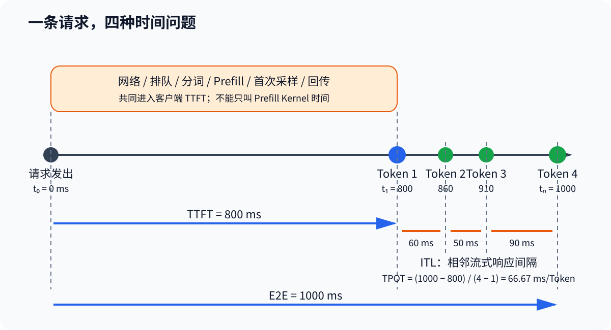
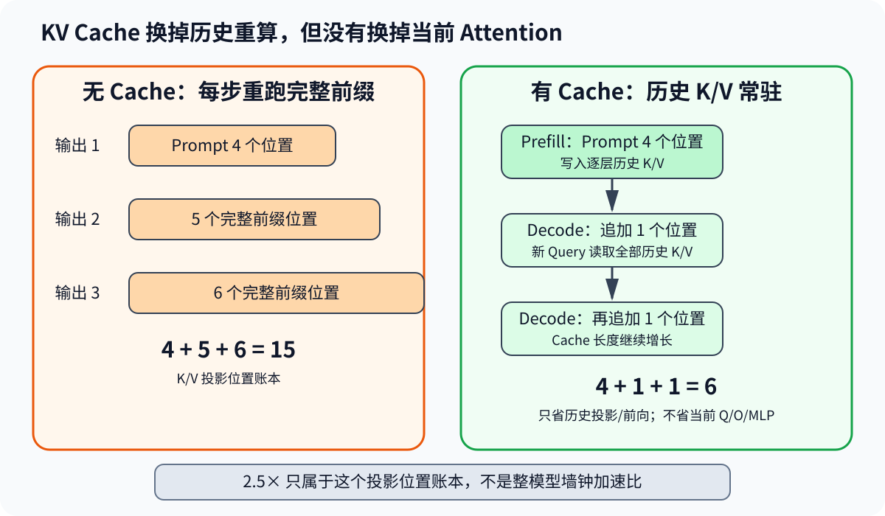
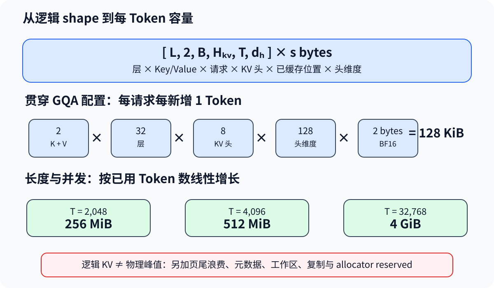
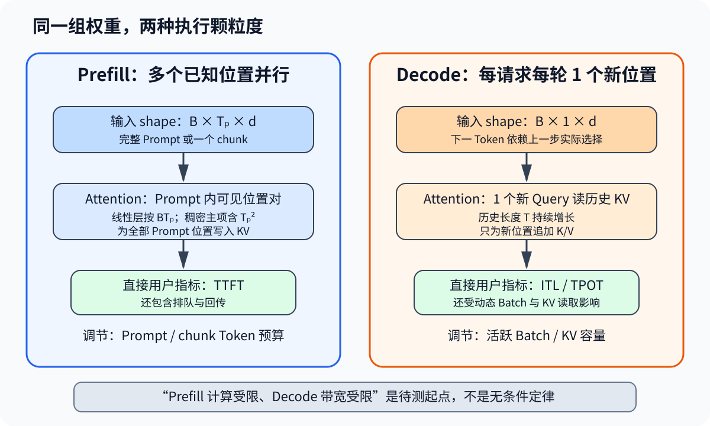
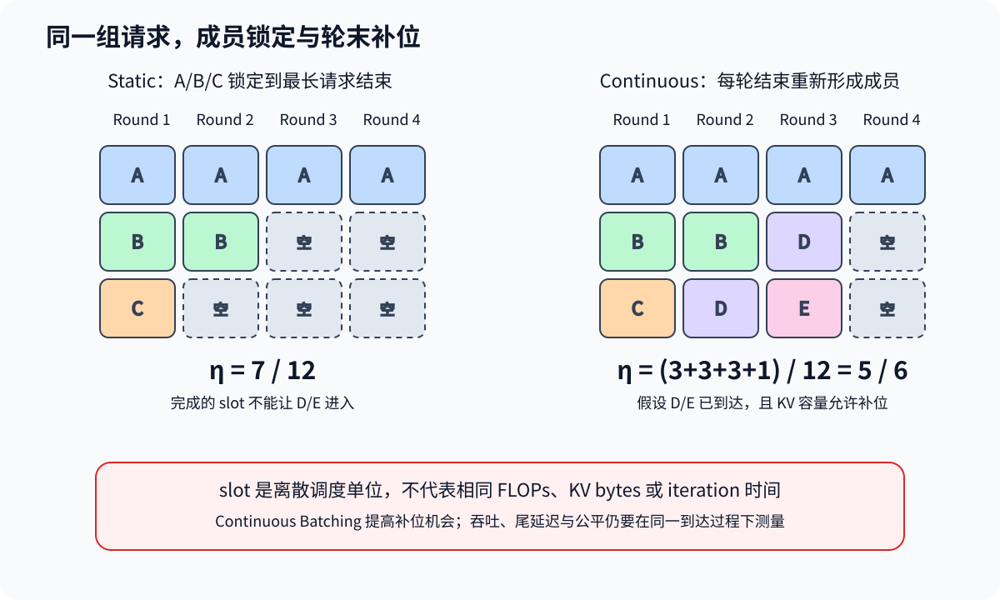
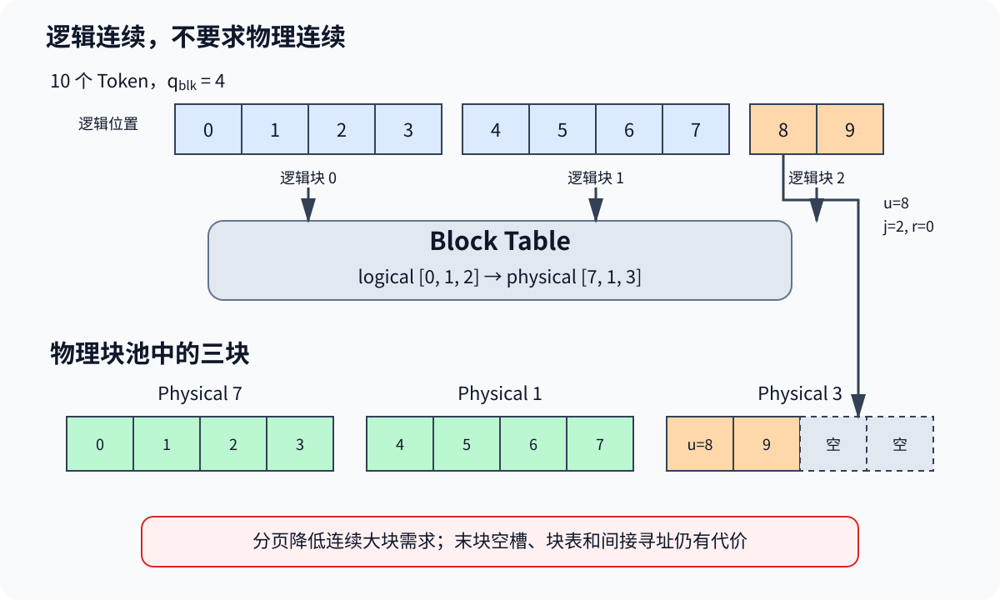
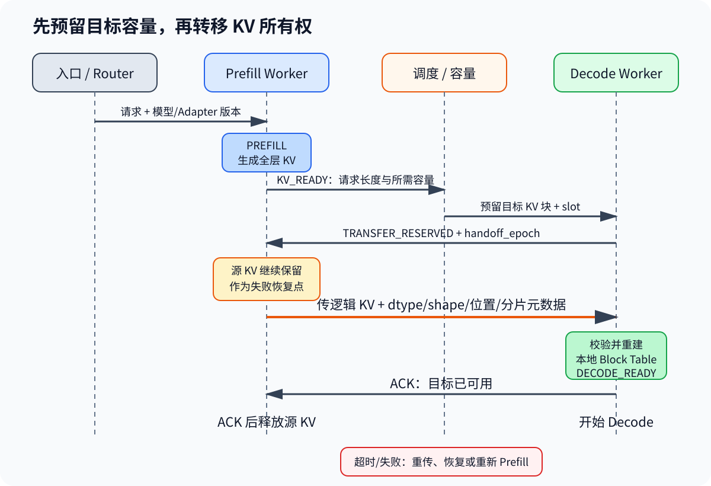
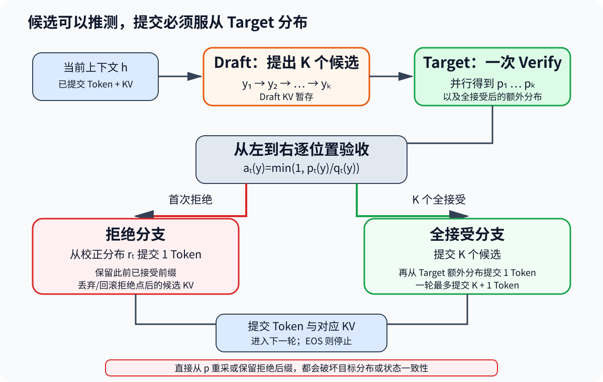

# 第 7 章 大语言模型推理与高性能服务系统

[总目录](../index.qmd) · 上一章：[第 6 章](06-efficient-attention.md) · 下一章：[第 8 章](08-post-training-evaluation.md)

一条请求在 0 ms 发出，直到 800 ms 才收到首个 Token；随后三个 Token 又分别间隔 60、50 和 90 ms 到达。用户只会觉得“有时等得久，有时输出卡顿”，服务端却必须把这段体验拆成不同问题：请求排了多久，Prompt 何时完成 Prefill，首 Token 在哪一侧产生，Decode 为什么抖动，KV Cache 又占了多少容量。

本章就沿这条请求的生命周期前进：

1. [7.1–7.3](#sec-7-1)先把客户端时间戳、KV 状态和 Prefill/Decode shape 放到同一条时间线上；
2. [7.4–7.6](#sec-7-4)再让多条长短不同的请求共同竞争 Batch、物理 KV 块和 Prefill/Decode 资源池；
3. [7.7–7.9](#sec-7-7)最后考察推测解码、量化和完整服务 Benchmark，判断优化是否真的增加满足 SLO 的请求，而不只提高某个局部吞吐数字。

::: {.callout-note title="同一请求，四个不同问题"}
TTFT 回答“多久看到第一个 Token”，ITL 回答“相邻输出是否卡顿”，TPOT 概括首 Token 之后的平均生成间隔，E2E 回答“整条请求多久结束”。四者共享一组事件，却不能互相替代。
:::

<a id="learning"></a>

## 学习目标与前置知识

教学目标：掌握从 Prompt 输入到 Token 流式输出的完整计算过程，能够估算 KV Cache、识别 Prefill/Decode 瓶颈，并理解现代 LLM 推理系统的主要优化技术。

完成本章后，读者应能够：

1. 画出Prompt进入API到Token流式返回的状态与时间线，区分TTFT、ITL、TPOT、端到端延迟、吞吐与SLO goodput。
2. 对给定$L,H_{\mathrm{KV}},d_h,T$、dtype和块大小复算逻辑/物理KV容量、末块浪费与PD交接payload，并声明scale、元数据和allocator边界。
3. 用Token预算与请求生命周期解释chunked prefill、continuous batching、Paged KV和prefix caching，识别吞吐、尾延迟、公平及容量之间的权衡。
4. 判断PD分离、推测解码和量化何时可能获益，分别列出通信、接受率/Draft成本、低精度Kernel与质量等必要验收证据。
5. 为推理框架设计可复现的开放环或闭环Benchmark，固定长度联合分布、到达过程、采样与资源预算，并用客户端日志、队列、内存和Profiler证据定位瓶颈。

前置知识是[第2章Transformer与GQA](02-transformer.md)、[第3章GPU与Roofline](03-compute-and-gpu.md)和[第6章高性能Attention](06-efficient-attention.md)。7.1–7.6、7.8–7.9为核心；7.7为选修扩展。

<a id="sec-7-1"></a>

## 7.1 LLM 推理基础

一次decoder-only LLM请求不是“一次模型调用”，而是一条有状态时间线：接收文本→分词和请求校验→处理Prompt→产生第一个Token→逐步生成并流式返回→满足停止条件→释放请求状态。服务系统还在这条时间线之前加入排队，在各步之间加入调度、batch重组和网络传输。

### 从Prompt到流式输出

1. **请求与分词。** 把Prompt、采样参数、最大输出长度和停止条件规范化；Tokenizer得到$T_{\mathrm p}$个Token ID及位置/attention mask。模板、特殊Token和截断策略都属于模型输入定义。
2. **Prefill。** 一次处理全部Prompt位置，逐层生成隐藏状态并为每个历史位置写入K/V；最后一个Prompt位置的logits给出第一个待采样Token的分布。
3. **首次选择与返回。** 按greedy或采样规则选择Token。若未立即停止，解码为增量文本并发送首个非空响应；这定义客户端观测的Time to First Token（TTFT）终点。
4. **Decode循环。** 把刚生成的Token作为下一步输入，追加其逐层K/V，用当前位置Query读取历史Cache，得到下一个Token分布，再选择并流式发送。
5. **停止与清理。** EOS Token、最大输出Token数或文本停止串触发结束；文本停止串可能跨Token/网络chunk，需保留尾部匹配。最后提交usage/finish reason并释放KV Cache等请求状态。

步骤2处理$T_{\mathrm p}$个已知输入位置，步骤4的每个新位置却依赖上一步实际选出的Token。一般Autoregressive Decoding（自回归解码）因此沿输出长度$T_{\mathrm o}$有顺序依赖，不能预先并行算出未知分支。服务仍可并行不同请求、不同层/头/设备，也可用[推测解码](#sec-7-7)一次验证多个候选；这些技术没有取消目标分布的条件依赖。

### Inference与Training不是同一shape

| 维度 | Training | 在线Inference |
| --- | --- | --- |
| 目标 | 对已知目标Token算loss、反向和更新 | 按条件分布生成输出，不更新权重 |
| 序列 | teacher forcing使整段目标位置已知，可并行前向 | Prefill整段Prompt；Decode通常每请求每步1个新Token |
| Batch | 常按固定Token预算组成，追求训练吞吐 | 请求动态到达/完成，batch成员与长度持续变化 |
| 主要状态 | 参数、梯度、optimizer、保存激活 | 权重、KV Cache、采样/RNG、调度与流式状态 |
| 容量压力 | 参数状态与反向激活 | 权重加随并发和上下文增长的KV Cache |

所以训练中高效的长序列大batch Kernel，不必在batch很小、Query长度为1的Decode中同样高效；反过来，Decode优化也不能直接外推训练吞吐。

### Prompt Length与Output Length的成本

$T_{\mathrm p}$首先影响Prefill：所有Prompt Token通过各层，Attention需要处理Prompt内部位置对，并建立初始KV Cache。$T_{\mathrm o}$影响Decode步数：每多生成一个Token就多一次依赖链上的模型步，并让Cache长度增长1。总上下文不能只写$T_{\mathrm p}+T_{\mathrm o}$后忽略阶段，因为Prefill的宽矩阵计算与Decode的重复小步在Kernel形状、并行度和瓶颈上不同。

长Prompt通常推高首Token等待与初始Cache；长Output直接增加用户持续等待、流式次数和每请求占用调度槽/KV页的时间。停止提前发生时实际$T_{\mathrm o}$小于上限，因此容量规划与压测要报告输入/输出长度分布，而不是只给`max_tokens`。

### 服务指标：先固定时间戳和分母

令$t_0$为客户端发出请求，$t_1$为收到第一个含Token的流式响应，$t_n$为收到最后一个Token；输出Token数为$N_{\mathrm o}\ge2$。本书采用

<a id="eq-07-inference-latency"></a>

$$
\mathrm{TTFT}=t_1-t_0,
\qquad
\mathrm{TPOT}=\frac{t_n-t_1}{N_{\mathrm o}-1},
\qquad
\mathrm{E2E}=t_n-t_0.
$$

TTFT是客户端首响应延迟，可能同时含网络、排队、分词/预处理、Prefill、首次采样与回传，不能直接叫“Prefill Kernel时间”。TPOT（Time Per Output Token）是每请求一次平均；ITL（Inter-Token Latency）则记录相邻流式响应间隔$\Delta_i=t_i-t_{i-1}$的分布；E2E即End-to-End Latency。标准一步一Token时ITL与TPOT均值接近；推测解码或服务端一次chunk返回多个Token时，chunk级ITL与Token归一化TPOT不再等价。[vLLM基准文档](https://docs.vllm.ai/en/latest/benchmarking/cli/)也明确提醒不同工具术语未标准化，应比较测量点和公式而非名称。

系统Output Token Throughput定义为压测窗口内所有成功请求的输出Token总数除窗口时长；Request Throughput则是完成请求数除窗口时长。它们是系统级聚合，不能用单请求$1/\mathrm{TPOT}$替代。吞吐还须注明是否计首Token、失败/取消请求、客户端还是服务端Tokenizer，以及并发或到达率。[NVIDIA GenAI-Perf指标表](https://docs.nvidia.com/deeplearning/triton-inference-server/user-guide/docs/perf_analyzer/genai-perf/README.html)将TTFT、ITL、请求延迟、输出Token吞吐和请求吞吐分开统计。

**时间线例。** 请求在0 ms发出，四个输出Token分别在800、860、910、1000 ms到达，则TTFT为800 ms，三个ITL为60/50/90 ms，TPOT为$(1000-800)/3\approx66.67$ ms/Token，E2E为1000 ms。单请求生成阶段平均约15 Token/s，但这不是多请求系统Output Token Throughput。

@fig-ch07-request-timeline 把这些数字放回同一组事件。TTFT 的右端点是客户端收到首个非空 Token，而不是服务端某个 Prefill Kernel 结束；TPOT 的分母是首 Token 之后的三个间隔，因此这里是 $N_{\mathrm o}-1=3$。若服务端一次返回多个 Token，图中的网络响应间隔与按 Token 归一化的 TPOT 还会进一步分离。

{#fig-ch07-request-timeline fig-alt="请求在0毫秒发出，经过网络、排队、分词、Prefill、首次采样和回传后，于800毫秒收到Token 1，随后在860、910、1000毫秒收到Token 2到4。图中TTFT跨越0到800毫秒，三段ITL为60、50、90毫秒，TPOT用首末Token差除以3，E2E跨越0到1000毫秒。" width="100%"}

### 延迟—吞吐不是单一最优

扩大batch或等待更多请求一起执行通常能提高设备利用率和系统吞吐，却会增加队列时间，且长Prefill可能阻塞已有请求的Decode，恶化TTFT或尾部ITL。反之，始终立即服务单请求可能降低轻载延迟，却浪费并行能力并在高到达率下形成更长队列。

在线服务应在明确负载下同时报告：输入/输出长度分布、到达过程或并发、TTFT/ITL/E2E的median与P90/P99、系统输出Token/s、请求/s、错误/超时率和资源使用；再对照SLO画吞吐—延迟曲线。离线吞吐、单请求延迟和饱和并发是不同实验，不能挑一个数字宣称系统“更快”。

本节没有运行推理服务器、模型、GPU或负载测试；800/60/50/90/1000 ms是教学时间戳，不是实测服务性能。

**理解检查。** 两个系统都报告TPOT 50 ms，但A的TTFT P99为0.5 s、B为5 s；能否称两者用户体验相同？还需核对哪些测量点、长度与负载条件？

<a id="sec-7-2"></a>

## 7.2 KV Cache

KV Cache用常驻历史Key/Value换取避免重复投影，但同时引入了随活跃Token增长的容量和读取成本。本节按三个递进问题展开：[7.2.1](#sec-7-2-1)先说明因果解码中什么可复用，[7.2.2](#sec-7-2-2)给出逻辑shape、显存公式与MHA/GQA/MQA容量账本，[7.2.3](#sec-7-2-3)再区分量化、前缀共享、结构性窗口与回收策略的收益和正确性边界。

读本节时始终分开三层量：数学上必须保存的KV元素、分页/量化/共享后的物理allocated bytes，以及分配器reserved、工作区和碎片组成的运行时峰值。前两章的[因果Attention](02-transformer.md#sec-2-2-3)和[Roofline与IO口径](03-compute-and-gpu.md#sec-3-6)是分析基础；本节的结论不等于特定框架、GPU或服务负载下的实测。

<a id="sec-7-2-1"></a>

### 7.2.1 为什么需要 KV Cache

自回归生成第$j$个输出Token时，模型输入前缀包含Prompt和此前$j-1$个输出。若每步都把完整前缀重新送入模型，那么历史位置在每一层的Key/Value线性投影会一再得到相同结果；最后只用新末位置logits，却重算了整段历史。

### 重复计算账本

只数“进入每层K/V投影的位置数”，设Prompt长度为$T_{\mathrm p}$、最终生成$T_{\mathrm o}$个Token。无缓存时，为产生第1到第$T_{\mathrm o}$个输出，要依次处理长度$T_{\mathrm p},T_{\mathrm p}+1,\ldots,T_{\mathrm p}+T_{\mathrm o}-1$的完整前缀；缓存时，Prefill处理Prompt一次，之后只为前$T_{\mathrm o}-1$个已生成Token各追加一次K/V：

<a id="eq-07-kv-recompute"></a>

$$
N_{\mathrm{KVproj,no\ cache}}
=\sum_{j=0}^{T_{\mathrm o}-1}(T_{\mathrm p}+j)
=T_{\mathrm o}T_{\mathrm p}+\frac{T_{\mathrm o}(T_{\mathrm o}-1)}{2},
\qquad
N_{\mathrm{KVproj,cache}}=T_{\mathrm p}+T_{\mathrm o}-1.
$$

取$T_{\mathrm p}=4,T_{\mathrm o}=3$，无缓存分别处理4/5/6个位置，共15；缓存处理Prompt的4个位置，再处理前两个生成Token，共6。这个2.5倍只针对K/V投影位置账本，不是整模型FLOPs或墙钟加速比：有缓存的当前Query仍要与长度逐步增长的历史K/V做Attention，且Cache还带来读写和管理成本。

@fig-ch07-kv-reuse 将“省掉的工作”和“仍要做的工作”分开：左侧每一步重跑完整前缀，右侧只为新位置追加 K/V；但右侧每个当前 Query 依然要读取全部可见历史 K/V。绿色表示可复用状态，橙色表示本轮新工作，所以图中的 $15\to6$ 不能直接解释为端到端加速 $2.5\times$。

{#fig-ch07-kv-reuse fig-alt="左侧无缓存依次处理4、5、6个完整前缀位置，共15个K/V投影位置；右侧有缓存先在Prefill处理4个Prompt位置，随后两次Decode各追加1个位置，共6个投影位置。右侧同时标明当前Query仍读取全部历史K/V，2.5倍只属于投影位置账本。" width="100%"}

### KV Cache的核心思想与逐步更新

对第$\ell$层，Prefill把

$$
\mathbf K_{\ell}^{(0)},\mathbf V_{\ell}^{(0)}
\in\mathbb R^{B\times H_{\mathrm{KV}}\times T_{\mathrm p}\times d_h}
$$

写入该层Cache。已有长度$t$时，新Token在本层只投影出$\mathbf k_{\ell,t},\mathbf v_{\ell,t}\in\mathbb R^{B\times H_{\mathrm{KV}}\times1\times d_h}$，逻辑更新为

$$
\mathbf K_{\ell}^{(t+1)}=[\mathbf K_{\ell}^{(t)};\mathbf k_{\ell,t}],
\qquad
\mathbf V_{\ell}^{(t+1)}=[\mathbf V_{\ell}^{(t)};\mathbf v_{\ell,t}],
$$

其中分号表示沿序列维追加，不要求物理上每次`concat`复制；预分配、分页等实现只需保持相同逻辑顺序。当前Query $\mathbf q_{\ell,t}\in\mathbb R^{B\times H\times1\times d_h}$读取长度$t+1$的Cache完成本层Attention，输出再进入下一层。每层投影权重和输入隐藏状态不同，因此Cache按层保存，不能让32层共用一份K/V。

[Hugging Face缓存机制文档](https://huggingface.co/docs/transformers/v5.6.0/cache_explanation)同样把Cache描述为逐层保存历史K/V、当前步追加并令attention mask覆盖past+current长度；具体Cache类/API随版本变化，本节只采用数学语义。

### 为什么因果Attention允许复用

在固定权重、固定Token前缀、相同位置编码与推理模式下，因果mask保证历史位置$i$的隐藏状态只依赖位置$\le i$。在末尾追加Token不会改变任何历史位置的层输入，所以由它们投影出的K/V也不变；新Query可以安全读取这些历史结果。这不是因为K/V“与上下文无关”，而是因为它们依赖的**历史前缀没有改变**。

以下变化会使原Cache失效或需要重映射：修改/删除中间Token，改变chat template或position/cache position，切换模型权重、LoRA/adapter或影响前向的模式，把请求换到不同batch槽却未同步页表，以及采用会回看未来并更新历史表示的非因果结构。Prefix Cache共享还必须验证Token序列及相关模型/位置/租户边界，不能按原始字符串相似就复用。

KV Cache也不是“缓存模型输出”：它不保存下一Token logits，不消除当前Token的Q/O/MLP计算，也不消除当前Query对全部可见历史Key的打分与Value聚合。它用随上下文增长的显存，换掉历史Token跨层K/V投影及历史隐藏状态的重复前向。

::: {.callout-important title="KV Cache 保存的不是文本或 logits"}
Cache 保存的是每一层、每个 KV 头的历史 K/V 张量。Token 文本用于请求状态与输出，logits 用于本步选择；它们都不能替代下一步 Attention 需要读取的逐层 K/V。
:::

训练中teacher forcing已经能并行整段位置，权重还会更新，反向需要完整计算图且dropout等状态参与；把跨step推理Cache直接用于训练可能得到陈旧值或错误梯度。因此这里的复用范围是固定权重的自回归Inference，不把“use cache”当通用训练优化。

本节没有运行模型、Cache API、GPU或计时；15、6与2.5倍是K/V投影位置的离散账本，不是实测加速。

**理解检查。** $T_{\mathrm p}=1024,T_{\mathrm o}=128$时，两种账本各处理多少个K/V投影位置？为什么有Cache时单步Attention成本仍会随已生成长度增长？

<a id="sec-7-2-2"></a>

### 7.2.2 KV Cache 的显存计算

单层Key与Value各可抽象为$[B,H_{\mathrm{KV}},T,d_h]$；跨$L$层可把逻辑Tensor Shape记为$[L,2,B,H_{\mathrm{KV}},T,d_h]$。各维分别是Batch $B$、Layers $L$、KV Heads $H_{\mathrm{KV}}$、Sequence Length $T$与Head Dimension $d_h$；“2”分别对应K和V，不是FP16的2 bytes。真实实现可能把batch、层、头或block维重排，也可能分页存放，但只要元素集合相同，逻辑容量不变。

设每元素$s$ bytes，等长batch且所有层都使用相同全局Attention配置，则

<a id="eq-07-kv-cache-memory"></a>

$$
\boxed{M_{\mathrm{KV}}=2BLT H_{\mathrm{KV}}d_hs.}
$$

该式不含模型权重、当前激活、logits、workspace、allocator reserved、页表/元数据、对齐、碎片和跨设备复制。若层间有Sliding Window、局部/全局混合或不同KV头数，应逐层求和，不能统一乘$L$。

### 贯穿配置的单位账本

沿用$d=4096,H=32,H_{\mathrm{KV}}=8,d_h=128,L=32$，KV以BF16存储，$s=2$ bytes。GQA每增加一个Token、一个请求，需要

$$
\begin{aligned}
m_{\mathrm{KV/token}}
&=2\times32\times8\times128\times2\ \text{bytes}\\
&=131{,}072\ \text{bytes}=128\ \text{KiB}.
\end{aligned}
$$

因此单请求逻辑容量随上下文为：

| $T$ | GQA KV Cache |
| ---: | ---: |
| 2,048 | 256 MiB |
| 4,096 | 512 MiB |
| 32,768 | 4 GiB |

这说明上下文长度翻倍时KV容量线性翻倍；它没有说明Attention算术也线性，因为Prefill的稠密score仍含位置对，Decode每步读取的历史长度也持续增长。

@fig-ch07-kv-ledger 把容量式拆成两层：上半部分说明 $[L,2,B,H_{\mathrm{KV}},T,d_h]$ 的每个维度在保存什么；下半部分先得到贯穿配置的 128 KiB/Token，再让长度与活跃请求数线性放大。最下方的红色边界提醒：逻辑 payload 仍不是进程的 allocated/reserved 峰值。

{#fig-ch07-kv-ledger fig-alt="顶部把KV Cache逻辑shape分解为层、K和V、请求、KV头、序列位置与头维度，并乘每元素字节。中部用2乘32层乘8个KV头乘128维乘2字节得到每Token 128 KiB。底部列出2048、4096、32768 Token对应256 MiB、512 MiB和4 GiB，并注明物理峰值还包括页尾浪费、元数据、工作区、复制和allocator reserved。" width="100%"}

### MHA、GQA与MQA

保持$B=1,L=32,T=4096,d_h=128,s=2$，只改变KV头数：

| 结构 | $H_{\mathrm{KV}}$ | 每Token | 4096 Token |
| --- | ---: | ---: | ---: |
| MHA | 32 | 512 KiB | 2 GiB |
| GQA | 8 | 128 KiB | 512 MiB |
| MQA | 1 | 16 KiB | 64 MiB |

所以本配置GQA相对MHA减少4倍，MQA相对GQA再减少8倍。节省来自共享K/V头；Query头仍为32，输出shape与Query侧score/Softmax工作不按同一比例消失。模型质量、投影参数、内核复用和通信也不由这张容量表决定。

### 变长请求与并发

若并发请求实际已占用长度为$T_1,\ldots,T_B$，紧凑逻辑下应写成

$$
M_{\mathrm{KV,used}}
=2LH_{\mathrm{KV}}d_hs\sum_{i=1}^{B}T_i,
$$

而不是无条件用$BT_{\max}$。Static Cache预分配到每请求上限时，reserved/地址空间更接近$BT_{\max}$；连续Tensor按batch补齐时会有padding浪费；分页Cache按block取整，浪费取决于每个请求最后一页未用槽和分配碎片。

若64个请求都实际达到$T=4096$，贯穿GQA配置的逻辑KV总量为$64\times512$ MiB = 32 GiB，尚未计权重和运行时；因此“模型权重能装入GPU”不等于能承载目标并发。Beam Search或并行采样若为每条候选保留不同后缀，等效活跃序列数还会扩大；共享前缀能否物理复用取决于Cache管理策略，不能直接把beam数乘/除后当实测峰值。

容量规划应同时报告：活跃请求数、实际/上限输入与输出长度、每层Attention类型、KV dtype、是否TP分片或复制、页大小/利用率、allocated与reserved峰值。式（07-KV-Cache-Memory）是可审计逻辑下界账本，不是OOM阈值。

本节没有运行模型、KV分配器、GPU显存测量或并发压测；128 KiB/Token、256/512 MiB、2/4/32 GiB等均由公式复算。

**理解检查。** 贯穿GQA配置中，20个请求实际长度各不相同时，应如何用总已用Token数估算逻辑KV？为什么Static Cache的reserved峰值可能更接近$20T_{\max}$而非该结果？

<a id="sec-7-2-3"></a>

### 7.2.3 KV Cache 的局限与优化

全量KV Cache把历史投影重算换成常驻状态，但代价随“活跃请求的已缓存Token总数”线性增长。长上下文、长输出和高并发会同时占用更多显存并延长页/请求寿命；当容量不足时，排队、抢占、offload或重算又会影响TTFT/ITL。因此下面四种优化解决的不是同一个量。

### KV Cache Quantization：减少每元素bytes

把K/V从BF16/FP16的16 bit压到$q$ bit，理想payload为

<a id="eq-07-kv-quant-memory"></a>

$$
M_{\mathrm{KV,quant,payload}}
\approx2LH_{\mathrm{KV}}d_hT\frac{q}{8},
$$

但真实容量还要加scale、zero-point、分组元数据、对齐，以及为近期Token保留的高精度residual区。贯穿配置$T=32768$的BF16 GQA payload为4 GiB；理想INT4 payload为1 GiB，不应写成“实测恰好省4倍”。

量化还增加quantize/dequantize与更复杂Kernel，短上下文时可能更慢；K/V误差会改变Attention score和Value聚合，质量风险随层、头、Token位置和任务变化。验收至少比较固定请求集上的输出/任务质量、TTFT/ITL、峰值allocated/reserved与吞吐，并分别扫context和残差长度。[Transformers Cache Strategies](https://huggingface.co/docs/transformers/en/kv_cache)也提示量化Cache在内存充足的短上下文下可能损害延迟；其后端/API会变化，本书不固定实现名。

### Prefix Caching：跨请求复用完全相同的前缀

若多个请求具有相同Token前缀，例如系统提示词、模板和长文档，首个请求Prefill得到的完整KV Block可由后续请求引用；只对未命中的后缀做Prefill。这减少重复Prompt计算和物理副本，不减少各请求分叉后的Decode状态。

正确的Cache key至少要绑定：完整Token ID及顺序、父前缀/Block边界、模型权重与版本、LoRA/adapter、多模态输入、位置语义以及影响前向的配置。原始字符串相同不保证Token/模板相同；Token相同但模型或adapter不同也不能共享。[vLLM Automatic Prefix Caching设计](https://docs.vllm.ai/en/latest/design/prefix_caching/)采用父Block hash、Block Token和额外hash，并可用cache salt隔离多租户。哈希碰撞、权限边界和侧信道属于正确性/安全问题，不只是命中率问题。

假设公共前缀4096 Token按16 Token/Block对齐，共256个完整Block；100个请求都命中时，逻辑引用有100份，但完整前缀物理KV可保留一份并以引用计数共享，后续各自suffix另分配。若前缀末尾只有8个Token落在半Block，系统若只缓存完整Block，则这8个Token需重算。应报告命中Token率、命中请求率、被复用物理bytes、hash开销与因Cache占用导致的其他请求eviction，不能只报“cache hit”。

### Sliding Window Attention：结构性限制可见历史

窗口大小$W$的层让当前位置只看最近$W$个历史Token；超过窗口的K/V不再被该层读取，因而该层Cache容量可把$T$替换为$\min(T,W)$。这能让长生成时该层容量封顶，但它改变Attention可见集合，必须由模型结构/训练配置支持。对原本全上下文Attention的模型擅自丢掉旧K/V会改变输出，不是无损内存优化。

混合模型可能部分层为Sliding Window、部分层为Global Attention，应逐层计算：窗口层封顶，全局层继续随$T$增长。[Transformers官方Cache策略](https://huggingface.co/docs/transformers/en/kv_cache)也只在模型具有sliding/chunked layer时让相应Cache停止增长。

### KV Cache Eviction：容量压力下决定谁被回收

请求完成或取消后，其私有页应立即释放；共享前缀页要等引用计数归零。容量不足时，系统可按LRU/代价/优先级回收未引用的prefix block，或抢占低优先级请求的私有KV。后者若恢复，通常要从仍保留的前缀重算被驱逐suffix，增加TTFT/ITL与计算；把Cache移到CPU/NVMe则以传输延迟和带宽换GPU容量。

Eviction策略要同时保护正确性和服务目标：不能释放仍被运行中Kernel/请求引用的页；页表更新与请求迁移须原子一致；租户/会话边界不能因物理复用泄露Token存在性；优先级不能让长请求永久饥饿。应记录evicted bytes/blocks、重算Token、preemption次数、offload流量、命中率、OOM/拒绝率和尾延迟。

四种策略可组合但收益不能简单相加：量化后的页使单页bytes变小；Prefix Cache提高共享却占用更久；Sliding Window可能降低可共享的远古前缀价值；激进Eviction会抵消前缀命中。选择顺序应先确认模型语义，再以真实长度/复用/到达分布测容量和SLO。

本节没有运行KV量化、Prefix Cache、Sliding Window模型、eviction/offload或服务器压测；4 GiB→理想1 GiB、256个Block与100请求均为假设账本。

**理解检查。** 同一4 GiB BF16 Cache采用理想INT4、公共前缀命中和Sliding Window时，为什么不能直接把三个节省比例相乘？分别指出元数据/残差、共享引用和模型可见性边界。

<a id="sec-7-3"></a>

## 7.3 Prefill 与 Decode

一次请求先经过Prefill建立Prompt的KV Cache并产生首Token，再进入Decode的逐Token依赖链。两阶段共享权重和数学模型，却在输入shape、并行度、KV读写及服务SLO上异质，因而不应用一个无条件的“计算受限/带宽受限”标签概括。

本节按执行时间线阅读：[7.3.1](#sec-7-3-1)说明完整或分块Prompt的并行前向及TTFT代价，[7.3.2](#sec-7-3-2)分析逐Token Decode的历史KV读取、权重复用与TPOT/ITL，[7.3.3](#sec-7-3-3)再在同一FLOPs/bytes和Roofline口径下比较两者。分析复用[KV Cache逻辑容量](#eq-07-kv-cache-memory)和[Roofline定义](03-compute-and-gpu.md#eq-03-roofline)；所有数值均是理论/假想账本，未运行模型、GPU或服务压测。

@fig-ch07-prefill-decode 先固定两阶段的共同点和差异：它们读取同一组模型权重，但 Prefill 的本次新输入是多个已知位置，Decode 的本次新输入通常是每请求一个位置；前者批量写 Prompt KV，后者追加新 K/V 并读取不断增长的历史。后文所有 Roofline 与调度判断都应回到这组 shape，而不是只凭阶段名称。

{#fig-ch07-prefill-decode fig-alt="左栏Prefill输入为B乘Prompt长度乘隐藏维度，多个已知位置可并行，处理Prompt内位置对并写入整段KV，直接影响TTFT。右栏Decode输入为B乘1乘隐藏维度，每请求下一Token依赖上一步选择，当前Query读取增长的历史KV并追加新K/V，直接影响ITL和TPOT。底部注明计算受限或带宽受限必须由目标shape测量。" width="100%"}

::: {.callout-warning title="阶段标签不是瓶颈结论"}
“Prefill 更像大矩阵、Decode 更像重复小步”是分析起点。是否计算受限、带宽受限、通信受限或容量受限，仍要把目标 shape 的 FLOPs 与同一存储边界上的 bytes 配对，并用 Kernel、队列和内存证据验证。
:::

<a id="sec-7-3-1"></a>

### 7.3.1 Prefill 阶段

Prefill（提示填充）把长度$T_{\mathrm p}$的Prompt一次送入Decoder-only模型，在每层为全部Prompt位置并行计算隐藏状态，把K/V写入Cache，并用最后一个有效位置的logits产生第一个输出Token。“一次处理”指位置可在一个完整前向中并行，不意味服务端只发射一个Kernel，也不意味不受因果mask约束。

### 计算形状与Prompt长度主项

对batch中$B$条等长Prompt，线性层把$BT_{\mathrm p}$个位置合并为较大GEMM；因此Q/K/V/O与SwiGLU投影的主项按$BT_{\mathrm p}$线性增长。Attention中QK转置和Probability乘V需要处理Prompt内位置对：完整方阵实现的主项按$BT_{\mathrm p}^{2}d$增长，若Kernel确实跳过因果不可见区，理想有效位置对是$T_{\mathrm p}(T_{\mathrm p}+1)/2$。具体FLOPs沿用[3.3的Block账本](03-compute-and-gpu.md#eq-03-block-flops)，不为同一计数重造公式。

这一形状通常比单Token Decode更容易产生大GEMM并复用权重，但“Prefill一定计算受限”仍不是定理：短Prompt可能受启动/调度开销影响，长Prompt的Attention、KV写入、多卡通信、shape和dtype都会改变[算术强度与Roofline](03-compute-and-gpu.md#sec-3-6)位置。

### 性能目标与服务干扰

对当前请求，Prefill的直接目标是尽早建好KV并缩短TTFT；对整个服务器，还必须避免一个长Prompt长时间占用执行资源，拉高已在Decode请求的ITL。因此要同时报告输入长度分布、到达负载、Prefill队列时间/执行时间、TTFT分位数、正在Decode流的ITL分位数与系统Token/s；只降低单请求Prefill时间不足以证明服务SLO更好。

### Chunked Prefill：以执行颗粒度换可调度性

Chunked Prefill把长Prompt分成$c_1,\ldots,c_m$个Token chunk，每次只推进一部分，使调度器能在chunk边界插入Decode或其他请求。它改变了**何时执行**数学工作，不会自动消除标准稠密Attention必需的可见位置对。令$S_j=\sum_{i=1}^{j}c_i$、$S_0=0$，第$j$块的Query需读取旧Cache与本块中较早位置；理想因果位置对账本为

<a id="eq-07-chunked-prefill-pairs"></a>

$$
\sum_{j=1}^{m}\left(c_jS_{j-1}+\frac{c_j(c_j+1)}{2}\right)
=\frac{T_{\mathrm p}(T_{\mathrm p}+1)}{2},
\qquad T_{\mathrm p}=\sum_{j=1}^{m}c_j.
$$

例如$T_{\mathrm p}=4096$分为4个1024-Token chunk，四块可见位置对分别为524,800、1,573,376、2,621,952、3,670,528，合计8,390,656，与$4096\times4097/2$相同。旧chunk的K/V必须保存，非方形mask必须用绝对位置构造；否则可能重算旧Token或错误遮蔽可见Key。

[vLLM调度配置](https://docs.vllm.ai/en/latest/api/vllm/config/scheduler/)把`max_num_batched_tokens`定义为单iteration的Token上限，并允许Prefill按剩余预算分块；这是访问时的实现语义，不是跨版本接口保证。[NVIDIA Dynamo的分离服务文档](https://docs.nvidia.com/dynamo/dev/knowledge-base/concepts/system-architecture/disaggregated-serving)明确区分了较大chunk的“更少但更长”干扰与较小chunk的“更频繁但更短”干扰。[Sarathi-Serve论文](https://arxiv.org/abs/2403.02310)以chunked-prefill调度处理Prefill/Decode干扰；其性能数字不外推为本书或本机结果。

chunk太大时，单次执行可能阻塞Decode、拉高ITL；chunk太小时，Kernel启动、调度、页表/元数据与小矩阵效率开销可能增大，当前请求TTFT也可能变差。最优颗粒度依赖模型、硬件、输入长度、并发与SLO，需在目标负载下扫描；不能从上述位置对恒等式推出墙钟时间相同。

本节没有运行模型、vLLM/TensorRT-LLM、GPU或服务负载；8,390,656为因果位置对的整数复算，不是Profiler或延迟实测。

**理解检查。** 为什么把4096-Token Prompt分成4块不会自动把标准稠密Attention的总位置对除以4？若已在Decode的请求ITL P99超标，应如何同时检查chunk大小、当前请求TTFT和系统吞吐？

<a id="sec-7-3-2"></a>

### 7.3.2 Decode 阶段

Decode（解码）从Prefill产生的第一个输出Token之后开始。每一步对每条活跃序列只输入一个新Token：各层计算该位置的Q/K/V，把新K/V追加到Cache，让新Query读取全部可见历史KV，再经MLP、最终Norm与LM Head得到下一Token分布。选样、停止判定后，未完成请求进入下一iteration。

这个循环有两个容易混淆的长度：本步新输入长度为1，而追加后Cache总长度$T$持续增长。因此权重投影和MLP每条序列只处理一个位置，但QK/PV仍需读取$T$个历史Key/Value。主要FLOPs复用[3.3的缓存Decode公式](03-compute-and-gpu.md#eq-03-decode-flops)，KV字节则复用[7.2.2容量账本](#eq-07-kv-cache-memory)；二者不能只看其一。

### 为什么小Batch常遇到带宽压力

以一个线性层$\mathbf Y=\mathbf X\mathbf W$为局部账本，$\mathbf X\in\mathbb R^{B\times d_{\mathrm{in}}}$、$\mathbf W\in\mathbb R^{d_{\mathrm{in}}\times d_{\mathrm{out}}}$，数学仍采用全书行向量方向。若权重每个iteration从所选存储层级读一次并被$B$条序列共享，暂忽略输入/输出、Cache命中和其他流量，则

<a id="eq-07-decode-weight-intensity"></a>

$$
I_{\mathrm{weight,ideal}}
=\frac{2B d_{\mathrm{in}}d_{\mathrm{out}}}
{s_{\mathrm w}d_{\mathrm{in}}d_{\mathrm{out}}}
=\frac{2B}{s_{\mathrm w}}\quad\text{FLOPs/byte}.
$$

BF16权重取$s_{\mathrm w}=2$ bytes时，$B=1$的理想权重强度只是1 FLOP/byte，$B=32$时为32 FLOPs/byte。这不是整模型的实测算术强度：它没数激活和KV读写、布局转换、通信及Cache层级，也假设同一权重只读一次。它只说明为什么在形状允许时，Batching可用更多活跃Token摊薄权重读取。

小Batch Decode每步GEMM的行数少，还要反复读取大量权重；随$T$增长的KV Cache读取又会增加字节量。因而它常是低算术强度候选，但“Decode必然Memory-bound”仍过度简化：大Batch、短Cache、量化权重/KV、高命中率、特定Kernel形状和多卡通信都可改变[实际Roofline位置](03-compute-and-gpu.md#sec-3-6)。

### Batch提高吞吐，也引入容量与延迟代价

调度器把多条活跃序列的当前Token放进同一iteration，可增大线性层的行数、摊薄权重与Kernel启动开销，提升系统输出Token/s。[Sarathi-Serve](https://arxiv.org/abs/2403.02310)也以“Decode每请求每次只处理一个Token、Batching因此重要”作为调度动机；本节不复制其性能数字。

但Batch不是免费的：更多并发序列同时占用KV，长度不同导致每步读取量和完成时间不同，等待凑batch会增加排队延迟，过大iteration还可能拉高TPOT/ITL。[NVIDIA Dynamo文档](https://docs.nvidia.com/dynamo/dev/knowledge-base/concepts/system-architecture/disaggregated-serving)说明了mixed prefill/decode中Token预算会改变延迟干扰；具体执行路径与调度开关依后端而异。

Decode优化所以必须同时考察：每请求TPOT/ITL的median与尾部、系统输出Token/s与请求/s、活跃序列数、KV allocated/reserved与页利用率、OOM/拒绝/抢占率，并固定输入/输出长度与到达过程。单请求TPOT下降和系统Tokens/s上升可能互相冲突；“最大Batch”不是通用最优值。

本节没有运行模型、GPU、Decode Kernel或服务压测；1与32 FLOPs/byte是忽略其他流量的局部理想权重账本，不是本机带宽或Profiler结果。

**理解检查。** 为什么“每步新输入1 Token”不等于Attention每步成本与历史长度无关？把Batch从1提到32时，局部权重账本改善了哪一项，又必须额外核对哪些KV、排队和尾延迟代价？

<a id="sec-7-3-3"></a>

### 7.3.3 Prefill 与 Decode 的对比

Prefill与Decode使用同一组模型权重，但执行颗粒度不同：Prefill一次提交一批Prompt中的多个已知位置，Decode则沿每条请求的生成链迭代，每步通常只提交1个新Token。“Prefill大矩阵、Decode小矩阵”是有用的起点，却不能直接推出前者永远计算受限、后者永远带宽受限。

| 比较项 | Prefill | Decode |
| --- | --- | --- |
| 本次新输入 | 每请求$T_{\mathrm p}$个Prompt Token，或一个chunk | 每条活跃序列通常1个Token |
| 请求内并行性 | 已知位置可并行 | 下一Token依赖本步选择结果 |
| Attention历史 | 建立Prompt KV，标准稠密主项含$T_{\mathrm p}^{2}$ | 用1个新Query读取长度$T$的历史KV |
| 直接用户指标 | Prefill执行及排队主要进入TTFT | 迭代时间主要进入TPOT/ITL |
| 常见调优杠杆 | Token/chunk大小、Attention IO、TTFT | 活跃Batch、权重/KV读取、尾延迟 |

### 用同一Roofline口径比较

要比较两个阶段的算术强度（Arithmetic Intensity），必须先固定存储接口、dtype和执行路径。以一个行向量线性层$\mathbf Y=\mathbf X\mathbf W$为局部代数例，设本次共处理$N_{\mathrm{tok}}$个Token，权重从所选存储层级读一次且被这些Token理想共享，忽略激活、KV、通信和重复读，则[7.3.2的强度账本](#eq-07-decode-weight-intensity)可统一写成

<a id="eq-07-stage-weight-intensity"></a>

$$
I_{\mathrm{weight,ideal}}
=\frac{2N_{\mathrm{tok}}d_{\mathrm{in}}d_{\mathrm{out}}}
{s_{\mathrm w}d_{\mathrm{in}}d_{\mathrm{out}}}
=\frac{2N_{\mathrm{tok}}}{s_{\mathrm w}},
\qquad
N_{\mathrm{tok}}=
\begin{cases}
BT_{\mathrm p} & \text{Prefill},\\
B & \text{Decode iteration}.
\end{cases}
$$

因此Prompt长度、Prefill chunk和Decode Batch都能增大这个**局部理想权重强度**；但它们并不等价。Prefill的长序列还增加Attention位置对与KV写入，Decode的长历史则增加每步KV读取；chunk变小或Batch变大还会改变Kernel数量、并发KV容量、排队和尾延迟。所以该式只隔离“权重摊薄”一项，不是整模型operational intensity。

### 同一假想硬件上的条件性结论

复用[3.6的假想设备](03-compute-and-gpu.md#sec-3-6)：计算屋顶$C_{\mathrm{peak}}=100$ TFLOP/s，带宽$\beta=2$ TB/s，故ridge point为50 FLOPs/byte。取BF16权重$s_{\mathrm w}=2$ bytes、$B=4$：

| 局部情景 | $N_{\mathrm{tok}}$ | 理想权重强度 | Roofline上界 | 仅就该账本的判定 |
| --- | ---: | ---: | ---: | --- |
| Prefill，$T_{\mathrm p}=512$ | 2,048 | 2,048 FLOPs/byte | 100 TFLOP/s | 计算屋顶 |
| Decode iteration | 4 | 4 FLOPs/byte | 8 TFLOP/s | 带宽屋顶 |

这不是对Prefill和Decode的实测，也不是整模型速度预测。若Prefill只有很短的Prompt，或者Attention IO、通信和启动开销主导，整体可能达不到计算屋顶；若Decode有足够大的活跃Batch，权重量化/更高层级Cache命中，局部权重强度可跨过ridge point，但长历史KV流量或多卡通信又可能成为新瓶颈。[Roofline原始定义](03-compute-and-gpu.md#eq-03-roofline)要求将FLOPs与同一边界上的bytes配对，不允许只选有利的流量作最终结论。

### 为什么同一执行配置难以两头最优

长Prefill倾向用较大Token tile/chunk保持GEMM与Attention Kernel效率；但大chunk会延长一次不可抢占的执行，干扰已在Decode的流并抬高ITL。Decode倾向聚合更多活跃序列来复用权重；但等待凑Batch、扩大并发KV和增长iteration又会损害排队时间、TPOT/ITL及容量。[NVIDIA Dynamo文档](https://docs.nvidia.com/dynamo/dev/knowledge-base/concepts/system-architecture/disaggregated-serving)展示了mixed prefill/decode中chunk大小的这类干扰形状；[Sarathi-Serve](https://arxiv.org/abs/2403.02310)也正是从两阶段异质性出发设计chunked-prefill调度。这里只复用其机制动机，不复制论文或文档的性能数字。

实际选型应在同一到达过程和长度分布下扫描Prefill chunk、最大batched Token、Decode Batch与优先级，同时记录TTFT/ITL分位数、系统Token/s、KV allocated/reserved、Kernel shape及FLOPs/bytes。某一阶段的利用率提升，只有在另一阶段SLO和整体容量没有被破坏时才是服务改善。

本节没有运行模型、GPU、Profiler或服务压测；2,048/4 FLOPs/byte与100/8 TFLOP/s均是忽略其他流量的局部理想账本和Roofline上界，不是实测吞吐。

**理解检查。** 在上述假想设备上，把Decode Batch从4增到64后，局部权重账本会给出什么Roofline判定？为什么这仍不足以宣称Decode整体已经compute-bound？

<a id="sec-7-4"></a>

## 7.4 Batching 与推理调度

单请求Decode常难以充分复用权重，而盲目增大Batch又会引入排队、KV容量和尾延迟代价。本节把“如何组成一次执行”与“何时更换成员”分开：先看成员固定的[Static Batching](#sec-7-4-1)，再看允许在iteration边界补位的[Continuous Batching](#sec-7-4-2)。两种方法都必须结合[Prefill/Decode差异](#sec-7-3-3)和[客户端延迟指标](#eq-07-inference-latency)判断，Batch或slot占用率本身不是服务目标。

<a id="sec-7-4-1"></a>

### 7.4.1 Static Batching

Static Batching（静态批处理）在执行前选定一组$B$个请求，把它们的张量堆叠到batch维，并在这组完成前保持成员集合不变。直接收益是权重和Kernel启动可被多个请求摊薄；直接代价是形状对齐与快慢请求锁在同一组中。这里的“静态”指调度成员不在iteration边界动态替换，不等于所有请求的序列长度相同。

### Padding如何对齐变长请求

设Prompt长度为$T_1,\ldots,T_B$，$T_{\max}=\max_iT_i$。直接的稠密实现将每条补到$T_{\max}$，并用attention mask使真实Token不看PAD；只填一个PAD ID而不修正mask和有效位置logits，会改变模型语义。Left/Right Padding还要与position ID、cache position及“最后一个有效位置”的logits选取一致。

对一个确实以$B\times T_{\max}$稠密执行的Prefill，以及一个成员固定、直到最长输出完成才释放的Decode组，可定义两个教学利用率账本：

<a id="eq-07-static-batch-utilization"></a>

$$
\eta_{\mathrm{prefill}}
=\frac{\sum_{i=1}^{B}T_i}{BT_{\max}},
\qquad
\eta_{\mathrm{decode}}
=\frac{\sum_{i=1}^{B}O_i}{BO_{\max}},
\qquad 0<\eta\le1,
$$

其中$O_i>0$是第$i$个请求的实际Decode迭代数，$O_{\max}=\max_iO_i$。分子是有效Token/活跃slot账本，分母是该稠密静态shape提供的slot；$1-\eta$是空槽比，不必等于墙钟时间或FLOPs的浪费比，因为变长Kernel、mask跳过、bucket、KV实际分配与启动开销会改变物理工作。

**小账本。** 三条Prompt长度为$[8,5,3]$，补到8时使用16个真实Token和24个slot，$\eta_{\mathrm{prefill}}=16/24=2/3$。若后续Decode迭代数为$[4,2,1]$且已完成slot仍占位到第4轮，则只有7个活跃slot，容器提供12个，$\eta_{\mathrm{decode}}=7/12$。按长度分bucket可提高两者，但需要等候相似请求，可能增加队列时间。

### 生成长度不一致的锁步代价

一条请求遇到EOS后，静态组若不允许新请求补位，后续iteration的有效Batch就会下降；已完成slot或是执行被mask的空工作，或是让Kernel shape缩小但留下不规则调度。最长输出成为straggler，决定整组何时释放；快请求即使已经把最后Token返回给用户，其预留slot/KV是否立即释放也依实现而定。

静态Batch因此更适合长度可控、请求可离线聚类、且吞吐优先的负载。在动态到达的在线服务中，它会将“等待凑齐batch”加到TTFT，大Batch的iteration又可能抬高TPOT/ITL。更高的系统Token/s不代表某个用户更早收到首Token或最后Token；验收要同时扫描Batch Size、到达率、输入/输出长度分布，并报告TTFT/ITL/E2E分位数、系统Token/s、空槽比和KV峰值。

本节没有运行模型、GPU、调度器或服务压测；$2/3$与$7/12$是离散slot账本，不是实测GPU利用率或延迟改善。

**理解检查。** 一个静态batch的输出长度为$[128,128,8,8]$时，$\eta_{\mathrm{decode}}$是多少？即使增大Batch提升权重复用，为什么用户TTFT和尾延迟仍可能变差？

<a id="sec-7-4-2"></a>

### 7.4.2 Continuous Batching

Continuous Batching（连续批处理，也称动态批处理）把调度边界从“整个请求完成”缩短到一次模型iteration：每轮只为本轮被选中的请求执行有限Token工作，轮末重新形成下一批。这样，已完成请求可以退出，等待队列中的请求可以补位；它改变的是**成员调度**，并不自动解决KV Cache的物理碎片，也不保证每轮恰好只含Decode Token。

[ORCA论文](https://www.usenix.org/system/files/osdi22-yu.pdf)将这种机制称为 iteration-level scheduling：执行引擎每次只运行一个iteration，调度器随后再决定下一轮成员。对纯Decode教学模型，可把请求状态写成

```text
WAITING --(有slot、Token预算与KV容量)--> RUNNING
RUNNING --(生成1 Token，未停止)-------> RUNNING
RUNNING --(EOS/长度上限/取消/错误)----> FINISHED
RUNNING --(KV不足或策略抢占)----------> WAITING/PREEMPTED
FINISHED --(结果提交且无在途写入)-----> 释放请求私有KV与slot
```

新请求不能插入一个正在执行的GPU Kernel；“动态加入”发生在安全的iteration边界。若一轮混合Prefill chunk、Decode或推测Token，一次调度的工作粒度可能多于每请求一个Token，所以 iteration-level 也不应机械等同于 token-level。ORCA还用 selective batching处理不同请求位置相关操作，说明“换成员”需要执行引擎配合，而不只是改一个队列。

### 补位、完成与离散利用率账本

设第$r$轮实际执行的活跃请求集合为$\mathcal A_r$，本轮允许的最大请求slot数为$C_r>0$，并要求$|\mathcal A_r|\le C_r$。定义

<a id="eq-07-continuous-batch-utilization"></a>

$$
\eta_{\mathrm{continuous}}
=\frac{\sum_{r=1}^{R}|\mathcal A_r|}
{\sum_{r=1}^{R}C_r},
\qquad 0<\eta_{\mathrm{continuous}}\le1.
$$

它只数“请求×iteration”的已占/可用slot，不是GPU利用率；不同请求的历史长度、Prefill chunk、KV流量与Kernel效率都可能不同，两个slot不能视为相同FLOPs或相同时间。

**小账本。** 最大slot数恒为3。首轮请求A/B/C还需$4/2/1$次Decode；第1轮后C完成，D（需2轮）补位；第2轮后B完成，E（需1轮）补位；第3轮后D、E完成且队列为空；第4轮只有A。于是活跃slot为$3+3+3+1=10$，可用slot为$4\times3=12$，得到$\eta_{\mathrm{continuous}}=5/6$。同一批A/B/C若静态锁步，[7.4.1的账本](#eq-07-static-batch-utilization)只有$(4+2+1)/(3\times4)=7/12$。这个差值来自假设D/E恰好已到达且KV可容纳；没有等待请求时，连续调度也无法补满。

@fig-ch07-batching-timeline 把两个分母相同的账本画成四轮三槽。Static 路线中 B、C 完成后的格子只能空着；Continuous 路线在安全的轮末让 D、E 补位。A 的四轮工作没有改变，变化的是“谁能进入下一轮”，因此 $7/12\to5/6$ 只说明离散 slot 被更充分使用。

{#fig-ch07-batching-timeline fig-alt="左侧Static Batching中A占四轮、B占前两轮、C占第一轮，之后五个格子为空，利用率为7/12。右侧Continuous Batching中C完成后D补位，B完成后E补位，四轮活跃slot为3、3、3、1，利用率为5/6；图下注明D和E必须已经到达且KV容量允许。" width="100%"}

::: {.callout-warning title="slot 利用率不是 GPU 利用率"}
两个请求 slot 可能拥有不同历史长度、KV bytes、Prefill chunk 和 Kernel 时间。$\eta$ 用于解释调度空槽，不等于 FLOPs 利用率、显存利用率或墙钟加速比。
:::

请求生成EOS、达到长度上限、被客户端取消或失败后，应先停止把它放入新一轮，提交相应结果，再在确认没有在途Kernel或异步传输仍会写该请求状态后释放KV。当前[vLLM官方调度器源码文档](https://docs.vllm.ai/en/stable/api/vllm/v1/core/sched/scheduler/)也区分立即释放和延迟到在途step完成后归还Block；这是实现示例，不代表所有框架具有相同状态机。分页Block怎样降低动态增长与回收的困难留到[7.5](#sec-7-5)。

### 性能收益不是无条件的

- **利用率与吞吐。** 及时补位通常能增加活跃Token工作，改善权重摊薄并减少静态空槽；但若到达率低、KV容量先耗尽、调度/重排开销高或新Prefill干扰Decode，GPU利用率和系统Token/s未必上升。
- **请求延迟。** 短请求无需等待同组最长请求结束即可返回，新到请求也可能只等一轮便获选，因此队列时间和完成延迟可能下降；但更大的动态Batch会拉长单轮时间，Prefill插队也可能恶化已有请求的ITL/TPOT。
- **尾延迟与公平性。** 只追求每轮最大Token吞吐，可能持续偏爱短Prompt、短上下文或高优先级租户，使长请求反复等待或抢占。FCFS可限制重排却未必满足紧急请求；Shortest-Job-First需要估计输出长度且会伤害长请求；严格优先级若没有配额会造成低优先级饥饿。

工程上应明确可检查的饥饿边界，例如“等待年龄超过阈值后提升优先级”、为租户保留配额，或限制请求连续被跳过的iteration数；同时用最大batched Token、最大并发请求和KV水位约束单轮工作。验收不能只报均值：在同一到达过程与输入/输出长度分布下，同时记录系统request/s与Token/s、TTFT/ITL/E2E的p50/p95/p99、每请求等待轮数、抢占/重算次数、KV峰值及各优先级完成率。只有吞吐增加且目标SLO与公平约束仍满足，才能称为服务收益。

本节没有运行模型、GPU、调度器或服务压测；$5/6$与$7/12$是离散slot账本。ORCA论文的性能数字未复制为本书结果，vLLM链接只用于说明访问时的实现语义。

**理解检查。** 若最大slot数为4，但调度器持续让新来的短请求补位而一条长请求连续6轮未获选，slot利用率可能仍很高。你会增加哪一个等待/公平指标，并用什么规则给出可检查的饥饿上界？

<a id="sec-7-5"></a>

## 7.5 PagedAttention 与 KV Cache 管理

连续调度允许请求在 iteration 边界加入和退出，但前提是 KV Cache 能随请求长度增长而安全、及时地取得空间。最直接的连续布局有两难：若按最大长度一次预留，请求提前结束时，大量尚未写入的容量会长期占位；若只按当前长度反复扩容，又可能找不到足够大的相邻空洞，需要搬移旧 KV，并在不同尺寸的分配与释放后产生外部碎片。这里的“碎片”要区分：预留块中未被实际 Token 使用的是内部浪费；空闲总量足够但缺少所需连续区间是外部碎片。

[PagedAttention 原论文](https://arxiv.org/abs/2309.06180)借鉴虚拟内存分页：把每条序列逻辑上连续的 KV Cache 切成固定 Token 数的 **Logical Block（逻辑块）**，再把它们映射到预先划分的 **Physical Block（物理块）**。相邻逻辑块不必位于相邻物理地址；请求也不必提前占满最大上下文。固定大小物理块池降低了该层分配器的外部碎片和大块搬移需求，但没有消灭末块内部浪费、块表元数据或 Kernel 间接寻址成本。

### Block Table：从 Token 位置找到物理 KV

设每个块容纳$q_{\mathrm{blk}}>0$个 Token，某请求的绝对 Token 位置仍按全书约定从$u=0$起。其逻辑块号$j$与块内偏移$r$为

$$
j=\left\lfloor\frac{u}{q_{\mathrm{blk}}}\right\rfloor,
\qquad r=u\bmod q_{\mathrm{blk}}.
$$

请求自己的 **Block Table（块表）** 保存映射$\operatorname{table}[j]=p_j$，其中$p_j$是物理块号。因此Attention Kernel先由$(j,r)$查到$(p_j,r)$，再按层、K/V、KV头和头内维度的既定布局取数。这里描述的是逻辑地址转换；具体系统可以为不同层或头维护不同表，也可以把它们组织在同一物理块中，不能把一种布局误写成算法唯一要求。

**局部玩具例子。** 令$q_{\mathrm{blk}}=4$，某请求已有10个Token，块表为$[7,1,3]$。位置$u=8$属于$j=2,r=0$，应访问物理块3的第0槽，而不是假设逻辑块2紧邻物理块1。第11、12个Token可继续写物理块3；需要写第13个Token前才申请新块并追加表项。请求完成且没有在途写入后，私有物理块回到空闲池，正好接上[7.4.2的释放顺序](#sec-7-4-2)。

@fig-ch07-paged-kv 展开这次地址转换。Token 位置在请求内部仍按 0–9 连续编号，逻辑块也仍是 0、1、2；只有 Block Table 把它们映射到物理块 7、1、3。橙色的 $u=8$ 因而落到物理块 3 的偏移 0，最后两个虚线槽则是本请求末块尚未使用的内部空间。

{#fig-ch07-paged-kv fig-alt="逻辑位置0到9分为逻辑块0、1、2，Block Table把三个逻辑块分别映射到物理块7、1、3。位置u等于8属于逻辑块2偏移0，因此访问物理块3偏移0；物理块3的最后两个槽为空，表示末块内部浪费。" width="100%"}

::: {.callout-note title="物理块号只在本 Worker 内有意义"}
Block Table 保存的是当前分配器的本地映射。请求迁移或 PD 交接时，应传逻辑 KV 与布局元数据，并在目标端重建块表，不能把源 Worker 的物理块整数直接当成目标地址。
:::

### 物理容量与末块碎片账本

对请求$i$，令已缓存长度为$T_i>0$。贯穿模型中每个Token的全层K/V payload为

$$
m_{\mathrm{tok}}=2LH_{\mathrm{KV}}d_hs_{\mathrm{KV}}\quad\text{bytes}.
$$

固定块池为这些请求实际占用的payload容量和末块内部浪费分别为

<a id="eq-07-paged-kv-capacity"></a>

$$
\begin{aligned}
M_{\mathrm{paged,payload}}
&=q_{\mathrm{blk}}m_{\mathrm{tok}}
  \sum_i\left\lceil\frac{T_i}{q_{\mathrm{blk}}}\right\rceil,\\
W_{\mathrm{last}}
&=M_{\mathrm{paged,payload}}
  -m_{\mathrm{tok}}\sum_iT_i.
\end{aligned}
$$

其中$0\le W_{\mathrm{last}}<Nq_{\mathrm{blk}}m_{\mathrm{tok}}$，$N$为非空请求数。式（07-Paged-KV-Capacity）只数KV payload槽位；实际物理显存还要加块表、引用计数、分配器对齐、Kernel workspace、可能的复制/交换缓冲以及框架保留但尚未分配给请求的块池。这与[式（F-KV）](#eq-07-kv-cache-memory)的逻辑已用容量不是同一口径。

**贯穿配置小账本。** BF16下$m_{\mathrm{tok}}=2\times32\times8\times128\times2=131{,}072$ bytes，即128 KiB。取$q_{\mathrm{blk}}=4$，两条请求长度为7和10，需要$\lceil7/4\rceil+\lceil10/4\rceil=5$块、20个Token槽，payload容量为2.5 MiB；逻辑已用量为17×128 KiB=2.125 MiB，末块浪费3×128 KiB=384 KiB。若两条请求都按$T_{\max}=4096$预留，则会预留1 GiB；这只是容量反事实，不是分配器或GPU实测。

块越小，末块浪费上界越低，按需增长也更细；但块表更长、调度/分配次数更多，Kernel读取更零散。块越大则相反。原论文报告了特定实现与工作负载下的权衡，本书不把其块大小或性能数字当作跨硬件的通用最优值。

### 动态增长、释放与 Prefix Sharing

每个安全调度边界可按以下顺序管理块：先估算本轮新Token所需的空槽；若最后一块已满，则从空闲池取得物理块并原子地扩展块表；Kernel完成并提交状态后再更新已填槽数；请求结束、取消或被回收时，等待在途读写结束，然后减少其各块的引用计数，仅将计数降为0的块归还空闲池。若块不足，系统必须明确选择排队、抢占后重算、交换或拒绝，而不能覆盖仍被引用的KV。

**Prefix Sharing（前缀共享）**让多个序列的逻辑块表指向相同的只读物理块。物理块维护引用计数；某分支要改写仍被共享的末块时，先分配私有块并复制已有内容，再写入，即 Copy-on-Write。跨请求缓存还必须校验Token序列、模型/适配器和影响KV的配置，并考虑租户隔离；当前[vLLM前缀缓存设计](https://docs.vllm.ai/en/latest/design/prefix_caching/)只复用完整Block，是一种实现边界而非分页概念的必然要求。共享可同时减少重复Prefill计算和KV占用，但短前缀、命中率低、散列/元数据开销高或安全域不兼容时可能没有收益。

### 与 FlashAttention 的边界

PagedAttention首先回答“逻辑位置的K/V放在哪个物理块、如何增长与共享”；[FlashAttention](../chapters/06-efficient-attention.md#sec-6-3)首先回答“给定Q/K/V后，如何分块并用Online Softmax减少Attention中间量的HBM往返”。前者引入块表查找、非连续访问和缓存管理，后者改变Kernel计算/IO调度而不负责请求级生命周期。两者目标正交而非互斥：实现可以让Attention Kernel一边按块表读取分页KV，一边采用IO-aware的Softmax合并；能否更快仍取决于长度分布、块大小、布局、硬件与Kernel实现。

本节没有运行模型、GPU、vLLM或服务压测；2.5 MiB、2.125 MiB与384 KiB均为按统一配置得到的确定性payload账本。论文只用于核验分页、块表、动态分配、引用计数/Copy-on-Write及其代价边界；论文性能数字未复制为本书或本机实测。

**理解检查。** 三条请求长度分别为4、5、8，$q_{\mathrm{blk}}=4$。它们共需多少块、浪费多少Token槽？若前两条请求共享第一个完整块，物理块数怎样变化；第二条随后要改写该共享块时为何必须先做Copy-on-Write？

<a id="sec-7-6"></a>

## 7.6 Prefill-Decode Disaggregation（PD 分离）

Prefill-Decode Disaggregation（PD分离）把一次请求的Prompt计算与逐Token生成放入不同资源池，目标是隔离两阶段干扰并允许独立配置；代价是KV交接、重复模型状态、两池失衡和更复杂的故障边界。本节先解释[为什么需要分离](#sec-7-6-1)，再给出[Worker、KV所有权与传输架构](#sec-7-6-2)，最后用[同负载、同SLO和同资源预算](#sec-7-6-3)判断何时收益覆盖代价。PD分离是一个部署选择，不是所有工作负载的默认最优答案。

<a id="sec-7-6-1"></a>

### 7.6.1 为什么需要 PD 分离

在混合部署（colocated serving）中，同一组模型副本既接收长Prompt的Prefill，也执行活跃请求逐Token的Decode。这样可以避免跨实例搬运Prefill产生的KV，并允许两阶段共享空闲算力；但它把两种不同的工作负载放进同一资源与调度域。

[7.3的阶段对比](#sec-7-3-3)已经说明：Prefill一次处理许多Query位置，较容易形成较大的矩阵乘；Decode每条序列每轮通常只增加一个位置，却反复读取权重和不断增长的KV。因而二者可能分别更受计算吞吐、权重/KV带宽、容量或启动开销限制，不能仅凭“Prefill计算密集、Decode内存密集”一句话为所有模型和Batch下定论。真正需要拆分的信号是：在目标工作负载和硬件上，两阶段的资源偏好、延迟目标或扩缩容比例出现了可测冲突。

### 共置时的阻塞与SLO耦合

Decode关注连续输出之间的ITL/TPOT，Prefill直接影响TTFT。若两阶段共享一个不可抢占的执行队列，长Prefill或较大的Prefill chunk会占住Decode下一轮所需的Kernel执行窗口。设请求A的第$k$与$k+1$个输出回调之间，在同一串行关键路径上执行了Prefill集合$\mathcal J_k$；$d_{A,k}$是A本轮Decode执行时间，$p_j$是Prefill工作$j$的执行时间，$q_{A,k}$汇总其他排队与调度时间。则这个明确限定的玩具模型有

<a id="eq-07-pd-colocation-itl"></a>

$$
\operatorname{ITL}_{A,k}
=d_{A,k}+\sum_{j\in\mathcal J_k}p_j+q_{A,k}.
$$

式（07-PD-Colocation-ITL）不是通用服务公式：若Kernel能并发、Prefill被切块、请求被抢占，或客户端流式缓冲改变时间戳，关键路径会不同。但它指出共置的直接风险——即使A自己的Decode没有变慢，插入其两次输出之间的Prefill也会进入可见ITL。[DistServe原论文](https://arxiv.org/abs/2401.09670)在其系统与工作负载上观察到Prefill/Decode相互干扰，并据此将TTFT与TPOT分别优化；这里不把该实验幅度外推到本书环境。

**局部玩具账本。** 假设A的一轮Decode为12 ms；两次输出之间串行插入80 ms和35 ms的Prefill，忽略其他排队，则ITL为$12+80+35=127$ ms，而不是12 ms。将Prefill移到另一执行实例、且Decode实例此时无队列，只能说明这段重复关键路径可回到12 ms；请求在进入Decode前仍可能支付KV传输和Decode排队，因此不能据此声称TTFT、端到端延迟或系统吞吐必然改善。

chunked prefill也能在不拆实例的情况下缩短单次阻塞窗口，但它没有消除共享资源竞争：chunk过小会增加调度与Kernel开销，chunk过大仍可能伤害ITL。因此“先调度优化还是直接PD分离”应由同一到达过程下的TTFT、ITL/TPOT、端到端延迟、吞吐和资源成本共同决定。

### PD分离与独立扩缩容

**Prefill-Decode Disaggregation（PD分离）**把Prefill和Decode调度到不同GPU或服务实例。Prefill实例计算Prompt并产生全层KV；随后请求及其KV所有权转交Decode实例，后者继续逐Token生成。这样，新的长Prompt不再直接占用Decode执行队列，两阶段也能选择不同的Batch、并行策略、硬件类型和副本数。[Splitwise原论文](https://arxiv.org/abs/2311.18677)以两阶段不同的计算、内存和功耗特征为依据，将Prompt和Token阶段放入独立机器池；这是具体系统证据，不是“某代GPU必然适合某阶段”的永久规则。

独立扩缩容可以用一个粗粒度容量账本理解。令到达率为$\lambda$ requests/s，$w_{\mathrm P}$是一条请求在选定Prefill配置上的平均GPU-seconds，$w_{\mathrm D}$是每个输出Token在选定Decode配置上的平均GPU-seconds，$O$为输出Token数；有$n_{\mathrm P},n_{\mathrm D}$个同类工作实例时，忽略Batch非线性、方差和通信的规划负载为

$$
\rho_{\mathrm P}=\frac{\lambda\,\mathbb E[w_{\mathrm P}]}{n_{\mathrm P}},
\qquad
\rho_{\mathrm D}=\frac{\lambda\,\mathbb E[O\,w_{\mathrm D}]}{n_{\mathrm D}}.
$$

稳定运行至少要求两者都留有余量，而不是只让总GPU数看似充足。Prompt变长会优先推高$w_{\mathrm P}$，输出变长会优先推高$O w_{\mathrm D}$；分离后可只增加对应池，或为两池采用不同并行度。这个公式是规划近似：Batch会改变单请求有效GPU-seconds，尾部分布和SLO也不能由平均负载推出。

**局部规划例。** 若$\lambda=2$ requests/s，$\mathbb E[w_{\mathrm P}]=0.12$ GPU-s/request，$\mathbb E[O]=50$且$w_{\mathrm D}=0.004$ GPU-s/token，则单个Prefill与Decode实例的平均负载分别为0.24和0.40。若输出长度翻倍而Prompt分布不变，Decode侧升至0.80，Prefill侧仍为0.24；独立扩缩容允许只增加Decode容量。数字仅是确定性教学情景，不含Batch收益、KV传输和排队尾延迟。

PD分离改变的是干扰域和资源配置自由度，代价是模型可能在两池重复常驻、需要传输和交接KV、增加路由/故障状态，并可能因两池速率不匹配产生新队列。短Prompt、低并发、互连较慢、KV很大，或共置调度已能满足SLO时，拆分可能更差。下一节将具体讨论Worker、KV传输和请求状态；[7.6.3](#sec-7-6-3)再建立通信与收益边界。

本节没有运行模型、GPU、DistServe、Splitwise或服务压测；127 ms及$\rho_{\mathrm P}/\rho_{\mathrm D}$例子均为显式假设下的算术账本。两篇论文的性能数字未复制为本书或本机实测。

**理解检查。** 某服务把Prefill切成20 ms的chunk，目标Decode ITL上限为30 ms，而自身Decode一轮需14 ms。若同一串行队列在两次输出之间最多插入一个Prefill chunk且其他排队为0，是否满足上限？PD分离后还需检查哪些一次性和跨池代价，才能判断端到端收益？

<a id="sec-7-6-2"></a>

### 7.6.2 PD 分离的系统架构

一个可工作的PD系统不只是“两组GPU”。它至少包含入口/调度器、Prefill Worker池、Decode Worker池、KV传输通道和请求状态存储。两池通常都装载兼容的模型权重；Prefill Worker处理Prompt并产生交接点以前的全层KV，Decode Worker接收这些状态后继续自回归生成。模型版本、权重分片和KV布局若不兼容，即使字节成功到达也不能正确续算。

本节约定交接长度$T_{\mathrm h}$表示“Decode开始前已经缓存的Token位置数”。某些实现由Prefill侧同时产生首个输出Token，此时$T_{\mathrm h}$可能包含它；另一些边界只含Prompt。记录必须同时保存Token序列、绝对位置和交接边界，不能仅写“传了Prompt KV”。

### Worker、状态与KV所有权

一种保守的请求状态机是：

    ARRIVED
      -> PREFILL_QUEUED -> PREFILL_RUNNING -> KV_READY
      -> TRANSFER_RESERVED -> TRANSFERRING -> DECODE_READY
      -> DECODING -> FINISHED

调度器先为目标Decode Worker预留足够KV容量和请求slot，再发放带唯一request_id与递增handoff_epoch的转移任务。Prefill Worker在KV_READY后保留源副本；传输端逐层或整批发送KV及元数据，Decode端校验模型/适配器版本、层数、dtype、$H_{\mathrm{KV}}$、$d_h$、$T_{\mathrm h}$、Token/位置摘要和分片布局，重建本地[Block Table](#sec-7-5)。只有Decode端确认数据完整并把请求置为DECODE_READY后，Prefill端才可释放其源KV。

这个顺序避免“源已释放、目标尚不可用”的空窗。重复消息以$(\texttt{request\_id},\texttt{handoff\_epoch})$去重；超时前源副本仍是恢复点。若Decode在确认后失败，策略可以从源重传、从持久/远端KV恢复，或重新Prefill，但必须明确哪一方持有权威状态。论文系统也指出分离会扩大故障传播面；本书不把容错视为自动获得的性质。

@fig-ch07-pd-handoff 将所有权变化画成一条确认链：目标 Decode Worker 先取得容量，Prefill Worker 在传输期间继续保留源 KV；目标校验模型、shape、位置和分片布局并重建本地块表，返回 ACK 后源端才释放。传输完成和所有权转移不是同一个事件。

{#fig-ch07-pd-handoff fig-alt="入口把请求送到Prefill Worker；Prefill生成KV后通知调度器，调度器先在Decode Worker预留KV块和slot。Prefill保持源副本并传输逻辑KV及dtype、shape、位置和分片元数据。Decode校验并重建本地Block Table，返回ACK后Prefill才释放源KV；超时或失败可重传、恢复或重新Prefill。" width="100%"}

::: {.callout-important title="ACK 前不得释放源 KV"}
“字节已经发出”不等于目标已可继续 Decode。目标端还要完成接收、校验、布局重建和状态提交；在 ACK 之前释放唯一源副本，会制造无法安全重试的空窗。
:::

物理块号只在各自Worker的分配器内有意义，不能把Prefill的块表整数原样当作Decode地址。传输的是逻辑KV内容及足以重建布局的元数据；目标端可用不同的本地物理块号。若两侧采用不同TP/PP分片，还要执行对应的重分片或让配对stage直接交换各自负责的层，通信量和同步点随布局改变。

### KV Cache传输账本

若交接时缓存$T_{\mathrm h}$个位置，且两侧使用贯穿模型相同的未量化BF16 GQA布局，KV payload为

<a id="eq-07-pd-kv-transfer"></a>

$$
\begin{aligned}
M_{\mathrm{handoff}}
&=2LT_{\mathrm h}H_{\mathrm{KV}}d_hs_{\mathrm{KV}}
  \quad\text{bytes},\\
t_{\mathrm{wire}}
&\ge \ell+\frac{M_{\mathrm{wire}}}{\beta_{\mathrm{eff}}}.
\end{aligned}
$$

式（07-PD-KV-Transfer）中第一式是逻辑payload；$M_{\mathrm{wire}}$还可能包含分块描述、校验、对齐和协议头，也可能因量化/压缩而小于原始payload。第二式用固定启动/同步时延$\ell$与端到端有效带宽$\beta_{\mathrm{eff}}$给出不重叠传输的理想下界；若与逐层Prefill重叠，用户可见残余不是简单的总传输时间。多链路、TP/PP重分片、拥塞、重试和接收端写入均需另计。

**贯穿配置小账本。** 每Token全层BF16 KV为128 KiB。若$T_{\mathrm h}=2048$，则$M_{\mathrm{handoff}}=256$ MiB。忽略$\ell$与协议开销，在50 GB/s十进制有效带宽下，下界为$268{,}435{,}456/(50\times10^9)\approx5.37$ ms；在12.5 GB/s下约21.47 ms。若到达率为10 requests/s且都具有相同交接长度，仅payload平均需求就是2.5 GiB/s。它们是容量与带宽除法，不是本机网络、NCCL或GPU实测。

[Splitwise](https://arxiv.org/abs/2311.18677)讨论了串行与逐层异步传输：逐层发送可以把前面层的KV搬运与后面层的Prefill计算重叠，却需要细粒度就绪同步，也可能与计算竞争链路或内存带宽。[DistServe](https://www.usenix.org/system/files/osdi24-zhong-yinmin.pdf)则展示了按对应流水stage放置和由Decode侧拉取KV的设计。两者是可核验的实现方案，不表示所有集群都应使用同一种传输方向、通信库或放置方式。

### 请求调度、背压与两池匹配

入口调度不能只选“最短Prefill队列”。在Prefill开始前或最迟在交接前，应选择一个兼容的Decode目标，并检查：

- 模型、适配器、采样配置与分片布局兼容；
- Decode的空闲KV容量能容纳$T_{\mathrm h}$及预期增长，并保留安全水位；
- Prefill→Decode路径有足够带宽，当前传输队列不过载；
- Decode活跃Batch、预计输出长度、等待年龄和租户配额满足吞吐与公平约束。

若Decode池跟不上，Prefill继续高速产出只会把GPU显存变成无界KV等待队列。可采用pull协议：Decode先取得容量令牌，再从仍持有KV的Prefill端拉取；或者使用有界中间缓存并对入口/Prefill施加背压。请求完成后由Decode释放增长后的完整KV；交接成功前则由Prefill持有恢复责任。监控至少应分开记录Prefill排队/执行、容量等待、KV传输、Decode排队/执行五段时间，以及源/目标KV驻留重叠、传输失败/重试、两池利用率和拒绝数。

PD架构的代价包括重复模型权重、控制面状态、KV双份驻留窗口、网络与同步、两池负载失衡和跨池故障传播。低负载下两个池都可能闲置；慢链路或长Prompt会让交接进入关键路径；错误的容量预留还可能形成“Prefill完成但Decode无处接收”的死锁式积压。因此优化目标不是把传输时间隐藏在图里，而是让完整状态机在目标SLO、成本和故障策略下可验证。

本节没有运行GPU、网络、NCCL、DistServe或Splitwise；256 MiB、5.37/21.47 ms与2.5 GiB/s均为统一配置下的理论账本。论文中的传输和系统性能数字未复制为本书或本机实测。

**理解检查。** 若Decode Worker只有384 MiB可用KV容量，某请求交接payload为256 MiB，预计再生成1024 Token（另需128 MiB），是否应在未计块表、末块浪费与workspace时接受它？为什么“恰好等于384 MiB”仍不是安全的准入条件？

<a id="sec-7-6-3"></a>

### 7.6.3 PD 分离的性能分析

PD分离的性能问题不是“传输是否足够快”这一问，而是同一输入/输出长度分布、到达过程、模型、精度、总资源或成本预算下，TTFT、TPOT/ITL、端到端延迟和吞吐能否同时满足目标。若混合部署使用更多GPU、不同Batch上限或更宽松SLO，直接比较单个吞吐数字没有意义。

### TTFT与TPOT的分段口径

对一条分离请求，应分别记录Prefill排队$q_{\mathrm P}$、Prefill计算$c_{\mathrm P}$、交接容量等待$q_{\mathrm H}$、用户可见KV传输残余$x_{\mathrm H}$、Decode排队$q_{\mathrm D}$和Decode执行。第一Token由哪一侧产生决定TTFT口径：

- 若Prefill Worker生成并立即流出首Token，则TTFT主要含$q_{\mathrm P}+c_{\mathrm P}$及响应开销；KV交接通常影响首Token到第二Token的间隔，而不是TTFT。
- 若系统等待Decode Worker接管后才返回首Token，则$q_{\mathrm H}+x_{\mathrm H}+q_{\mathrm D}$也进入TTFT关键路径。

因此报告“KV Transfer不影响TTFT”必须同时给出首Token发送点。TPOT沿用[7.1定义](#eq-07-inference-latency)，是首末输出间的每请求平均；它可能掩盖交接后的第一个长间隔和中途抖动，所以还要保存逐Token ITL分布。资源隔离删除了共置Prefill干扰，却不会删除Decode自身排队、KV容量阻塞、动态Batch变大或网络交接造成的长尾。

### 吞吐、Goodput与资源利用率

原始request/s只表示完成率，不说明请求是否满足交互SLO。给定联合门限$S_{\mathrm{TTFT}},S_{\mathrm{TPOT}},S_{\mathrm{E2E}}$和目标达标率$\alpha$，本书定义可承载到达率

<a id="eq-07-pd-goodput"></a>

$$
\lambda_{\mathrm{SLO}}
=\sup\left\{\lambda:
\Pr_{\lambda}\!\left[
\mathrm{TTFT}\le S_{\mathrm{TTFT}},
\mathrm{TPOT}\le S_{\mathrm{TPOT}},
\mathrm{E2E}\le S_{\mathrm{E2E}}
\right]\ge\alpha
\right\}.
$$

式（07-PD-Goodput）要求在指定到达过程和请求分布下估计联合达标概率；有限压测只能给出置信度有限的经验估计，不能把未观测到违约当成概率保证。若业务分别约束三个指标的边际达标率，应另列三个条件，不能悄悄替换为联合概率。

比较时至少并列：admitted/completed request/s、input/output Token/s、$\lambda_{\mathrm{SLO}}$、TTFT/ITL/TPOT/E2E的p50/p95/p99、Prefill/Decode/网络利用率、峰值与平均KV、模型权重副本数、GPU-hours/能耗及拒绝/重试。分离系统的端到端吞吐受最慢环节约束，可粗略看成Prefill容量、Decode容量、网络交接率和KV准入率的最小值；某一池100%忙而另一池空闲通常表示配比或路由失衡，不是高效的充分证据。

### 一次性交接与重复干扰的盈亏账本

设同一请求在共置部署的平均相邻输出间隔为$i_{\mathrm C}$，分离后Decode池内为$i_{\mathrm D}$，且$\Delta i=i_{\mathrm C}-i_{\mathrm D}>0$。令$C_{\mathrm{one}}$汇总分离新增且未被隐藏的一次性关键路径代价，例如KV传输残余、额外交接排队与控制开销。在其他首Token和执行工作近似相同的局部模型中，输出$O\ge2$个Token时，分离降低端到端延迟的必要教学判断为

<a id="eq-07-pd-breakeven"></a>

$$
(O-1)\Delta i>C_{\mathrm{one}}.
$$

式（07-PD-Breakeven）只比较重复间隔节省与一次性代价；它忽略Batch改变、两池排队相关性、模型副本成本、故障和吞吐反馈，不是部署定律。

**局部玩具账本。** 假设$i_{\mathrm C}=32$ ms、$i_{\mathrm D}=16$ ms，故$\Delta i=16$ ms；未隐藏交接代价$C_{\mathrm{one}}=22$ ms。输出2个Token时只节省16 ms，不足以覆盖22 ms；输出3个Token时节省32 ms，才跨过这个局部盈亏点；输出64个Token时重复节省为$63\times16=1008$ ms。所有数字均为构造情景，不是论文或系统测量。

另一个常见误区是只看平均吞吐。假设同一窗口中，共置完成120 requests/s但只有80%满足联合SLO，SLO内完成率为96 requests/s；分离完成110 requests/s但95%满足，SLO内完成率为104.5 requests/s。后者原始吞吐更低却交付更多合格请求。这个乘法只是窗口统计示例；正式的$\lambda_{\mathrm{SLO}}$仍需在不同负载点寻找满足目标$\alpha$的最大到达率。

### 工作负载与性能边界

- **长输入、短输出。** Prefill计算与交接KV都大，重复Decode间隔少；若共置干扰不强或网络慢，一次性交接更难摊薄。
- **短输入、长输出。** KV交接较小，Decode持续时间长，隔离后的重复ITL收益更容易累计；但Decode池容量和权重带宽可能先成为瓶颈。
- **长输入、长输出或高并发。** 干扰隔离机会大，同时KV、网络和两池排队风险也最大；必须用真实长度联合分布而非两个独立均值规划。
- **低并发或突发流量。** 固定两池会降低统计复用；突发Prefill可能在交接处堆积，突发长输出则耗尽Decode KV。弹性混合池或共置调度可能更合适。

[DistServe](https://www.usenix.org/system/files/osdi24-zhong-yinmin.pdf)以TTFT/TPOT约束下的可服务速率比较配置，[Splitwise](https://arxiv.org/abs/2311.18677)同时考察阶段特征、集群成本与功耗。它们支持“按阶段测量并配置”的方法，但各自硬件、模型、trace和实现结果不能证明本书任意环境下PD必胜。

最终决策应做同预算A/B：固定模型与质量、请求trace/随机种子、预热、持续时间、到达率扫描、并发和拒绝策略；共置与分离使用相同总GPU/成本约束，分别调到合理Batch与chunk参数；保留逐请求原始时间戳、资源和网络记录。只有在目标SLO/成本范围内，分离的收益稳定覆盖KV传输、重复权重、失衡与运维代价，才应采用PD分离。

本节没有运行模型、GPU、网络或服务Benchmark；16/22/1008 ms及96/104.5 requests/s均为构造的盈亏与统计例子。论文实验结果未复制为本书或本机实测。

**理解检查。** 若$i_{\mathrm C}=25$ ms、$i_{\mathrm D}=19$ ms且$C_{\mathrm{one}}=30$ ms，最少输出多少Token才严格满足式（07-PD-Breakeven）？如果分离为达到该结果多用了25%的GPU成本，仅凭延迟盈亏式能否作部署决定？

<a id="sec-7-7"></a>

## 7.7 Speculative Decoding（建议扩展）

标准自回归Decode每次Target Model（目标模型）前向只提交一个Token，强依赖链使输出长度近似对应同样多次目标模型调用。**Speculative Decoding（推测解码）**用更便宜的Draft Model（草稿模型）先提出长度$K$的候选，再让目标模型在一次带因果掩码的前向中并行评分这些位置。若多个候选被接受，一次昂贵验证便可提交多个Token；被拒绝的计算只是推测工作，不能污染已提交序列或KV Cache。

### Draft与Verify流程

令当前位置上下文为$h$，目标模型经温度、Top-k/Top-p等实际解码变换后的归一化分布为$p_t(v)$，草稿分布为$q_t(v)$，$v$遍历同一词表。一次lookahead为$K$的轮次：

1. Draft按$q_1,\ldots,q_K$自回归采样候选$y_1,\ldots,y_K$，每一步上下文包含此前候选。
2. Target把候选前缀作为输入，一次计算候选各位置的$p_t$，以及全接受后额外一个位置的目标分布。这里的“并行验证”是一次Target前向内并行评分位置，不是取消因果关系。
3. 从左到右进行接受检验；遇到首次拒绝就从校正分布采一个Token，提交已接受前缀与该校正Token，并丢弃后续候选。
4. 若$K$个候选全接受，再从Target的额外位置分布采一个Token，因此一轮最多提交$K+1$个Token。

@fig-ch07-speculative-decoding 把“候选生成”“目标验证”和“状态提交”分开。最容易混淆的是：Target可以在一次前向中并行评分多个候选位置，但提交仍须按从左到右的因果顺序决定；尚未通过验收的Token与KV都只是暂存状态。

{#fig-ch07-speculative-decoding fig-alt="当前上下文进入Draft模型，Draft自回归产生K个候选；Target模型一次并行验证候选位置。随后从左到右验收：首次拒绝时从校正分布提交一个Token、保留接受前缀并回滚后缀；全部接受时提交K个候选及一个Target额外Token。两条分支最终提交Token和对应KV，EOS时停止。"}

目标与草稿必须使用相同Tokenizer、Token ID语义和上下文；两者可有不同参数。实现需要为Target与Draft分别维护KV。验证前产生的候选KV只能处于暂存态：提交接受前缀，拒绝点以后的Target/Draft KV均回滚或覆盖。EOS一旦被合法提交就终止，不能为凑满$K$继续输出。

### 接受、拒绝与目标分布正确性

对当前候选$y\sim q_t$，接受概率与拒绝后的校正分布为

<a id="eq-07-spec-correction"></a>

$$
a_t(y)=\min\!\left(1,\frac{p_t(y)}{q_t(y)}\right).
$$

$$
r_t(v)=\frac{[p_t(v)-q_t(v)]_+}
{\sum_u[p_t(u)-q_t(u)]_+}.
$$

只有$q_t(y)>0$的Token才可能被Draft采到；若$p_t=q_t$，拒绝概率为0，不会实际调用分母为0的$r_t$。实现应在一致的后处理概率和足够稳定的精度下计算比值与正差，不能把原始logits、截断前概率和截断后概率混用。

为什么式（07-Spec-Correction）恢复目标分布？某Token $v$经“Draft提出且接受”得到的概率质量为

$$
q_t(v)a_t(v)=\min\{q_t(v),p_t(v)\}.
$$

总拒绝概率为

$$
\rho_t=1-\sum_u\min\{p_t(u),q_t(u)\}.
$$

$$
\rho_t=\sum_u[p_t(u)-q_t(u)]_+.
$$

因此拒绝分支经$r_t$给$v$补回$[p_t(v)-q_t(v)]_+$，两条路径之和恰为$p_t(v)$。在此前Token均按Target分布提交的条件下逐位置应用这一论证，得到与Target自回归采样相同的序列分布（有限精度实现误差另计）。[Leviathan等](https://proceedings.mlr.press/v202/leviathan23a)和[Chen等](https://arxiv.org/abs/2302.01318)分别给出了这一类推测解码/推测采样算法与证明。

::: {.callout-important title="一次并行 Verify 不等于可以任意提交"}
分布正确性同时依赖三件事：Draft与Target使用同一套采样后处理；拒绝时从正差校正分布采样；KV只提交被接受的连续前缀。只测“平均接受率高”无法替代这三项语义检查。
:::

**局部概率例。** 词表只有A/B，$q(A)=0.8,q(B)=0.2$，$p(A)=0.5,p(B)=0.5$。Draft提出A时接受率为$0.5/0.8=0.625$；提出B时接受率为1。接受路径质量分别为0.5和0.2，总拒绝概率0.3。正差仅在B上，故拒绝后必采B；最终A质量0.5，B质量$0.2+0.3=0.5$，正好恢复$p$。若拒绝后直接再从$p$采样，B会得到额外0.15但A也会得到0.15，结果不再等于目标分布。

Greedy decoding可采用“候选与Target argmax连续相同就接受，首次不同时提交Target argmax”的简化验证；它保持确定性Target输出，但不能拿来证明随机Top-p/温度采样的分布正确性。

### Acceptance Rate、接受长度与成本

设$A\in\{0,\ldots,K\}$是一轮连续接受的Draft Token数；首次拒绝时会提交一个校正Token，全接受时会提交一个Target额外Token，所以本轮提交数$N=A+1$。一般地，

<a id="eq-07-spec-round"></a>

$$
\mathbb E[N]
=1+\sum_{j=1}^{K}\Pr(A\ge j).
$$

若仅作玩具近似，假设每个位置独立且接受率恒为$\alpha$，则

$$
\mathbb E[N]
=1+\alpha+\cdots+\alpha^K
=\frac{1-\alpha^{K+1}}{1-\alpha}
\quad(\alpha\ne1),
$$

$\alpha=1$时为$K+1$。真实接受事件依赖上下文和先前候选，不能由单一平均$\alpha$完整描述。

若每个Draft Token耗时$t_{\mathrm d}$，一次并行Target验证耗时$t_{\mathrm v}(K)$，采样/同步/KV整理开销为$t_{\mathrm o}$，粗略轮次成本为$Kt_{\mathrm d}+t_{\mathrm v}(K)+t_{\mathrm o}$。相对基线Target单Token耗时$t_{\mathrm T}$，延迟加速估计为

$$
S_{\mathrm{spec}}
\approx\frac{\mathbb E[N]\,t_{\mathrm T}}
{C_{\mathrm{round}}}.
$$

$$
C_{\mathrm{round}}
=Kt_{\mathrm d}+t_{\mathrm v}(K)+t_{\mathrm o}.
$$

它不是硬件无关保证：验证多个位置不一定与验证一个位置同耗时，大Batch可能本就充分摊薄权重，Draft还会占显存、算力和调度slot。

**成本账本。** 取$K=4,\alpha=0.8$，则$\mathbb E[N]=1+0.8+0.64+0.512+0.4096=3.3616$。若$t_{\mathrm d}=1$ ms、$t_{\mathrm v}=14$ ms、$t_{\mathrm o}=1$ ms、$t_{\mathrm T}=12$ ms，一轮成本19 ms，等量基线期望成本40.3392 ms，估计$S_{\mathrm{spec}}\approx2.12$。若Draft变为4 ms/Token，轮次成本31 ms，加速仅约1.30；若接受率降到0.3，$\mathbb E[N]=1.4251$，原19 ms配置反而约$0.90\times$，即变慢。以上均为构造账本，不是GPU实测。

性能验收应记录每轮$K$、连续接受数分布、平均提交Token数、Draft/Verify/采样/KV整理分段时间、Target调用次数、TTFT/ITL/TPOT、吞吐、峰值KV与显存。高接受率只有在Draft足够便宜且Target并行验证效率好时才有价值；盲目增大$K$会增加Draft成本、暂存KV和被丢弃验证工作，还可能恶化尾延迟。

### 候选生成变体

- **Self-Speculative Decoding（自推测解码）**不常驻独立Draft模型，而用同一Target的部分层、跳层路径或早退路径生成候选，再由完整模型验证。[Draft & Verify](https://arxiv.org/abs/2309.08168)以选择性跳过中间层构造草稿；它减少额外模型内存，但草稿与验证可能争用同一模型资源，跳层策略也影响接受率。
- **多Token头或特征Draft。** 在Target上增加预测未来Token的头，或用Target中间特征驱动小Draft；可提高候选相关性，但通常需要额外训练并改变部署图。
- **树形、多候选与检索/缓存Draft。** 一轮验证多条分支，或从历史n-gram、检索结果生成候选；有机会覆盖多模态分布，却增加验证宽度、元数据和KV分支管理。

无论候选来自何处，声称“无损”都必须给出与目标解码规则匹配的接受/校正机制；只比较文本质量分数或偶然相同输出不构成分布证明。

本节没有运行模型、GPU或推测解码实现；概率例与$2.12/1.30/0.90\times$均为手算情景。论文性能数字未复制为本书或本机实测。

**理解检查。** 在$K=3$、独立恒定接受率$\alpha=0.5$的玩具假设下，$\mathbb E[N]$是多少？若$t_{\mathrm d}=2$ ms、$t_{\mathrm v}=13$ ms、$t_{\mathrm o}=1$ ms、$t_{\mathrm T}=10$ ms，估计是加速还是减速？为什么即使该估计大于1，也仍需检查Target/Draft的采样后处理是否完全一致？

<a id="sec-7-8"></a>

## 7.8 模型量化与低精度推理

模型量化把连续的高精度权重或激活映射到更少的离散码或较窄浮点格式，主要目标是减少模型驻留与内存流量，并在后端存在相应指令和高效Kernel时提高计算吞吐。它会引入舍入、截断、饱和与尺度估计误差；“文件更小”“HBM读取更少”“MatMul更快”和“端到端服务更快”是四个不同命题，必须分别验证。

### 仿射量化与误差来源

对一个量化组内的实数元素$x$，常用整数仿射量化为

<a id="eq-07-affine-quant"></a>

$$
q=\operatorname{clip}\!\left(
\operatorname{round}\!\left(\frac{x}{s}\right)+z,
q_{\min},q_{\max}\right).
$$

$$
\hat x=s(q-z).
$$

式（07-Affine-Quant）中$s>0$是scale，整数$z$是zero-point，$q$是存储码，$\hat x$是反量化近似。对称量化常固定$z=0$并令正负范围近似对称；非对称量化选择$z$以覆盖偏移区间。二者都必须说明整数码范围，例如有符号INT8常取$[-128,127]$，某些对称实现为便于正负对称会取$[-127,127]$。位宽名称本身不能唯一确定范围、舍入规则或零点。

误差来自三处：区间内的舍入误差、超出校准范围的clip误差，以及一个组共享尺度时被极端值拉大的量化步长。校准数据用于估计各张量或各组的范围、百分位或误差目标；校准集若不代表部署分布，离线误差也可能低估线上退化。

**局部INT4例。** 对称码取$[-7,7]$，一组$x=(-1.0,-0.3,0.2,0.9)$，令$s=\max|x|/7=1/7$。量化码为$(-7,-2,1,6)$，反量化值约为$(-1.0000,-0.2857,0.1429,0.8571)$，误差$\hat x-x$约为$(0,0.0143,-0.0571,-0.0429)$。这是确定性舍入示例，不代表模型精度测试；若出现更大的离群值，同一组其余元素会使用更粗的步长。

### Weight-only与Weight-Activation

**Weight-only Quantization（仅权重量化）**把线性层权重以INT8/INT4等低位码和分组scale保存，激活通常仍以BF16/FP16进入算子。Kernel可以在片上反量化权重后执行高精度乘加，或使用后端支持的混合类型路径。它直接降低权重容量与读取payload，尤其适合[Decode中权重读取难以摊薄](#sec-7-3-2)的情形；但解包、反量化、scale读取和不规则group布局也会抵消收益。[GPTQ](https://arxiv.org/abs/2210.17323)用近似二阶信息逐层做一次性权重量化，[AWQ](https://arxiv.org/abs/2306.00978)根据激活统计保护显著权重通道并做等价缩放；二者都是PTQ权重方法，但优化目标与实现机制不同。

**Weight-Activation Quantization（权重—激活量化）**同时将输入激活和权重映射到低精度，并通常在更宽的累加类型中求和，再按输出尺度重标定。它有机会使用低精度矩阵乘硬件，同时减少激活流量；困难在于激活随Token和上下文变化，通道离群值可能让一个共享scale失去有效分辨率。[SmoothQuant](https://proceedings.mlr.press/v202/xiao23c.html)通过逐通道等价缩放，把激活中的量化困难平滑地迁移到较易离线处理的权重，再做W8A8 PTQ。该变换保持未量化线性层等价，不表示量化后的输出没有误差。

二者都不自动量化KV Cache。权重是跨请求共享的静态参数，激活是一次算子的动态输入，KV是跨Decode步保留的动态状态；[7.2.3](#sec-7-2-3)的KV量化需要独立的scale、元数据、Cache Kernel与质量验收。

### INT8、INT4与FP8

- **INT8。** 每元素理想payload为1 byte，量化级数较多，scale/zero-point与较宽累加的实现相对成熟；是否走整数矩阵乘仍取决于shape、布局、算子和后端。
- **INT4。** 两个4-bit码可理想打包进1 byte，权重payload更小，但通常需要分组scale、nibble打包/解包，且矩阵维度、对齐和Kernel覆盖更受限制。INT4并不意味着通用处理器能以INT8两倍速度执行。
- **FP8。** FP8保留指数与尾数字段，通常配合缩放使用；E4M3与E5M2在动态范围和有效精度间取舍不同，并非一个单一格式，详见[4.4](04-pretraining.md#sec-4-4)与[REF-050](../appendices/references.md)。浮点低精度一般不使用整数zero-point，异常值、饱和和累加类型规则也与INT不同。

硬件支持必须核对目标设备、驱动、编译器、推理框架、具体Kernel及允许的shape。后端可能只支持“低精度存储、高精度计算”，也可能提供原生低精度乘法但在小Batch、短矩阵或频繁类型转换时没有端到端收益。报告精度名称时还应写明权重/激活/累加/输出各自dtype，而不能只写“INT4模型”或“FP8推理”。

### PTQ、QAT与量化粒度

**Post-Training Quantization（PTQ，训练后量化）**在已有模型上用校准统计和/或逐层优化确定量化参数，不进行完整的量化感知训练。它成本较低，适合快速部署；低位宽、离群值和分布偏移时质量风险更高。**Quantization-Aware Training（QAT，量化感知训练）**在训练或微调前向中模拟量化/反量化与clipping，反向通常用近似梯度，让参数适应部署误差；它可能改善低位质量，但需要训练数据、算力、超参数和新的模型制品。PTQ与QAT描述的是参数获得阶段，不等于某个固定的整数格式或Kernel。

scale共享范围决定量化粒度：

- **Per-tensor：** 整个张量一个scale（以及可选zero-point）。元数据最少、实现简单，但一个离群值会放大全张量步长。
- **Per-channel：** 权重某一输出或输入通道各有scale。能适应通道范围差异，代价是更多元数据，并要求说明轴；在本书行向量线性层$Y=XW$中，$W\in\mathbb R^{d_{\mathrm{in}}\times d_{\mathrm{out}}}$，所谓“输出通道”对应$W$的列。
- **Per-group：** 沿指定轴每$g$个元素共享scale，位于两者之间。更小的$g$通常降低局部误差，却增加scale/zero-point数量、访存、padding与Kernel约束；“group size 128”若不说明分组轴仍不完整。

若参数量为$P$、每权重$b$ bit，理想打包权重payload与一个含元数据的实际模型占用关系可写为

<a id="eq-07-quant-storage"></a>

$$
M_{\mathrm{payload}}
=\left\lceil\frac{Pb}{8}\right\rceil\ \text{bytes}.
$$

实际占用满足

$$
M_{\mathrm{actual}}=M_{\mathrm{payload}}+M_{\mathrm{overhead}},
$$

其中$M_{\mathrm{overhead}}=M_{\mathrm{scale}}+M_{\mathrm{zp}}+M_{\mathrm{padding}}+M_{\mathrm{other}}$。式（07-Quant-Storage）的第一项只给出位码下界；实际checkpoint、加载后allocated/reserved显存还可能包含高精度未量化层、索引、临时反量化缓冲、Kernel workspace与框架对象。按本书$P=5{,}802{,}037{,}248$参数配置，BF16权重理想payload约10.807 GiB，INT4理想payload为2,901,018,624 bytes，约2.702 GiB，恰为位宽意义上的四分之一；这不等于实际模型恰占2.702 GiB，更不等于延迟缩短四分之三。

::: {.callout-warning title="位宽只能推出 payload 下界"}
“INT4是BF16的四分之一”只描述理想权重位码。加载显存还包含scale、zero-point、padding、高精度例外层和workspace；端到端速度还取决于低精度Kernel是否命中，以及解包、反量化和数据重排是否进入关键路径。
:::

### 性能与质量的联合验收

量化候选至少要在同一模型版本、Tokenizer、提示/输出长度分布、Batch、采样规则和SLO下与高精度基线比较：

1. **正确性与质量：** 先做逐层/端到端有限值检查和代表性任务指标；生成任务还应检查困惑度或对数似然、准确率/人工评测，以及安全和长尾切片。只比较少量贪心文本相同不足以证明等价。
2. **容量与流量：** 分别记录checkpoint bytes、加载后权重allocated/reserved、峰值显存、scale/zero-point/padding，以及Profiler中的实际内存流量；不要用$b/16$直接代替测量。
3. **性能：** 分开报告Prefill与Decode的TTFT、ITL/TPOT、吞吐和功耗，并注明低精度Kernel是否命中、融合/反量化位置与累加dtype。权重带宽受限的Decode可能比计算受限Prefill获益更明显，但这是待测假设。
4. **可移植性：** 固定设备、软件版本、Kernel、shape约束和fallback日志。若某层回退高精度或发生频繁重排，应计入端到端结果。

校准时应保留可复现的样本选择、预处理、随机种子、每层/每组scale与被clip比例；部署前用目标工作负载扫描位宽、粒度与例外高精度层，寻找满足质量门限的最小成本点，而不是单独最小化模型文件。

本节没有运行模型、GPU、量化工具或服务Benchmark；INT4四元素例及10.807/2.702 GiB均为明确口径下的确定性算术。三篇论文的质量与速度数字未复制为本书或本机实测。

**理解检查。** 某权重张量有1,048,576个元素，采用INT4、每128个元素一组，每组保存一个BF16 scale且无zero-point。理想权重码与scale各占多少bytes？为什么二者之和仍不能直接当作加载后的显存或端到端速度预测？

<a id="sec-7-9"></a>

## 7.9 推理框架与性能 Benchmark

推理框架把模型前向、请求调度、KV生命周期和网络协议组合成一个持续运行的系统。Benchmark的目标不是生成一个脱离工作负载的“tokens/s排行榜”，而是在固定模型质量、资源预算与请求分布下回答：系统能承载多大负载、多少请求满足SLO，以及瓶颈位于模型、内存、调度还是服务链路。

### 从API请求到输出Token

一个最小在线推理栈可分为四类职责：

1. **API Server。** 接收并校验请求，鉴权/限流，记录到达时刻，完成Tokenization，向引擎提交请求，并以流式或非流式响应返回Token。真实部署还可能有网关、负载均衡和队列；客户端TTFT会包含这些路径。
2. **Scheduler。** 维护waiting/running状态，按Token与KV预算构造每轮Batch，决定Prefill chunk、Decode、抢占、优先级和PD路由。它必须同时考虑公平、SLO和容量，不能只最大化某轮Token数。
3. **KV Cache Manager。** 分配/释放物理块，维护请求到块的映射、引用与前缀复用，处理容量不足、换出或重算，并向Scheduler暴露可准入容量。逻辑Token数不等于物理占用，见[7.5](#sec-7-5)。
4. **Model Executor。** 加载权重并执行Attention、线性层、并行通信、采样等算子；负责dtype、量化、CUDA Graph或编译图、TP/PP等执行细节。它返回logits或采样Token及必要状态，不应暗中改变API层的采样语义。

典型循环是“取新请求→调度Token预算→预留KV→执行前向/采样→提交输出与更新KV→释放完成请求”。Tokenizer、Detokenizer、语法约束、Adapter管理和指标导出可独立成组件，但仍要纳入端到端时间。API Server的请求已入队不等于GPU已经接收；Executor空闲也可能是Scheduler、Tokenization、网络或同步没有及时供给。

### 框架是可演进的设计集合

以下系统只用于展示不同优化入口，不作不同时点的绝对排名：

- **vLLM。** 官方V1架构把Scheduler放在Engine Core中，以每步Token预算统一处理waiting/running请求，并组合chunked prefill、prefix caching和speculative decoding；OpenAI兼容API位于引擎外层。[官方架构说明](https://docs.vllm.ai/en/latest/design/arch_overview/)也描述了KV不足时的抢占。其PagedAttention思想已在[7.5](#sec-7-5)单独讨论。
- **SGLang。** 官方源码文档展示了API/Tokenizer、Scheduler/Model Worker和Detokenizer的服务流水线，并以Radix Cache组织可复用前缀；cache-aware调度可优先具有较长已缓存前缀的请求。Radix树提高的是特定前缀工作负载的复用机会，不保证无共享前缀的随机请求更快。
- **TensorRT-LLM。** 官方架构把PyExecutor循环分解为Scheduler、KVCacheManager、ModelEngine和Sampler，并提供编译/运行时Kernel、图执行与多GPU策略。它与前两者的配置入口和支持矩阵不同，不能只凭同名选项假设语义相同。

版本更新会改变默认调度、Kernel和支持矩阵。可复现实验应记录commit或发行版、容器/驱动、启动命令和fallback日志；比较框架时必须使用同一模型权重/量化、Tokenizer、采样与停止规则、可用GPU数和服务接口。

### 指标、时间窗口与百分位

[7.1](#sec-7-1)已经定义客户端TTFT、ITL、TPOT与端到端延迟。Benchmark还应区分发出负载、完成能力和SLO内完成能力。对长度为$\Delta$的测量窗口，令$N_{\mathrm{arr}}$为窗口内到达数，$N_{\mathrm{done}}$为完成数，$O_i$为完成请求输出Token数，$N_{\mathrm{SLO}}$为同时满足规定TTFT/TPOT/E2E门限的完成数，则

<a id="eq-07-serving-benchmark"></a>

$$
\lambda_{\mathrm{offered}}
\;=\frac{N_{\mathrm{arr}}}{\Delta},
\qquad
\theta_{\mathrm{req}}
\;=\frac{N_{\mathrm{done}}}{\Delta}.
$$

$$
\theta_{\mathrm{tok}}
\;=\frac{\sum_{i\in\mathrm{done}}O_i}{\Delta}.
$$

$$
g_{\mathrm{SLO}}=\frac{N_{\mathrm{SLO}}}{\Delta}.
$$

式（07-Serving-Benchmark）要求说明窗口边界：窗口末仍在途的请求不能既从延迟样本删除、又把其到达计入稳定吞吐。常用做法是先预热，再停止注入并排空在途请求，分别报告测量窗口与drain时间；过载时还要报告队列增长、拒绝、超时和取消。

::: {.callout-warning title="吞吐不是 SLO goodput"}
系统可以一边完成更多Token，一边让更多请求违反TTFT、TPOT或E2E门限。比较配置时要同时报告完成吞吐、联合SLO goodput、队列增长及拒绝/超时；只给tokens/s无法回答服务是否可用。
:::

**窗口例。** 60 s内发出120条、完成110条，其中99条满足联合SLO，完成请求共输出9,900 Token，则offered load为2.00 requests/s，完成吞吐约1.833 requests/s，SLO goodput为1.65 requests/s，输出吞吐为165 tokens/s。剩余10条必须标为在途、超时或拒绝，不能从报告中消失。这是算术示例，不是服务实测。

对每请求TTFT、TPOT与E2E分别排序，P50/P95/P99描述的是各自经验分布的不同位置；不能把“各指标P99均达标”解释为99%的请求同时满足全部门限，也不能由平均值推出尾延迟。样本量$n$很小时，P99接近最大值且置信度很弱；应同时给出$n$、原始或直方图数据、聚合规则和置信区间/重复轮次。系统Token吞吐还应区分input、output与total tokens/s。

### Workload Design：长度、到达与并发

工作负载至少固定并保存：

- Prompt Length与Output Length的联合分布，而不只是两个均值；长度可能相关，且EOS会让实际输出短于上限。
- 请求内容、共享前缀比例、Tokenizer、采样/停止规则、Adapter与多模态输入；它们改变Token数、前缀命中和执行图。
- Request Rate、到达过程和持续时间。开放环（open-loop）按预定时间发请求，能暴露过载排队；闭环（closed-loop）维持固定并发，请求完成后才补发，客户端反压会使实际offered load随服务速度变化。
- 并发连接数、客户端机器与网络、流式读取方式、超时/重试/取消，以及服务端队列上限和拒绝策略。

若采用合成固定长度，应明确它只隔离shape效应；若重放真实trace，应保留到达间隔、长度相关性与前缀结构，同时处理隐私。每个配置先做模型加载、Kernel编译/图捕获和Cache预热，再进行足够长的稳态测量；随机种子和请求顺序相同仍不保证异步系统逐次时序相同，因此应重复运行并报告变异。

固定并发和固定request rate回答不同问题。例如并发32的闭环测试在系统变慢时会自动降低到达率，可能隐藏队列失稳；2 requests/s开放环若完成率长期只有1.8 requests/s，队列会以约0.2 requests/s增长，短测量窗口可能尚未显现最终尾延迟。

### 用证据定位瓶颈

先用客户端时间戳把问题分为排队、Prefill、Decode/ITL与响应链路，再用服务端trace和Profiler向下定位：

- **计算受限：** Tensor Core/计算管线接近目标设备可达上界，HBM带宽未饱和；检查MatMul shape、精度、Kernel选择与并行通信，而不是先扩大KV池。
- **带宽受限：** HBM读写高、计算利用率较低，Decode随Batch或量化明显变化；结合[Roofline](03-compute-and-gpu.md#sec-3-6)和逐算子bytes判断权重或KV流量，不能仅凭“Decode通常带宽受限”下结论。
- **容量受限：** KV/权重allocated或reserved接近上限，频繁抢占、换出、重算或拒绝；检查块大小、碎片、最大上下文、Batch和前缀缓存，不把OOM简单归因于算力不足。
- **调度/主机受限：** GPU时间线出现空洞，CPU Tokenization、采样、队列锁、Python/IPC或Kernel launch占据关键路径；需要CPU/GPU关联trace和队列长度，而非只看平均GPU利用率。
- **通信/网络受限：** TP/PP collective、PD KV传输或API流式发送占据关键路径；记录链路bytes、带宽、重叠和等待，区分集群互连与客户端网络。

Profiler会扰动时序，详细trace宜在代表性短窗口采集，吞吐/尾延迟则用较低扰动计数器和客户端日志复测。GPU utilization是忙碌时间的聚合指标，不说明执行的是有效MatMul、通信、自旋还是低效小Kernel；必须与Kernel、带宽、队列和内存证据联合解释。

### 从测量回到系统配置

配置选择应形成可回退的假设—实验循环：

1. 先固定质量与SLO基线，扫描到达率，找出排队开始无界增长或SLO goodput不再增加的区间。
2. 若KV容量限制准入，评估Paged KV、块大小、prefix caching、KV量化和最大Batch；共享前缀低时不要假设缓存命中。
3. 若Decode权重带宽占主导，测试连续Batch与[权重量化](#sec-7-8)；若长Prefill伤害ITL，测试chunked prefill、优先级或[PD分离](#sec-7-6)。
4. 每次只改变可解释的一组参数，重新检查质量、TTFT/ITL/TPOT、吞吐、goodput、峰值内存与成本；优化均值后必须复核P95/P99和拒绝率。

例如“增大Batch”可能提高权重摊薄，却增加排队和KV；“缩小Prefill chunk”可能改善ITL，却增加调度/launch开销；“启用INT4”可能减少权重流量，却因fallback或反量化降低某些shape性能；“PD分离”可能隔离干扰，却引入KV交接与重复权重。最终配置是目标工作负载和资源约束下的Pareto选择，不是功能开关的简单叠加。

本节没有安装或运行vLLM、SGLang、TensorRT-LLM、GPU Profiler或服务Benchmark；2.00/1.833/1.65 requests/s与165 tokens/s均为构造算术。框架文档中的性能数字未复制为本书或本机实测。

**理解检查。** 开放环以5 requests/s注入10分钟，系统完成2,700条，其中2,430条满足联合SLO，完成请求输出405,000 Token。分别计算完成吞吐、SLO goodput和输出吞吐；还需要哪些在途/拒绝信息才能判断系统是否稳定？

<a id="experiment"></a>

## 本章实验

**目标。** 部署一个能够流式返回的小型开源decoder-only模型，扫描Batch上限、Prompt Length、Output Length、开放环Request Rate与闭环并发，测量客户端TTFT、TPOT、E2E、request/output-token throughput、P50/P95/P99与SLO goodput；在同一基线下分别A/B Prefix Caching和一种后端实际支持的权重量化。实验回答“目标工作负载和资源预算下哪一配置满足质量与SLO”，不追求脱离口径的最高tokens/s。

### 输入、环境与实验矩阵

目标环境应固定一个许可证允许实验的小型开源模型及其本地revision，记录模型配置、Tokenizer revision、聊天模板、权重dtype/量化方法、最大上下文和采样参数。推荐基础矩阵为：

| 维度 | 基础取值 |
| --- | --- |
| Prompt Length | 32、128、512 Token；用Tokenizer生成/截断到精确Token数 |
| Output Length | 16、64 Token；基础路线禁用EOS提前停止或保留实际长度 |
| Server Batch上限 | 1、4、16；记录框架中实际对应的request/Token预算参数 |
| 闭环并发 | 1、4、16；完成一条再补一条 |
| 开放环Request Rate | 0.5、1、2、4 requests/s，或按单机能力缩放 |
| Prefix结构 | 独立Prompt；共享固定128-Token前缀两组 |
| 精度 | 高精度基线；一种明确格式、分组和Kernel的量化配置 |

矩阵不要求一次笛卡尔积跑完。先以Prompt 128、Output 64、Batch上限4、并发4建立基线，再每次只改变一个主维度；对接近饱和点的Request Rate细扫。每个配置预热至少20条请求，正式窗口至少持续120 s或完成500条，以较大者为准，并在停止注入后排空或明确记录在途/超时/拒绝。固定请求内容、随机种子、采样/停止规则和客户端机器；Prefix A/B必须使用相同请求顺序，共享前缀不能泄漏不同租户的受保护内容。

每次运行保存：模型与Tokenizer revision、框架/commit、Python/PyTorch/CUDA/驱动、GPU/CPU/内存、启动命令、权重/KV dtype、量化格式与group size、TP/PP、KV块大小/容量、prefix caching、chunked prefill、Batch/Token预算、采样参数、预热/窗口/drain、到达时间表，以及每请求arrival/first-token/每Token或last-token/completion/status/Token数。客户端和服务端时钟若不在同一主机，端到端指标只使用同一客户端单调时钟。

### 真实服务路线（本机未运行）

1. 固定版本后先检查框架帮助与模型许可证；启动OpenAI兼容服务，保存完整标准输出和环境manifest。vLLM示意入口如下，具体参数必须以所固定版本的`--help`为准：

   ~~~bash
   python -m vllm.entrypoints.openai.api_server \
     --model <MODEL_ID_OR_LOCAL_PATH> \
     --dtype bfloat16 \
     --max-model-len 1024 \
     --max-num-seqs 4
   ~~~

2. 用框架官方Benchmark或能够保存逐请求客户端时间戳的负载发生器先做闭环并发扫描，再做开放环rate扫描。不能用“并发数”冒充Request Rate；客户端自身CPU/网络饱和时增加独立负载机。
3. Prefix A/B仅切换缓存功能，保持请求trace、模型、Batch/Token预算与内存上限相同；记录prefix cache hit Token数、KV占用、TTFT和是否发生驱逐。首轮冷Cache与后续稳态分开报告。
4. 量化A/B保持模型版本与请求trace相同，先做固定提示的有限值、Token ID/停止原因检查，再运行代表性质量集；性能报告必须注明实际命中的低精度Kernel和高精度fallback。模型文件变小但质量越界或服务回退，不记为成功优化。
5. 每组至少重复3轮，报告每轮及聚合结果。正确性门槛为：无非有限logits/非法Token，成功请求usage与事件日志Token数一致，错误/超时/取消不丢失；质量指标在实验前设定的容限内；性能比较同时给原始分布和样本数。

当前机器为Python 3.11.5、PyTorch 2.5.1+cu124，Transformers可导入；`torch.cuda.is_available()==False`且设备数为0，NVML初始化失败，vLLM、SGLang与TensorRT-LLM均未安装。因此上述服务、Prefix Caching、量化、GPU计时和Profiler路线**未运行**，没有TTFT/TPOT/吞吐或加速实测文件，也没有下载模型。

### 低资源路线：事件日志指标管线（已运行）

[合成事件日志](../examples/ch07_synthetic_serving_trace.jsonl)包含10 s窗口内6条构造请求：5条完成、1条timeout。它不是模型输出或网络采样，只用于检查“未完成请求不能消失”、TPOT分母、nearest-rank百分位和联合SLO计数。[分析脚本](../examples/ch07_serving_trace_analysis.py)仅使用Python标准库，校验时间戳与Token事件后计算式（07-Serving-Benchmark）：

~~~bash
python docs/examples/ch07_serving_trace_analysis.py \
  --input docs/examples/ch07_synthetic_serving_trace.jsonl \
  --output docs/experiments/ch07_synthetic_trace_metrics.json \
  --window-start 0 --window-end 10 \
  --ttft-slo 1.5 --tpot-slo 0.4 --e2e-slo 4
~~~

[实际输出JSON](../experiments/ch07_synthetic_trace_metrics.json)为PASS：offered load 0.6 requests/s、完成吞吐0.5 requests/s、输出吞吐1.4 tokens/s、联合SLO goodput 0.3 requests/s；TTFT的P50/P95/P99为0.8/2.0/2.0 s，TPOT为0.3/0.5/0.5 s，E2E为1.3/3.0/3.0 s。结果保留1条timeout，并把证据类型写为`synthetic_fixture_metric_pipeline_check`。

这次真实运行只证明日志校验和指标算术可执行，不证明任何模型、GPU、框架、网络、Prefix Cache或量化性能。把真实客户端事件换成相同schema时，还必须另存工作负载与环境manifest；合成结果不得与真实A/B点画在同一性能曲线上。

### 验收表与停止条件

每个真实配置至少输出一行：配置ID、Prompt/Output实际分布、Batch上限、concurrency/rate、到达/完成/拒绝/超时/取消、input/output tokens/s、TTFT/TPOT/ITL/E2E的P50/P95/P99、联合SLO goodput、峰值allocated/reserved与KV、prefix hit/eviction、实际Kernel/fallback、质量指标和原始日志路径。若队列持续增长、客户端饱和、OOM、fallback、质量越界或样本不足，结果标为受限/失败而不是删除。

低资源路线只覆盖语法、schema和确定性算术；真实服务路线只有在目标环境完成预热、重复、drain、质量和逐请求日志检查后才能写“实测”。第10章项目五可在此任务书基础上扩展为跨框架与成本比较。

<a id="exercises"></a>

## 本章小结与习题

推理服务是一条持续变化的请求—Token—KV状态机：Prefill建立上下文，Decode沿依赖链逐Token推进；连续Batch和分页KV让资源随请求动态分配，PD分离、推测解码与量化分别从干扰隔离、减少Target调用和降低低精度流量切入。所有优化都有反向代价，必须在相同模型质量、工作负载、资源预算和SLO下，用TTFT/ITL/TPOT、goodput、KV物理占用、Kernel/网络与队列证据联合验收。

| 优化入口 | 直接改变的对象 | 主要反向代价 | 部署前的必要证据 |
| --- | --- | --- | --- |
| KV Cache / Prefix Cache | 重复计算与跨请求前缀复用 | 显存容量、命中依赖与租户隔离 | 物理KV占用、命中/驱逐、TTFT |
| Continuous Batching / Paged KV | 调度补位与物理块分配 | 排队、公平、碎片和元数据 | ITL尾延迟、块利用率、抢占/重算 |
| PD分离 | Prefill与Decode的资源和干扰域 | KV交接、重复权重与两池失衡 | 交接bytes/时间、两池队列、SLO goodput/成本 |
| 推测解码 | 每次Target验证可提交的Token数 | Draft成本、拒绝工作与暂存KV | 接受长度分布、分段耗时、分布语义检查 |
| 量化 | 权重/激活/KV的表示与流量 | 误差、元数据、转换及Kernel fallback | 质量门限、实际内存、Kernel与端到端指标 |

学完本章后，可以用三层标准自检：**知道**请求、Token、KV、调度与执行器如何形成一条状态链；**会算**TTFT/TPOT、KV容量、分页浪费、PD盈亏、推测轮次和Benchmark分母；**能判断**一项优化的收益是否在相同质量、工作负载、资源与SLO口径下覆盖了反向代价。

1. 贯穿配置下每Token全层BF16 KV为128 KiB。三条请求当前长度为513、1024、2049，块大小$q_{\mathrm{blk}}=256$ Token。求逻辑KV payload、分配块数、物理payload和末块浪费；说明为何结果仍不是进程reserved显存。
2. 某PD系统共置ITL为28 ms，分离后Decode ITL为18 ms，新增未隐藏交接代价45 ms。按局部盈亏式，最少输出多少Token才严格降低端到端延迟？若交接长度为2048 Token，贯穿配置下还需传多少MiB的逻辑KV？
3. 推测解码取$K=3$，玩具独立接受率$\alpha=0.75$；Target单Token为11 ms，Draft每候选1.5 ms，一轮Verify 13 ms，其他开销1 ms。估算每轮提交Token数与相对基线速度，并列出该估算没有覆盖的三项条件。
4. 一个120 s开放环测试发出720条请求，完成660条，共输出79,200 Token；594条同时满足TTFT/TPOT/E2E门限。求offered load、完成吞吐、输出吞吐与SLO goodput。为什么还必须报告60条请求的状态、长度分布和P95/P99，才能比较两个框架？

[答案与提示](../appendices/exercise-solutions.md#solutions-7)

到这里，我们已经回答“系统怎样更稳定、更高效地交付Token”。第8章将把视角转向“这些Token是否构成有帮助、可靠且符合约束的助手行为”：指令微调、偏好对齐与评测不会替代本章的系统指标，而是为服务系统增加质量与安全门槛。

<a id="references"></a>

## 参考资料

本章使用 REF-102–123 及复用的 REF-050，覆盖指标、KV/调度、PD 分离、推测解码、量化与三个框架的官方架构资料；按章节与主题的入口、具体阅读范围、版本性和未运行边界见[参考资料附录](../appendices/references.md#refs-ch7)与来源台账。
